# Hướng Dẫn Sử Dụng — Sprint 04: Trải Nghiệm Giao Diện (UI/UX)

| Thuộc tính | Giá trị |
| :--- | :--- |
| ID | UG-S04-001 |
| Trạng thái | Draft — chờ QA/khách xác nhận |
| Phiên bản / cập nhật | 0.1 / 2026-10-05 |
| Phạm vi | Cá nhân hoá giao diện, menu, icon, context menu, tải dữ liệu, đa ngôn ngữ/RTL |
| Đầu vào | [CONF-S04-001](../sprints/sprint_04_ui_ux_experience/04_confirmation/01_CONF-S04-001_sprint_04_scope.md), [TR-S04-001](../sprints/sprint_04_ui_ux_experience/08_testing/02_TR-S04-001_sprint_04_test_report.md) |

## 1. Bảng giao diện — 4 lựa chọn độc lập

Mở menu tài khoản (góc phải trên) để chọn **từng trục riêng biệt**:

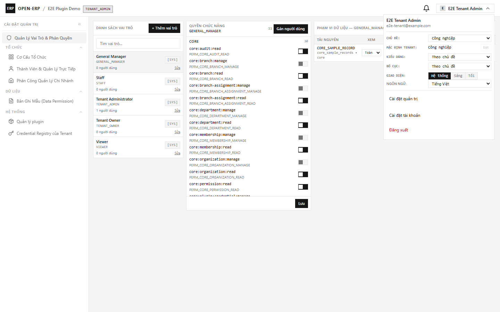

| Trục | Lựa chọn | Ghi chú |
| :--- | :--- | :--- |
| **Chủ đề** (màu) | Theo mặc định tenant · Công nghiệp · Xanh xám · Lục bảo · Hổ phách | Mặc định tenant do chủ tenant đặt |
| **Kiểu dáng** | Theo chủ đề · Vuông vắn · Mềm mại · Bo tròn | "Theo chủ đề" = giữ bộ mặt theme thiết kế |
| **Bố cục menu** | Theo chủ đề · Menu trái · Menu phải · Menu ngang · Ngăn kéo | Chỉ là **vị trí** menu (dọc/ngang) |
| **Giao diện** | Hệ thống · Sáng · Tối | Theo giờ hệ điều hành nếu chọn "Hệ thống" |

- **Lưu theo tài khoản**: mọi lựa chọn lưu vào hồ sơ người dùng (`/api/v1/account/ui-preferences`) — đăng nhập máy khác vẫn giữ. Giá trị **tenant chỉ là mặc định** cho người chưa chọn.
- **Chủ tenant**: hàng "MẶC ĐỊNH TENANT: <theme> [Đặt]" để nâng theme đang dùng thành mặc định chung cho tenant.
- Đổi chủ đề/kiểu dáng/sáng tối có **hiệu ứng chuyển màu** nhẹ; nếu hệ điều hành bật "giảm chuyển động" thì tắt.

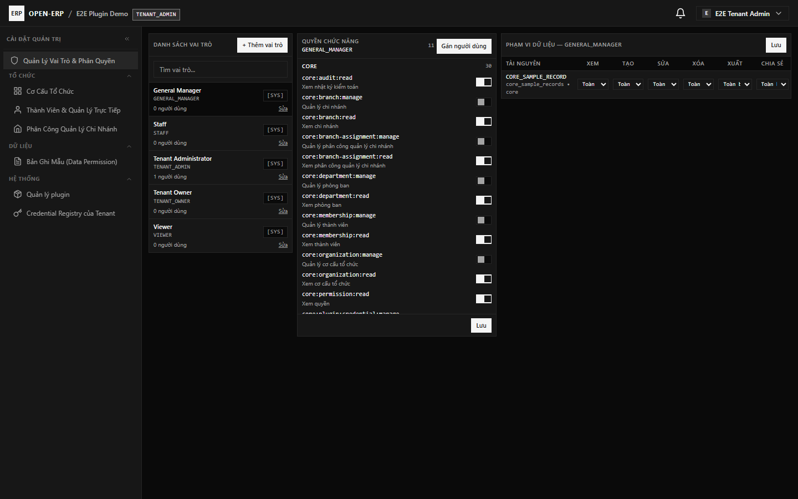

## 2. Menu điều hướng

**Menu dọc (trái/phải)** — nhóm in hoa, mở sẵn toàn bộ, nhóm chứa trang đang mở luôn mở:

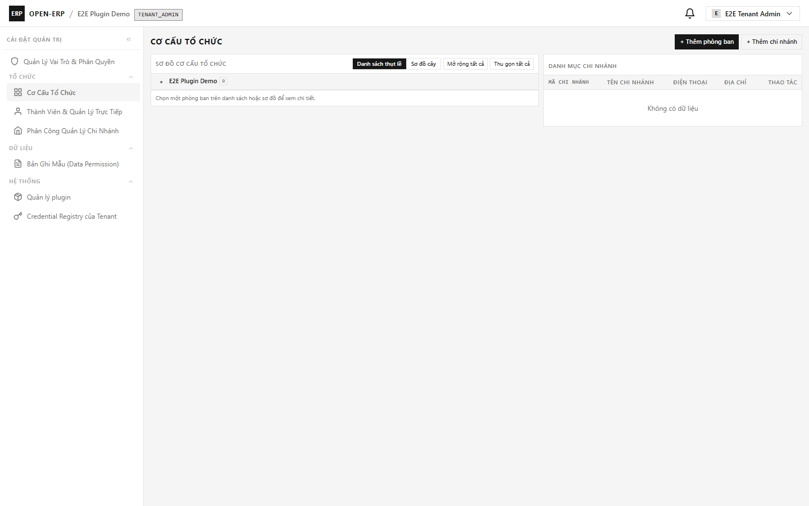

Nút **thu gọn** (`«`) ngay trong tiêu đề menu chuyển sang dạng **chỉ icon** (48px); rời chuột vào icon để xem tooltip:

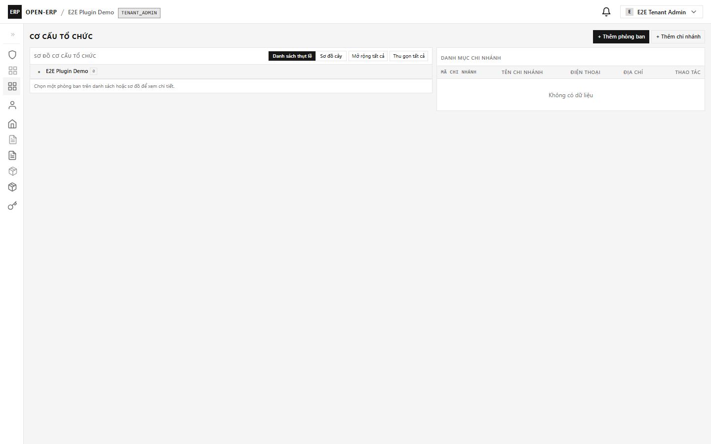

**Menu ngang** — nhóm cấp 1 mở dropdown cấp 2; mở nhóm khác thì nhóm cũ tự đóng, bấm ra ngoài hoặc `Esc` để đóng:

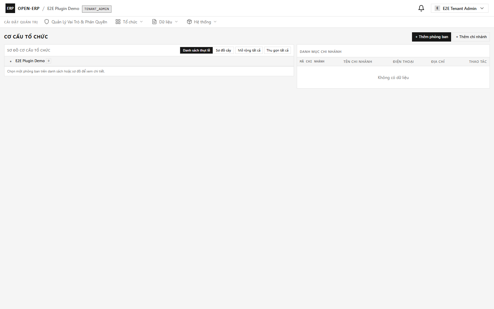

**Dạng icon cấp 1**: hover/click icon nhóm để mở **popover** cấp con:

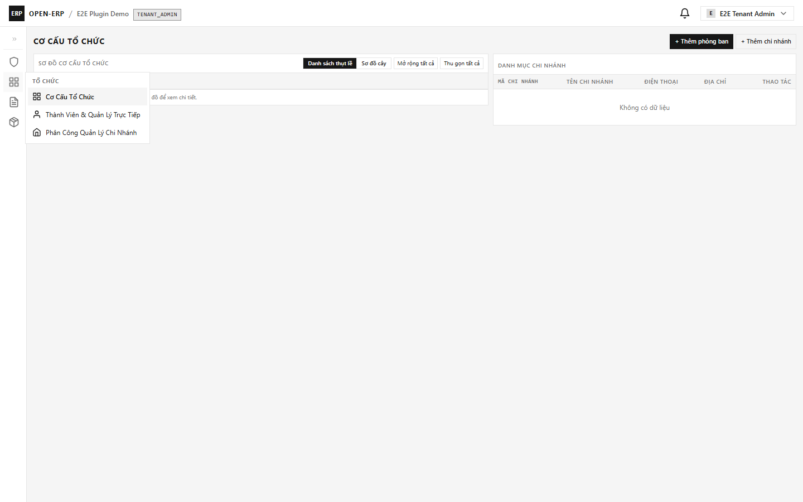

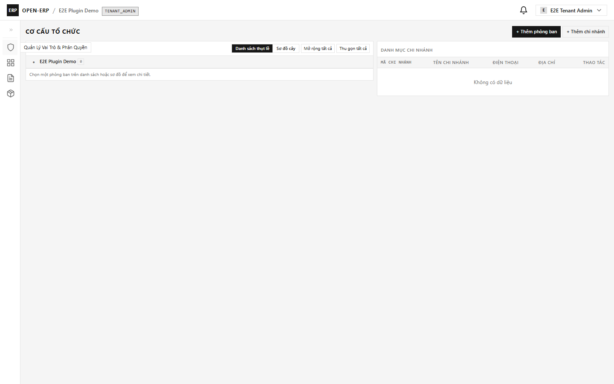

## 3. Menu chuột phải (Desktop)

Chuột phải vào hàng danh sách (vai trò, thành viên, bản ghi mẫu, plugin, credential, phiên đăng nhập) để mở nhanh thao tác; mục **thiếu quyền** hiển thị mờ kèm lý do. Bàn phím: `Shift+F10` mở, mũi tên di chuyển, `Esc` đóng và trả focus về hàng.

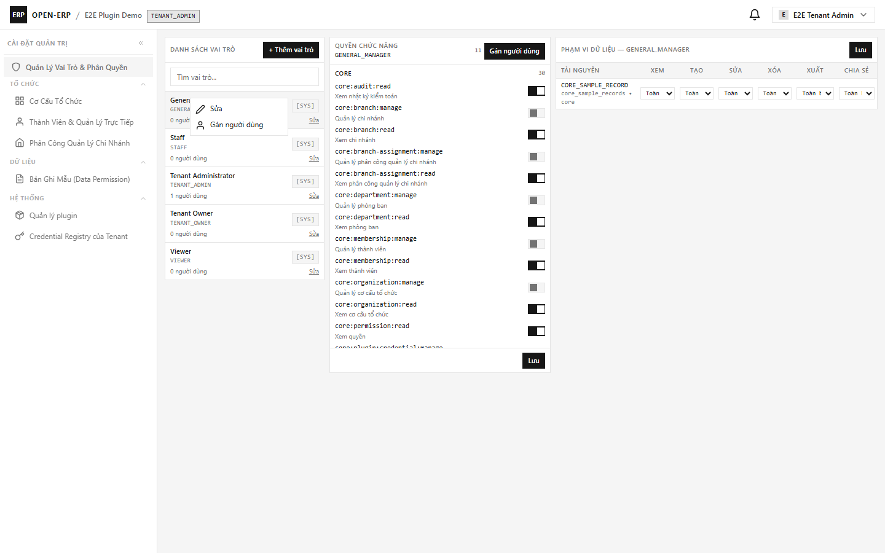

> **Mobile không có menu chuột phải** — thao tác vẫn qua nút trên màn hình.

## 4. Tải dữ liệu

- Thanh tiến trình mảnh ở **sát mép trên** xuất hiện khi có request (chỉ hiện nếu request lâu hơn 150ms nên thao tác nhanh không nhấp nháy).
- Mỗi vùng dữ liệu (ví dụ: danh sách vai trò, bảng quyền, phạm vi dữ liệu) có **skeleton riêng**; vùng lỗi hiện thông báo + nút **Thử lại** chỉ tải lại vùng đó.

## 5. Ngôn ngữ (13 locale) và RTL

Chọn ngôn ngữ trong menu tài khoản — áp dụng **ngay**, không cần tải lại trang, và giữ sau khi F5:

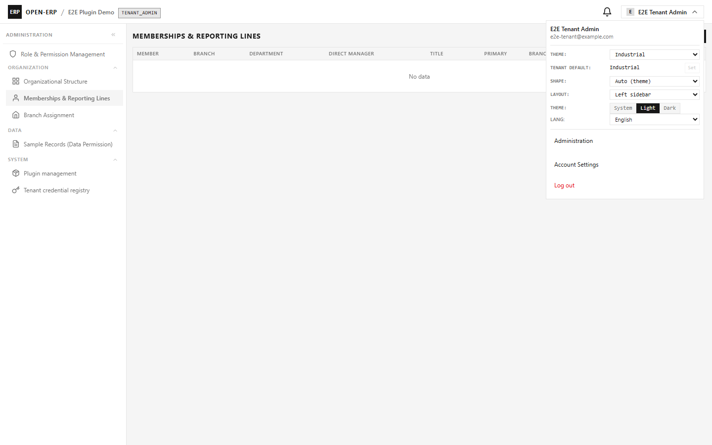

Chọn **العربية (ar)** ⇒ toàn bộ giao diện lật sang phải-trái (menu, bảng, drawer, icon hướng):

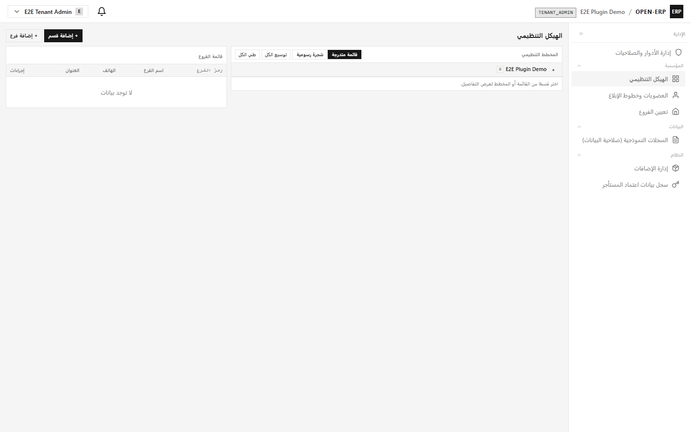

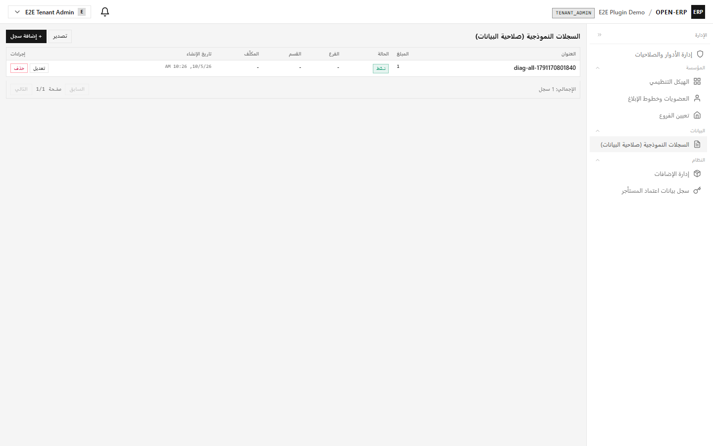

## 6. Mobile (Ionic, 390×844)

Giao diện mobile dùng chung thư viện component với Web: cùng 4 trục giao diện, cùng ngôn ngữ, không có context menu:

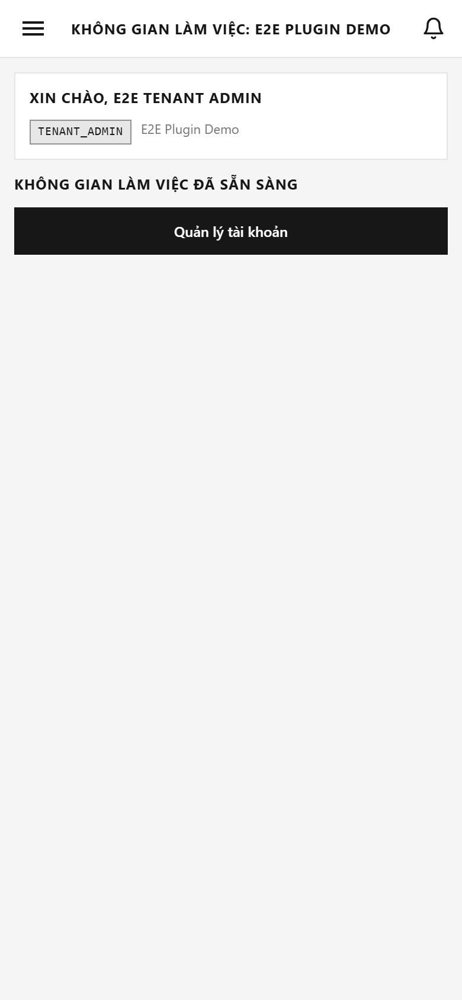

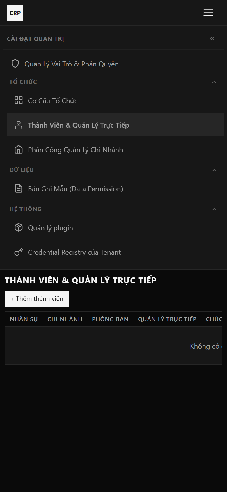

## 7. Ghi chú kỹ thuật cho người vận hành

- Sở thích giao diện lưu ở bảng `users` (cột `ui_*`); mặc định tenant ở `tenants.ui_theme`. Migration `V3.2.0` tự chạy khi khởi động backend.
- Trạng thái thu gọn menu dọc nhớ **theo trình duyệt** (chưa đồng bộ theo tài khoản).
- Biểu đồ cơ cấu tổ chức (canvas) cố định chiều trái-phải để chữ không bị lật — ghi chú trong BUG-127/TASK-371.
