# Hướng Dẫn Sử Dụng — Sprint 05: Plugin Danh Mục (Danh mục & quản trị danh mục)

| Thuộc tính | Giá trị |
| :--- | :--- |
| ID | UG-S05-001 |
| Trạng thái | **Final (QA PASS — chờ khách hàng nghiệm thu)** — có ảnh minh chứng desktop/mobile cho TASK-404/406 |
| Phiên bản / cập nhật | 0.3 / 2026-10-29 |
| Phạm vi | Quản trị danh mục (loại, bản ghi, quan hệ đa cha, phiên bản, quyền theo loại), nhập tự do, import/export, danh mục hệ thống & ghi đè, tra cứu trên Mobile |
| Đầu vào | [CONF-S05-001](../sprints/sprint_05_catalog_plugin/04_confirmation/01_CONF-S05-001_sprint_05_scope.md), [DES-UI-S05-001](../sprints/sprint_05_catalog_plugin/06_designs/ui/01_DES-UI-S05-001_catalog_admin_ui.md), [DES-API-S05-001](../sprints/sprint_05_catalog_plugin/06_designs/api/01_DES-API-S05-001_catalog_api.md) |

> **Ảnh minh hoạ**: các ảnh desktop/mobile được lưu tại [08_testing/evidence/screenshots](../sprints/sprint_05_catalog_plugin/08_testing/evidence/00_EVD-S05-001_evidence_index.md).

## 1. Danh mục là gì và ai dùng?

**Danh mục** là plugin core đầu tiên của hệ thống: hạ tầng dữ liệu tra cứu dùng chung cho mọi plugin khác (chức danh, phòng ban, loại hợp đồng, ca làm việc, trình độ học vấn, tỉnh/xã, ngành, nghề…). Plugin **luôn bật cho mọi tenant**, không cài/gỡ được.

Hai nhóm người dùng:

| Vai trò | Làm được gì |
| :--- | :--- |
| **Quản trị viên tenant** | Tạo/sửa loại danh mục của tenant, thêm/sửa bản ghi, thiết lập quan hệ cha–con, cấp quyền theo loại, import/export |
| **Người dùng thường** | Chọn giá trị danh mục trong form (kèm nhập tự do nếu loại cho phép); xem tra cứu read-only trên Mobile |
| **Super admin platform** | Quản trị **danh mục hệ thống** (tỉnh/xã, ngành, nghề) ở cổng Platform |

## 2. Mở màn quản trị danh mục

Vào **Cài đặt → Dữ liệu → Danh mục**. Màn hình chia **2 cột** — cột chi tiết **không chiếm chỗ** khi bạn chưa chọn bản ghi nào:

| Cột | Nội dung |
| :--- | :--- |
| Trái | Danh sách **loại danh mục** (hệ thống + của tenant); nhãn `Hệ thống`/`Ghi đè` |
| Giữa | **Bản ghi** của loại đang chọn: tìm kiếm, lọc, phân trang, menu chuột phải từng dòng, nút **Nhập / Xuất danh mục** và nút **API** |

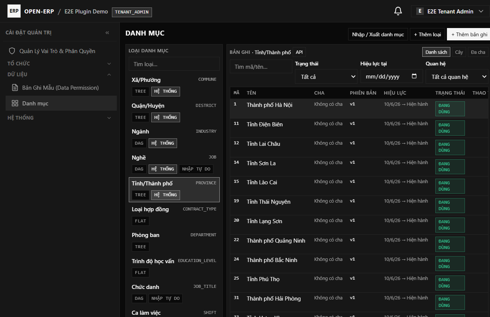

*Ảnh: khung 2 cột (loại danh mục | bản ghi) — cột chi tiết chỉ xuất hiện khi đã chọn bản ghi.*

**Xem chi tiết bản ghi**: bấm vào một dòng (hoặc chuột phải → **Xem chi tiết**) để mở **drawer trượt từ phải** chứa thông tin, thuộc tính động, quan hệ cha/con, **lịch sử phiên bản (chỉ đọc)** và các nút thao tác. Đóng drawer ⇒ bảng chiếm lại toàn bộ bề rộng, dòng vẫn được chọn.

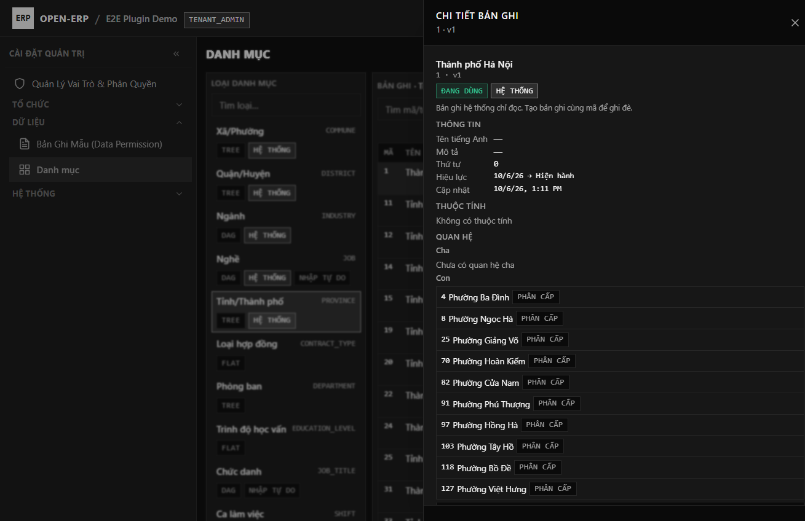

*Ảnh: drawer chi tiết "Thành phố Hà Nội" — danh sách **con phân trang 10/trang** (126 con ⇒ 13 trang), bản ghi hệ thống hiện thông báo chỉ đọc.*

Mọi biểu mẫu mở dạng **Drawer trượt từ phải** (có thể xếp chồng nhiều tầng), **không dùng popup che màn hình**.

### 2.1. Xem API dùng danh mục (nút "API")

Nhấn nút **API** cạnh tên loại đang chọn để xem đúng endpoint mà plugin khác / biểu mẫu động sẽ gọi cho loại đó (mã loại được điền sẵn, kèm nút **Sao chép** cho từng đoạn):

| Đoạn | Dùng để |
| :--- | :--- |
| `GET /api/v1/catalog/lookup/{CODE}/options?q=&parent_id=&as_of=&page=&size=` | Lấy danh sách tuỳ chọn (tìm, lọc theo cha, theo thời điểm, phân trang) — kèm **phản hồi mẫu** |
| `POST /api/v1/catalog/lookup/{CODE}/inline` | Lưu nhanh giá trị người dùng tự gõ (cần quyền `catalog:item:inline-create`) |
| `POST /api/v1/catalog/lookup/{CODE}/resolve` | Đổi danh sách **id** đã lưu thành tên hiển thị (1 lần gọi, tránh N+1) |
| `GET /api/v1/catalog/lookup/{CODE}/path?id=…` | Breadcrumb tổ tiên của một mục |
| Shape giá trị form | `{ "catalog_item_id": "…|null", "text": "…" }` — lưu cả id (để tra cứu lại) và text (để in/báo cáo) |

Ghi chú theo loại: `TREE`/`DAG` có phân cấp (truyền `parent_id` để lọc con, đọc `path`/`has_children`); `FLAT` không có phân cấp; loại bật **nhập tự do** thì picker cho gõ giá trị mới và có thể lưu nhanh.

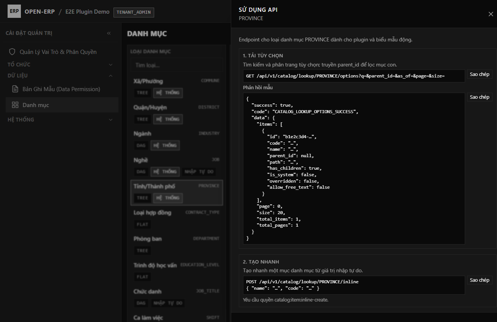

*Ảnh: panel "Sử dụng API" cho loại `PROVINCE`.*

## 3. Loại danh mục

Nhấn **Thêm loại** (hoặc chọn loại rồi **Sửa**) để mở drawer:

| Trường | Ý nghĩa |
| :--- | :--- |
| Mã (`code`) | Định danh không đổi sau khi tạo (vd `JOB_TITLE`) |
| Nhãn | Khoá đa ngôn ngữ hiển thị tên loại |
| Chế độ phân cấp | **TREE** (một cha), **DAG** (nhiều cha), **FLAT** (phẳng) |
| Quan hệ cho phép | `HIERARCHY` / `CLASSIFICATION` / `ALLOCATION` |
| Loại cha cho phép | Chỉ khai báo khi muốn cho phép **cha khác loại** (bỏ trống = chỉ cùng loại) |
| Cho nhập tự do | Bật ⇒ người dùng được gõ giá trị ngoài danh mục |
| Schema thuộc tính | JSON mô tả trường động của bản ghi (tuỳ chọn) |

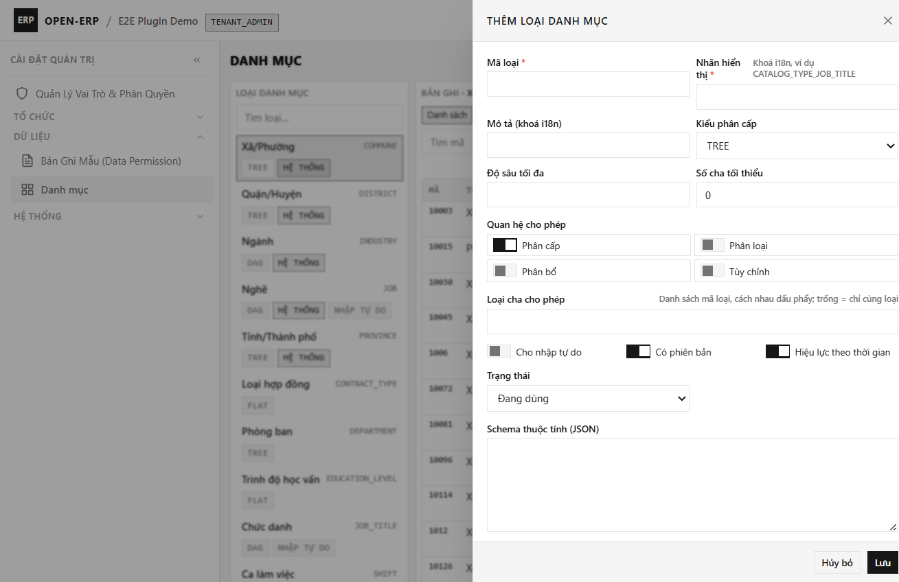

*Ảnh: drawer trượt phải "Thêm loại danh mục" — không dùng modal.*

> **Loại hệ thống** (tỉnh/xã, ngành, nghề) hiển thị chỉ đọc với tenant — muốn "đổi" thì tạo bản ghi **ghi đè** cùng mã (mục 8).

## 4. Bản ghi: thêm, sửa (phiên bản mới), ngừng dùng

- **Thêm bản ghi**: nhấn **Thêm bản ghi** → drawer với các trường tĩnh + trường động theo schema của loại.
- **Sửa**: lưu sẽ **tạo phiên bản mới** và **đóng hiệu lực bản cũ** — dữ liệu lịch sử không bị ghi đè. Cột phải hiển thị **lịch sử phiên bản chỉ đọc** (số phiên bản, hiệu lực, người sửa).
- **Ngừng dùng** (biểu tượng thùng rác): **đóng hiệu lực** (`valid_to = hiện tại`), **không xoá cứng** — bản ghi vẫn còn trong lịch sử và các chứng từ cũ vẫn tra cứu được theo mốc thời gian.
- **Đọc theo mốc thời gian**: API và form hỗ trợ tham số `as_of` để xem đúng trạng thái tại một thời điểm.

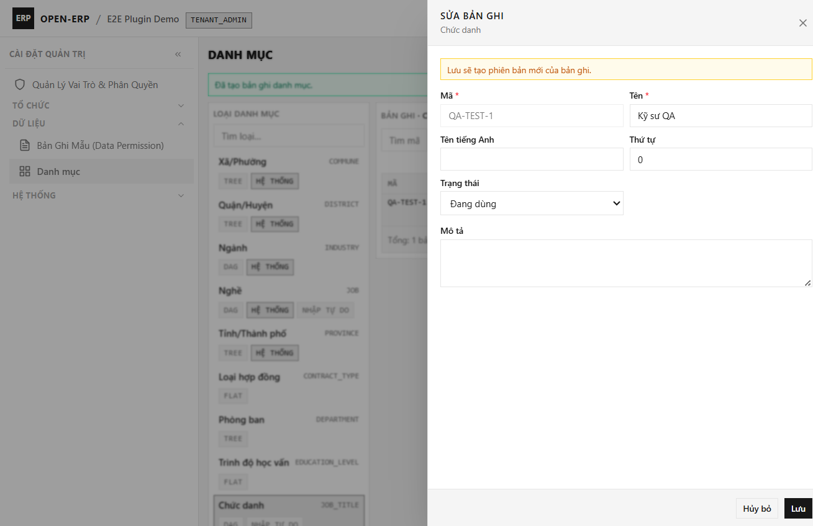

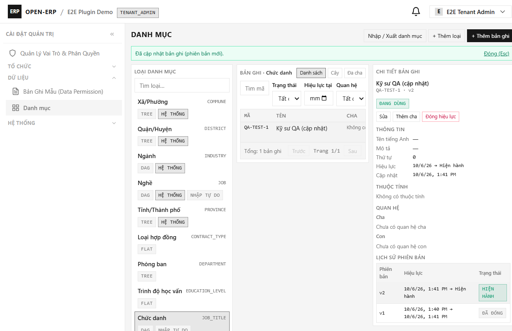

*Ảnh: drawer sửa có cảnh báo "Lưu sẽ tạo phiên bản mới" và lịch sử v2 HIỆN HÀNH / v1 ĐÃ ĐÓNG.*

## 5. Quan hệ cha–con (đa cha, nhảy cấp)

- **Đa cha (DAG)**: một bản ghi có thể có nhiều cha (vd "Lập trình viên" thuộc cả "Công nghệ thông tin" và "Khoa học dữ liệu").
- **Nhảy cấp**: được phép nối thẳng tỉnh → xã mà không cần huyện.
- **Thêm quan hệ**: nút **Thêm quan hệ** trong drawer chi tiết → chọn cha bằng ô tra cứu danh mục (picker), chọn loại quan hệ và thứ tự.
- **Chống lỗi**: hệ thống chặn **chu trình** (A là cha của B và B là cha của A), chặn quan hệ không nằm trong "quan hệ cho phép", chặn cha khác loại khi loại đó không khai báo.

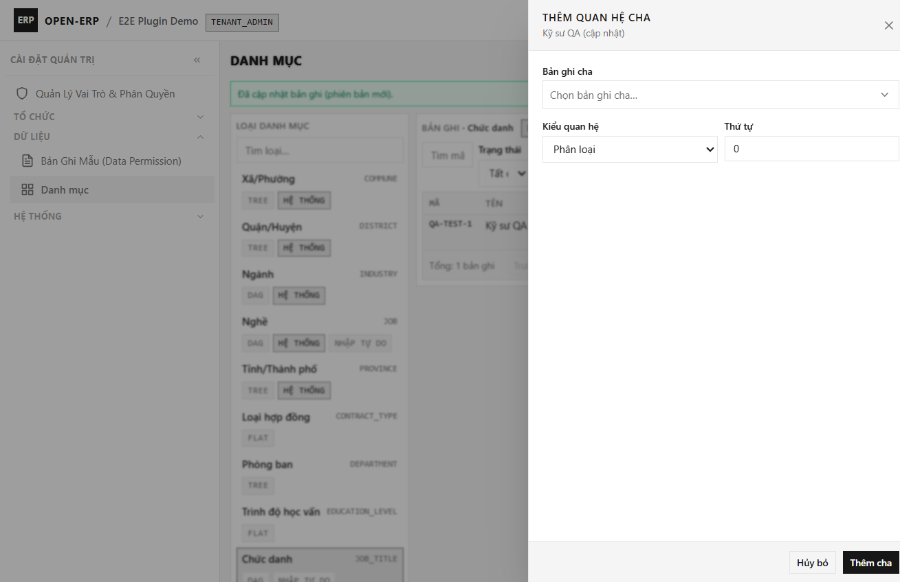

*Ảnh: drawer "Thêm quan hệ cha" và ô tra cứu cha (lazy, hiện tên + mã).*

### 5.1. Quản lý cha/con ngay trong drawer sửa bản ghi

Mở bản ghi → **Sửa** → tab **Phân cấp**:

1. Vùng **CHA** liệt kê cha hiện tại; nút **Thêm cha** mở picker lọc theo loại cha được phép. Nút **+ Thêm loại cha** mở form tạo loại mới và gán sẵn quan hệ đang xem.
2. Vùng **CON** nhóm theo `Quan hệ · Loại con` (ví dụ `Phân cấp · COMMUNE`) kèm số lượng. Mỗi nhóm có nút đóng/mở, **+ Tạo nhanh** (chỉ cần mã/tên), bảng phân trang 10 dòng và nút **Gỡ quan hệ** (đóng hiệu lực, không xoá bản ghi).
3. Nút **+ Thêm loại con** tạo loại mới với quan hệ cha trỏ về loại hiện tại; lưu xong nhóm mới xuất hiện tại chỗ.
4. Thêm/gỡ con hoặc tạo nhanh **không đóng drawer** và **không làm mất dữ liệu form** đang nhập.
5. Bản ghi **mới chưa lưu**: tab Phân cấp hiện nhưng bị khoá kèm hint “Lưu bản ghi trước…”; sau khi Lưu, drawer giữ nguyên và tự mở tab quan hệ đầu tiên.
6. Lỗi chu trình/loại không được phép hiển thị inline theo mã i18n. Trên **Mobile**, tab quan hệ chỉ đọc: ẩn toàn bộ nút thêm/sửa/gỡ.

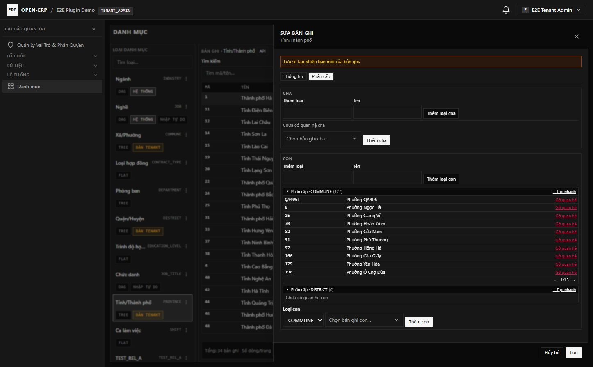

*Ảnh: tab Phân cấp của bản ghi Hà Nội — vùng CHA, vùng CON nhóm `Phân cấp · COMMUNE (126)` có tạo nhanh và phân trang.*

## 6. Quyền theo từng loại danh mục

Ngoài quyền module (`catalog:type:manage`, `catalog:item:read`, `catalog:item:manage`, `catalog:item:inline-create`), mỗi loại có **ma trận quyền theo vai trò**:

1. Chọn loại → **Quyền** → drawer ma trận **vai trò × (Đọc / Ghi)**.
2. Lưu là **ghi đè toàn bộ** danh sách quyền của loại đó.
3. Không có quyền **Ghi** ⇒ người dùng chỉ xem, các nút thao tác bị ẩn.

> Khi cài plugin, **Chủ tenant** và **Quản trị tenant** mặc định có toàn quyền trên mọi loại của tenant để tránh tình trạng "cài xong không ai sửa được".

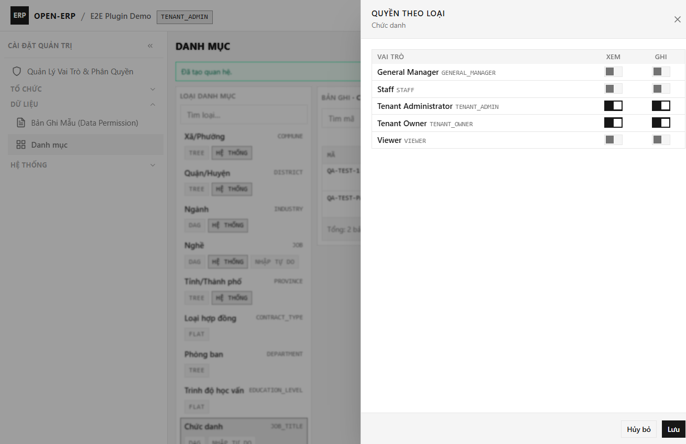

*Ảnh: ma trận vai trò × XEM/GHI; Chủ tenant và Quản trị tenant mặc định có cả hai.*

## 7. Nhập tự do và "Lưu vào danh mục"

Với loại bật **cho nhập tự do** (vd Chức danh):

1. Gõ giá trị không có trong danh sách ⇒ hiện dòng **"Dùng giá trị tự do: …"** — giá trị vẫn được lưu vào chứng từ.
2. Nếu có quyền `catalog:item:inline-create`, hiện nút **"Lưu vào danh mục"** ⇒ tạo mục mới và gán luôn vào trường.
3. Giá trị tự do được giữ nguyên văn bản đã gõ, kể cả sau này danh mục đổi tên.

📷 *Ô tra cứu danh mục với giá trị tự do + nút lưu.*

## 8. Danh mục hệ thống và ghi đè của tenant

| Tình huống | Hành vi |
| :--- | :--- |
| Tenant tạo bản ghi **cùng mã** với mục hệ thống | Tạo bản ghi **của tenant**; form hiển thị bản tenant (nhãn **Ghi đè**) |
| Tenant **ngừng dùng** bản ghi cùng mã đó | Mục hệ thống **biến mất khỏi lựa chọn của tenant đó** (tenant khác không đổi) |
| Tenant sửa/xoá trực tiếp bản hệ thống | Bị chặn (`CATALOG_SYSTEM_ITEM_READONLY`) — phải tạo bản ghi của mình |

## 9. Import / Export

Mở **Import/Export** trong màn quản trị:

1. **Tải tệp mẫu** (CSV, UTF-8) — cột `code, name, parent_code` (`parent_code` tuỳ chọn để tạo quan hệ cha–con).
2. Chọn tệp **CSV hoặc `.xlsx`** → nhấn **Kiểm tra trước** (dry-run) — **chưa ghi gì**.
3. Xem **báo cáo theo dòng** (Tạo mới / Cập nhật / Bỏ qua / Lỗi + mã lỗi) → nhấn **Ghi vào danh mục** để áp dụng.
4. **Export**: xuất CSV theo loại đang chọn hoặc toàn bộ, kèm cột cha/con, hiệu lực, trạng thái, phiên bản.

Quy tắc an toàn: tệp sai cấu trúc bị **từ chối trước khi ghi**; lỗi theo dòng **không** chặn các dòng hợp lệ; giới hạn **20.000 dòng**/lần (cấu hình được); bản ghi trùng mã ⇒ **tạo phiên bản mới**; tenant nhập mã trùng mục hệ thống ⇒ tạo **bản ghi ghi đè của tenant**.

📷 *Drawer Import: kiểm tra trước + báo cáo theo dòng.*

## 10. Cổng Platform — quản trị danh mục hệ thống

Super admin vào **Platform → Danh mục hệ thống**: cùng bố cục 3 cột nhưng thao tác trên **dữ liệu hệ thống** (`tenant_id IS NULL`): tỉnh/xã, ngành, nghề… Tenant không thấy màn này và gọi API hệ thống sẽ bị **403**.

📷 *Màn quản trị danh mục hệ thống ở cổng Platform.*

## 11. Mobile (Ionic)

- **Tra cứu danh mục** (read-only): màn hình là **UI plugin** (iframe) theo manifest; hiển thị loại + bản ghi, tìm kiếm, xem chi tiết — **không có nút nhập/xuất, thêm/sửa/xoá, menu hành động** (quản trị làm trên bản Web).
- **Ô chọn danh mục trong form** hoạt động trên mobile: danh sách dạng panel trong trang (không modal), vùng chạm ≥ 40px, không tràn ngang ở 390×844.
- Plugin runtime token hết hạn: màn hình tự xin token mới và tải lại; nếu phiên core hết hạn thì về trang đăng nhập.

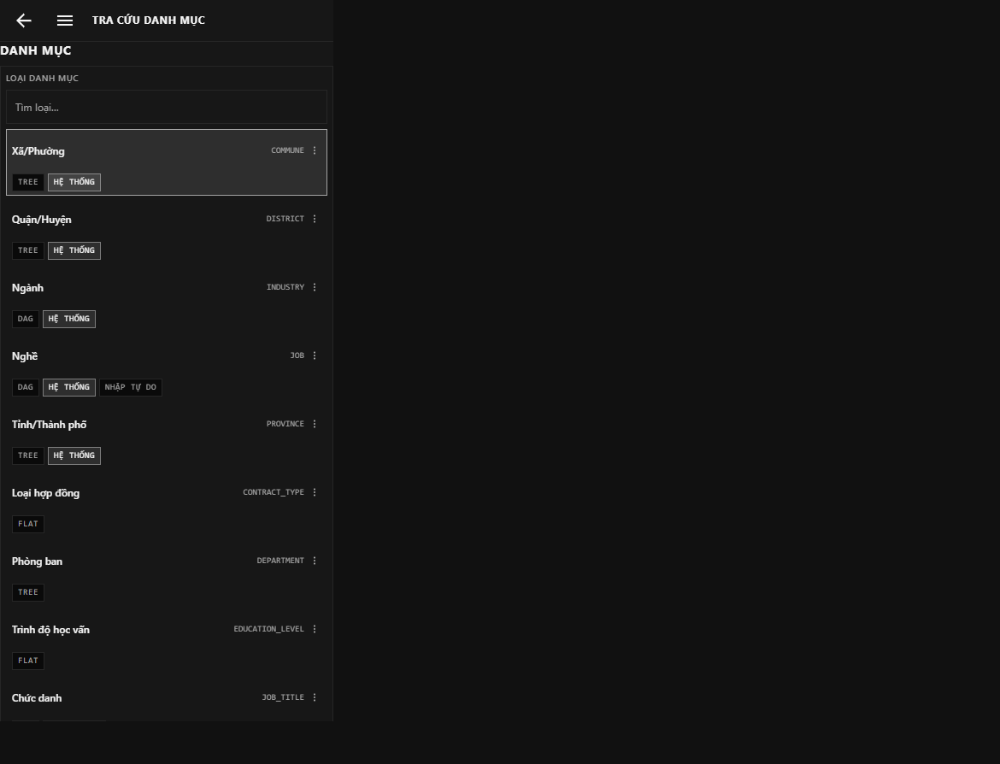

*Ảnh: màn tra cứu plugin trên Mobile 390×844 — chỉ đọc, touch ≥ 40px, không tràn ngang.*

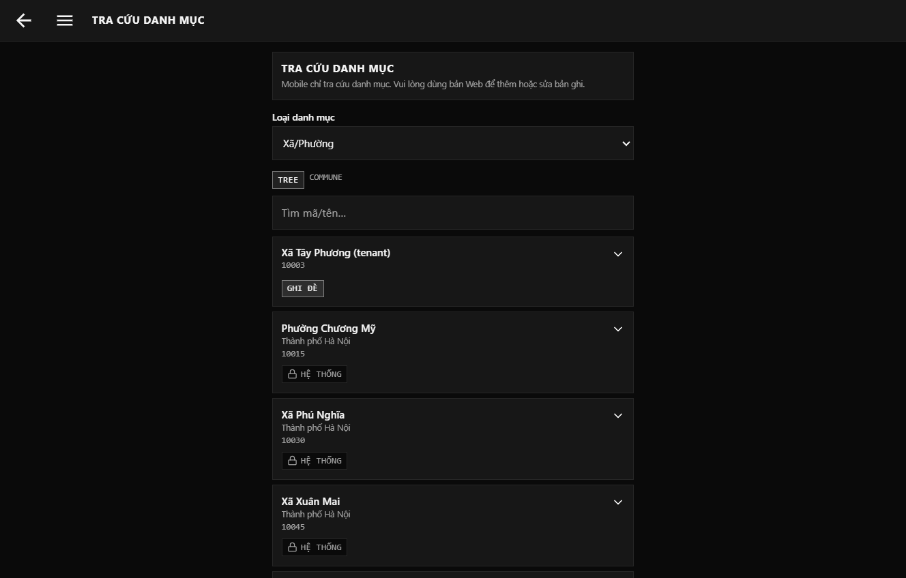

*Ảnh lịch sử của page native trước TASK-403; UI hiện tại là plugin iframe như ảnh đầu mục.*

## 12. Dữ liệu địa giới có sẵn

Sau khi cài plugin, hệ thống đã có sẵn **34 tỉnh/thành** và **3.321 xã/phường** (dữ liệu sau sáp nhập hành chính 2025: **xã thuộc trực tiếp tỉnh, không có huyện**). Loại `DISTRICT` vẫn có sẵn nếu tenant muốn dùng sau này.

## 13. Ghi chú kỹ thuật cho người vận hành

- Plugin `catalog` là **plugin core**: luôn bật, không gỡ; tenant mới nhận tự động khi đăng ký, tenant cũ được **backfill** khi nâng cấp.
- Migration `V4.0.0__catalog_core_plugin.sql` cần extension PostgreSQL `btree_gist` và `pg_trgm` (trusted, không cần superuser) — chi tiết ở [docker_deployment_guide.md](../07_deployment_guides/docker_deployment_guide.md) mục 5.
- Giới hạn import: `OPENERP_CATALOG_IMPORT_MAX_ROWS` (mặc định `20000`).
- Cập nhật dữ liệu địa giới khi sáp nhập: `npm run data:admin-units` → `npm run data:admin-units:check` trước khi build image (runtime **không** gọi mạng).
- Tra cứu danh mục trong form là **lazy + phân trang** (mặc định 20, tối đa 100) — không tải toàn bộ danh mục.
