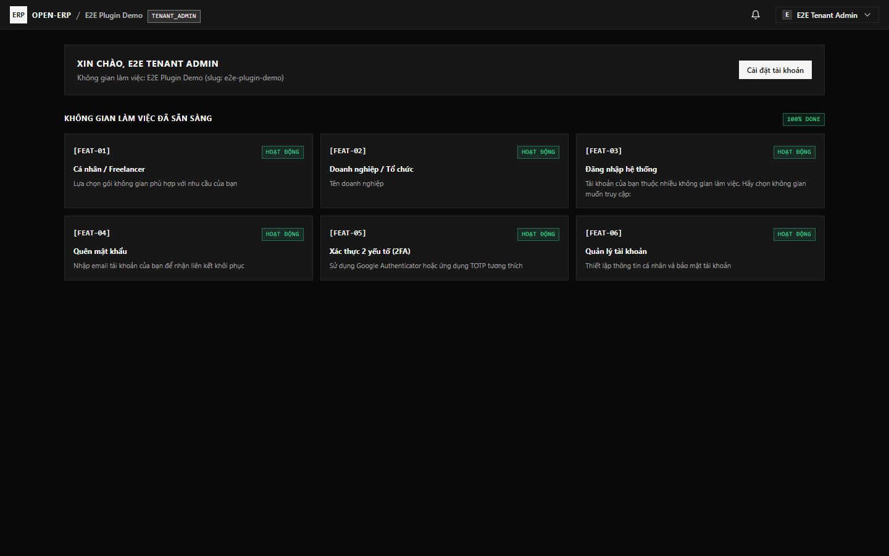
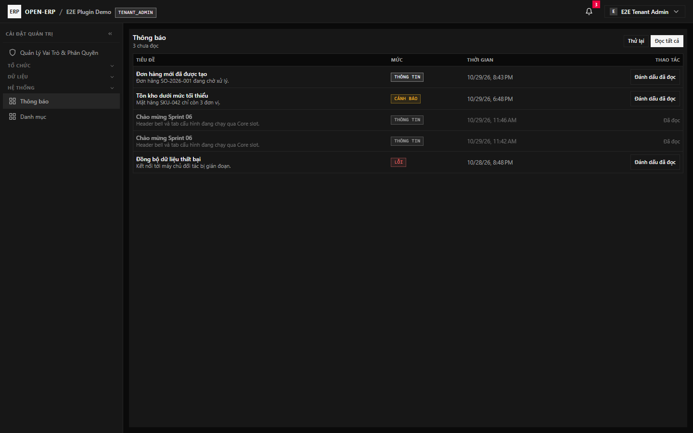
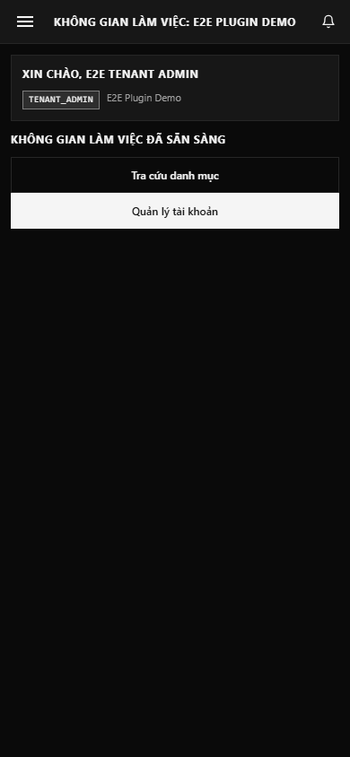
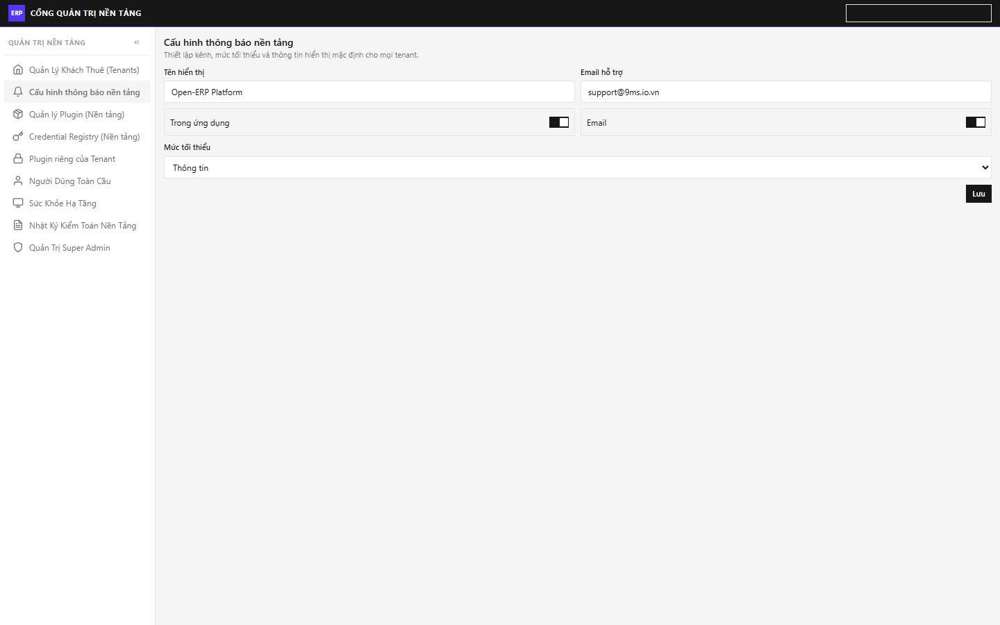
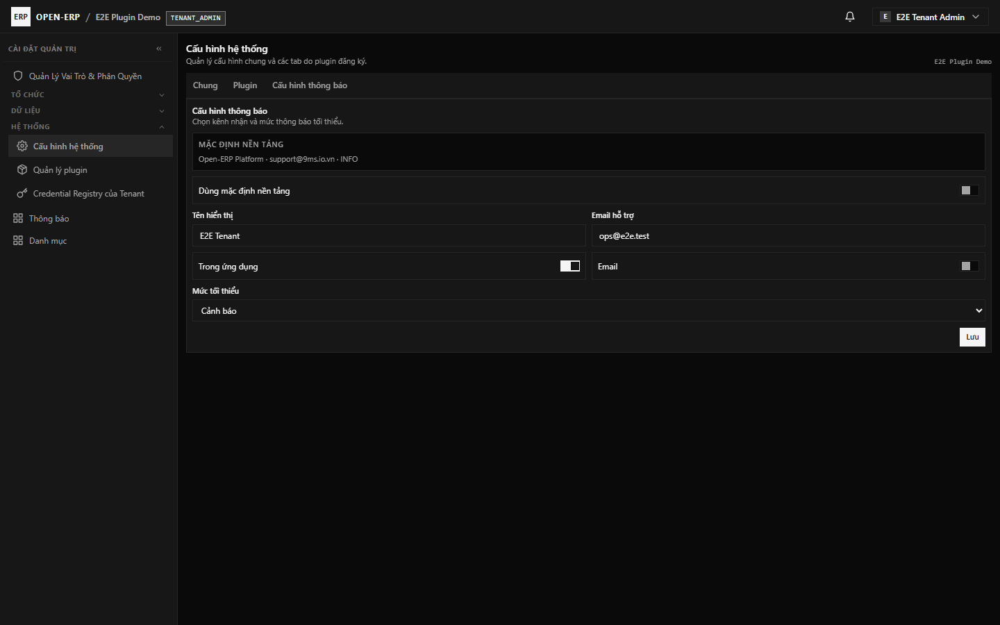
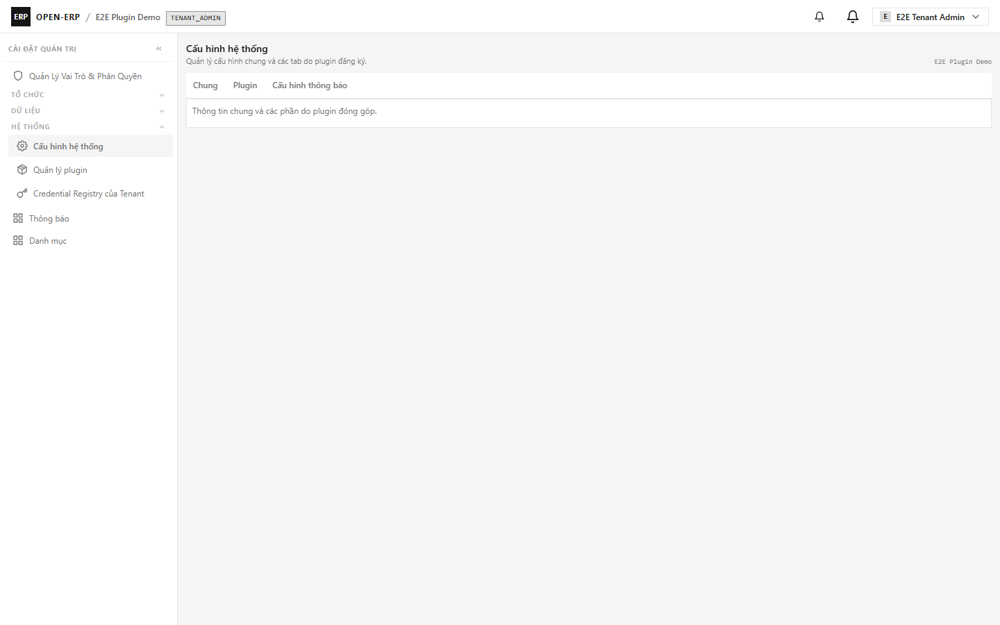
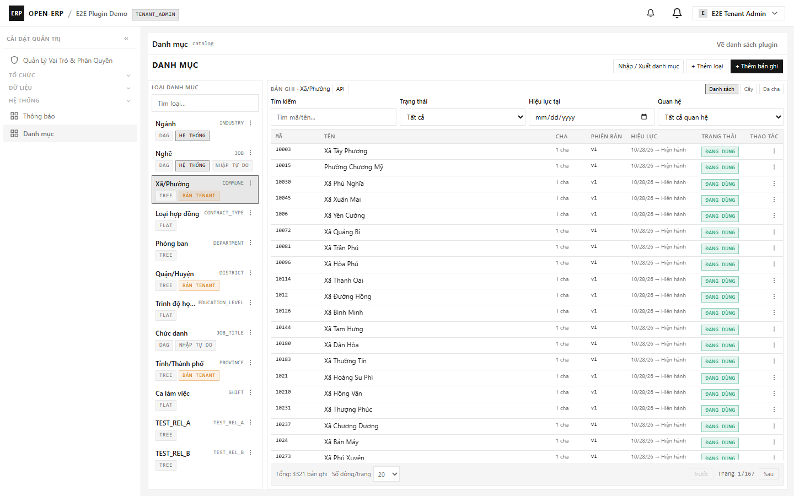
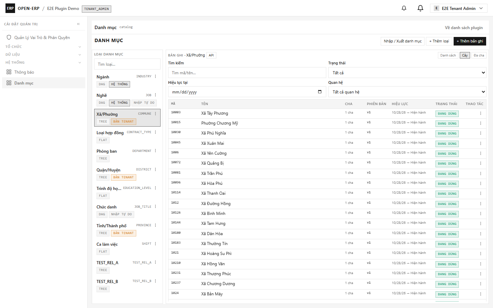
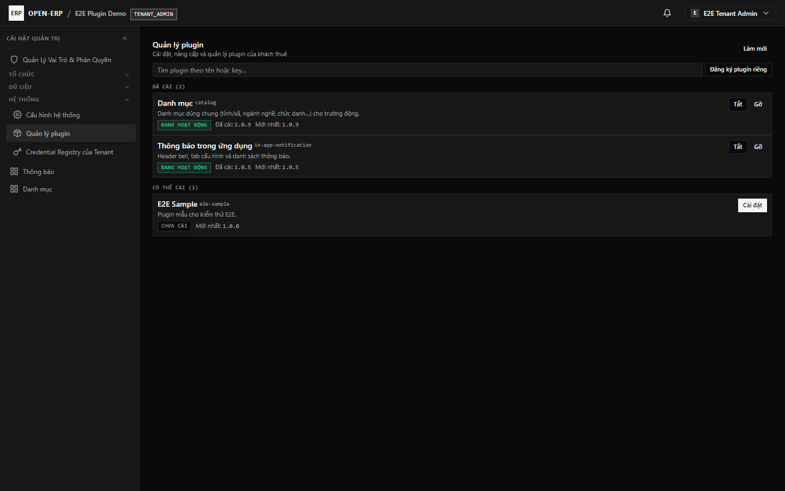

# Hướng dẫn sử dụng Sprint 06 — Plugin UI extension & Catalog Web Component

| Trường | Giá trị |
| :--- | :--- |
| ID / phiên bản / cập nhật | UG-S06-001 / 1.4 / 2026-10-29 |
| Đối tượng | Tenant Admin, Platform Admin, người dùng cuối |
| Phạm vi | Header contribution, tab cấu hình hệ thống, catalog WC, thông báo trong ứng dụng |
| Liên quan | [Sprint 06 reading guide](../sprints/sprint_06_plugin_dev_platform/00_READING_GUIDE.md) |

> Ảnh minh chứng được QA chụp trên môi trường dev ngày 2026-10-29: desktop 1440×900 và Ionic 390×844; cả hai nền tảng đã đạt 0 console error.

## 1. Chuông thông báo trên header

1. Đăng nhập tenant đã cài plugin `in-app-notification`.
2. Nhìn góc phải header: có chuông **Thông báo** do plugin render. Chuông Core cũ đã được bỏ; plugin là nguồn thông báo duy nhất.
3. Bấm chuông để mở **drawer** danh sách thông báo gần nhất; bấm vào một mục để đánh dấu đã đọc, hoặc **Đọc tất cả**.
4. Bấm **Xem tất cả** ở footer drawer để mở trang danh sách thông báo đầy đủ.
5. Badge số chưa đọc cập nhật sau khi đánh dấu; không cần tải lại trang.

Plugin chỉ đăng ký contribution vào slot `core.layout.header.actions`; Core đọc manifest, kiểm tra quyền `in-app-notification:notification:read` và mount Web Component.

## 2. Tab cấu hình trong `/settings/system`

1. Platform admin vào **Cổng quản trị nền tảng → Cấu hình thông báo nền tảng** (`/platform/notification-settings`).
2. Đặt thông tin mặc định dùng chung: tên hiển thị, email hỗ trợ, kênh nhận, mức tối thiểu; bấm **Lưu**.
3. Tenant admin vào **Cấu hình hệ thống** (`/settings/system`) → tab **Cấu hình thông báo**.
4. Bật **Dùng mặc định nền tảng** để tenant kế thừa toàn bộ giá trị platform; tắt để nhập thông tin riêng của tenant.
5. URL giữ `?tab=<contribution-id>` khi đổi tab; tải lại trang vẫn mở đúng tab.

## 3. Catalog dùng Web Component

1. Vào **Cài đặt → Ứng dụng → Danh mục** (`/settings/apps/catalog`).
2. Màn hình catalog render trực tiếp trong layout Core, không còn iframe; header/menu/tìm kiếm giữ nguyên.
3. Chọn loại danh mục, đổi chế độ xem **Danh sách / Cây / Đa cha**; URL cập nhật route-state.
4. Tải lại hoặc bookmark URL (ví dụ `/settings/apps/catalog/all/-/20/1/-/list?view=tree`) để mở lại đúng trạng thái.
5. Mobile Ionic mở **Tra cứu danh mục** ở chế độ chỉ đọc: danh sách loại cuộn trong khung 320px, bảng bản ghi hiển thị ngay bên dưới, ẩn nút thêm/sửa/xóa và không tràn ngang.

## 4. Bật/tắt plugin

1. Tenant Admin vào **Quản lý plugin**.
2. Tắt plugin: contribution header/tab biến mất sau khi manifest được tải lại; bật lại: contribution xuất hiện lại, không cần sửa code Core.
3. Gỡ plugin: contribution biến mất và dữ liệu plugin được xử lý theo chính sách migration/backup của plugin.

## 5. Xử lý sự cố

| Hiện tượng | Kiểm tra |
| :--- | :--- |
| Không thấy chuông | Plugin ACTIVE? Tài khoản có `in-app-notification:notification:read`? |
| Không thấy tab Cấu hình thông báo | Cửa sổ ≥1280px? Tài khoản có `in-app-notification:settings:manage`? |
| Catalog trắng | Plugin catalog ACTIVE đúng version 1.0.9? Kiểm tra `GET /api/v1/plugins/ui-manifest` trả screen `WEB_COMPONENT`. |
| Mobile không thấy bảng bản ghi | Kiểm tra cửa sổ ≥390px và plugin catalog ACTIVE 1.0.9; danh sách loại cuộn trong khung, bảng nằm bên dưới. |
| Mobile không thấy chuông plugin | Plugin ACTIVE? Tài khoản có `in-app-notification:notification:read`? Header mobile chỉ render chuông plugin (bell Core đã bỏ). |
| Lỗi tải plugin | Kiểm tra container catalog/notification healthy và log backend `PLUGIN_RUNTIME_*`. |
