# Hướng dẫn sử dụng Sprint 08 — Biểu mẫu động (Form Builder) & Quy trình phê duyệt (Workflow Engine)

| Trường | Giá trị |
| :--- | :--- |
| ID / phiên bản / cập nhật | UG-S08-001 / 1.1 / 2026-11-09 |
| Đối tượng | Tenant Admin, Quản lý (General Manager), Nhân viên nghiệp vụ (Staff), Người điền biểu mẫu công khai |
| Phạm vi | Plugin mặc định `form` (`1.0.8`) và `workflow` (`1.0.13`) — luôn bật cho tất cả các tenant |
| Liên quan | [Sprint 08 Reading Guide](../sprints/sprint_08_plugin_form_workflow/00_READING_GUIDE.md), [Báo cáo kiểm thử TR-S08-001](../sprints/sprint_08_plugin_form_workflow/08_testing/02_TR-S08-001_sprint_08_test_report.md) |

> Hai plugin **Biểu mẫu động (`form`)** và **Quy trình phê duyệt (`workflow`)** là các plugin mặc định và luôn bật (`default_install = true`, `locked = true`) cho tất cả doanh nghiệp (tenants) trên hệ thống Open-ERP.

---

## 1. Quản lý & Thiết kế Biểu mẫu động (`/apps/form`)

### 1.1. Không gian làm việc Biểu mẫu động
1. Từ thanh điều hướng bên trái (mục **Hệ thống**), chọn **Biểu mẫu động** (`/apps/form`).
2. Màn hình hiển thị 4 chỉ số KPI tổng quan (**Tổng biểu mẫu**, **Đang mở**, **Bản nháp**, **Tỷ lệ hoạt động / Lượt phản hồi**), bộ lọc tìm kiếm theo mã/tiêu đề/trạng thái, và bảng danh sách biểu mẫu.

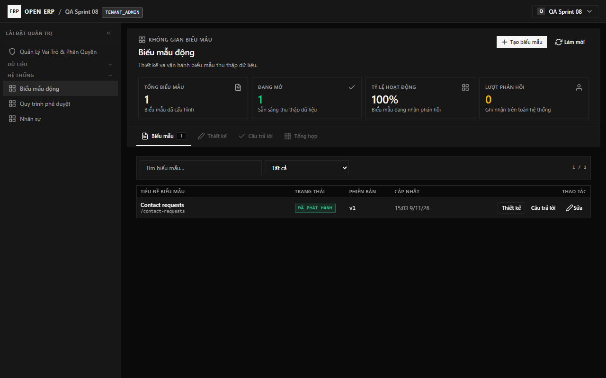

### 1.2. Trình thiết kế Biểu mẫu trực quan — Live Visual Form Studio (`WYSIWYG`)
1. Bấm **+ Tạo biểu mẫu mới** hoặc bấm **Mở** tại dòng biểu mẫu cần chỉnh sửa để mở **Trình thiết kế Biểu mẫu trực quan (3 phân vùng)**:
   - **Cột trái — Bảng công cụ kéo thả (Toolbox Palette & Outline)**:
     - Kéo thả hoặc nhấn vào nhóm **1. Khung bố cục** để chia biểu mẫu theo **Phần (`SECTION`)**, **Đa trang (`PAGE`)**, hoặc **Từng bước (`STEP` Wizard)**.
     - Kéo thả hoặc nhấn vào nhóm **2. Trường dữ liệu** (`SHORT_TEXT`, `LONG_TEXT`, `NUMBER`, `DATE`, `SINGLE_CHOICE`, `MULTI_CHOICE`, `DROPDOWN`, `RATING`, `MATRIX`, `FILE_UPLOAD`) trực tiếp vào khung xem trước.
   - **Vùng giữa — Xem trước trực quan (`Live Visual Preview / WYSIWYG`)**:
     - Chuyển đổi tức thì chế độ bố cục (`Theo phần`, `Đa trang`, `Từng bước Wizard`), số cột mặc định trên Desktop (`1..4 cột`) và Mobile (`1..2 cột`), cùng nút giả lập khung nhìn **`Desktop`** / **`Mobile 390px`** ngay trên vùng thiết kế.
     - Trên mỗi khung `SECTION`/`PAGE`/`STEP`, bấm nhanh **`1C | 2C | 3C | 4C`** (Desktop) hoặc **`M:1C | M:2C`** (Mobile) để đổi lưới cột của riêng phần đó.
     - Trên mỗi thẻ trường dữ liệu, kéo thả để sắp xếp lại vị trí hoặc bấm nhanh **`1C | 2C | 3C | Full`** để chỉnh độ rộng cột và **`↵`** để ngắt xuống hàng mới.
   - **Cột phải — Bảng thuộc tính & Ánh xạ thực thể (`Inspector`)**:
     - Mã tham chiếu (`ref`) tự động sinh từ nhãn câu hỏi (hoặc bấm **Tự sinh mã**).
     - Cấu hình chi tiết **Bố cục Cột, Hàng & Responsive Mobile** (`Độ rộng cột Desktop`, `Chiều cao hàng (Row span)`, `Hiển thị trên Mobile`, `Ngắt xuống hàng mới`, `Ẩn trên giao diện Mobile`).
     - Cấu hình **Ánh xạ Dữ liệu Thực thể (Entity Registry)**: chọn **Thực thể đích** (ví dụ: `Hồ sơ nhân sự (employee.employee)`) và **Trường dữ liệu đích** (`Họ và tên (full_name)`, `Email (email)`...) từ danh sách đăng ký của hệ thống mà không cần nhập mã kỹ thuật thủ công.
2. Bấm **Lưu** để lưu bản nháp, hoặc bấm **Phát hành** để mở thu thập phản hồi qua đường dẫn công khai.

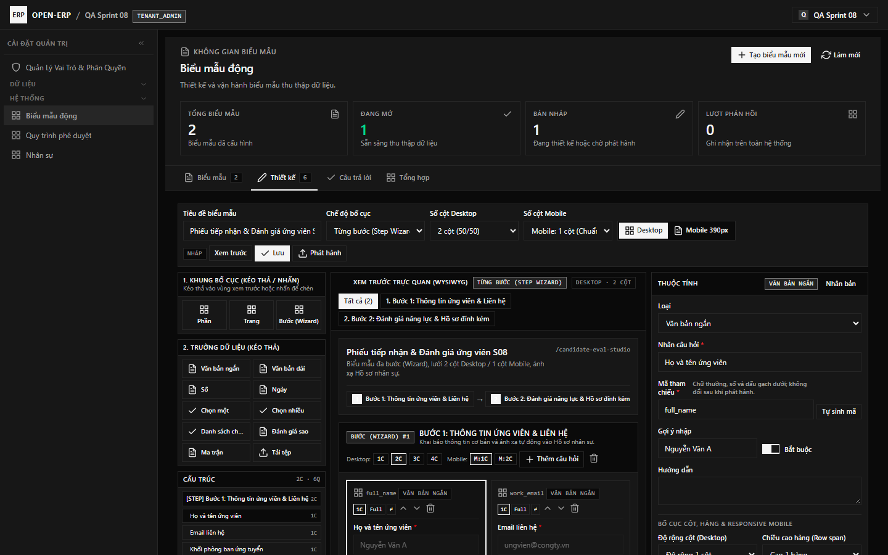

### 1.3. Xem câu trả lời & Báo cáo tổng hợp
1. Chuyển sang tab **Câu trả lời** để tra cứu từng lượt gửi ở chế độ chia đôi màn hình (danh sách bên trái, chi tiết câu trả lời bên phải) hoặc bấm **Xuất CSV**.
2. Chuyển sang tab **Tổng hợp** để xem thống kê số lượt phản hồi và tỷ lệ phân bố theo từng phương án lựa chọn.

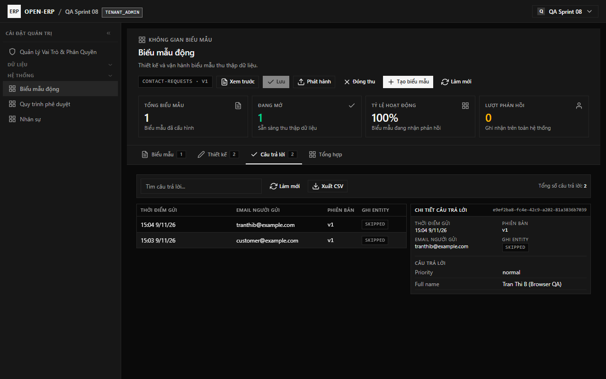

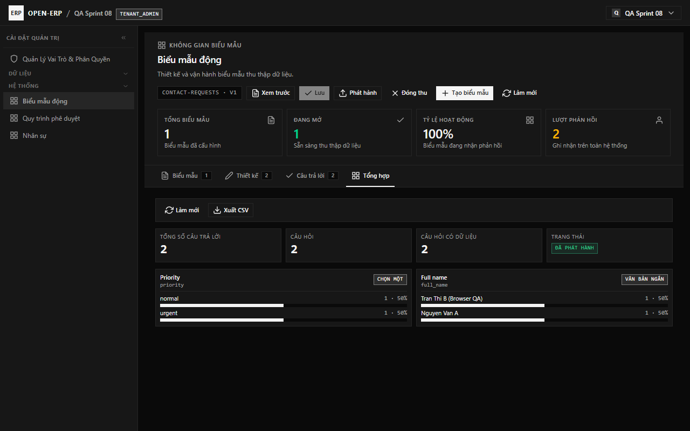

---

## 2. Điền Biểu mẫu công khai (`/public/forms/{tenant}/{slug}`)

1. Người dùng bên ngoài truy cập đường dẫn công khai `/public/forms/{tenant}/{slug}` trên trình duyệt máy tính hoặc điện thoại di động (không cần đăng nhập).
2. Điền đầy đủ các trường bắt buộc (có dấu `*`), nhập email người trả lời (tùy chọn) và bấm **Submit / Gửi câu trả lời**.
3. Hệ thống hiển thị màn hình xác nhận kèm **Mã tham chiếu (Reference ID)** và tự động phát sự kiện sang Quy trình phê duyệt nếu biểu mẫu có gắn trigger.

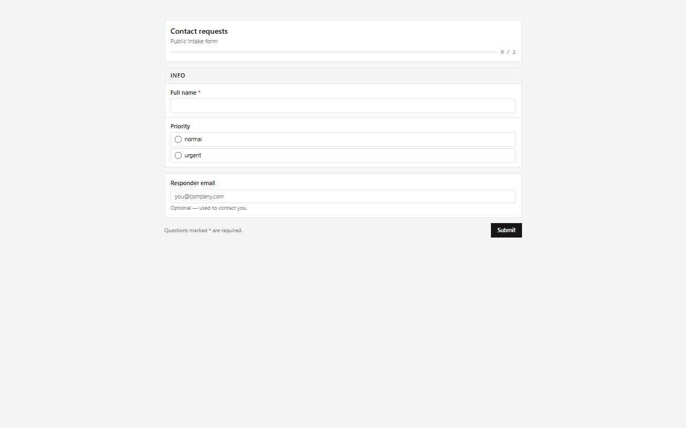

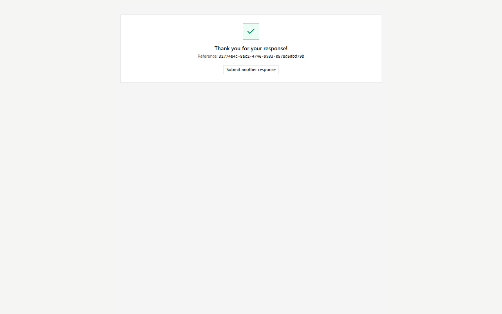

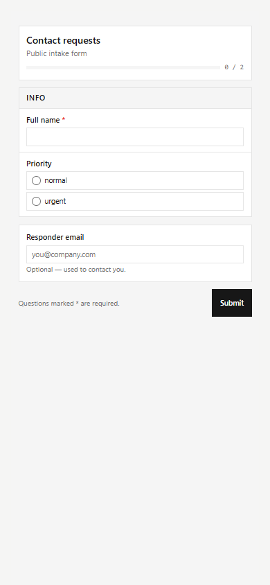

---

## 3. Quy trình phê duyệt & Xử lý công việc (`/apps/workflow`)

### 3.1. Hộp thư Việc của tôi & Drawer Phê duyệt
1. Từ thanh điều hướng bên trái (hoặc từ menu người dùng góc phải trên cùng), chọn **Quy trình phê duyệt** (`/apps/workflow`).
2. Tại tab **Việc của tôi**, người dùng xem danh sách các bước đang chờ mình xử lý (hoặc chuyển sang phạm vi **Tất cả**).
3. Bấm **Mở** trên dòng công việc để mở ngăn trượt **Chi tiết việc** (`Drawer`) bên phải.
4. Nhập **Ý kiến** và bấm **Đồng ý**, **Từ chối**, **Nhận việc**, hoặc mở mục **Thao tác khác** để chọn **Bước trả về** từ danh sách (`app-sharp-select`) hoặc tìm kiếm và chọn **Người nhận mới** theo họ tên/email (không cần nhập UUID thủ công).

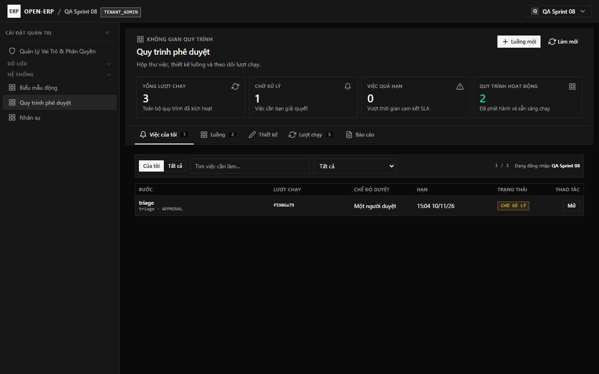

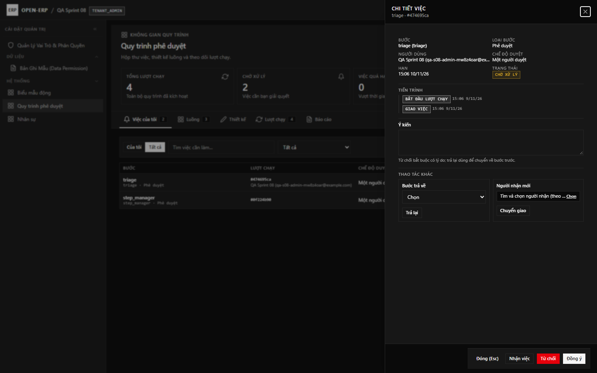

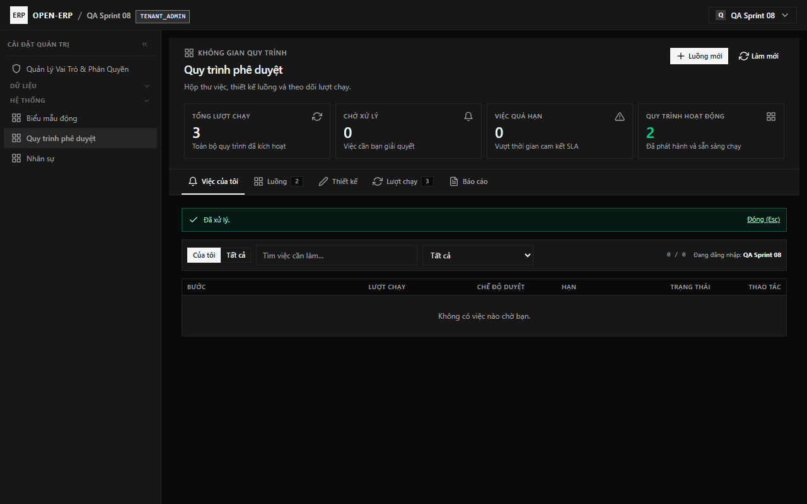

### 3.2. Sơ đồ luồng Quy trình đồ họa (`Visual Node Graph`) & Theo dõi lượt chạy
1. Chuyển sang tab **Luồng** hoặc **Thiết kế** để thiết kế quy trình trên **Sơ đồ luồng đồ họa (Visual Node Graph)**:
   - Các node (`START`, `APPROVAL`, `TASK`, `CONDITION`, `PARALLEL`, `AUTO_WEBHOOK`, `AUTO_ENTITY_UPDATE`, `CC`, `END`) được hiển thị trực quan kèm **đường cong mũi tên SVG định hướng** thể hiện rõ các nhánh chuyển tiếp.
   - Kéo thả trực tiếp từng node trên sơ đồ để bố trí vị trí, hoặc bấm **Ngang (Trái → Phải)** / **Dọc (Trên → Dưới)** / **Tự căn chỉnh đồ thị**.
   - Bấm **`+ Bước`** ngay trên node để chèn bước tiếp theo tự động nối dây, hoặc bấm **`🔗 Nối`** rồi nhấn vào bước đích để tạo/gỡ đường liên kết; nhấn **`×`** trên nhãn mũi tên để ngắt liên kết.
   - Tại bảng **Thuộc tính** bên phải, người dùng chọn **Bước kế tiếp** từ danh sách, chọn **Người duyệt** qua **Bộ chọn tìm kiếm Người dùng** (hiển thị đầy đủ `Họ tên + Email`), chọn **Vai trò** (`Quản trị viên (TENANT_ADMIN)`...) hoặc chọn **Trường dữ liệu** từ danh sách gợi ý — tuyệt đối không phải nhập UUID hay mã kỹ thuật thủ công.
2. Chuyển sang tab **Lượt chạy** để theo dõi trạng thái thực thi và xem **Timeline tiến trình** chi tiết (đã phân giải tên người xử lý) ở cột bên phải.
3. Giao diện hỗ trợ đầy đủ trên trình duyệt di động (`390×844`) không tràn ngang.

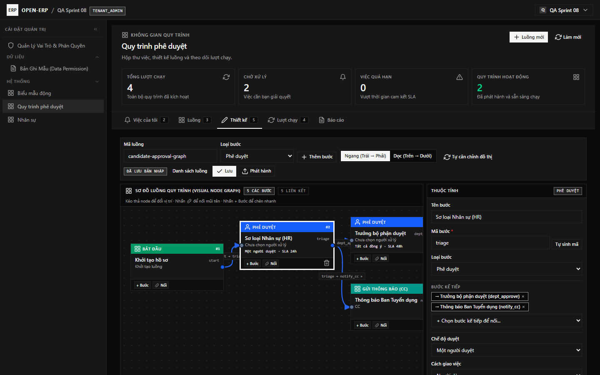

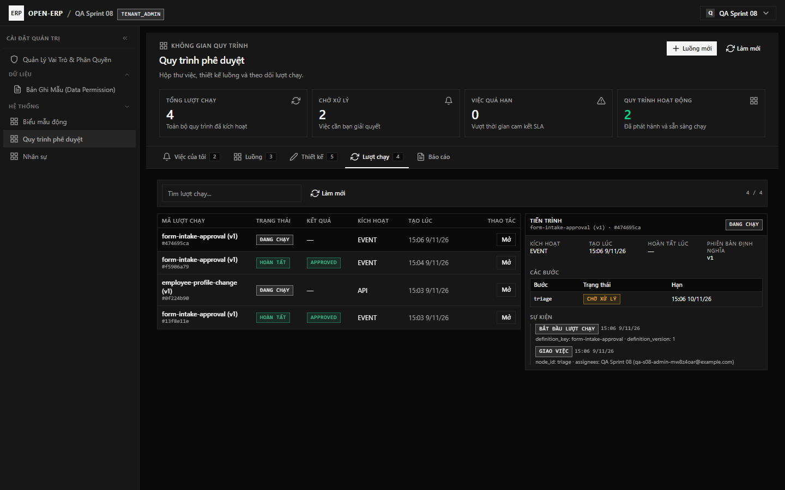

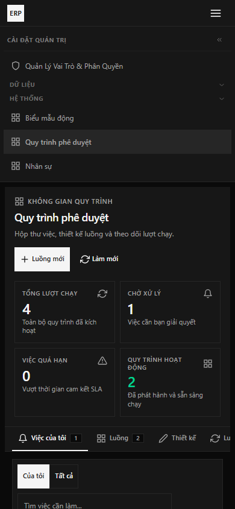

