# Hướng dẫn sử dụng Sprint 09 — Plugin Chấm công, Bảng công & Đơn từ (`attendance`)

| Trường | Giá trị |
| :--- | :--- |
| ID / phiên bản / cập nhật | UG-S09-001 / 1.0 / 2026-11-11 |
| Đối tượng | Nhân viên (Self-service), Quản lý trực tiếp (Manager), Quản trị Nhân sự (HR Admin), Vận hành Kiosk |
| Phạm vi | Plugin `attendance` (`1.0.0`) — Chấm công đa nguồn, quản lý ca kíp, đơn từ, sổ cái nghỉ phép, bảng công kỳ 4 bước và xuất bảng lương |
| Liên quan | [Sprint 09 Reading Guide](../sprints/sprint_09_plugin_attendance_timesheet/00_READING_GUIDE.md), [Báo cáo kiểm thử TR-S09-001](../sprints/sprint_09_plugin_attendance_timesheet/08_testing/02_TEST_REPORT.md) |

---

## 1. Chấm công cá nhân & Tra cứu lịch sử (`/apps/attendance`)

Toàn bộ giao diện plugin `attendance` được vận hành trực tiếp bên trong **Khung ứng dụng chuẩn Open-ERP (Open-ERP Application Shell)**: Topbar định danh Tenant, menu điều hướng Sidebar bên trái với chỉ báo plugin đang kích hoạt, Breadcrumb điều hướng và banner thông tin plugin `plugin: attendance (v1.0.0) • Active`.

### 1.1. Bảng điều khiển Chấm công cá nhân (Chưa chấm công)
1. Từ thanh điều hướng bên trái hoặc menu tài khoản, chọn **Chấm công của tôi** (`/apps/attendance`).
2. Màn hình cung cấp giao diện ERP trực quan mật độ cao:
   - **Thanh trạng thái GPS**: Tự động định vị tọa độ, tính toán khoảng cách theo công thức Haversine tới trụ sở văn phòng.
   - **Nút CHẤM VÀO / CHẤM RA**: Nút bấm nổi bật giúp ghi nhận nhanh thời gian làm việc.
   - **Huy hiệu trạng thái hôm nay (`AttendanceStatusBadge`)**: Hiển thị rõ ràng 6 trạng thái chuẩn (`CÓ MẶT`, `VẮNG MẶT`, `NỬA NGÀY`, `LÀM TỪ XA`, `NGHỈ PHÉP`, `CÔNG TÁC`).
   - **Lịch tuần cá nhân**: Hiển thị ca làm việc được phân công từng ngày trong tuần.
   - **Lịch sử 30 ngày**: Bảng nhật ký quẹt thẻ chi tiết.
   - **Thẻ số dư phép cá nhân (`LeaveBalanceCard`)**: Thống kê số ngày phép Được cấp, Đã dùng, Còn lại, và Sắp hết hạn.

### 1.2. Chấm vào thành công & Cập nhật trạng thái Có mặt
Khi bấm **CHẤM VÀO**: Hệ thống xác thực vị trí GPS trong bán kính văn phòng, ghi nhận log thời gian thực và cập nhật ngay trạng thái sang `CÓ MẶT` (màu xanh lục).
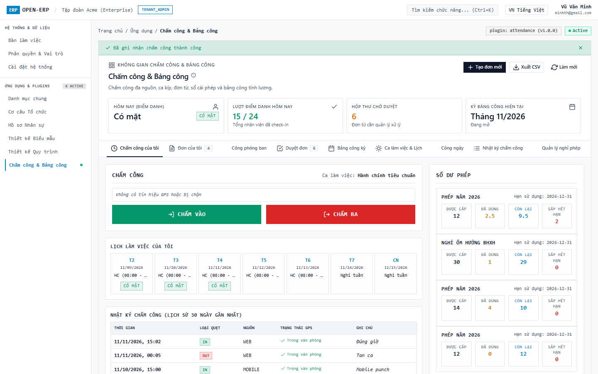

### 1.3. Kịch bản Chấm công Ngoài bán kính GPS
Khi nhân viên chấm công tại công trường hoặc đi công tác ngoài trụ sở: Hệ thống cảnh báo rõ ràng khoảng cách mét (`Ngoài văn phòng (1250m)`) và ghi nhận vào sổ nhật ký phục vụ đối soát công.

---

## 2. Nộp đơn & Quản lý Đơn từ (`/apps/attendance/requests`)

### 2.1. Danh sách đơn từ của tôi
Tab **Đơn của tôi** hiển thị toàn bộ các đơn từ đã nộp kèm trạng thái `ĐÃ DUYỆT`, `CHỜ DUYỆT`, `TỪ CHỐI`.
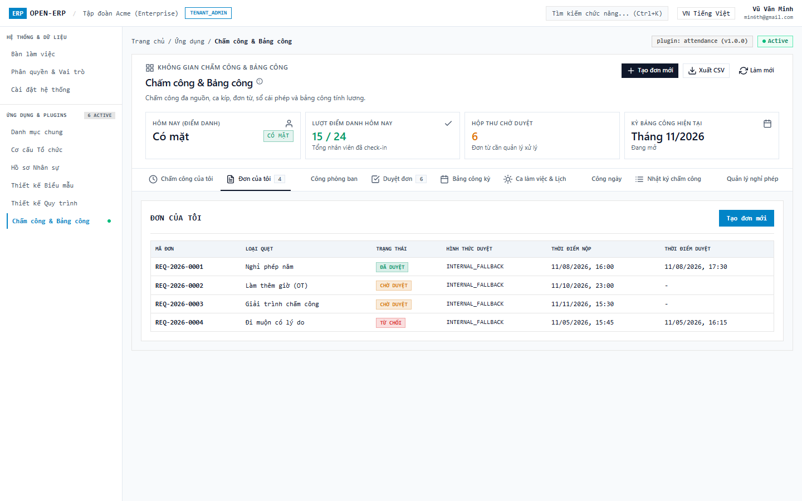

### 2.2. Nộp đơn Nghỉ phép năm qua Drawer trượt (Anti-Modal)
1. Bấm nút **+ Tạo đơn mới**.
2. Hệ thống mở Drawer trượt xếp tầng từ cạnh phải màn hình (tuân thủ nguyên tắc Anti-Modal Rule 10, Rule 26 không 2 lớp viền footer). Các nút bấm ở footer drawer ở chế độ sáng (Light Mode) được thiết kế tương phản cao sắc nét (Nút Hủy nền trắng viền xám, Nút Gửi đơn nền xanh nổi bật):
   - Chọn loại đơn: Nghỉ phép năm (`LEAVE`).
   - Chọn khoảng thời gian: Từ ngày - Đến ngày.
   - Nhập lý do nộp đơn và bấm **Gửi đơn**.

### 2.3. Nộp đơn Làm thêm giờ (OT)
Drawer tự động thích ứng với cấu hình loại đơn OT, cho phép nhân viên nhập số giờ làm thêm dự kiến và lý do tăng ca; các nút điều khiển footer rõ ràng, không gây chói hoặc lẫn màu.

---

## 3. Hộp thư Phê duyệt & Động cơ Quy trình (`/apps/attendance/approvals`)

### 3.1. Phê duyệt đơn nhanh dạng Chia màn hình & Quy trình Phê duyệt Đa tầng (Workflow Pipeline)
1. Quản lý trực tiếp chuyển sang tab **Duyệt đơn** (`/apps/attendance/approvals`).
2. Giao diện chia đôi màn hình độc lập:
   - **Cột trái**: Bộ lọc phân loại đơn nhanh (7 pills: *Tất cả*, *Nghỉ phép*, *Làm thêm giờ*, *Công tác*, *Bổ sung công*, *Đi muộn / Về sớm*, *Đổi ca*) và Danh sách các đơn đang chờ phê duyệt (kèm badge loại đơn, người nộp, ngày tạo) cùng bộ chuyển đổi chế độ xem giữa *Hộp thư duyệt đơn* và *Ma trận Quy trình (6 loại đơn)*.
   - **Cột phải**: Chi tiết đơn được chọn tích hợp đầy đủ **Quy trình duyệt đơn đa cấp Sprint 08 (`ADR-S09-002`)**:
     * **Tiến trình phê duyệt 4 bước trực quan (`selectedRequestWorkflow`)**: 1. Nhân viên gửi đơn (`COMPLETED`) -> 2. Quản lý trực tiếp phê duyệt (`PENDING`) -> 3. Trưởng phòng ban kiểm duyệt (`WAITING`) -> 4. Động cơ tự động HR (`WAITING`), hiển thị rõ ràng người thực hiện, chức vụ, vai trò, thời gian và ý kiến đóng góp.
     * **Lưới dữ liệu Form Builder**: Loại nghỉ phép, khoảng ngày, kiểm tra số dư phép, nhân viên bàn giao công việc và lý do chi tiết.
     * **Hành động tự động sau duyệt (Post-actions Grid)**: Khấu trừ sổ cái phép (`LEAVE_LEDGER_DEDUCTION`), đánh dấu công ngày (`DAILY_RECORD_MARK`).
     * **Bộ nút tác vụ phê duyệt**: Nút `DUYỆT ĐƠN` (xanh lục), `TỪ CHỐI` (đỏ), `YÊU CẦU GIẢI TRÌNH THÊM` (trung tính).

### 3.2. Ma trận Danh mục Quy trình Duyệt đơn (Workflow Definitions Catalog Matrix)
Chuyển đổi sang chế độ *Ma trận Quy trình (6 loại đơn)*: Bảng đối chiếu toàn bộ 6 loại đơn chuẩn của doanh nghiệp sang các quy trình Workflow Engine Sprint 08 độc lập:
- Nghỉ phép năm (`LEAVE` -> `WF-LEAVE-3LEVEL`, 3 bước duyệt: Nhân viên -> Quản lý -> Trưởng phòng -> Khấu trừ số dư phép)
- Làm thêm giờ (`OVERTIME` -> `WF-OT-2LEVEL`, 2 bước duyệt: Nhân viên -> Quản lý dự án -> Ghi nhận quỹ OT)
- Công tác ngoại tỉnh (`BUSINESS_TRIP` -> `WF-TRIP-3LEVEL`, 3 bước duyệt: Nhân viên -> Trưởng phòng -> Giám đốc điều hành -> Tạm ứng công tác phí & Miễn kiểm tra Geofence)
- Bổ sung công (`ATTENDANCE_FIX` -> `WF-FIX-2LEVEL`, 2 bước duyệt: Nhân viên -> Giám sát ca -> Chèn log bù & Tính lại công ngày)
- Đi muộn / về sớm (`LATE_EARLY` -> `WF-LATE-1LEVEL`, 1 bước duyệt: Nhân viên -> Quản lý trực tiếp -> Miễn trừ phạt chuyên cần)
- Đổi ca làm việc (`SHIFT_SWAP` -> `WF-SWAP-2LEVEL`, 2 bước duyệt: Nhân viên A -> Nhân viên B đồng ý -> Quản lý ca duyệt -> Hoán đổi ca trên lịch)
Bảng hiển thị chi tiết các bước phê duyệt, người duyệt tương ứng, điều kiện tự động và hành động sau duyệt.

---

## 4. Quản trị Điểm danh, Nhật ký Logs & Lịch ca

### 4.1. Bảng theo dõi Công phòng ban Toàn công ty (Team Attendance)
Tab **Công phòng ban** cung cấp 5 thẻ KPI tổng hợp nhanh (Tổng nhân sự: 45, Có mặt: 42, Đi muộn: 3, Vắng mặt: 1, Nghỉ phép: 2) và bảng danh sách nhân viên theo phòng ban kèm giờ vào/ra thực tế.
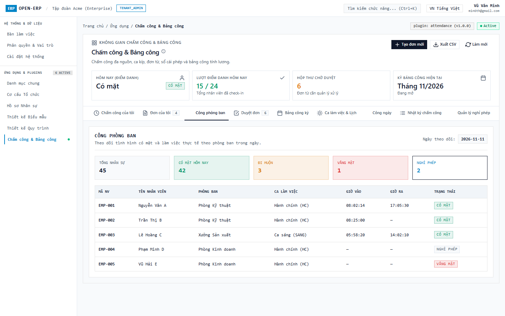

### 4.2. Nhật ký Chấm công Toàn công ty (Admin Attendance Logs)
Tab **Nhật ký chấm công** quản lý toàn bộ dữ liệu quẹt thẻ thô từ mọi nguồn (WEB, MOBILE, KIOSK sảnh, và MÁY VÂN TAY BIOMETRIC), lưu trữ append-only bất biến, ghi nhận chi tiết tọa độ GPS và khoảng cách mét. Hỗ trợ nút `Nhập từ CSV`.

### 4.3. Quản lý Ca làm việc & Lịch phân ca (Shifts)
Tab **Ca làm việc & Lịch** hiển thị danh mục các ca làm việc của doanh nghiệp (Ca Hành chính HC, Ca Sáng, Ca Chiều, Ca Đêm) với thông số khung giờ, thời gian nghỉ giữa ca, biên độ cho phép muộn/sớm (grace period) và công quy đổi.

### 4.4. Drawer Tạo / Cấu hình Ca làm việc
Drawer trượt hỗ trợ quản trị viên thêm mới hoặc cấu hình lại thông số ca làm việc: Mã ca, tên ca, khung giờ bắt đầu/kết thúc và thời gian giải lao.
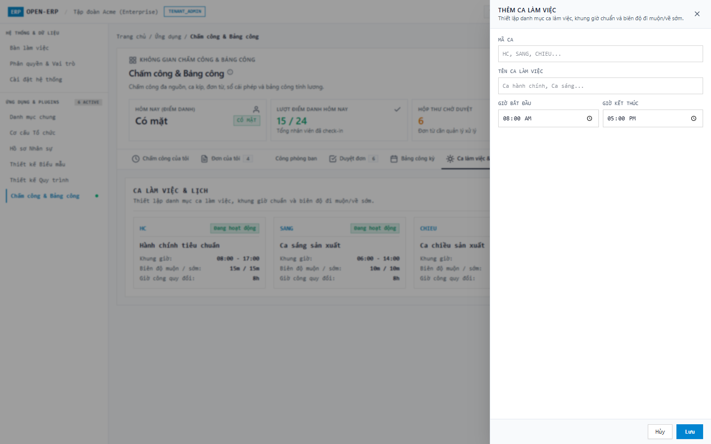

### 4.5. Bảng Công ngày Tổng hợp & Động cơ Tính công (Daily Records)
Tab **Công ngày** thể hiện kết quả tính toán tự động của động cơ tính công: Giờ làm thực tế, phút đi muộn, phút về sớm, giờ làm thêm OT và trạng thái công của từng nhân viên; có nút `Chạy tính toán công` để kích hoạt recalculate engine.
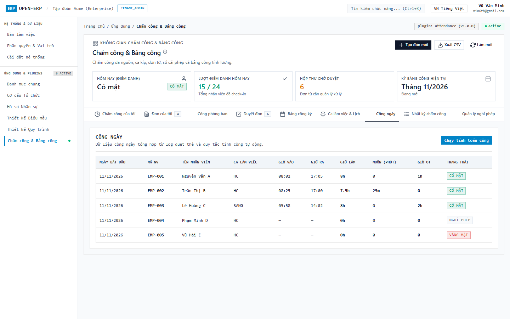

---

## 5. Quản lý Bảng công kỳ 4 bước, Nghỉ phép & Báo cáo

### 5.1. Quy trình Xử lý & Chốt Bảng công kỳ 5 bước chuẩn mực (Timesheet Closing Pipeline)
1. Nhân sự truy cập tab **Bảng công kỳ** (`/apps/attendance/admin/timesheets`).
2. Màn hình cung cấp quy trình xử lý và chốt công chuẩn mực 5 bước tiên quyết:
   - **Bước 1 — Xử lý Đơn từ Tồn đọng (Pending Requests)**: Kiểm tra toàn bộ đơn nghỉ phép, làm thêm giờ OT, công tác ngoại tỉnh, bổ sung công chưa được duyệt. Tích hợp nút `Giải quyết hàng loạt` để tự động xử lý theo chính sách.
   - **Bước 2 — Đối soát Quẹt thẻ & Bất thường (Raw Punch & Anomalies)**: Rà soát phát hiện các bản ghi quẹt thẻ bất thường (quên quẹt ra, quẹt ngoài phạm vi GPS Geofence). Tích hợp nút `Tự động chuẩn hóa`.
   - **Bước 3 — Động cơ Tính công Tổng hợp (Batch Calculation Engine)**: Kích hoạt engine tính toán đồng loạt toàn bộ 45 nhân viên, tự động đồng bộ ngày phép hưởng lương, giờ làm thêm OT và ngày công tác vào công kỳ.
   - **Bước 4 — Đối soát & Khiếu nại từ Nhân viên (Disputes & Confirmation)**: Theo dõi trạng thái xác nhận di động của nhân viên (43/45 đã xác nhận), danh sách 2 khiếu nại công kèm nút `Xử lý khiếu nại`.
   - **Bước 5 — Ký duyệt Đa cấp & Khóa sổ (Audit Sign-off & Lock)**: Ký duyệt kép giữa Quản lý Nhân sự và Giám đốc Điều hành, băm mã SHA-256 đóng băng bất biến dữ liệu, kích hoạt nút `Xuất bảng lương CSV`.
3. Bảng tổng hợp công kỳ 45 nhân sự hiển thị đầy đủ Ngày công chuẩn (22.0), Công thực tế, Phép hưởng lương, Giờ OT (1.5x/2.0x), Ngày công tác, Phút đi muộn, Tổng công thanh toán và Trạng thái xác nhận.
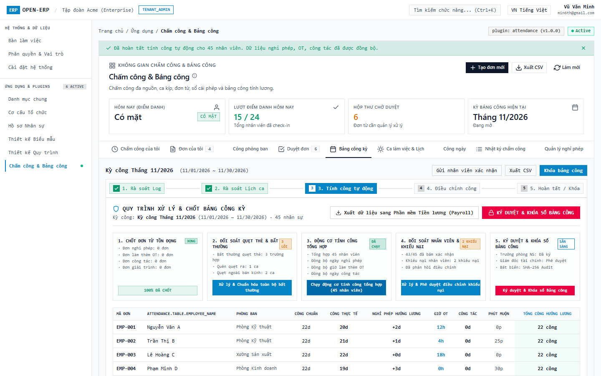

### 5.2. Kỳ Bảng công Đã khóa An toàn (Locked)
Kỳ công đã đóng hoàn tất được hiển thị với trạng thái `ĐÃ KHÓA` (ổ khóa đỏ), đóng băng dữ liệu để bảo vệ tính toàn vẹn trước kỳ tính lương.
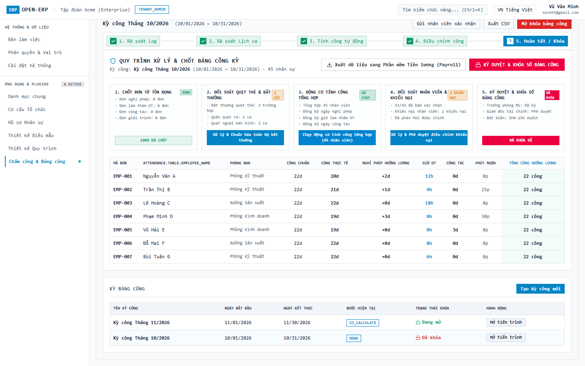

### 5.3. Drawer Xác nhận Khóa Kỳ Bảng công
Bấm `Khóa bảng công` mở Drawer xác nhận: Cảnh báo đóng băng dữ liệu toàn bộ kỳ công, yêu cầu nhập bắt buộc lý do kiểm toán / khóa kỳ.

### 5.4. Quản lý Nghỉ phép & Sổ cái Biến động phép (Leave Ledger)
Tab **Quản lý nghỉ phép** bao gồm 2 bảng quản trị: Bảng tổng hợp số dư phép từng nhân sự (Được cấp, Đã dùng, Còn lại, Hạn dùng) và Bảng lịch sử sổ cái phép ghi nhận toàn bộ biến động cộng/trừ ngày phép append-only.

### 5.5. Báo cáo Chuyên cần, Top Đi muộn & Thống kê Làm thêm giờ OT
Tab **Báo cáo & Xuất dữ liệu** phân tích dữ liệu chuyên cần toàn diện: Thẻ KPI tỷ lệ chuyên cần (93.3%), tổng giờ OT (180h), tổng ngày nghỉ (14d); Bảng Top nhân viên đi muộn nhiều nhất và Bảng phân bổ giờ OT theo từng phòng ban; hỗ trợ xuất CSV mẫu tính lương.

---

## 6. Cấu hình Quy trình Phê duyệt & Quản trị Kiosk Chi nhánh

### 6.1. Cấu hình Quy trình Phê duyệt & Ma trận Phân quyền RACI (`/apps/attendance/admin/workflows`)
Dành cho Quản trị viên Nhân sự (HR Admin) và Quản trị viên Hệ thống (System Admin):
- **Phân định Quyền hạn Cấu hình**: Khẳng định rõ ràng chỉ **HR Admin & System Admin** có quyền thiết lập chính sách quy trình; **Line Manager** thực hiện phê duyệt Cấp 1; **HR Manager** duyệt Cấp 2 và Khóa bảng công; **Nhân viên** theo dõi tiến trình và nộp đơn.
- **Ma trận Trách nhiệm RACI 4 Vai trò**: Trực quan hóa vai trò giữa Nhân viên (R), Quản lý trực tiếp (A), HR Admin (C), và System Admin (I) qua 5 loại quy trình.
- **5 Thẻ Chính sách Quy trình Độc lập với Stepper Đa tầng Trực quan**:
  1. *Đơn Nghỉ phép (Leave Policy)*: 3 cấp (Quản lý trực tiếp -> Trưởng phòng ban -> Động cơ trừ phép tự động), SLA 24h.
  2. *Đơn Làm thêm giờ (OT Policy)*: 2 cấp (Quản lý dự án -> HR tính quỹ OT), SLA 12h.
  3. *Đơn Giải trình / Bổ sung công (Regularization Policy)*: 2 cấp (Giám sát ca -> HR chèn log bù & tính lại công), SLA 24h.
  4. *Đơn Công tác ngoại tỉnh (Business Trip Policy)*: 3 cấp (Trưởng phòng -> Giám đốc -> Tạm ứng & Miễn Geofence), SLA 48h.
  5. *Quy trình Chốt & Khóa Bảng Chấm công Kỳ (Monthly Timesheet Closing Policy)*: 3 cấp (Kiểm toán công -> Ký duyệt kép HR Manager & CEO -> Băm mã SHA-256 khóa sổ), SLA 72h.
- **Thao tác nhanh**: Nút gạt Kích hoạt/Vô hiệu hóa tức thì và nút `Chỉnh sửa Cấu hình Policy`.

### 6.2. Drawer Chỉnh sửa Cấu hình Quy trình Phê duyệt Đa tầng
Thao tác bấm `Chỉnh sửa` tại thẻ chính sách mở Drawer trượt cạnh phải (Anti-modal chuẩn Rule 10, Rule 26):
- **Cấu hình tham số SLA**: Thiết lập thời hạn SLA tối đa (giờ) cho toàn bộ quy trình.
- **Trạng thái kích hoạt**: Bật/tắt chính sách áp dụng toàn tenant.
- **Danh sách chi tiết các cấp duyệt**: Cấp 1 (Line Manager - Quản lý trực tiếp), Cấp 2 (Department Head / HR Manager), Cấp 3 (Automated Engine / Director) với vai trò, mô tả và cấu hình chuyển cấp tự động (Escalation) khi quá hạn.
- **Footer Drawer độ tương phản cao**: Nút Hủy và Nút Lưu (`COMMON_CANCEL`, `COMMON_SAVE`) sắc nét, dễ nhìn trên chế độ sáng (Light Mode).

### 6.3. Quản trị Kiosk Chi nhánh & Xuất Link Bảo Mật Cách Ly Danh Tính (`/apps/attendance/admin/kiosk`)
Dành cho HR Admin và Vận hành IT quản lý các thiết bị chấm công sảnh của từng chi nhánh:
- **Bộ 4 chỉ số vận hành Kiosk**: Tổng thiết bị (3 máy), Đang trực tuyến (2 máy online), Ngoại tuyến (1 máy offline), Tổng lượt quẹt thẻ hôm nay (142 lượt).
- **Bảng Danh mục Thiết bị Kiosk phân bổ theo từng Chi nhánh / Đơn vị độc lập**:
  * *Hà Nội (`BRANCH-HN` / `KIOSK-HN-01`)*: Sảnh Lễ tân Keangnam (Tầng 1), hiển thị link chi nhánh chuyên biệt `?branch=BRANCH-HN&device=KIOSK-HN-01&token=...`, danh sách phòng ban: Kỹ thuật, Kinh doanh.
  * *TP. Hồ Chí Minh (`BRANCH-HCM` / `KIOSK-HCM-01`)*: Sảnh Văn phòng Bitexco (Tầng 12), link `?branch=BRANCH-HCM&device=KIOSK-HCM-01&token=...`, phòng ban: Nhân sự, Tài chính, Vận hành.
  * *Bình Dương (`BRANCH-BD` / `KIOSK-BD-01`)*: Cổng Nhà máy VSIP II (Cổng A), link `?branch=BRANCH-BD&device=KIOSK-BD-01&token=...`, phòng ban: Xưởng Sản xuất, Kho vận.
- **Các nút tác vụ bảo mật 1-chạm**:
  * `Sao chép Link Chi nhánh`: Tự động copy link chứa token bảo mật vào clipboard.
  * `Mở Kiosk Sảnh`: Mở màn hình Kiosk độc lập toàn màn hình.
  * `Xoay vòng Token`: Rotate Token vô hiệu hóa link cũ khi nghi ngờ lộ token.
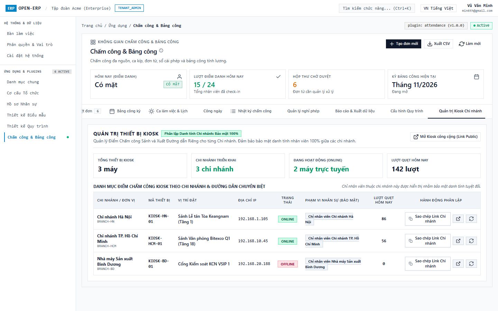

---

## 7. Terminal Kiosk Sảnh Công cộng Độc lập Cách ly Danh tính theo Chi nhánh (`/kiosk`)

### 7.1. Kiosk Sảnh Chi nhánh Hà Nội — Cách ly Danh tính Tuyệt đối (`/kiosk?branch=BRANCH-HN`)
Khi mở link chuyên biệt của Chi nhánh Hà Nội:
- **Header Kiosk phân lập**: Hiển thị rõ ràng tên chi nhánh `Chi nhánh Hà Nội` (Sảnh Lễ tân Tòa Keangnam - Tầng 1) kèm huy hiệu bảo mật `Cách ly danh tính chi nhánh`.
- **Cách ly danh bạ triệt để**: Danh sách nhân viên CHỈ hiển thị **12 nhân viên** thuộc Chi nhánh Hà Nội (`EMP-001` đến `EMP-012`). Tuyệt đối không hiển thị nhân viên TP.HCM hay Nhà máy Bình Dương, ngăn chặn triệt để nguy cơ rò rỉ thông tin nhân sự giữa các đơn vị.
- **Tiện ích sảnh trực quan**: Đồng hồ số thời gian thực, Lưới thẻ cảm ứng, Thanh chữ cái A-Z, Vuốt chạm chuyển trang, Bộ lọc phòng ban (Kỹ thuật, Kinh doanh).
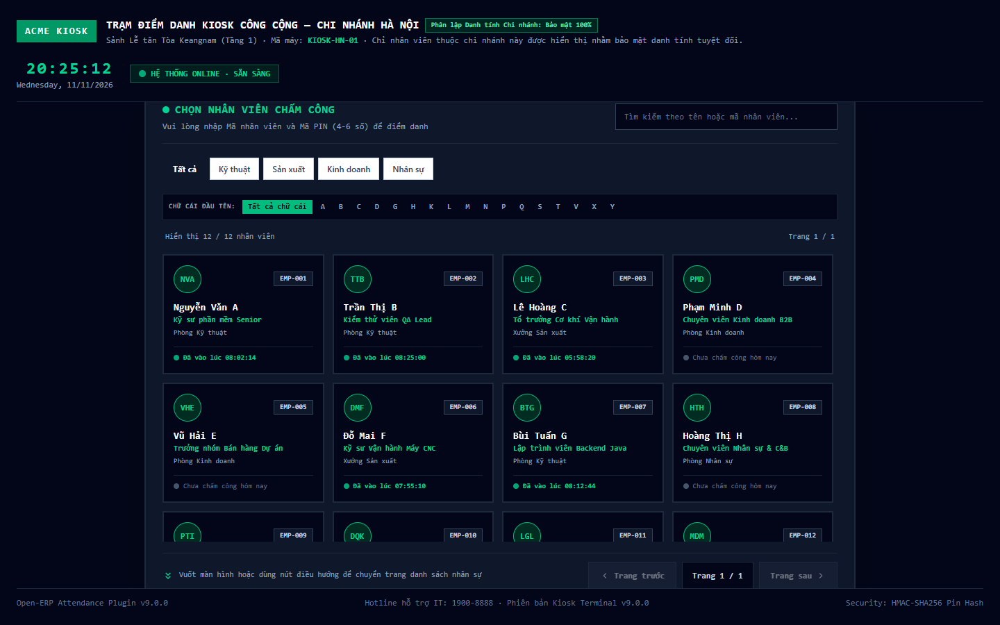

### 7.2. Kiosk Sảnh Chi nhánh TP. Hồ Chí Minh — Cách ly Danh tính Tuyệt đối (`/kiosk?branch=BRANCH-HCM`)
Khi mở link chuyên biệt của Chi nhánh TP.HCM:
- **Header Kiosk phân lập**: Tự động nhận diện chi nhánh `Chi nhánh TP. Hồ Chí Minh` (Sảnh Văn phòng Bitexco - Tầng 12) kèm huy hiệu `Cách ly danh tính chi nhánh`.
- **Cách ly danh bạ triệt để**: Danh sách nhân viên CHỈ hiển thị **6 nhân viên** thuộc Chi nhánh TP.HCM (`EMP-013` đến `EMP-018`: Ngô Bảo N, Trần Gia P, Nguyễn Hoàng Q, v.v.). Toàn bộ nhân sự các chi nhánh khác hoàn toàn bị ẩn.

### 7.3. Kiosk Sảnh — Chạm Thẻ Nhân sự & Bàn phím PIN Pad Cảm ứng 3x4
Chạm vào thẻ nhân viên `Ngô Bảo N` (EMP-013) tại Chi nhánh TP.HCM:
- **Thẻ Hồ sơ Nhân sự Đồng bộ (Linked Employee Profile Card)**: Phía trên bàn phím PIN hiển thị trọn vẹn thẻ hồ sơ nhân sự liên kết từ `plugin-employee` gồm ảnh avatar, họ tên, mã nhân viên, chức danh công việc, phòng ban.
- **Bàn phím PIN Pad cảm ứng 3x4**: Nút số to rõ, phản hồi cảm ứng nhạy bén, nút `⌫` xóa lùi, nút `Đổi nhân viên` để quay lại lưới.
- **Bảo mật tuyệt đối**: Che giấu mã PIN bằng ký tự tròn bảo mật khi chạm.

### 7.4. Kiosk Sảnh — Chấm công Thành công Banner Chào mừng
Bấm `CHẤM VÀO`:
- **Xác thực an toàn**: Backend xác thực mã PIN qua băm muối SHA-256 bảo mật cao.
- **Banner chào mừng lớn**: Hiển thị banner chào mừng thành công màu xanh lục kèm tên nhân viên (`Ngô Bảo N`), mã nhân viên (`EMP-013`), và thời điểm chấm công (`08:05:00`).
- **Tự động làm mới (Auto-Reset)**: Giao diện tự động đếm lùi 3.5 giây và làm mới màn hình về danh sách nhân viên chi nhánh cho lượt quẹt tiếp theo.
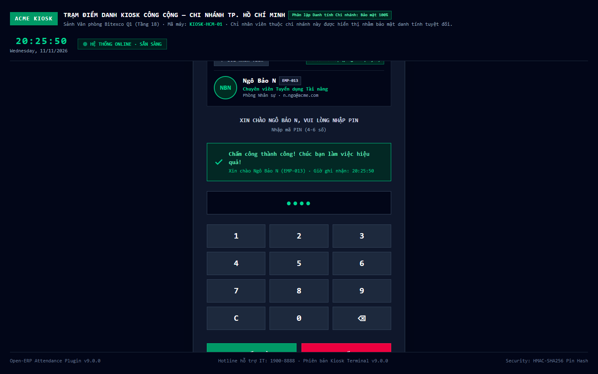

---

## 8. Ứng dụng Di động Ionic 8 (Mobile App 5 Tab Chuẩn iPhone 390x844 px)

Toàn bộ các tác vụ tự phục vụ (Self-service) của nhân viên và quản lý được tối ưu hóa hoàn hảo trên màn hình di động (chuẩn kích thước iPhone 390x844 px), đảm bảo **0% tràn ngang (overflow = 0)**, diện tích chạm nút bấm **≥ 48px**:

### 8.1. Tab 1: Chấm công Di động Trong Bán kính GPS
Nút bấm lớn `CHẤM VÀO` (xanh) / `CHẤM RA` (đỏ), tự động lấy GPS của điện thoại và hiển thị khoảng cách tới văn phòng.

### 8.2. Tab 1: Chấm công Di động Ngoài Bán kính GPS
Kịch bản quẹt thẻ ngoài phạm vi văn phòng: Hệ thống hiển thị huy hiệu cảnh báo và yêu cầu nhập ghi chú lý do công tác.

### 8.3. Tab 2: Lịch làm việc Tuần Cá nhân
Tra cứu ca làm việc từng ngày trong tuần kèm huy hiệu trạng thái công thực tế (Có mặt / Nghỉ tuần).
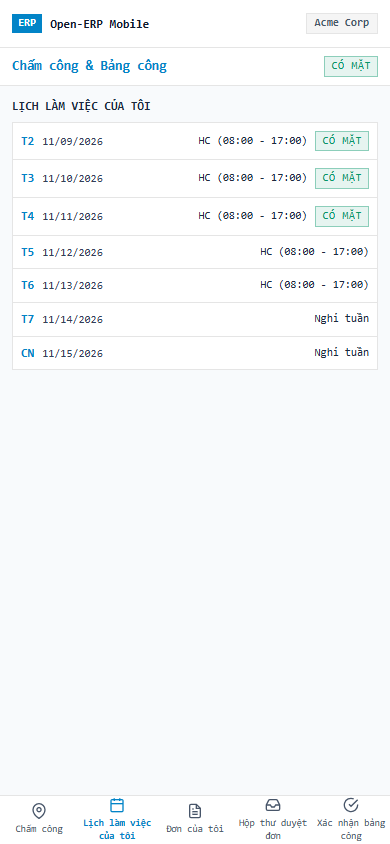

### 8.4. Tab 3: Danh sách Đơn từ Cá nhân
Xem danh sách đơn từ đã nộp với mã số, loại đơn, thời gian nộp và huy hiệu trạng thái màu sắc trực quan (`APPROVED`, `PENDING`, `REJECTED`).
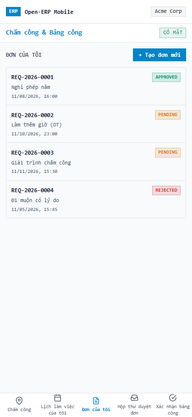

### 8.5. Tab 3: Biểu mẫu Nộp đơn Mới Di động
Drawer biểu mẫu nộp đơn tối ưu cho thao tác chạm trên màn hình cảm ứng điện thoại, dễ dàng nhập liệu và gửi duyệt.

### 8.6. Tab 4: Hộp thư Duyệt đơn Quản lý Di động
Quản lý trực tiếp có thể xem xét, nhập ý kiến phản hồi và bấm `DUYỆT` hoặc `TỪ CHỐI` đơn từ của nhân viên cấp dưới ngay trên di động.

### 8.7. Tab 5: Nhân viên Xác nhận Kỳ Bảng công
Nhân viên xem thông tin kỳ công tháng, bấm `ĐÃ XÁC NHẬN` để đồng ý với số liệu công và giờ làm thêm được tổng hợp.

### 8.8. Tab 5: Nhân viên Khiếu nại Kỳ Bảng công
Trường hợp có sai lệch giờ quẹt thẻ hoặc ca làm việc, nhân viên bấm `KHIẾU NẠI BẢNG CÔNG` kèm ghi chú phản hồi để quản trị viên kiểm tra và điều chỉnh.

