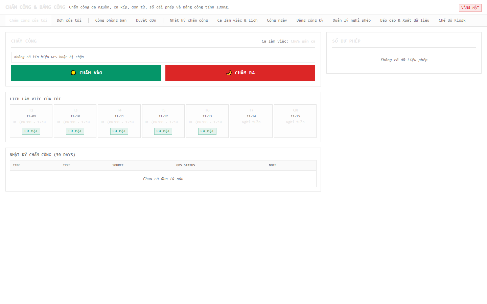
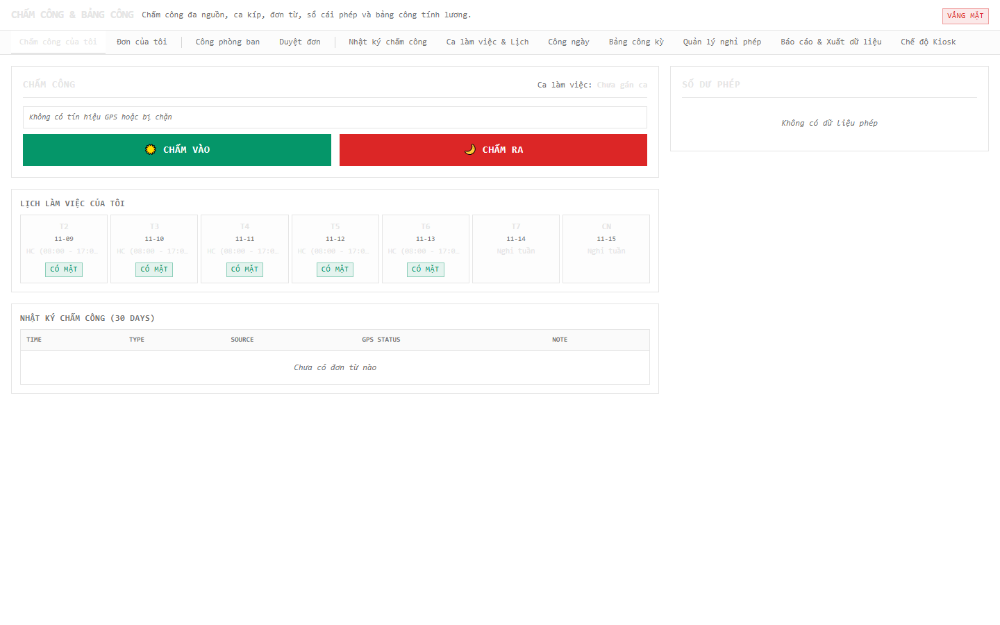
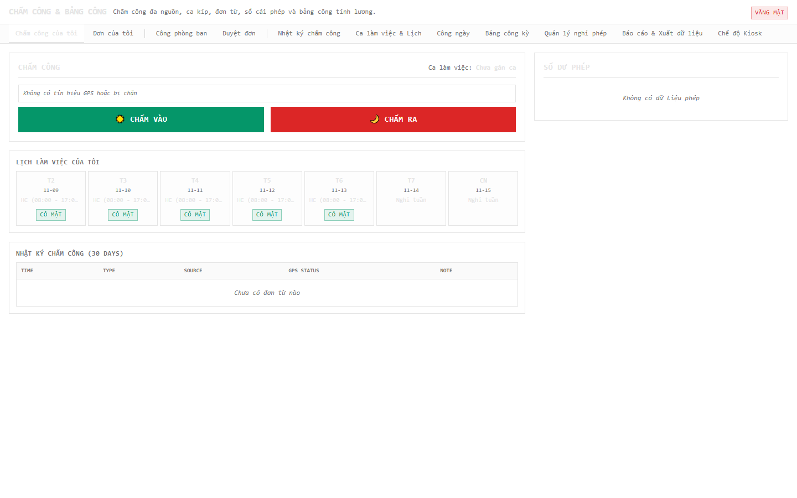
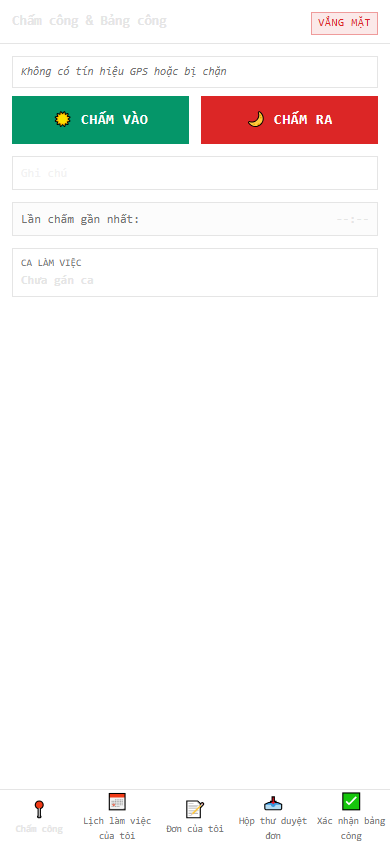

# Hướng dẫn sử dụng Sprint 09 — Plugin Chấm công, Bảng công & Đơn từ (`attendance`)

| Trường | Giá trị |
| :--- | :--- |
| ID / phiên bản / cập nhật | UG-S09-001 / 1.0 / 2026-11-11 |
| Đối tượng | Nhân viên (Self-service), Quản lý trực tiếp (Manager), Quản trị Nhân sự (HR Admin), Vận hành Kiosk |
| Phạm vi | Plugin `attendance` (`1.0.0`) — Chấm công đa nguồn, quản lý ca kíp, đơn từ, sổ cái nghỉ phép, bảng công kỳ 4 bước và xuất bảng lương |
| Liên quan | [Sprint 09 Reading Guide](../sprints/sprint_09_plugin_attendance_timesheet/00_READING_GUIDE.md), [Báo cáo kiểm thử TR-S09-001](../sprints/sprint_09_plugin_attendance_timesheet/08_testing/02_TEST_REPORT.md) |

---

## 1. Chấm công cá nhân & Tra cứu lịch sử (`/apps/attendance`)

### 1.1. Bảng điều khiển Chấm công cá nhân (Desktop Web)
1. Từ thanh điều hướng bên trái hoặc menu tài khoản, chọn **Chấm công của tôi** (`/apps/attendance`).
2. Màn hình cung cấp giao diện ERP trực quan mật độ cao:
   - **Thanh trạng thái GPS**: Tự động định vị tọa độ, tính toán khoảng cách theo công thức Haversine tới trụ sở văn phòng. Nếu ngoài bán kính cho phép, hệ thống gắn cờ cảnh báo `⚠️ Ngoài bán kính` (không chặn chấm công per ADR-S09-001).
   - **Nút CHẤM VÀO / CHẤM RA**: Nút bấm nổi bật giúp ghi nhận nhanh thời gian làm việc.
   - **Huy hiệu trạng thái hôm nay (`AttendanceStatusBadge`)**: Hiển thị rõ ràng 6 trạng thái chuẩn (`CÓ MẶT`, `VẮNG MẶT`, `NỬA NGÀY`, `LÀM TỪ XA`, `NGHỈ PHÉP`, `CÔNG TÁC`) kèm cảnh báo viền đứt nếu bản ghi cần xem xét (`needs_review`).
   - **Lịch tuần cá nhân**: Hiển thị ca làm việc được phân công từng ngày trong tuần.
   - **Lịch sử 30 ngày**: Bảng nhật ký chấm công chi tiết (thời gian, hình thức, định vị GPS, ghi chú).
   - **Thẻ số dư phép cá nhân (`LeaveBalanceCard`)**: Thống kê số ngày phép Được cấp, Đã dùng, Còn lại, và Sắp hết hạn.

---

## 2. Nộp đơn & Quản lý Đơn từ (`/apps/attendance/requests`)

### 2.1. Nộp đơn mới qua Drawer trượt (Anti-Modal)
1. Tại tab **Đơn của tôi**, bấm nút **+ Tạo đơn mới**.
2. Hệ thống mở Drawer trượt xếp tầng từ cạnh phải màn hình (tuân thủ nguyên tắc Anti-Modal Rule 10, không che khuất ngữ cảnh làm việc):
   - Chọn loại đơn: Hỗ trợ 6 loại đơn chuẩn của hệ thống (`LEAVE`, `OVERTIME`, `ATTENDANCE_FIX`, `LATE_EARLY`, `BUSINESS_TRIP`, `SHIFT_SWAP`) và các loại đơn tùy chỉnh do doanh nghiệp tự định nghĩa.
   - Chọn khoảng thời gian: Hệ thống tự động kiểm tra ngày lùi không quá `window_days` của loại đơn và kiểm tra kỳ công chưa bị khóa.
   - Nhập lý do và nội dung chi tiết.
3. Bấm **Gửi đơn**. Đơn được đẩy vào quy trình duyệt tự động hoặc luồng duyệt nội bộ `INTERNAL_FALLBACK`.

---

## 3. Hộp thư Phê duyệt dành cho Quản lý (`/apps/attendance/approvals`)

### 3.1. Phê duyệt đơn nhanh dạng Chia màn hình (Split-View)
1. Quản lý trực tiếp hoặc HR chuyển sang tab **Duyệt đơn** (`/apps/attendance/approvals`).
2. Giao diện chia đôi màn hình độc lập:
   - **Cột trái**: Danh sách các đơn đang chờ phê duyệt, hiển thị tên nhân viên, loại đơn, mã đơn và thời điểm gửi.
   - **Cột phải**: Chi tiết đơn được chọn kèm **Dòng thời gian tiến trình (`RequestTimeline`)** mô tả các mốc sự kiện từ khi nộp đơn, trạng thái người duyệt đến kết quả áp dụng dữ liệu công.
3. Nhập ý kiến phản hồi và bấm **✓ Duyệt** hoặc **✕ Từ chối** (khi từ chối bắt buộc phải nhập lý do). Kết quả duyệt được ánh xạ tự động vào sổ cái phép, log chấm công hoặc phân ca làm việc.

---

## 4. Quản lý Bảng công kỳ 4 bước (`/apps/attendance/admin/timesheets`)

### 4.1. Quy trình chốt công chuẩn mực 4 bước (`PeriodStepper`)
1. Nhân sự truy cập tab **Bảng công kỳ** (`/apps/attendance/admin/timesheets`).
2. Màn hình cung cấp thanh chỉ báo tiến trình trực quan 4 bước:
   - **Bước 1 — Rà soát Log (`S1_LOGS`)**: Kiểm tra toàn bộ dữ liệu quẹt thẻ thô, phát hiện bất thường.
   - **Bước 2 — Rà soát Lịch ca (`S2_SCHEDULE`)**: Đối soát ca làm việc, ngày nghỉ lễ và các đơn đổi ca.
   - **Bước 3 — Tính công tự động (`S3_CALCULATE`)**: Động cơ `AttendanceCalculator` tổng hợp ngày công, giờ làm việc, giờ làm thêm (OT), thời gian đi muộn/về sớm.
   - **Bước 4 — Điều chỉnh công (`S4_ADJUST`)**: Cho phép nhân sự điều chỉnh thủ công các trường hợp đặc biệt kèm ghi chú lý do.
   - **Hoàn tất / Khóa (`DONE`)**: Đóng kỳ công, thông báo xuất dữ liệu sang bảng lương.
3. **Cơ chế chống mất điều chỉnh**: Khi quay lại bước trước, hệ thống cảnh báo rõ ràng về việc tính toán lại có thể ghi đè các điều chỉnh thủ công đã lưu.
4. **Gửi xác nhận & Khóa kỳ**:
   - Bấm **Gửi nhân viên xác nhận** để kích hoạt thông báo cho toàn bộ nhân sự kiểm tra công cá nhân.
   - Bấm **Khóa bảng công** để đóng băng dữ liệu kỳ công.
   - Bấm **Xuất CSV** để tải về bảng tổng hợp công chuẩn phục vụ tính lương.

---

## 5. Chế độ Chấm công Kiosk (`/apps/attendance/kiosk`)

### 5.1. Vận hành Thiết bị Kiosk Độc lập
1. Thiết bị máy tính bảng hoặc máy tính đặt tại sảnh/cửa ra vào chạy chế độ Kiosk fullscreen (`/apps/attendance/kiosk`).
2. Nhân viên thao tác độc lập, an toàn:
   - Nhập Mã nhân viên (ví dụ: `EMP-001`).
   - Nhập mã PIN cá nhân trên bàn phím số cảm ứng (mã PIN được che dấu an toàn).
   - Bấm **CHẤM VÀO** hoặc **CHẤM RA**.
3. Hệ thống xác thực mã PIN qua chuẩn băm mật mã muối (Salted SHA-256) và hiển thị thông báo chúc mừng, tự động xóa màn hình sau 3.5 giây để sẵn sàng cho người tiếp theo (đảm bảo không lộ thông tin cá nhân).

---

## 6. Ứng dụng Di động Ionic 8 (Mobile App 5 Tab)

Toàn bộ các tác vụ tự phục vụ (Self-service) của nhân viên và quản lý được tối ưu hóa hoàn hảo trên màn hình di động (chuẩn kích thước iPhone 390x844 px), đảm bảo **0% tràn ngang (overflow = 0)**, diện tích chạm nút bấm **≥ 44px**:

### 6.1. Tab 1: Chấm công di động (Punch)
- Hiển thị nút bấm CHẤM VÀO / CHẤM RA kích thước lớn.
- Tự động lấy tọa độ GPS của điện thoại và hiển thị khoảng cách tới văn phòng.
- Thẻ tóm tắt ca làm việc và số dư ngày nghỉ phép.

### 6.2. Tab 2: Lịch làm việc cá nhân (Schedule)
- Tra cứu ca làm việc từng ngày trong tuần kèm trạng thái công thực tế.

### 6.3. Tab 3: Danh sách & Nộp đơn (Requests)
- Xem danh sách đơn từ đã nộp kèm trạng thái màu sắc nổi bật.
- Bấm nút **+ Tạo đơn mới** để mở Drawer nộp đơn tiện lợi.

### 6.4. Tab 4: Hộp thư Duyệt đơn Quản lý (Approvals)
- Quản lý duyệt nhanh các yêu cầu nghỉ phép, làm thêm giờ trực tiếp trên điện thoại di động kèm ô nhập lý do.

### 6.5. Tab 5: Xác nhận Bảng công (Confirmations)
- Nhận thông báo khi có bảng công kỳ mới, kiểm tra số công và bấm **Xác nhận** hoặc gửi **Khiếu nại**.

