# Hướng dẫn sử dụng Sprint 09 — Chấm công, Bảng công & Đơn từ (`attendance`)

| Trường | Giá trị |
| :--- | :--- |
| ID / phiên bản / cập nhật | UG-S09-001 / 2.1 / 2026-11-14 |
| Đối tượng | Nhân viên, Quản lý trực tiếp, HR Admin, System Admin, Vận hành Kiosk |
| Phạm vi | Plugin `attendance` 1.0.0 — chấm công, ca làm việc, đơn từ, nghỉ phép, bảng công kỳ, báo cáo, kiosk |
| Liên quan | [Reading Guide](../sprints/sprint_09_plugin_attendance_timesheet/00_READING_GUIDE.md), [Test Report TR-S09-003](../sprints/sprint_09_plugin_attendance_timesheet/08_testing/04_TR-S09-003_db_role_ui_retest_report.md) |

> Tài liệu này viết theo **luồng công việc thực tế**, không liệt kê chức năng rời rạc. Mỗi mục trả lời: *Khi nào dùng → Ai dùng → Làm gì → Kết quả*.

---

## 1. Luồng 1 — Một ngày làm việc của nhân viên

**Khi nào dùng:** đầu ngày vào ca, quên chấm công, cần xem công/thu nhập tạm tính, hoặc muốn xin nghỉ/OT.

### 1.1. Vào ca và chấm công

1. Mở **Chấm công & Bảng công → Chấm công của tôi**.
2. Kiểm tra ca hôm nay, vị trí GPS và trạng thái ngày.
3. Bấm **CHẤM VÀO** khi bắt đầu làm; bấm **CHẤM RA** khi kết thúc.

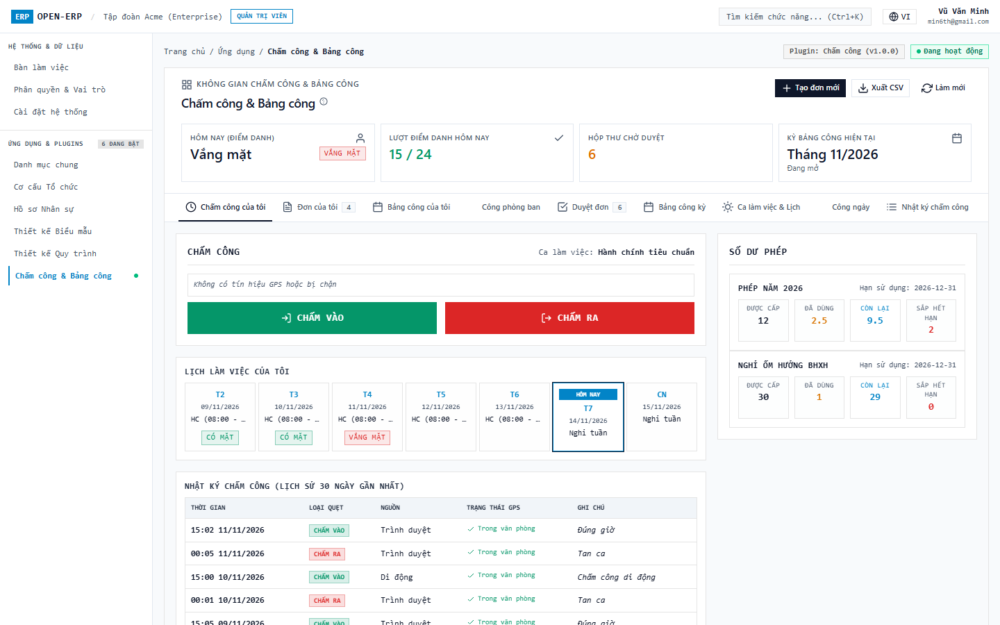

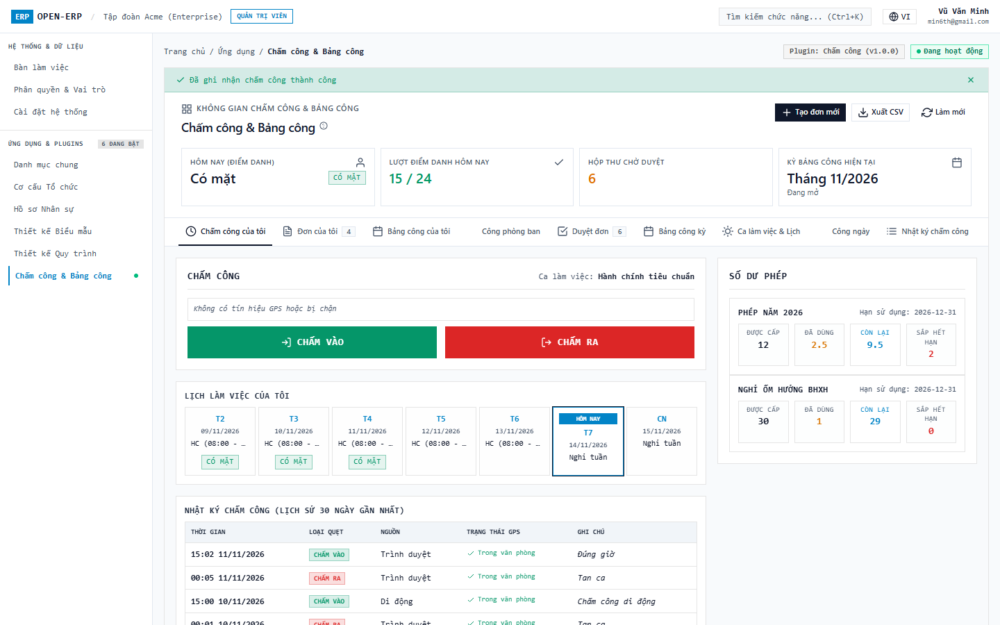

Nếu làm ngoài văn phòng, backend vẫn ghi nhận log kèm khoảng cách và cờ `in_geofence=false` để HR đối soát.

### 1.2. Xem bảng công của tôi

Vào tab **Bảng công của tôi** để xem:
- Kỳ công hiện tại, trạng thái khóa.
- Công chuẩn, công thực tế, phép hưởng lương, OT, công tác, phút muộn, tổng công thanh toán.
- Nhật ký chấm công cá nhân (có phân trang).

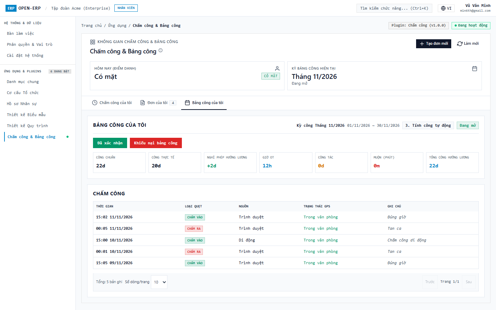

### 1.3. Nộp đơn khi cần

Vào **Đơn của tôi → Tạo đơn mới**, chọn loại đơn (nghỉ phép, OT, giải trình công, công tác, đi muộn/về sớm, đổi ca), nhập thời gian và lý do rồi gửi.

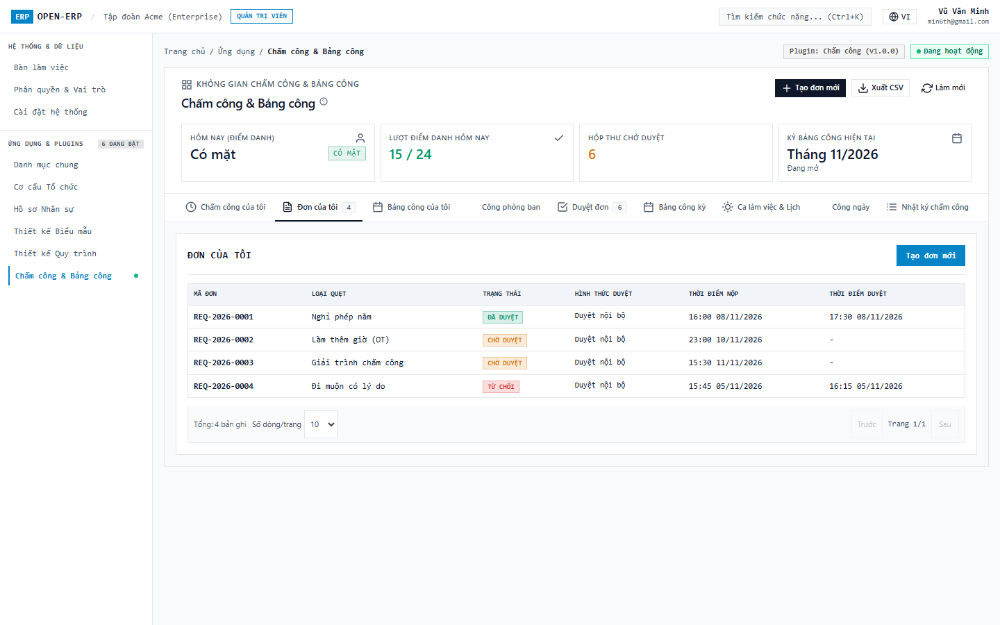

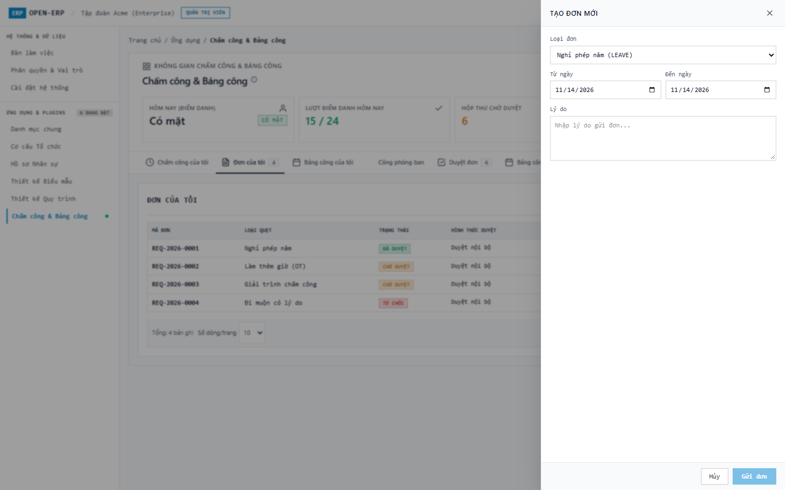

Hệ thống tự chọn quy trình duyệt theo loại đơn; nếu workflow engine chưa sẵn sàng, đơn chuyển sang duyệt nội bộ 1 cấp (`INTERNAL_FALLBACK`).

### 1.4. Xác nhận hoặc khiếu nại bảng công trên mobile

Khi HR gửi bảng công tháng, nhân viên mở tab **Xác nhận bảng công** trên mobile:
- Bấm **ĐÃ XÁC NHẬN** nếu số liệu đúng.
- Bấm **KHIẾU NẠI BẢNG CÔNG** nếu sai giờ/ca; HR sẽ kiểm tra và điều chỉnh.

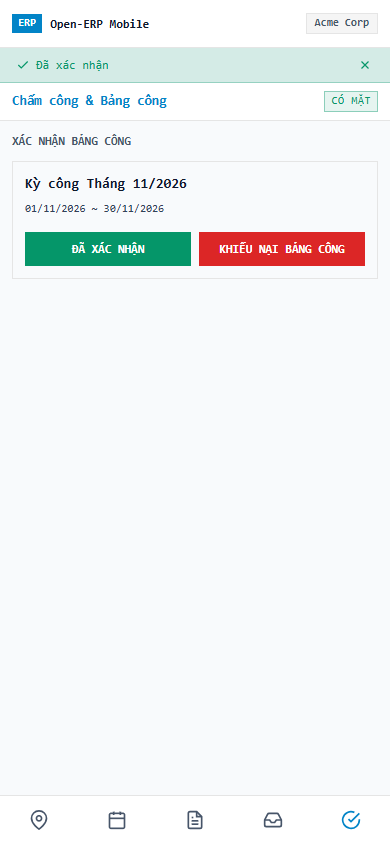

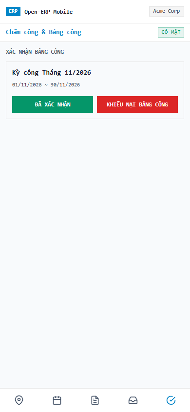

---

## 2. Luồng 2 — Quản lý duyệt đơn cho nhân viên

**Khi nào dùng:** nhân viên gửi đơn nghỉ/OT/giải trình/công tác/đổi ca; quản lý trực tiếp cần duyệt hoặc từ chối.

1. Mở **Duyệt đơn** — chỉ hiện với Line Manager.
2. Chọn đơn ở cột trái; xem tiến trình duyệt nhiều cấp, dữ liệu form, số dư phép và hành động tự động sau duyệt ở cột phải.
3. Bấm **DUYỆT ĐƠN** hoặc **TỪ CHỐI** (bắt buộc nhập lý do khi từ chối).

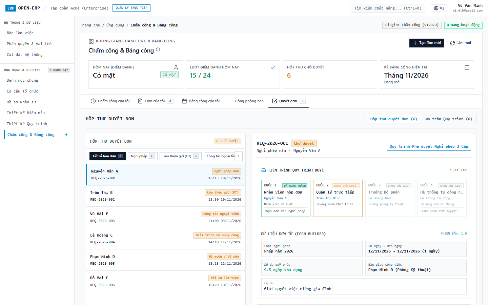

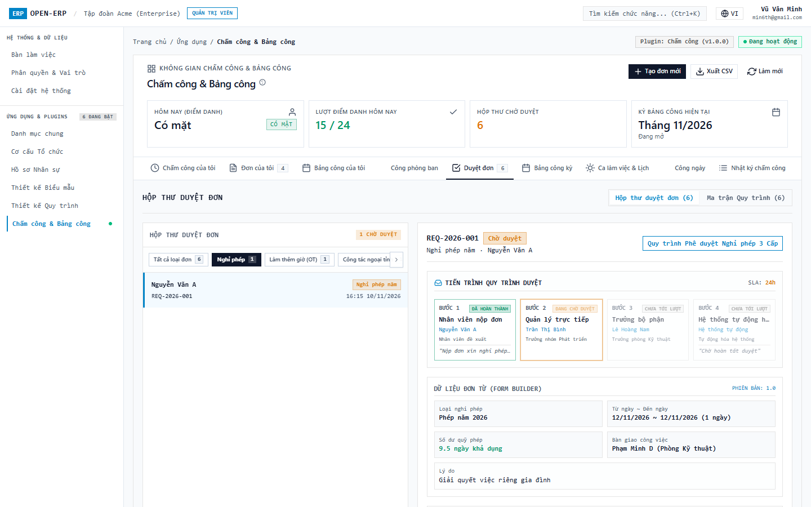

Đơn OT/công tác/đổi ca dùng quy trình riêng, hiển thị hệ số OT và bước duyệt tương ứng:

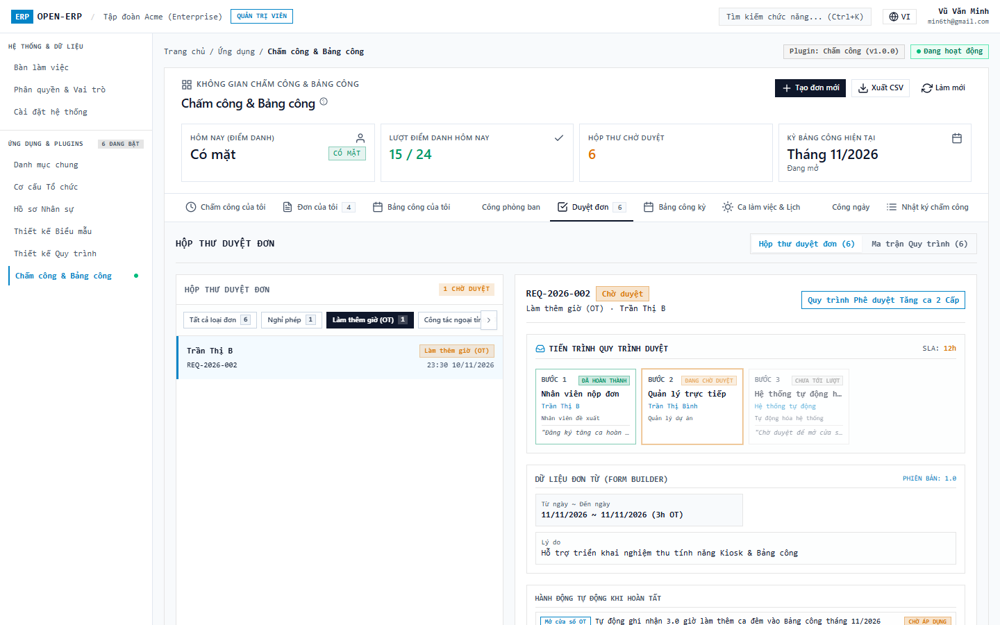

---

## 3. Luồng 3 — HR chốt bảng công tháng

**Khi nào dùng:** cuối kỳ lương, HR cần rà soát log, tính công, xử lý khiếu nại, khóa sổ và xuất dữ liệu lương.

Quy trình 5 bước trên màn **Bảng công kỳ**:

1. **Chốt đơn từ tồn đọng** — duyệt/giải quyết đơn nghỉ, OT, công tác, giải trình.
2. **Đối soát quẹt thẻ & bất thường** — xử lý quên quẹt, ngoài geofence.
3. **Chạy động cơ tính công** — tính công ngày, phép, OT, công tác cho toàn bộ nhân sự.
4. **Đối soát xác nhận & khiếu nại** — theo dõi nhân viên xác nhận, xử lý khiếu nại.
5. **Ký duyệt & khóa sổ** — khóa kỳ kèm lý do audit; dữ liệu đóng băng, sẵn sàng xuất payroll.

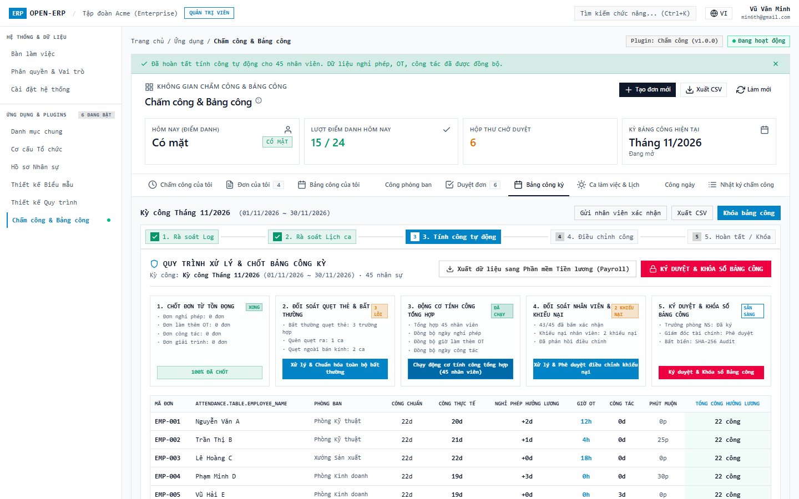

Sau khi khóa, kỳ công chuyển trạng thái **ĐÃ KHÓA**, không cho sửa tùy tiện:

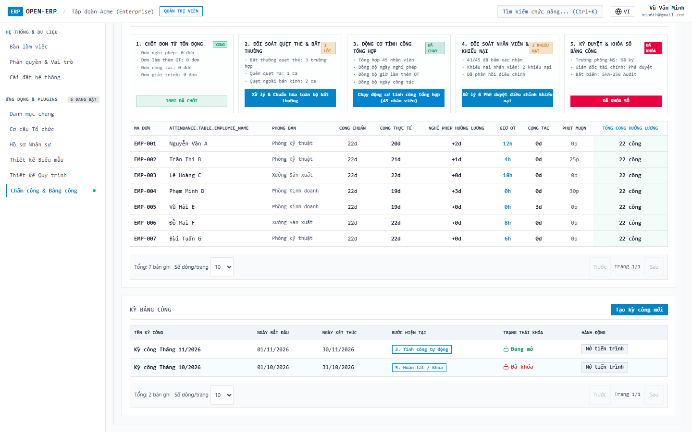

Drawer khóa kỳ yêu cầu nhập lý do kiểm toán:

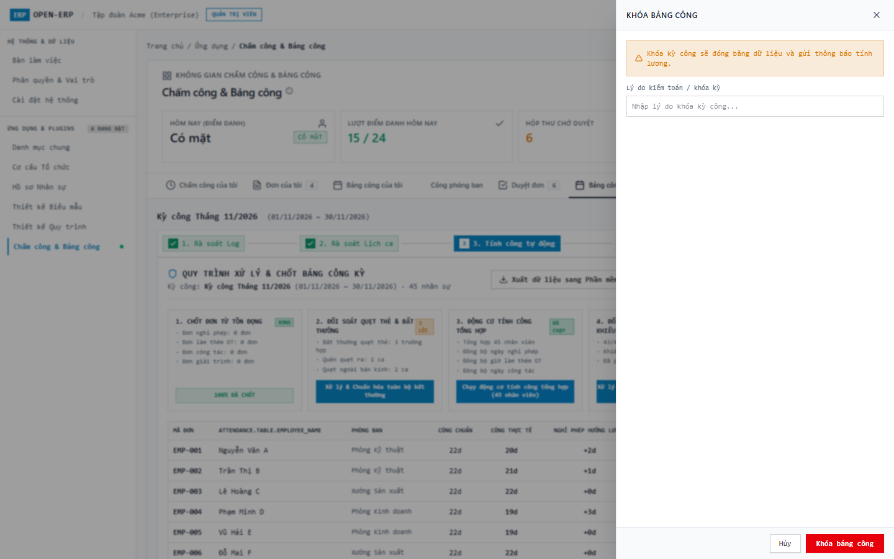

---

## 4. Luồng 4 — HR quản trị ca, log, nghỉ phép và báo cáo

**Khi nào dùng:** thiết lập ca làm việc, kiểm tra log thô, cấp/điều chỉnh phép, xem chuyên cần và OT.

### 4.1. Ca làm việc

Vào **Ca làm việc & Lịch** để thêm/sửa ca, giờ vào-ra, grace period, giờ công quy đổi.

Nút **Phân ca hàng loạt** mở drawer chọn ca và tháng; hệ thống gán ca cho toàn bộ nhân sự đang hoạt động trong các ngày làm việc (bỏ Thứ 7/Chủ nhật) và bỏ qua ngày đã có ca.

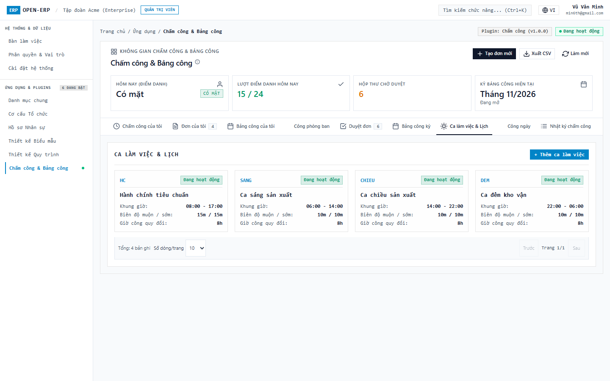

### 4.2. Nhật ký chấm công đa nguồn

Vào **Nhật ký chấm công** để xem log WEB/MOBILE/KIOSK/BIOMETRIC; nút **Nhập từ CSV** nạp dữ liệu máy chấm công; chuột phải để sao chép mã NV/thời gian.

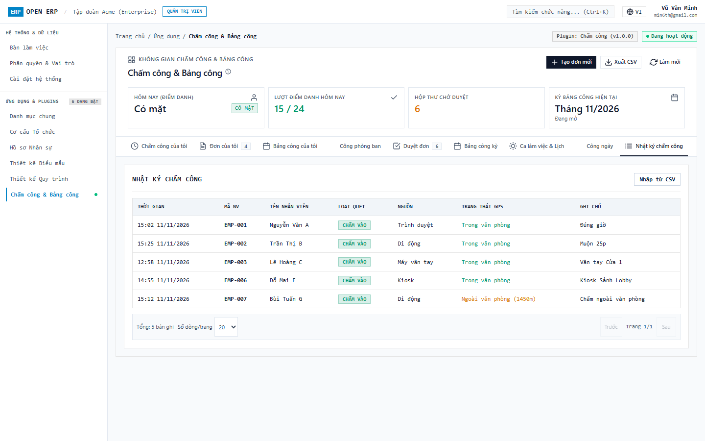

### 4.3. Nghỉ phép

Vào **Quản lý nghỉ phép** để xem loại phép, số dư, sổ cái append-only. Nút **Thêm loại phép** tạo loại mới; nút **Cấp phép mới** cấp số ngày cho một nhân sự kèm ghi chú.

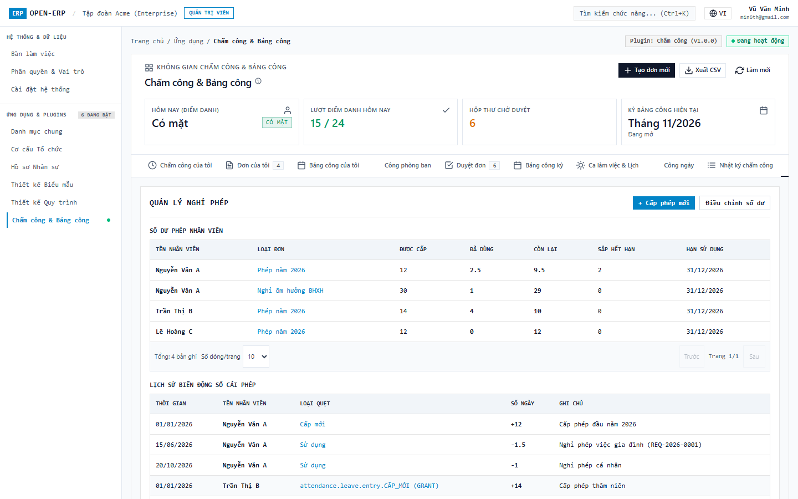

### 4.4. Báo cáo chuyên cần & OT

Vào **Báo cáo & Xuất dữ liệu** để xem tỷ lệ chuyên cần, số lượt đi muộn, top đi muộn, OT theo nhân viên/phòng ban và xuất CSV. Báo cáo bám theo kỳ công đang chọn (ví dụ 10/2026); tên phòng ban được đọc từ plugin Cơ cấu tổ chức qua gRPC.

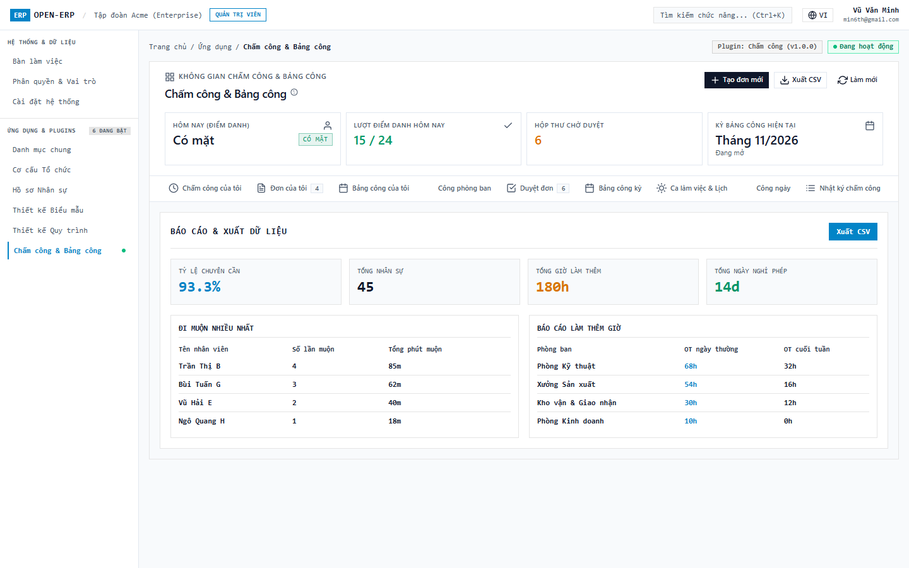

### 4.5. Lịch sử hoạt động

Tab **Lịch sử hoạt động** ghi lại mọi thao tác nhạy cảm: gửi/duyệt đơn, tạo/chuyển bước/khóa kỳ công, import/xóa log, sửa công ngày, tính lại công, phân ca, cấp/điều chỉnh phép. Mỗi dòng có thời điểm, hành động, đối tượng và chi tiết JSON.

Các bảng dữ liệu lớn đều có phân trang và context menu chuột phải:

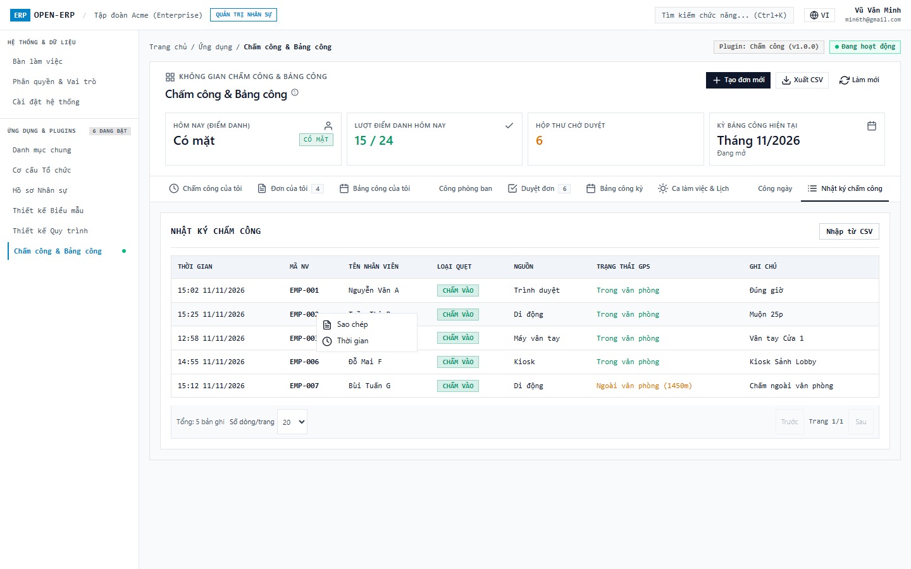

---

## 5. Luồng 5 — Kiosk chấm công tại từng chi nhánh

**Khi nào dùng:** nhân viên chấm công tại sảnh/lễ tân/nhà máy bằng tablet công cộng.

### 5.1. Lấy link Kiosk theo chi nhánh

HR vào **Quản trị Kiosk Chi nhánh**, chọn chi nhánh và sao chép link có `device` + `token`.

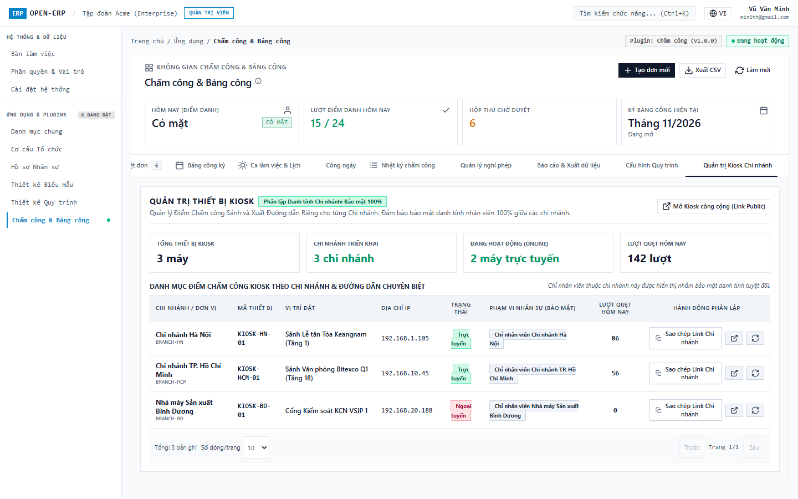

### 5.2. Nhân viên chấm công

1. Chọn tên mình trên lưới nhân viên của chi nhánh.
2. Nhập PIN 4–6 số.
3. Bấm **CHẤM VÀO** hoặc **CHẤM RA**.
4. Màn hình tự reset sau 3.5 giây cho lượt tiếp theo.

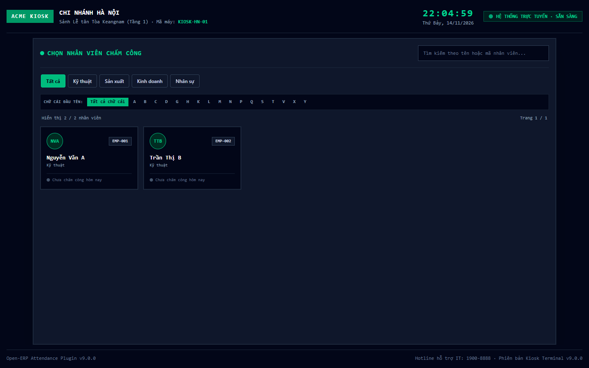

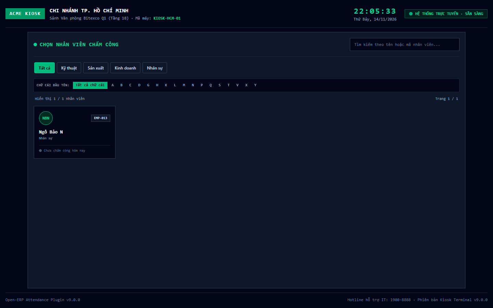

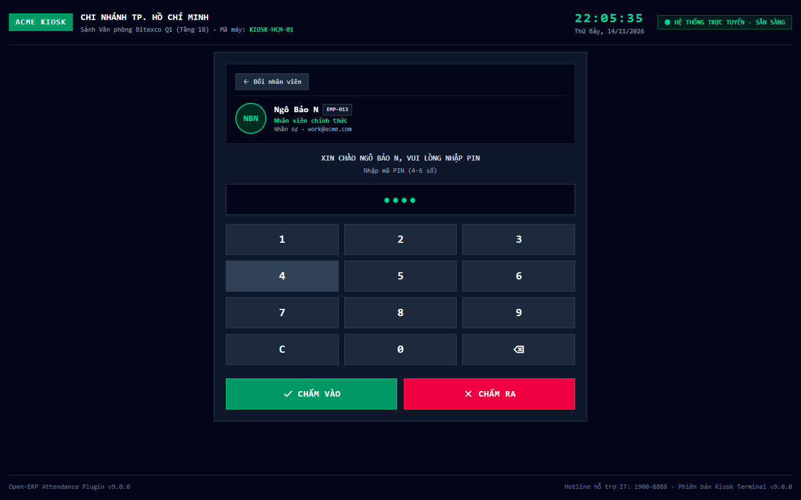

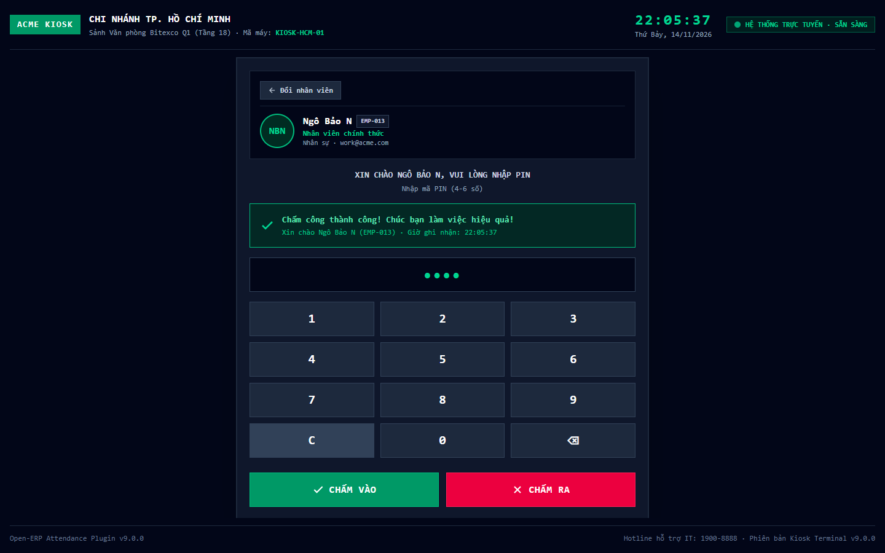

### 5.3. Bảo mật

Link chỉ có `?branch=...` **không đủ** để mở Kiosk. Nếu thiếu `device` hoặc `token`, hệ thống từ chối và không tải danh sách nhân viên:

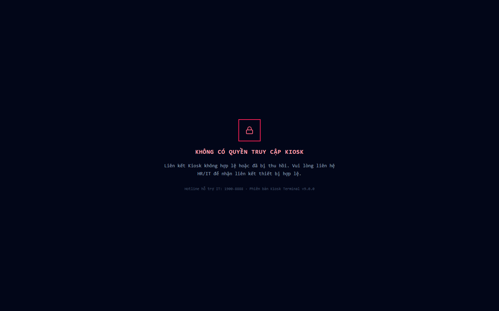

Backend kiểm tra token thiết bị (salted SHA-256), lọc nhân viên theo chi nhánh của thiết bị và từ chối session của thiết bị khác.

---

## 6. Luồng 6 — Cấu hình quy trình phê duyệt theo loại đơn

**Khi nào dùng:** HR Admin/System Admin cần đổi số cấp duyệt, người duyệt hoặc SLA cho từng loại đơn.

1. Mở **Cấu hình Quy trình**.
2. Bảng hiển thị ma trận loại đơn ↔ quy trình: tên loại đơn, mã đơn, workflow definition key, cửa sổ nộp (ngày), trạng thái.
3. Dữ liệu lấy trực tiếp từ cấu hình loại đơn của tenant; muốn đổi quy trình thì cập nhật loại đơn hoặc workflow definition ở plugin Quy trình phê duyệt.

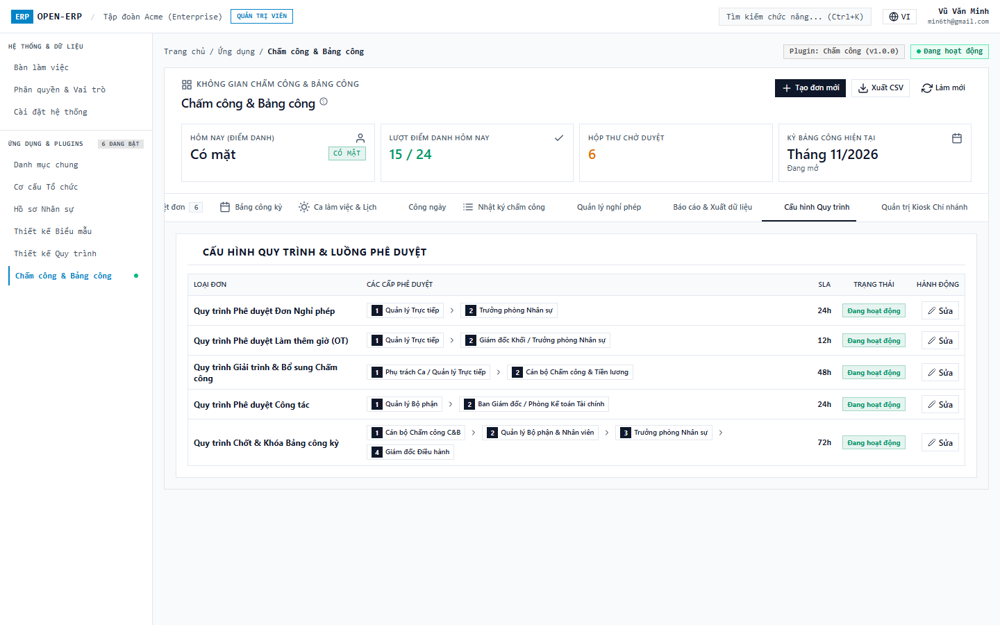

---

## 7. Luồng mobile — thao tác nhanh cho nhân viên và quản lý

Bottom navigation chỉ hiển thị **icon** (không label chữ) để tối ưu diện tích; vẫn có `aria-label`/`title` đa ngôn ngữ.

| Tab | Dùng khi nào |
| :--- | :--- |
| Chấm công | Vào ca/ra ca, xem GPS, ca hôm nay |
| Lịch làm việc | Xem ca tuần, ngày nghỉ |
| Đơn của tôi | Nộp/xem đơn |
| Duyệt đơn | Quản lý duyệt đơn |
| Xác nhận bảng công | Xác nhận/khiếu nại bảng công tháng |

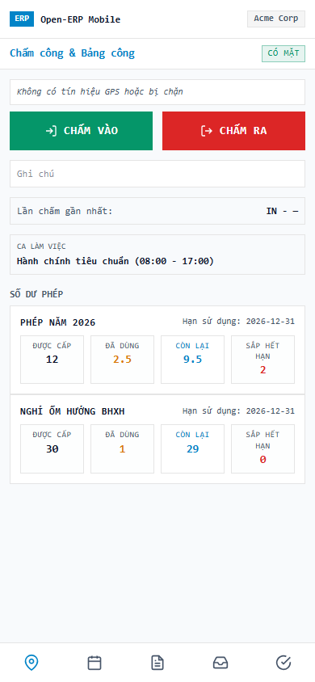

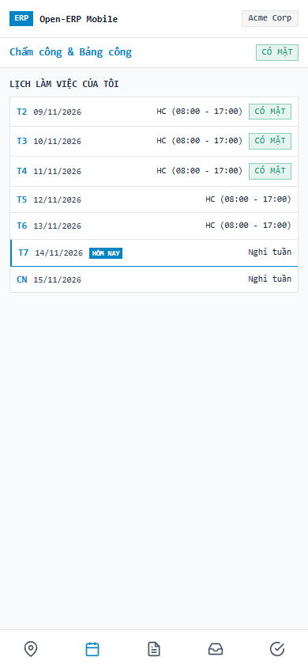

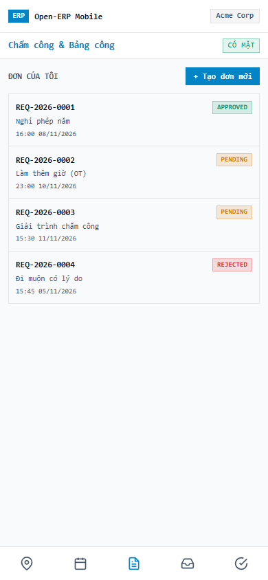

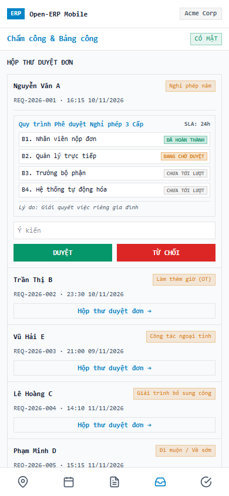

---

## 8. Lỗi thường gặp & lưu ý

| Tình huống | Cách xử lý |
| :--- | :--- |
| Không có tín hiệu GPS | Kiểm tra quyền vị trí trình duyệt; vẫn có thể chấm kèm ghi chú nếu chính sách cho phép |
| Kiosk báo không có quyền truy cập | Link thiếu `device`/`token` hoặc token đã bị thu hồi; liên hệ HR/IT |
| Không thấy tab quản trị | Tài khoản không có quyền HR Admin/System Admin |
| Bảng công đã khóa | Không sửa trực tiếp; liên hệ HR mở khóa kèm lý do audit |
| Đơn bị trả lại | Xem ý kiến quản lý trong timeline đơn, sửa và gửi lại |
| Số dư phép hiển thị nhiều dòng | Mỗi dòng là một loại phép; chỉ hiển thị số dư của chính nhân viên đang đăng nhập |
