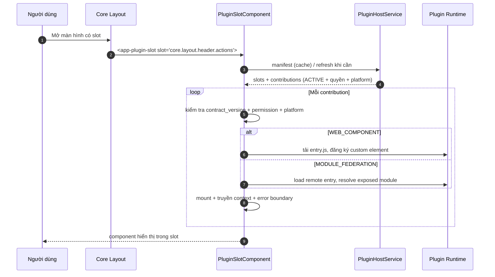

# [ANL-S06-002] Phân tích cơ chế Core render UI extension (slot–contribution)

| Trường | Giá trị |
| :--- | :--- |
| ID / loại / sprint | ANL-S06-002 / Phân tích / Sprint 06 |
| Trạng thái / phiên bản / cập nhật | Draft / 0.1 / 2026-10-29 |
| Owner / reviewer | BA Agent / Architect + Developer |
| Đầu vào | [RAW-S06-001](../01_raw_notes/01_RAW-S06-001_plugin_dev_platform_requirements.md), [SOL-03](../../sprint_03_plugin_manager/05_solutions/SOL-03_plugin_ui_extension_and_cli_dev_experience.md), [PLUGIN_MANAGER_API_SPEC](../../sprint_03_plugin_manager/06_designs/api/PLUGIN_MANAGER_API_SPEC.md), [TASK-399](../../sprint_05_catalog_plugin/07_items/TASK-399_plugin_ui_registry_dynamic_host.md) |
| Đọc trước / đọc tiếp | [RAW-S06-001](../01_raw_notes/01_RAW-S06-001_plugin_dev_platform_requirements.md) / [ANL-S06-001](01_ANL-S06-001_template_and_cli_interactive.md), [CONF-S06-001](../04_confirmation/01_CONF-S06-001_sprint_06_scope_and_questions.md) |

## 1. Mục đích

Chốt cách hiểu đúng yêu cầu “plugin chỉ đăng ký vị trí, Core mới là tác nhân render”, và xác định khoảng trống giữa backend UI Manifest hiện có với frontend chưa render slot.

> **Cập nhật 2026-10-29 — 16/16 câu đã trả lời:** **bỏ iframe hoàn toàn** (Q2 C), **Core + plugin đều khai báo slot** (Q3 B), dùng **cả 4 slot** (Q4 A+B+C+D), **WC + MF** (Q6 A), **migrate catalog sang MF/WC** (Q13 C), **plugin `in-app-notification` thật** (Q12 B), **header mobile + tab desktop** (Q14 A), **không cho tenant admin ẩn/đổi thứ tự** (Q15 A).

Câu hỏi trung tâm:

1. Ai sở hữu danh sách slot? → **Core + plugin** (Q3 B): Core sở hữu slot chuẩn; plugin có thể khai báo slot namespaced và render bằng shared outlet.
2. Plugin khai báo gì? → **Contribution**: slot + entry + render mode + quyền + thứ tự + contract version.
3. Core render thế nào? → **`PluginSlotComponent`** trong shared, chọn loader WC/MF, error boundary, truyền context.
4. Có bỏ iframe không? → **Có** (Q2 C): không còn `IFRAME` cho screen/contribution; catalog migrate sang MF/WC trong S06.

## 2. Hiện trạng

### 2.1. Backend đã có một nửa

`PluginUiManifestService` đã:

- Duyệt các plugin `ACTIVE` của tenant.
- Lọc screen/contribution theo `permission`.
- Trả `screens[]`, `slots[]` với `slot_code`, `host`, `contributions[]`.
- Sắp xếp contribution theo `order`.
- Resolve host Core/plugin và `contract_version`.

Nguồn: `src/backend/src/main/java/com/vn9melody/openerp/modules/plugin/service/PluginUiManifestService.java`.

### 2.2. Frontend mới dùng `screens`

`PluginHostService` chỉ khai báo:

```ts
interface PluginUiManifest {
  screens: PluginHostScreen[];
}
```

Chưa có `slots`, chưa có component render contribution. `PluginScreenHostComponent` chỉ mount iframe/MF/WC cho **screen toàn màn hình**.

### 2.3. Slot registry hiện có

Core đã seed tối thiểu:

- `core.dashboard.widgets`
- `core.settings.sections`

Chưa có slot cho header layout và tab cấu hình hệ thống. Topbar hiện render cứng `app-notification-bell` và `app-user-menu`; settings layout render menu tĩnh + screen plugin.

### 2.4. Catalog đang dùng iframe

`plugins/catalog/plugin.json` khai báo `ui_manifest.screens` với `render_mode: IFRAME`; Core mount `/settings/apps/catalog`. Đây là **screen**, không phải contribution. Yêu cầu mới không nhất thiết thay thế screen này.

## 3. Mô hình đề xuất

### 3.1. Khái niệm

| Khái niệm | Chủ sở hữu | Vai trò |
| :--- | :--- | :--- |
| **Slot** | Core hoặc plugin | Một vị trí UI trong layout/màn hình, có `slot_code`, `host_type`, `contract_version`, `allowed_render_modes`, `constraints` |
| **Contribution** | Plugin | Một component đăng ký vào slot; khai báo trong `plugin.json.ui_manifest.contributions[]` |
| **Outlet / Slot Host** | Core (shared) | Component `PluginSlotComponent` đọc manifest, lọc, chọn loader, render, bắt lỗi; plugin-hosted slot cũng dùng component này |
| **Loader** | Core (shared) | `WebComponentLoader`, `ModuleFederationLoader`; **không còn iframe loader** |
| **Context** | Core | Theme, ngôn ngữ, tenant, user, quyền, API base, navigate, notify |

### 3.2. Danh sách slot v1 (Q3/Q4 đã chốt)

| Slot code | Chủ sở hữu | Vị trí | Render mode | Desktop | Mobile | Ghi chú |
| :--- | :--- | :--- | :--- | :---: | :---: | :--- |
| `core.layout.header.actions` | Core | Topbar bên phải, trước user menu | WC/MF | ✅ | ✅ nếu khai báo | Ví dụ notification bell |
| `core.settings.system.tabs` | Core | Màn `/settings/system`, mỗi contribution = 1 tab | WC/MF | ✅ | ❌ (S06) | Ví dụ tab cấu hình notification |
| `core.dashboard.widgets` | Core | Dashboard | WC/MF | ✅ | ⏳ | Đã có trong registry |
| `core.settings.sections` | Core | Khu vực settings | WC/MF | ✅ | ❌ | Đã có trong registry |
| `<pluginKey>.*` | Plugin | Vị trí do plugin khai báo trong UI của chính plugin | WC/MF | ✅ | tùy plugin | Namespaced, không trùng `core.*`; render bằng shared outlet |

> **Q3 B:** plugin được khai báo slot, nhưng **không được dùng namespace `core.*`**. Slot plugin phải có `title_key`, `contract_version`, `allowed_render_modes`, `constraints`; Core đồng bộ vào `plugin_ui_slots` khi publish version.

### 3.2.1. Plugin-hosted slot descriptor

```json
{
  "slot_code": "crm.customer.detail.tabs",
  "title_key": "PLUGIN_CRM_SLOT_CUSTOMER_TABS",
  "contract_version": "1.2",
  "allowed_render_modes": ["WEB_COMPONENT", "MODULE_FEDERATION"],
  "constraints": { "max_contributions": 8, "min_height_px": 120 }
}
```

- Khai báo trong `plugin.json.ui_manifest.slots[]` của plugin host.
- Core sync registry; manifest của version host là nguồn sự thật runtime.
- Plugin host render slot bằng `<app-plugin-slot slot="crm.customer.detail.tabs" />`; component này nằm trong `@shared` nên vẫn do Core cung cấp.
- Contribution của plugin khác trỏ vào slot này; Core resolve `host.installed_version` + `contract_version`; mismatch ⇒ skip + log.
- Slot plugin chỉ hiển thị khi plugin host `ACTIVE`; tắt host ⇒ contribution không render.

### 3.3. Contribution descriptor

```json
{
  "id": "notification-bell",
  "slot": "core.layout.header.actions",
  "title_key": "PLUGIN_IN_APP_NOTIFICATION_HEADER",
  "render_mode": "WEB_COMPONENT",
  "entry": "/plugins-runtime/in-app-notification/contributions/header.js",
  "tag_name": "op-plugin-notification-bell",
  "permission": "in-app-notification:notification:read",
  "order": 10,
  "contract_version": "1.0",
  "platforms": ["desktop", "mobile"],
  "icon": "bell",
  "settings_tab": false
}
```

Với Module Federation:

```json
{
  "id": "notification-settings",
  "slot": "core.settings.system.tabs",
  "title_key": "PLUGIN_IN_APP_NOTIFICATION_SETTINGS",
  "render_mode": "MODULE_FEDERATION",
  "entry": "/plugins-runtime/in-app-notification/remote/entry.js",
  "exposed_module": "./NotificationSettingsTab",
  "permission": "in-app-notification:settings:manage",
  "order": 20,
  "contract_version": "1.0",
  "platforms": ["desktop"]
}
```

**Quy tắc:**

- `id` unique trong plugin; dùng cho telemetry/disable.
- `slot` phải tồn tại trong slot registry (Core hoặc plugin-hosted).
- `entry` lấy từ manifest, Core không nhận URL tùy ý từ client.
- `permission` do Core kiểm tra trước khi render; plugin vẫn kiểm tra lại ở API.
- `order` nhỏ trước.
- `contract_version` phải khớp major với slot.
- `platforms` quyết định render desktop/mobile.
- **Không còn `IFRAME`** (Q2 C): chỉ `WEB_COMPONENT` hoặc `MODULE_FEDERATION`; `PluginRenderMode.IFRAME` bị loại bỏ/deprecated sau khi migrate catalog.

### 3.4. Luồng render



### 3.5. Context contract (đề xuất)

Component nhận context qua properties/attributes (WC) hoặc props (MF):

| Khóa | Kiểu | Mục đích |
| :--- | :--- | :--- |
| `theme` | `light`/`dark` | Đồng bộ giao diện |
| `language` | `vi`/`en`/… | Đa ngôn ngữ |
| `direction` | `ltr`/`rtl` | RTL |
| `tenant` | `{ id, name }` | Hiển thị/tenant context |
| `user` | `{ id, name, email }` | Cá nhân hoá |
| `permissions` | `string[]` | Ẩn/hiện hành động |
| `apiBaseUrl` | string | Gọi API qua gateway |
| `navigate(path)` | function/event | Điều hướng trong Core |
| `notify({ level, code, params })` | function/event | Toast/banner theo i18n code |
| `resize()` | function/event | Báo Core tính lại kích thước slot |

**Quy ước:**

- WC dùng `CustomEvent` tên `op:` (ví dụ `op:navigate`, `op:notify`, `op:resize`).
- MF dùng props/callback theo contract.
- Không truyền token thô vào component nếu không cần; component gọi API qua interceptor JWT hiện có hoặc token ngắn hạn do Core cấp.
- Không hardcode màu/chuỗi; dùng CSS custom properties + i18n key.

### 3.6. Error boundary & an toàn

| Lớp | Biện pháp |
| :--- | :--- |
| Tải | Chỉ contribution của plugin `ACTIVE`, đúng tenant, đúng quyền, đúng platform |
| Cô lập | Shadow DOM cho WC; shared scope version pin cho MF; error boundary per contribution |
| Lỗi | Timeout tải, fallback “không thể hiển thị”, log telemetry; 1 contribution lỗi không làm hỏng layout |
| Bảo mật | CSP allowlist origin plugin; entry từ manifest; sanitize URL; không eval |
| Hợp đồng | `contract_version` mismatch ⇒ skip + log `PLUGIN_UI_SLOT_CONTRACT_MISMATCH`; không block cả plugin (Q13) |
| Hiệu năng | Manifest cache theo phiên; chỉ tải entry khi slot được render; lazy load |

### 3.7. Màn cấu hình hệ thống (Q5)

Đề xuất trang mới `/settings/system`:

- Tab Core: `General`, `Security`, `Plugins` (hoặc tab hiện có).
- Tab plugin: lấy từ slot `core.settings.system.tabs`; mỗi contribution là một tab.
- Tab chọn qua query/route `/settings/system?tab=<id>` hoặc nested route `/settings/system/<tab>`.
- Nội dung tab plugin render bằng `PluginSlotComponent` (chỉ render contribution của tab đang chọn).
- Không dùng modal; tab là router state, giữ URL bookmark được.
- Nếu chưa có trang này, Sprint 06 tạo vỏ trang + 1 tab Core mẫu; plugin notification thêm tab của nó.

**Phương án khác:** gắn tab vào `/settings/plugins` (marketplace) — không đúng ngữ nghĩa “cấu hình hệ thống”, dễ lẫn với quản lý plugin.

### 3.8. Header slot

- Chèn giữa phần brand và user menu (trước `app-notification-bell` hiện có).
- Mỗi contribution là một action độc lập; Core sắp xếp theo `order`.
- Mobile: chỉ render contribution khai báo `mobile`; nếu quá nhiều, gom vào menu overflow (có thể để sprint sau).
- Core vẫn giữ user menu; plugin không được thay thế toàn bộ header.

### 3.9. Bỏ iframe & migrate catalog (Q2 C + Q13 C)

| Loại UI | Cơ chế S06 | Trạng thái |
| :--- | :--- | :--- |
| Màn hình nghiệp vụ đầy đủ (catalog, sales) | Screen + MF/WC + host `/settings/apps/:pluginKey` | **Không còn iframe** |
| Widget/action nhúng (header, tab, dashboard) | Slot + contribution + `PluginSlotComponent` | Làm mới |
| Catalog | Screen MF/WC (migrate từ iframe) | **Bắt buộc trong S06** (AC-15/18) |
| Plugin cũ khác | Migrate template 2.0 + bỏ iframe | Chỉ có `catalog` hiện tại |

**Kế hoạch migrate catalog (đề xuất):**

1. Build `plugins/catalog/web` thành MF remote (hoặc WC) với entry cho screen; giữ route-state.
2. Đổi `ui_manifest.screens[].render_mode` từ `IFRAME` sang `MODULE_FEDERATION`/`WEB_COMPONENT`; cập nhật loader/host.
3. Kiểm thử route-state, token refresh, context menu, mobile read-only.
4. Sau khi catalog PASS: xoá `PluginIframeLoaderComponent`, nhánh `IFRAME` trong `PluginRenderMode`, test/QA liên quan; cập nhật template/CLI.
5. Nếu có sự cố: giữ loader iframe tạm sau feature flag, nhưng **không phát hành template mới có iframe**.

> Đây là thay đổi High risk; cần QA hồi quy toàn bộ catalog desktop + mobile trước khi xoá iframe.

### 3.10. Plugin mẫu (Q12 B: `in-app-notification` thật)

**Phạm vi tối thiểu của plugin mẫu:**

- Entity `Notification` (title, body, level, read_at, recipient soft ref `core.user`) + migration + CRUD desktop (dùng CLI/template mới).
- Header contribution: chuông + badge số chưa đọc; click mở drawer/danh sách.
- Settings tab contribution: bật/tắt loại thông báo, tần suất; lưu theo tenant/user.
- Quyền `in-app-notification:notification:read/manage`, `in-app-notification:settings:manage`.
- Không thay thế `app-notification-bell` Core trong S06; có thể đặt cạnh hoặc thay sau khi khách chốt.
- Dùng chính CLI/template 2.0 để chứng minh end-to-end.

> Rủi ro trùng notification Core: cần chốt UX (ẩn bell Core khi plugin bật? hay để cả hai?) trong bước thiết kế. Đề xuất để cả hai trong S06, đánh dấu plugin là ví dụ; thay thế Core bell là sprint sau.

## 4. Rủi ro & giảm thiểu

| Rủi ro | Mức | Giảm thiểu |
| :--- | :--- | :--- |
| WC/MF chạy trong origin Core gây rò rỉ CSS/JS | High | Shadow DOM, shared scope pin, CSP, review component |
| Contribution lỗi làm hỏng layout | High | Error boundary per contribution + timeout + fallback |
| Contract thay đổi làm plugin cũ hỏng | Medium | `contract_version` + skip/log + test ma trận |
| Slot header quá tải trên mobile | Medium | Giới hạn số contribution + overflow menu (sau) |
| Plugin không có quyền vẫn tải entry | Medium | Lọc ở manifest + kiểm tra lại trước khi mount |
| Trùng notification Core | Medium | Chốt UX bell Core vs plugin; S06 để cả hai, thay thế sau |
| **Bỏ iframe làm hỏng catalog/mobile** | **High** | Migrate MF/WC có feature flag; QA regression; xoá loader sau khi PASS |
| **Plugin-hosted slot contract phức tạp** | High | Namespace `pluginKey.*`, contract version, validate, test 2 plugin |

## 5. Câu hỏi đã chốt tại CONF

| # | Câu hỏi | Đề xuất | **Chốt** |
| :--- | :--- | :--- | :--- |
| Q2 | Giữ iframe cho screen? | Có | **C — bỏ iframe hoàn toàn** |
| Q3 | Plugin được tự khai báo slot không? | Không trong v1 | **B — Core + plugin** |
| Q4 | Slot v1 gồm những đâu? | Header + settings tabs + dashboard | **A + B + C + D (thêm settings sections)** |
| Q5 | Trang cấu hình hệ thống | Trang mới `/settings/system` | **A** |
| Q6 | Render mode cho slot | WC + MF; không iframe | **A — WC + MF** |
| Q12 | Plugin mẫu | `demo-slot` + tài liệu notification | **B — `in-app-notification` thật** |
| Q13 | Migrate catalog khỏi iframe? | Không trong S06 | **C — migrate trong S06** |
| Q14 | Mobile cho slot | Header nếu khai báo; settings tab desktop trước | **A** |
| Q15 | Tenant admin ẩn/đổi thứ tự contribution? | Không trong v1 | **A — không** |

## 6. Lịch sử

| Phiên bản | Ngày | Thay đổi | Nguồn |
| :--- | :--- | :--- | :--- |
| 0.1 | 2026-10-29 | Phân tích hiện trạng backend/frontend; đề xuất slot registry, contribution descriptor, context contract, header/settings tab; nêu rủi ro | BA Agent; RAW-S06-001 + SOL-03 |
| 0.2 | 2026-10-29 | Cập nhật theo 16 câu trả lời: bỏ iframe, plugin-hosted slot, 4 slot v1, migrate catalog, notification thật, mobile header | BA Agent; CONF-S06-001 0.2 |
