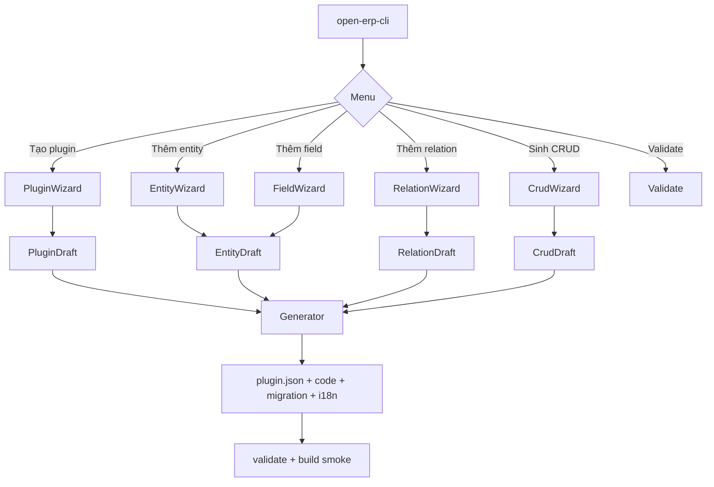

# [SOL-S06-001] Kiến trúc template plugin 2.0 & CLI tương tác

| Trường | Giá trị |
| :--- | :--- |
| ID / loại / sprint | SOL-S06-001 / Giải pháp kiến trúc / Sprint 06 |
| Trạng thái / phiên bản / cập nhật | **APPROVED — 2026-10-29** / 1.0 / 2026-10-29 |
| Owner / reviewer | Solution Architect / Chủ dự án + Developer |
| Đầu vào | [CONF-S06-001](../04_confirmation/01_CONF-S06-001_sprint_06_scope_and_questions.md) 1.0 (APPROVED), [ANL-S06-001](../02_analysis/01_ANL-S06-001_template_and_cli_interactive.md), [TASK-407](../../sprint_05_catalog_plugin/07_items/TASK-407_cli_scaffold_zero_db.md) |
| Đọc trước / đọc tiếp | [CONF-S06-001](../04_confirmation/01_CONF-S06-001_sprint_06_scope_and_questions.md) / [ADR-S06-001](02_ADR-S06-001_core_rendered_ui_slots.md), [DES-ARCH-S06-001](../06_designs/arch/01_DES-ARCH-S06-001_plugin_platform_architecture.md) |

## 1. Mục đích

Chốt kiến trúc cho hai luồng đầu của Sprint 06:

1. Template plugin **zero-DB, đúng runtime Sprint 05**.
2. CLI **tương tác** tạo plugin/entity/field/relation/CRUD, sinh mã Angular + Java, validate và migrate plugin cũ.

Tài liệu này là quyết định kiến trúc; đặc tả file/tham số chi tiết nằm ở [DES-ARCH-S06-002](../06_designs/arch/02_DES-ARCH-S06-002_cli_interactive_and_codegen.md) và [DES-API-S06-001](../06_designs/api/01_DES-API-S06-001_manifest_and_ui_manifest.md).

## 2. Quyết định kiến trúc

| # | Quyết định | Lý do | Trạng thái |
| :--- | :--- | :--- | :--- |
| **D1** | Phát hành **template bundle 2.0.0**; plugin mới ghi `template_version: 2.0.0` | Tách khỏi template 0.x còn Panache/Flyway | Accepted |
| **D2** | Plugin backend chỉ còn **POJO + DTO + service + resource + query descriptor**; không JPA/JDBC/Flyway/datasource/`TENANT_ID` | Đúng ADR-S05-001/002, TASK-402 | Accepted |
| **D3** | Core sở hữu schema/migration; plugin khai báo `migrations[]` (file + SHA-256); plugin không tự chạy Flyway | Zero-DB, least privilege | Accepted |
| **D4** | `plugin-sdk` là dependency bắt buộc cho API envelope, error code, response key, tenant/permission filter, `PluginDataClient` | Không lặp runtime ở từng plugin | Accepted |
| **D5** | Manifest mở rộng: `entities[].fields[]`, `entities[].validators[]`, `relations[]`, `ui_manifest.{screens,slots,contributions,crud}` | Một nguồn sự thật cho CLI/Core/UI | Accepted |
| **D6** | CLI dùng **`node:readline/promises`**, không thêm thư viện prompt | Giữ zero-dependency; đã dùng ở `create` | Accepted |
| **D7** | Bare `open-erp-cli` mở menu; mọi lệnh hỗ trợ `--interactive`; flag + `--non-interactive` giữ cho CI | Q10 A; không phá workflow cũ | Accepted |
| **D8** | Tách **prompt → draft → generator**: prompt chỉ thu thập; generator thuần sinh file; draft có thể serialize để test | Dễ test, idempotent, không trộn UI với file I/O | Accepted |
| **D9** | `generate entity` sinh **entity + field + migration + permission + query descriptor + DTO + service + resource + test backend** | Q7 B + Q8 B | Accepted |
| **D10** | `generate crud` sinh **Angular list + form drawer + service + route + i18n**; không sinh `.spec.ts` | Q7 B; policy frontend no unit test | Accepted |
| **D11** | Quan hệ: **FK trong cùng schema plugin**; **soft reference** (UUID + display text) tới Core/plugin khác | Q9 B; schema riêng không FK xuyên plugin | Accepted |
| **D12** | `validate` mặc định offline (schema/manifest/migration/field/relation syntax); `--core-url` kiểm tra Entity Registry + UI Slot Registry | Q16 A; CI không phụ thuộc Core | Accepted |
| **D13** | `upgrade --check/--apply` migrate plugin cũ sang template 2.0; **catalog là plugin cũ duy nhất** phải migrate | Q11 B; không phá dữ liệu | Accepted |
| **D14** | Mọi generator **idempotent**: file tồn tại → dừng, yêu cầu `--force`; không merge file người dùng đã sửa | Tránh mất code | Accepted |
| **D15** | Template web mặc định **Web Component**; Module Federation là tùy chọn cho plugin có build MF | Q6 A; WC đơn giản hơn cho catalog/notification | Accepted |
| **D16** | Smoke test CI: `create → generate entity → generate crud → validate → mvn package → web build` | Template lỗi phải phát hiện trước khi giao | Accepted |
| **D17** | Không sinh code trực tiếp vào `src/frontend/web` của Core; chỉ sinh trong repo plugin | Giữ Core không import plugin | Accepted |
| **D18** | Template 2.0 đặt plugin trong **monorepo `plugins/<id>`** để dùng `@shared`; repo plugin độc lập ngoài monorepo cần package UI SDK riêng (follow-up) | `@shared` hiện là source path mapping, chưa publish npm; catalog cũng nằm trong monorepo | Accepted (giới hạn S06) |

## 3. Cấu trúc template 2.0

```text
<plugin>/
├── plugin.json                       # manifest 2.0
├── pom.xml                           # Quarkus + plugin-sdk; không JDBC/Panache/Flyway
├── README.md
├── src/main/java/<package>/
│   ├── model/<Entity>.java           # POJO
│   ├── dto/<Entity>Dto.java
│   ├── service/<Entity>Service.java  # PluginDataClient
│   ├── resource/<Entity>Resource.java
│   └── query/<Entity>Queries.java    # descriptor builder
├── src/main/resources/
│   ├── application.properties        # gateway/redis/TLS; không datasource
│   └── migrations/V1.0.0__initial_schema.sql
├── src/test/java/<package>/          # JUnit + RestAssured PostgreSQL/Redis thật
├── web/                              # Angular 22 standalone
│   ├── src/plugin-main.ts            # entry screen (WC/MF)
│   ├── src/contributions/<id>.ts     # entry contribution
│   ├── src/app/features/<entity>/    # list/form/drawer sinh tự động
│   ├── src/styles.css                # Tailwind entry riêng
│   └── public/i18n/{vi,en}.json
├── deploy/Dockerfile
├── deploy/k8s.yaml
└── ci/github-actions.yml
```

**Quy ước:** package `com.vn9melody.openerp.plugins.<id không dấu gạch>`; table `plg_<plugin_snake>_<entity_snake>s`; permission `<plugin>:<entity-kebab>:read|create|update|delete`; tất cả id/table/permission do generator suy ra, không hỏi lại.

## 4. Mô hình manifest 2.0

```json
{
  "id": "in-app-notification",
  "version": "1.0.0",
  "template_version": "2.0.0",
  "entities": [
    {
      "name": "Notification",
      "table": "plg_in_app_notification_notifications",
      "storage_scope": "TENANT",
      "fields": [
        { "name": "title", "type": "string", "required": true, "max_length": 255 },
        { "name": "level", "type": "enum", "enum_values": ["INFO", "WARN", "ERROR"], "default": "INFO" },
        { "name": "recipient_id", "type": "uuid", "required": true }
      ],
      "validators": [
        { "field": "title", "rule": "max_length", "value": 255 }
      ]
    }
  ],
  "relations": [
    {
      "name": "recipient",
      "owner_entity": "Notification",
      "type": "MANY_TO_ONE",
      "target": "core.user",
      "storage": "SOFT_REF",
      "target_display_field": "full_name",
      "required": true,
      "on_delete": "RESTRICT"
    }
  ],
  "queries": [
    { "name": "notification.list", "operation": "LIST", "entity": "Notification", "filters": ["read_at", "level"] }
  ],
  "migrations": [
    { "version": "1.0.0", "file": "V1.0.0__initial_schema.sql", "checksum": "sha256:<64hex>" }
  ],
  "ui_manifest": {
    "contract_version": "1.0",
    "screens": [],
    "slots": [],
    "contributions": [
      {
        "id": "notification-bell",
        "slot": "core.layout.header.actions",
        "title_key": "PLUGIN_IN_APP_NOTIFICATION_HEADER",
        "render_mode": "WEB_COMPONENT",
        "entry": "/plugins-runtime/in-app-notification/contributions/header.js",
        "tag_name": "op-in-app-notification-bell",
        "permission": "in-app-notification:notification:read",
        "order": 10,
        "contract_version": "1.0",
        "platforms": ["desktop", "mobile"]
      }
    ],
    "crud": [
      {
        "entity": "Notification",
        "route": "/apps/in-app-notification/notifications",
        "columns": ["title", "level", "read_at", "created_at"],
        "filters": ["level", "read_at"],
        "form_fields": ["title", "body", "level"]
      }
    ]
  }
}
```

Chi tiết schema/validate: [DES-API-S06-001](../06_designs/api/01_DES-API-S06-001_manifest_and_ui_manifest.md).

## 5. Kiến trúc CLI

### 5.1. Thành phần

```text
tools/open-erp-cli/src/
├── commands/
│   ├── create.js              # wizard tạo plugin
│   ├── generate.js            # entity/field/relation/crud
│   ├── validate.js            # offline + --core-url
│   ├── upgrade.js             # check/apply template
│   └── misc.js                # dev/package/inspect
├── interactive/
│   ├── prompt.js              # text/confirm/select/multi/loop
│   ├── wizard.js              # menu + state machine
│   └── draft.js               # PluginDraft/EntityDraft/RelationDraft
├── lib/
│   ├── templates/v2/          # template bundle 2.0
│   ├── codegen/
│   │   ├── java.js            # model/dto/service/resource/query
│   │   ├── angular.js         # list/form/service/route/i18n
│   │   └── migration.js
│   ├── manifest.js            # đọc/ghi/validate
│   ├── checksum.js
│   └── fsx.js
└── test/                      # node --test
```

### 5.2. Luồng wizard



### 5.3. Câu hỏi tối thiểu

- **Plugin:** id, name, description, platforms, web?, packaging, storage scope mặc định, entity đầu tiên?
- **Entity:** name, table (mặc định), storage scope, fields?, relations?, CRUD?
- **Field:** name, type, required, unique, default, enum values, validator (min/max/pattern/email), label key.
- **Relation:** name, owner entity, target (`core.*`, `plugin:*.*`, `self.*`), cardinality, storage (FK/SOFT_REF), display field, required, on_delete.
- **CRUD:** entity, route, columns, filters, form fields, drawer/split, permission.
- **Review:** hiển thị tóm tắt + danh sách file sẽ ghi; xác nhận trước khi ghi.

### 5.4. Quy tắc sinh mã

1. `--dry-run` in danh sách file, không ghi.
2. File tồn tại → bỏ qua + cảnh báo; `--force` mới ghi đè (có xác nhận tương tác).
3. Ghi manifest **sau cùng**, sau khi tất cả file khác thành công; lỗi giữa chừng → rollback file đã tạo trong lần chạy.
4. Không sửa file ngoài phạm vi plugin; không ghi vào Core.
5. Migration version tăng theo patch hiện có; không sửa migration cũ.
6. i18n: thêm key vào `vi.json`/`en.json`; không hardcode trong template.
7. Sinh test backend tối thiểu; không sinh `.spec.ts`.

## 6. Luồng chính

**L1 — Tạo plugin mới**
`open-erp-cli` → PluginWizard → PluginDraft → generator ghi template 2.0 + manifest + entity đầu tiên (nếu có) → validate → in next steps.

**L2 — Thêm entity/field/relation**
`open-erp-cli generate entity --interactive` → đọc manifest hiện tại → EntityWizard/FieldWizard/RelationWizard → generator cập nhật manifest + file + migration → validate.

**L3 — Sinh CRUD**
`open-erp-cli generate crud --interactive` → đọc entity/field/relation → CrudWizard → sinh Angular + Java + manifest `ui_manifest.crud` → build smoke.

**L4 — Validate**
`open-erp-cli validate` → offline checks; `--core-url` → gọi `/api/v1/plugins/entity-registry`/`/api/v1/plugins/ui-slots` (hoặc endpoint tương đương) để kiểm tra target/slot.

**L5 — Migrate plugin cũ**
`open-erp-cli upgrade --check` → so sánh template 2.0 → báo file lệch; `--apply` → migrate có xác nhận; `catalog` migrate theo [ADR-S06-002](03_ADR-S06-002_iframe_removal_catalog_migration.md).

## 7. Phi chức năng

| Yêu cầu | Cách đáp ứng |
| :--- | :--- |
| Không phụ thuộc mạng | Validate offline; chỉ `--core-url` mới gọi API |
| Hiệu năng | Sinh file tuần tự; template nhỏ; không build trong lúc generate (trừ smoke CI) |
| An toàn | Không chạy shell tùy ý; chỉ `git init`, `mvn`, `npm` theo lệnh cố định |
| Test | Node test cho prompt/draft/generator; snapshot manifest; build smoke |
| Tương thích | Template version + `upgrade --check`; không đổi plugin.json cũ nếu không migrate |
| Docs | README template + `create_new_plugin_guide` cập nhật cùng sprint |

## 8. Rủi ro & giảm thiểu

| Rủi ro | Mức | Giảm thiểu |
| :--- | :--- | :--- |
| Template 2.0 vẫn lệch runtime | High | Smoke test CI; đối chiếu `plugins/catalog`; build trong Docker |
| Sinh mã Angular/Java quá nhiều, khó bảo trì | High | Template nhỏ, codegen tập trung; test snapshot; review mẫu trước khi nhân rộng |
| Migrate catalog làm hỏng plugin | High | Kế hoạch phase + rollback; QA regression; không đổi API contract |
| Wizard dài, developer bỏ dở | Medium | Default thông minh; cho phép thoát giữa chừng; lưu draft? (không bắt buộc) |
| `--core-url` lệch API | Medium | Endpoint versioned; fallback offline; lỗi rõ ràng |
| File người dùng bị ghi đè | High | Idempotent + `--force` + rollback |

## 9. Việc bước 06 phải đặc tả

1. JSON schema manifest 2.0 + bảng field type/validator.
2. Danh sách file sinh ra cho từng lệnh, nội dung template, quy tắc idempotency.
3. Prompt flow chi tiết + test cases.
4. API Entity Registry/UI Slot cho `--core-url`.
5. Kế hoạch migrate catalog/template 2.0.
6. Test plan CLI + build smoke.

## 10. Lịch sử

| Phiên bản | Ngày | Thay đổi | Nguồn |
| :--- | :--- | :--- | :--- |
| 0.1 | 2026-10-29 | Chốt 17 quyết định template 2.0 + CLI; cấu trúc, manifest, luồng, rủi ro | Architect; CONF-S06-001 1.0 |
| 1.0 | 2026-10-29 | Chủ dự án duyệt design ready (Q17 + design review); Chốt 17 quyết định template 2.0 + CLI; cấu trúc, manifest, luồng, rủi ro | Architect; CONF-S06-001 1.0 |
