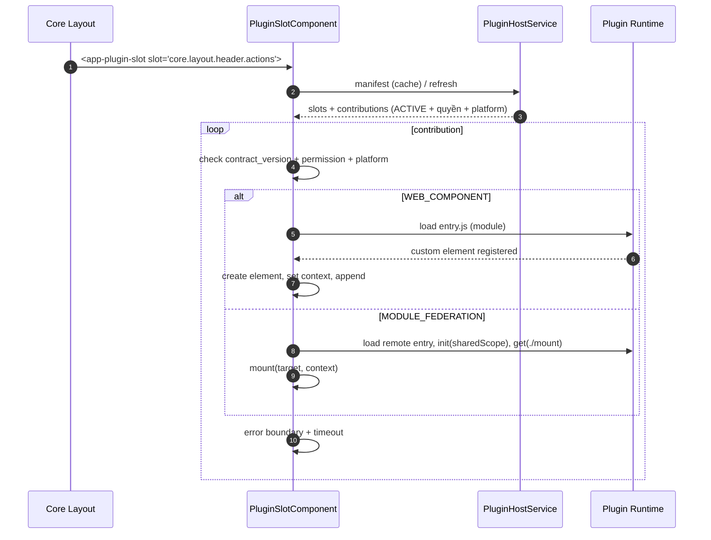

# [ADR-S06-001] Core render UI extension bằng slot–contribution

| Trường | Giá trị |
| :--- | :--- |
| ID / loại / sprint | ADR-S06-001 / Architecture Decision Record / Sprint 06 |
| Trạng thái / phiên bản / cập nhật | **Accepted (dev)** / 0.1 / 2026-10-29 |
| Owner / reviewer | Solution Architect / Chủ dự án + Developer + QA |
| Đầu vào | [CONF-S06-001](../04_confirmation/01_CONF-S06-001_sprint_06_scope_and_questions.md) 1.0, [ANL-S06-002](../02_analysis/02_ANL-S06-002_core_rendered_ui_slots.md), [SOL-03](../../sprint_03_plugin_manager/05_solutions/SOL-03_plugin_ui_extension_and_cli_dev_experience.md) |
| Đọc trước / đọc tiếp | [SOL-S06-001](01_SOL-S06-001_template_and_cli_architecture.md) / [ADR-S06-002](03_ADR-S06-002_iframe_removal_catalog_migration.md), [DES-UI-S06-001](../06_designs/ui/01_DES-UI-S06-001_slots_layout_and_settings.md) |

## 1. Bối cảnh

Backend đã có `GET /api/v1/plugins/ui-manifest` trả `screens` + `slots` + `contributions`, nhưng frontend chỉ dùng `screens`. Core chưa có component render slot; topbar/settings đang hardcode. Catalog dùng screen iframe. Yêu cầu Sprint 06: plugin chỉ đăng ký vị trí + component; Core render vào header và tab cấu hình hệ thống; **bỏ iframe hoàn toàn** (Q2 C).

## 2. Quyết định

| # | Quyết định | Lý do | Trạng thái |
| :--- | :--- | :--- | :--- |
| **A1** | **Core sở hữu slot chuẩn** (`core.*`); **plugin được khai báo slot namespaced** (`<pluginKey>.*`) | Q3 B; cho phép plugin mở rộng UI của chính plugin mà không xâm lấn Core | Accepted |
| **A2** | Slot v1: `core.layout.header.actions`, `core.settings.system.tabs`, `core.dashboard.widgets`, `core.settings.sections` | Q4 A+B+C+D | Accepted |
| **A3** | Contribution descriptor gồm `id`, `slot`, `title_key`, `render_mode`, `entry`, `tag_name`/`exposed_module`, `permission`, `order`, `contract_version`, `platforms`, `icon?` | Manifest declarative, đủ để Core render/filter | Accepted |
| **A4** | Renderer duy nhất: `PluginSlotComponent` trong `src/frontend/shared/plugin-host/`; plugin-hosted slot cũng dùng component này | Một nơi kiểm tra quyền/contract/error boundary | Accepted |
| **A5** | Chỉ **`WEB_COMPONENT`** và **`MODULE_FEDERATION`**; **không còn `IFRAME`** | Q2 C + Q6 A | Accepted |
| **A6** | Context bridge: WC dùng property + `CustomEvent` (`op:*`); MF dùng props/callback; contract versioned | Đồng bộ theme/i18n/auth/navigation | Accepted |
| **A7** | Plugin-hosted slot: manifest `ui_manifest.slots[]`, Core sync `plugin_ui_slots`, host render bằng shared outlet; contribution khác trỏ vào slot | Q3 B; mở rộng UI plugin an toàn | Accepted |
| **A8** | `contract_version` mismatch ⇒ **skip + log**, không làm hỏng layout; publish/validate cảnh báo | Q13; tránh plugin cũ phá Core | Accepted |
| **A9** | Manifest cache theo phiên; invalidate khi install/enable/disable/uninstall/upgrade | Tránh gọi API mỗi render | Accepted |
| **A10** | Error boundary per contribution + timeout tải + fallback i18n; 1 lỗi không làm hỏng slot | Yêu cầu ổn định | Accepted |
| **A11** | Trang `/settings/system` với tab Core + tab plugin; tab chọn qua URL (`?tab=` hoặc nested route) | Q5 A; bookmark/back | Accepted |
| **A12** | Mobile: header slot render nếu `platforms` có `mobile`; settings tab desktop-only trong S06 | Q14 A | Accepted |
| **A13** | Không cho tenant admin ẩn/đổi thứ tự contribution trong S06 | Q15 A; YAGNI | Accepted |
| **A14** | Backend UI Manifest trả thêm `id`, `tag_name`, `exposed_module`, `platforms` cho contribution; screen thêm `tag_name`/`entry` tùy chọn | Đủ dữ liệu cho loader | Accepted |
| **A15** | Không cho URL contribution tùy ý từ client; entry lấy từ manifest đã publish; CSP allowlist origin plugin | Bảo mật | Accepted |
| **A16** | Full-screen plugin dùng cùng cơ chế WC/MF; catalog chuyển sang WC | Q2 C + Q13 C; xem ADR-S06-002 | Accepted |

## 3. Mô hình slot–contribution

### 3.1. Core slots

| Slot | Vị trí | Render mode | Platform | Constraints |
| :--- | :--- | :--- | :--- | :--- |
| `core.layout.header.actions` | Topbar phải, trước user menu | WC/MF | desktop + mobile | tối đa 6, cao 32–40px |
| `core.settings.system.tabs` | `/settings/system`, mỗi contribution = 1 tab | WC/MF | desktop | tối đa 12 tab |
| `core.dashboard.widgets` | Dashboard | WC/MF | desktop | tối đa 6, min height 120px |
| `core.settings.sections` | Khu vực settings | WC/MF | desktop | tối đa 10 |

### 3.2. Plugin-hosted slot

Plugin khai báo trong `ui_manifest.slots[]`:

```json
{
  "slot_code": "crm.customer.detail.tabs",
  "title_key": "PLUGIN_CRM_SLOT_CUSTOMER_TABS",
  "contract_version": "1.2",
  "allowed_render_modes": ["WEB_COMPONENT", "MODULE_FEDERATION"],
  "constraints": { "max_contributions": 8, "min_height_px": 120 }
}
```

- `slot_code` bắt buộc bắt đầu bằng `<pluginKey>.`; cấm `core.*`.
- Core sync `plugin_ui_slots` khi publish; manifest version host là nguồn sự thật runtime.
- Plugin host render `<app-plugin-slot slot="crm.customer.detail.tabs" />` trong UI của mình.
- Contribution khác trỏ vào slot; Core resolve `host.installed_version` + `contract_version`; mismatch ⇒ skip + log `PLUGIN_UI_SLOT_CONTRACT_MISMATCH`.
- Tắt plugin host ⇒ slot/contribution không render.

### 3.3. Contribution descriptor

```json
{
  "id": "notification-bell",
  "slot": "core.layout.header.actions",
  "title_key": "PLUGIN_IN_APP_NOTIFICATION_HEADER",
  "render_mode": "WEB_COMPONENT",
  "entry": "/plugins-runtime/in-app-notification/contributions/header.js",
  "tag_name": "op-in-app-notification-bell",
  "permission": "in-app-notification:notification:read",
  "order": 10,
  "contract_version": "1.0",
  "platforms": ["desktop", "mobile"]
}
```

- `id` unique trong plugin; dùng telemetry/disable.
- `entry` bắt buộc với contribution; Core không nhận URL từ client.
- `tag_name` bắt buộc với WC; `exposed_module` mặc định `./mount` với MF.
- `permission` null = mọi user đã đăng nhập; vẫn phải qua lifecycle ACTIVE.
- `order` nhỏ trước; `platforms` lọc desktop/mobile.

## 4. Luồng render



## 5. Context contract

| Khóa | WC | MF | Ghi chú |
| :--- | :--- | :--- | :--- |
| `theme` | attribute/property `theme` | prop `theme` | `light`/`dark` |
| `language` | `language` | prop `language` | `vi`/`en`/… |
| `direction` | `direction` | prop `direction` | `ltr`/`rtl` |
| `tenant` | JSON property | prop `tenant` | `{id,name}` |
| `user` | JSON property | prop `user` | `{id,name,email}` |
| `permissions` | JSON property | prop `permissions` | `string[]` |
| `apiBaseUrl` | `api-base-url` | prop `apiBaseUrl` | gateway base |
| `navigate` | event `op:navigate` | callback `navigate` | `{path}` |
| `notify` | event `op:notify` | callback `notify` | `{level, code, params}` |
| `resize` | event `op:resize` | callback `resize` | `{height}` |

**Quy ước:**

- WC: property JSON được set trước khi append; event `bubbles: true, composed: true`.
- MF: `mount(target, context)` trả `{ unmount }`; loader gọi `unmount` khi destroy.
- Không truyền token thô; component gọi API qua interceptor JWT của Core hoặc gateway.
- Component không hardcode màu/chuỗi; dùng CSS custom properties + i18n key.

## 6. Error boundary & bảo mật

| Lớp | Biện pháp |
| :--- | :--- |
| Lifecycle | Chỉ plugin `ACTIVE` + tenant hiện tại; tắt plugin ⇒ manifest không trả contribution |
| Quyền | Lọc ở backend + kiểm tra lại trước mount; thiếu quyền ⇒ không tải entry |
| Contract | `contract_version` major mismatch ⇒ skip + log; publish validate |
| Tải | Timeout 10s; retry 1 lần; fallback “không thể hiển thị” |
| Cô lập | WC: `isolation` (`shadow` mặc định cho widget, `light` cho full-screen app); MF: shared scope version pin |
| CSP | `script-src`/`connect-src`/`frame-src` allowlist origin runtime plugin; không `unsafe-eval` |
| Telemetry | Log `plugin_key`, `contribution_id`, `slot`, `error_code`; không log token/PII |
| Cache | Manifest cache + invalidate theo lifecycle; entry URL có version/cache-buster |

## 7. Hệ quả

- **Tích cực:** một cơ chế render thống nhất; plugin không tự sửa layout; header/tab cấu hình mở rộng được; bỏ iframe giảm phức tạp token/route bridge.
- **Tiêu cực:** WC/MF chạy trong origin Core ⇒ rủi ro CSS/JS cao hơn; cần CSP/error boundary/QA kỹ; plugin-hosted slot tăng contract complexity.
- **Trung tính:** iframe loader bị xoá sau migrate catalog; plugin cũ phải chuyển WC/MF (chỉ catalog).
- **Rủi ro còn lại:** Angular Elements + Tailwind global CSS; cần quy ước isolation và test browser.

## 8. Việc bước 06 phải đặc tả

1. `PluginSlotComponent` API, loader contract, error boundary, context bridge.
2. UI Manifest response mới (field contribution/screen).
3. Slot registry seed + sync plugin-hosted slot.
4. Layout header, `/settings/system`, dashboard/settings sections.
5. Notification plugin UI + catalog WC migration.
6. Test matrix: permission, lifecycle, contract mismatch, mobile, CSS isolation.

## 9. Lịch sử

| Phiên bản | Ngày | Thay đổi | Nguồn |
| :--- | :--- | :--- | :--- |
| 0.1 | 2026-10-29 | Chốt 16 quyết định slot/contribution; Core + plugin slots; bỏ iframe; context/error/security | Architect; CONF-S06-001 1.0 |
| 1.0 | 2026-10-29 | Chủ dự án duyệt design ready (Q17 + design review); Chốt 16 quyết định slot/contribution; Core + plugin slots; bỏ iframe; context/error/security | Architect; CONF-S06-001 1.0 |
