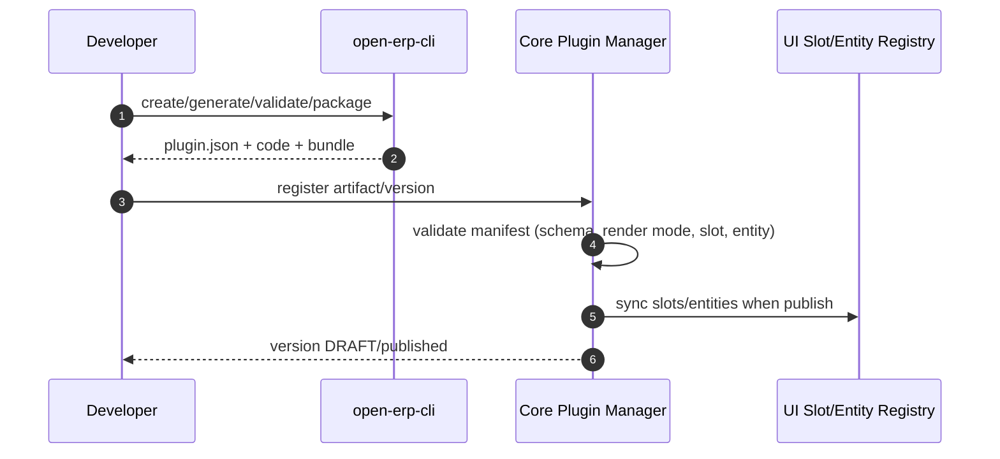
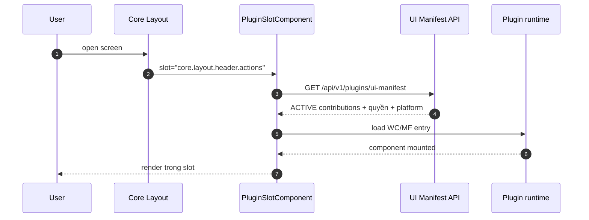
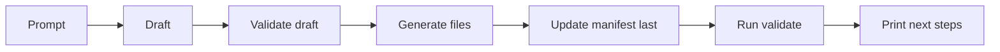

# [DES-ARCH-S06-001] Kiến trúc tổng thể nền tảng plugin Sprint 06

| Trường | Giá trị |
| :--- | :--- |
| ID / loại / sprint | DES-ARCH-S06-001 / Thiết kế kiến trúc / Sprint 06 |
| Trạng thái / phiên bản / cập nhật | **APPROVED — 2026-10-29** / 1.0 / 2026-10-29 |
| Owner / reviewer | Solution Architect / Developer + QA |
| Đầu vào | [CONF-S06-001](../../04_confirmation/01_CONF-S06-001_sprint_06_scope_and_questions.md) 1.0, [SOL-S06-001](../../05_solutions/01_SOL-S06-001_template_and_cli_architecture.md), [ADR-S06-001](../../05_solutions/02_ADR-S06-001_core_rendered_ui_slots.md), [ADR-S06-002](../../05_solutions/03_ADR-S06-002_iframe_removal_catalog_migration.md) |
| Đọc trước / đọc tiếp | [SOL/ADR-S06](../../05_solutions/) / [DES-ARCH-S06-002](02_DES-ARCH-S06-002_cli_interactive_and_codegen.md), [DES-API-S06-001](../api/01_DES-API-S06-001_manifest_and_ui_manifest.md), [DES-UI-S06-001](../ui/01_DES-UI-S06-001_slots_layout_and_settings.md) |

## 1. Mục đích

Mô tả ranh giới và thành phần của nền tảng plugin sau Sprint 06: Core, CLI, template, plugin `catalog` (migrate) và plugin `in-app-notification` (mới). Tài liệu này là bản đồ để triển khai; chi tiết manifest/API/DB/UI nằm ở các design chuyên biệt.

## 2. Thành phần

```text
┌─────────────────────────────────────────────────────────────────────┐
│ Core Backend (Quarkus)                                              │
│  ├─ Plugin Manager: lifecycle, versions, gateway, deployer          │
│  ├─ PluginUiManifestService: screens + slots + contributions        │
│  ├─ PluginUiSlotSyncService: sync plugin-hosted slots               │
│  ├─ EntityRegistryService: core/plugin entity public fields         │
│  ├─ PluginDataGateway (gRPC): query/migration cho plugin zero-DB     │
│  └─ REST: /api/v1/plugins/ui-manifest, /entity-registry, /ui-slots  │
└─────────────────────────────────────────────────────────────────────┘
             ▲                                   ▲
             │ manifest/API                      │ gRPC data
┌────────────┴────────────┐          ┌───────────┴───────────────────┐
│ Core Web (Angular 22)   │          │ Plugin runtime (container)     │
│  ├─ PluginHostService   │          │  ├─ Quarkus + plugin-sdk       │
│  ├─ PluginSlotComponent │          │  ├─ POJO/DTO/service/resource  │
│  ├─ WC/MF loaders       │          │  ├─ web WC/MF bundle           │
│  ├─ Topbar/Settings     │          │  └─ migrations/ + plugin.json  │
│  └─ Screen host         │          └────────────────────────────────┘
└─────────────────────────┘
             ▲
┌────────────┴────────────┐
│ @open-erp/cli (Node)    │
│  ├─ interactive wizard  │
│  ├─ codegen Angular/Java│
│  ├─ validate/upgrade    │
│  └─ template bundle 2.0 │
└─────────────────────────┘
```

## 3. Ranh giới trách nhiệm

| Thành phần | Sở hữu | Không được làm |
| :--- | :--- | :--- |
| Core backend | Plugin lifecycle, manifest, slot registry, entity registry, data gateway, migration executor | Không chứa nghiệp vụ plugin; không đọc/ghi schema plugin trực tiếp ngoài gateway |
| Core web | Layout, slot renderer, loaders, context, error boundary, route host | Không import source plugin; không hardcode menu/contribution |
| CLI | Scaffold, prompt, codegen, validate, upgrade | Không gọi production; không ghi vào Core; không chứa credentials |
| Plugin runtime | Nghiệp vụ, API, query descriptor, UI bundle | Không tự chạy migration DB; không tự thêm menu Core; không iframe |
| Plugin web | Screen + contribution component | Không sửa layout Core; không hardcode theme/i18n |

## 4. Luồng end-to-end

### 4.1. Publish plugin



### 4.2. Render slot



### 4.3. CLI generate



## 5. Build & đóng gói

| Thành phần | Build | Output |
| :--- | :--- | :--- |
| Core backend | Maven Quarkus | JAR/container |
| Core web | Angular 22 | `dist/` |
| Plugin backend | Maven Quarkus + `plugin-sdk` | `quarkus-app` container |
| Plugin web WC | Angular build `catalog-plugin`/plugin template | `META-INF/resources/main.js` (+ assets) |
| Plugin web MF (optional) | MF build của plugin | `remoteEntry.js` + exposed `./mount` |
| CLI | Node ≥22, zero runtime dep | npm package `@open-erp/cli` |
| Template | bundle trong CLI | `template_version: 2.0.0` |

**Quy ước:**

- Plugin WC entry ổn định (`main.js`), không hash; cache-buster theo version/gateway.
- Plugin MF entry `remoteEntry.js`; exposed `./mount` trả `{ mount(target, context), unmount() }`.
- Không build plugin web trong Core web (trừ catalog hiện đang dùng chung workspace; sẽ tách dần).
- Docker build plugin web trong image plugin (như catalog hiện tại).

## 6. Versioning & tương thích

| Contract | Version | Quy tắc |
| :--- | :--- | :--- |
| Plugin manifest | `schema_version`/`template_version` | CLI validate; Core từ chối manifest sai |
| UI slot | `contract_version` | Major mismatch ⇒ skip + log; publish cảnh báo |
| Contribution | `contract_version` | Khớp slot; thiếu ⇒ mặc định manifest `contract_version` |
| Plugin API | `/api/v1/...` | Không đổi trong S06; gateway giữ path |
| Core version | `core_version_compatibility` | Publish kiểm tra |

## 7. Bảo mật & tenant isolation

- Mọi API plugin đi qua gateway; `X-Tenant-Id`/`X-User-Id`/quyền do gateway ký/forward.
- UI Manifest chỉ trả plugin `ACTIVE` của tenant; system catalog có scope riêng.
- Contribution entry lấy từ manifest đã publish; CSP allowlist origin runtime.
- WC/MF chạy origin Core: error boundary + CSP + không `unsafe-eval`; review component.
- CLI không chứa credentials; `dev` chỉ local.

## 8. Error handling

| Tình huống | Hành vi |
| :--- | :--- |
| Manifest API lỗi | Slot hiển thị fallback/không render; không crash layout |
| Contribution entry 404/timeout | Fallback “không thể hiển thị”; log telemetry |
| Contract mismatch | Skip contribution; log `PLUGIN_UI_SLOT_CONTRACT_MISMATCH` |
| Plugin tắt | Manifest không trả contribution; slot trống |
| Thiếu quyền | Không tải entry; API trả 403 |
| CLI generate lỗi | Rollback file đã tạo; manifest không đổi |

## 9. Test strategy

| Lớp | Test |
| :--- | :--- |
| Backend | JUnit + RestAssured PostgreSQL/Redis thật: manifest slot/contribution, permission, lifecycle, contract mismatch, plugin-hosted slot |
| CLI | `node --test`: prompt/draft/generator/validate/upgrade snapshot |
| Template smoke | `create → generate entity → generate crud → validate → mvn package → web build` |
| Browser | Desktop ≥1280, mobile 390×844: header slot, settings tab, catalog WC, notification plugin, 0 console error, overflow 0 |
| Regression | Catalog API/UI/mobile; existing plugin lifecycle |

## 10. Open issues

1. Angular Elements + Tailwind global CSS: cần quy ước isolation (light DOM scoped vs Shadow DOM) — chi tiết ở DES-UI.
2. MF build plugin: có thể phát hành sau WC nếu thời gian; vẫn giữ contract loader.
3. Catalog bundle size sau WC: cần đo, có thể tách chunk.
4. Platform system WC dùng token/platform scope: cần test riêng.
5. `@shared` chưa publish npm: template 2.0 chỉ hỗ trợ plugin trong monorepo `plugins/<id>` trong S06; plugin repo độc lập cần package UI SDK (follow-up).

## 11. Lịch sử

| Phiên bản | Ngày | Thay đổi | Nguồn |
| :--- | :--- | :--- | :--- |
| 0.1 | 2026-10-29 | Bản đồ thành phần, luồng, build, versioning, bảo mật, test | Architect; SOL/ADR-S06 |
| 1.0 | 2026-10-29 | Chủ dự án duyệt design ready (Q17 + design review); Bản đồ thành phần, luồng, build, versioning, bảo mật, test | Architect; SOL/ADR-S06 |
