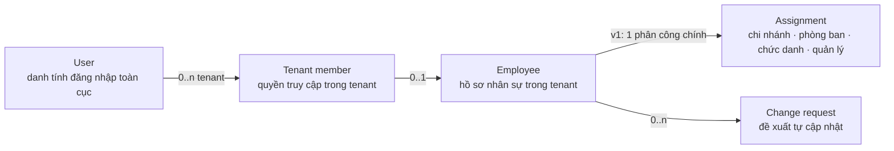

# [ANL-S07-001] Phân tích thân phận nhân viên, mô hình dữ liệu & vòng đời

| Trường | Giá trị |
| :--- | :--- |
| ID / loại / sprint | ANL-S07-001 / Phân tích / Sprint 07 |
| Trạng thái / phiên bản / cập nhật | Draft / 0.1 / 2026-10-29 |
| Owner / reviewer | BA Agent / Chưa review |
| Đầu vào | [RAW-S07-001](../01_raw_notes/01_RAW-S07-001_employee_plugin_requirements.md) (R1–R4), hiện trạng Core IAM/Organization, catalog Sprint 05 |
| Đọc trước / đọc tiếp | RAW-S07-001 / [ANL-S07-002](02_ANL-S07-002_admin_management_and_self_service.md), [BENCH-S07-001](../03_benchmarks/01_BENCH-S07-001_employee_profile_and_self_service.md), [CONF-S07-001](../04_confirmation/01_CONF-S07-001_sprint_07_scope_and_questions.md) |

## 1. Mục đích

Trước khi thiết kế CSDL/API, cần chốt **“nhân viên” là gì** trong một hệ multi-tenant đã có tài khoản, tenant membership và cơ cấu tổ chức. Tài liệu này:

1. Đối chiếu tài sản hiện có với khoảng trống của plugin.
2. Tách bốn khái niệm dễ trộn: **User**, **Tenant member**, **Employee**, **Assignment**.
3. Nêu phương án cho các quyết định lớn, kèm khuyến nghị và hệ quả.
4. Đề xuất mô hình khái niệm, quy tắc nghiệp vụ, edge case và phạm vi v1.

> Đây là phân tích, **không phải thiết kế CSDL cuối**. Mọi chi tiết bảng/cột/API được chốt ở bước 05–06 sau Confirmation Gate.

### 1.1. Quyết định đã chốt áp dụng vào phân tích

30/30 câu gốc đã trả lời tại [CONF-S07-001 0.2](../04_confirmation/01_CONF-S07-001_sprint_07_scope_and_questions.md). Các quyết định làm thay đổi mô hình so với bản nháp 0.1:

| # | Chốt | Ảnh hưởng tới mô hình |
| :--- | :--- | :--- |
| Q3 | Một hồ sơ, **nhiều phân công** | `EmployeeAssignment` 1–n; mỗi phân công có chi nhánh/phòng ban/chức danh/quản lý; một phân công chính |
| Q6 | **Always-on** | Provisioning mọi tenant; không gỡ; cần text fallback nếu catalog chưa cài |
| Q9 | **Thêm ngày hợp đồng** | Hợp đồng tối thiểu (loại/số/ngày) thuộc hồ sơ hoặc entity contract |
| Q10 | **Effective-dated đầy đủ** | Cần khoảng hiệu lực, as-of, future-dated, audit sửa hồi tố |
| Q11 | **Tự động khóa tài khoản + gỡ quyền** khi nghỉ | Offboarding tác động Core membership/account; cần xử lý cấp dưới |
| Q13 | Nhóm dữ liệu đúng đề xuất | Có giấy tờ/thuế/BHXH/học vấn/hợp đồng tối thiểu |
| Q17 | **Tài liệu đầy đủ** | Thêm `EmployeeDocument`, storage, virus scan, version, quyền, retention |
| Q20 | **Tenant tự cấu hình allowlist** | Cần cấu hình trường self-service theo tenant/nhóm |
| Q22 | **Duyệt nhiều cấp cấu hình** | State machine + chuỗi duyệt, delegation/reminder |
| Q23/Q24 | Self-onboarding + chiến dịch cập nhật | Link mời, theo dõi tiến độ, thông báo |
| Q29 | **Privacy đầy đủ** | Consent, DSAR, breach, retention, audit truy cập |
| Q41/Q53/Q54 | **Hai lớp**: organization giữ access membership; employee giữ HR assignment | Non-employee vẫn có scope; Core projection merge; không dual-write |
| Q47–Q52 | Tenant switcher trong header employee; auth endpoint Core | Không đổi mô hình employee; ảnh hưởng session/cache |

> Q31–Q38 (phasing, độ sâu effective-dated, quy tắc đa phân công, offboarding, always-on, duyệt, tài liệu, privacy) vẫn **Pending**; các đề xuất dưới đây có thể điều chỉnh sau khi chốt.

## 2. Hiện trạng và khoảng trống

| Tài sản hiện có | Phạm vi | Khoảng trống cho plugin employee |
| :--- | :--- | :--- |
| `users` | Danh tính đăng nhập toàn cục; email duy nhất; trạng thái tài khoản | Không có mã nhân viên, ngày vào làm, trạng thái lao động, dữ liệu HR |
| `user_profiles` | `full_name`, `phone`, `avatar_url`, `language`, `timezone` — **toàn cục**, không theo tenant | Không đủ dữ liệu HR; không tenant-scoped; không có lịch sử; dùng chung mọi tenant |
| `user_tenants` | Liên kết user–tenant, vai trò, `is_default`, `joined_at` | Là **quyền truy cập**, không phải quan hệ lao động; không có trạng thái nghỉ việc/thử việc |
| `branches` | Chi nhánh theo tenant: mã, tên, địa chỉ, trạng thái | Không có nhân viên thuộc chi nhánh |
| `departments` | Phòng ban theo tenant/chi nhánh, cây cha–con, `manager_user_id` | Không có hồ sơ nhân sự; `manager_user_id` là user, không phải employee |
| `user_department_memberships` | User ↔ chi nhánh/phòng ban; `direct_manager_user_id`, `title`, `is_primary`, `joined_at`; nhiều phòng ban, một primary | Không có lịch sử; `title` là text tự do; không có employment type/status; không phải hồ sơ HR |
| `user_branch_assignments` | User ↔ chi nhánh; `is_primary`, `can_manage` | Không có hồ sơ lao động |
| RBAC + data scope | Quyền chức năng, phạm vi `OWN_ONLY`/`BRANCH`/`OWN_AND_SUBORDINATES`… | Chưa có quyền `employee:*`; chưa có khái niệm “hồ sơ của tôi” |
| Catalog (Sprint 05) | Chức danh, Phòng ban, Loại hợp đồng, Ca làm việc, Trình độ học vấn | Chưa có entity nhân viên để tham chiếu; catalog “Phòng ban” **không** phải cây tổ chức |
| Plugin platform (Sprint 06) | Zero-DB, schema riêng, soft ref, Entity Registry, WC/MF | Cần manifest/registry cho `Employee`; chưa có plugin HR |

**Kết luận hiện trạng:** hệ thống đã có “người dùng thuộc tenant” và “phân công tổ chức”, nhưng **chưa có hồ sơ nhân sự**. Plugin employee phải bổ sung lớp hồ sơ, không được dựng lại tài khoản hay cây tổ chức.

**Nguồn đối chiếu hiện trạng:**

- [Sprint 02 — API organization/memberships](../../sprint_02_superadmin_rbac/06_designs/api/SUPERADMIN_RBAC_API_SPEC.md)
- [Sprint 05 — Catalog schema](../../sprint_05_catalog_plugin/06_designs/db/01_DES-DB-S05-001_catalog_schema.md)
- Mã nguồn: `src/backend/src/main/java/com/vn9melody/openerp/modules/organization/model/`, `.../modules/iam/model/`

## 3. Bốn khái niệm phải tách

| Khái niệm | Câu hỏi nó trả lời | Không nên dùng thay cho |
| :--- | :--- | :--- |
| **User** | “Người này đăng nhập bằng gì, là ai trên toàn hệ thống?” | Không phải hồ sơ HR; không phải quyền trong tenant |
| **Tenant member** | “Người này có được vào tenant không, vai trò gì?” | Không phải quan hệ lao động; có thể là cộng tác viên/khách |
| **Employee** | “Người này làm việc cho tenant với tư cách gì, hồ sơ HR ra sao?” | Không phải tài khoản; không phải phân quyền |
| **Assignment** | “Hiện tại làm chi nhánh/phòng ban nào, chức danh gì, báo cáo cho ai?” | Không phải toàn bộ lịch sử; không phải hợp đồng |

**Điểm dễ sai:** dùng `user_tenants` làm hồ sơ nhân viên, hoặc dùng `user_department_memberships` làm nguồn duy nhất cho HR. Cả hai đều không có trạng thái lao động, ngày vào làm, dữ liệu cá nhân, lịch sử và không hỗ trợ nhân viên không có tài khoản.

## 4. Các quyết định mô hình

### 4.1. Nhân viên có tách khỏi tenant member không?

| Phương án | Mô tả | Ưu | Nhược | Đánh giá |
| :--- | :--- | :--- | :--- | :--- |
| **A. Tách, liên kết tùy chọn** | `employee` là entity riêng; `user_id` nullable; tenant member vẫn do Core quản lý | Hỗ trợ nhân viên không tài khoản, cộng tác viên/khách, một user nhiều tenant; đúng mô hình Odoo/ERPNext/SAP | Cần quy tắc liên kết/đồng bộ; HR phải tạo hồ sơ riêng | **Khuyến nghị** |
| **B. Gộp: mọi member là employee** | Tạo employee tự động từ `user_tenants` | Ít bước nhập; mọi người đều có hồ sơ | Không phân biệt nhân viên với khách/cộng tác viên; khó hỗ trợ người chưa có tài khoản; mọi tenant member bị ép thành HR record | Không khuyến nghị |
| **C. Hybrid** | Member nội bộ tự tạo employee; vẫn cho phép employee không tài khoản | Linh hoạt | Thêm trạng thái “internal/external”; scope và UI phức tạp hơn | Cân nhắc sau v1 |

**Đã chốt Q1 = A.** “Thân phận nhân viên” là **thuộc tính nghiệp vụ của tenant**, không phải thuộc tính đăng nhập. Một user có thể là nhân viên tenant A, cộng tác viên tenant B và không thuộc tenant C.

### 4.2. Có hỗ trợ nhân viên không có tài khoản?

| Phương án | Mô tả | Đánh giá |
| :--- | :--- | :--- |
| **A. Có** | Tạo hồ sơ trước bằng mã/tên/email cá nhân; mời tài khoản sau; self-service chỉ mở khi đã liên kết | **Khuyến nghị** — phù hợp onboarding nhà máy/chi nhánh, nhân viên chưa có email công ty; Odoo/ERPNext đều hỗ trợ |
| **B. Không** | Phải có tenant member trước khi tạo employee | Đơn giản hơn nhưng chặn HR onboarding; không đáp ứng “quản lý nhân viên của chi nhánh” nếu người đó chưa có tài khoản |
| **C. Có nhưng tối thiểu** | Chỉ cho tạo “hồ sơ nháp” với vài trường, không phân công/không HR đầy đủ | Nửa vời; khó dùng thực tế |

**Đã chốt Q2 = A**, kèm quy tắc: nhân viên chưa liên kết không có self-service; khi liên kết phải là tenant member (hoặc mời trước).

### 4.3. Quan hệ số lượng

| Quan hệ | Khuyến nghị v1 | Ghi chú |
| :--- | :--- | :--- |
| User ↔ Employee trong **một tenant** | Tối đa 1–1 | Một user không nên có hai hồ sơ nhân viên trong cùng tenant; nếu cần nhiều hợp đồng, dùng nhiều assignment/employment (Q3) |
| User ↔ Employee **xuyên tenant** | 1–n | Mỗi tenant một hồ sơ/mã riêng; không chia sẻ dữ liệu HR |
| Employee ↔ Assignment | **1–n (Q3 = A)** | Một hồ sơ có nhiều phân công; đúng một phân công chính tại một thời điểm; lịch sử append-only |
| Employee ↔ Change request | 1–n; v1 tối đa 1 `PENDING` | Request mới phải rút/gộp; giữ lịch sử request cũ |

### 4.4. Nguồn sự thật cho phân công

| Phương án | Mô tả | Ưu | Nhược | Đánh giá |
| :--- | :--- | :--- | :--- | :--- |
| **A. Organization plugin canonical** | Organization plugin sở hữu branch/department/access membership; employee HR assignment tham chiếu | Một nguồn access; non-employee OK; employee nhẹ | Employee HR assignment vẫn cần lưu riêng | Một phần của mô hình hai lớp |
| **B. Hai lớp (organization access + employee HR)** | Organization giữ access membership; employee giữ HR assignment; Core projection merge | Tách bạch access/HR; không phụ thuộc hoàn toàn; non-employee OK | Cần sync một chiều + reconciliation | **Đã chốt Q41 = A, Q53 = A, Q54 = A** |
| **C. Hai nguồn độc lập** | Mỗi bên giữ assignment riêng | Không cần đồng bộ | Hai nguồn sự thật, rò rỉ quyền sai | **Loại** |

**Đã chốt B.** Quy tắc:

1. Organization plugin là nguồn sự thật cho **branch/department master + access membership** của mọi tenant member.
2. Employee plugin là nguồn sự thật cho **HR assignment** của employee (chức danh, phân công, hiệu lực).
3. Khi HR assignment thay đổi, employee plugin gọi API organization cập nhật access membership (một chiều, audit); không dual-write.
4. Core **không** query bảng plugin; đọc `core_user_scope_projection` merge hai nguồn.
5. Projection phải rebuild được; nếu stale/thiếu, fail-safe (không mở rộng quyền).
6. Non-employee chỉ có access membership trong organization; không cần hồ sơ nhân viên.
7. Cả hai plugin always-on; nếu một plugin lỗi, projection vẫn phục vụ phần còn lại + cảnh báo/rebuild.

> Nếu chủ dự án chọn Q2 = “không”, phương án A đơn giản hơn và nên được ưu tiên.

### 4.5. Mã nhân viên

- Là **định danh nghiệp vụ** trong tenant, khác `user_id` và `employee.id`.
- Duy nhất trong tenant; **không tái sử dụng** sau khi nghỉ việc.
- Bất biến sau khi hồ sơ được kích hoạt; đổi mã = tạo hồ sơ mới hoặc thao tác quản trị có audit đặc biệt.
- **Đã chốt Q7 = C**: auto `NV` + số thứ tự theo tenant, cho phép nhập tay khi tạo; bất biến sau khi kích hoạt.

### 4.6. Vòng đời trạng thái

| Trạng thái | Ý nghĩa | Có self-service? |
| :--- | :--- | :--- |
| `DRAFT` | Hồ sơ mới, chưa vào làm/chưa đủ dữ liệu | Không |
| `PROBATION` | Đang thử việc | Có (nếu đã có tài khoản) |
| `ACTIVE` | Đang làm việc chính thức | Có |
| `SUSPENDED` | Tạm hoãn/tạm khóa lao động (không phải khóa tài khoản) | Chỉ đọc |
| `LEFT` | Đã nghỉ việc/chấm dứt | Chỉ đọc, không sửa |
| `RETIRED` | Nghỉ hưu (nếu cần tách khỏi `LEFT`) | Chỉ đọc |

**Không dùng status để biểu diễn nghỉ phép/thai sản** — đó là dữ liệu attendance/leave của plugin khác. “Sa thải” là **lý do nghỉ việc**, không phải status riêng.

### 4.7. Lịch sử và hiệu lực

| Phương án | Mô tả | Đánh giá |
| :--- | :--- | :--- |
| **A. Chỉ trạng thái hiện tại + audit log** | Sửa ghi đè; audit ghi before/after | Rẻ, nhưng HR khó xem quá trình công tác |
| **B. Hiện tại + lịch sử append-only** | Bảng lịch sử ghi thay đổi chi nhánh/phòng ban/chức danh/quản lý/status, `effective_date` | Đủ nhu cầu HR cơ bản; không hỗ trợ future-dated/as-of |
| **C. Effective-dated đầy đủ** | Mọi thay đổi có khoảng hiệu lực, hỗ trợ future-dated, as-of, sửa hồi tố có lý do | **Đã chốt Q10 = C**; mạnh như SAP/Workday, nhưng cần kiểm soát chồng lấn và audit |

**Đã chốt C.** Hệ quả bắt buộc:

1. **Khoảng hiệu lực** trên assignment/status/contract (`valid_from`, `valid_to`); bản ghi hiện tại là bản có khoảng chứa `now()`.
2. **As-of**: API đọc nhận `as_of`; UI xem lịch sử read-only.
3. **Future-dated**: cho phép đặt thay đổi trong tương lai; không áp dụng trước ngày hiệu lực; cần job/kiểm tra khi đọc.
4. **Sửa hồi tố**: cho phép nhưng bắt buộc lý do + audit; không ghi đè im lặng.
5. **Chống chồng lấn**: ràng buộc khoảng hiệu lực ở DB (PostgreSQL range/EXCLUDE nếu khả thi) + kiểm tra service.
6. **Q32** sẽ chốt có cần future-dated + sửa hồi tố hay chỉ as-of; mô hình trên chuẩn bị cho phương án đầy đủ.

### 4.8. Dữ liệu cá nhân: hồ sơ HR vs hồ sơ tài khoản

`user_profiles` là **danh tính toàn cục** (tên hiển thị, phone, avatar, ngôn ngữ). `employee` là **hồ sơ HR theo tenant** (tên pháp lý, ngày sinh, CCCD, địa chỉ, liên hệ khẩn cấp…). Hai bên có thể lệch nhau:

- Nhân viên đổi tên pháp lý → hồ sơ HR đổi; tên tài khoản toàn cục có đổi theo không?
- Nhân viên thuộc 2 tenant, mỗi tenant có tên/địa chỉ/CCCD khác nhau (hiếm) → không được ghi đè chéo.

**Khuyến nghị:** không tự động đồng bộ hai chiều. Hồ sơ HR là tenant-scoped; cập nhật `user_profiles` chỉ khi người dùng chủ động hoặc có quy tắc rõ (Q14). Tránh một tenant sửa tên pháp lý làm đổi danh tính toàn hệ thống.

### 4.9. Nhóm dữ liệu và độ nhạy cảm

| Nhóm | Ví dụ | v1? | Độ nhạy cảm |
| :--- | :--- | :--- | :--- |
| Định danh | Mã NV, họ tên, ảnh, ngày sinh, giới tính, quốc tịch, hôn nhân | Có | Trung bình |
| Liên hệ | Email công ty/cá nhân, phone, địa chỉ hiện tại/thường trú, liên hệ khẩn cấp | Có | Trung bình |
| Công việc | Chi nhánh, phòng ban, chức danh, quản lý, loại lao động, ngày vào làm/thử việc/chính thức/nghỉ | Có | Thấp–trung bình |
| Giấy tờ | CCCD/hộ chiếu, ngày cấp, nơi cấp | Có | **Cao** |
| Thuế/BHXH/BHYT | Mã số thuế, số BHXH, số BHYT | Có | **Cao** |
| Ngân hàng | Ngân hàng, số tài khoản, chủ tài khoản | Phase 2 (gắn payroll) | **Cao** |
| Học vấn | Trình độ, trường, chuyên ngành, năm tốt nghiệp | Có (1 mức cao nhất) | Thấp |
| Kinh nghiệm/chứng chỉ | Quá trình làm việc, chứng chỉ | Phase 2 | Thấp |
| Gia đình/người phụ thuộc | Vợ/chồng, con, người phụ thuộc | Phase 2 (thuế) | **Cao** |
| Hợp đồng | Loại, số, ngày hiệu lực, ngày hết hạn | **Có** (Q9) | Trung bình |
| Tài liệu | Scan CCCD, hợp đồng, bằng cấp; version/quyền/scan/retention | **Có** (Q17) | **Cao** |
| Lương/phụ cấp | Lương cơ bản, phụ cấp, BHXH | **Ngoài scope** — payroll | **Rất cao** |

## 5. Mô hình khái niệm đề xuất

> Chưa phải schema cuối; dùng để chốt scope và thiết kế ở bước 06.

| Thực thể khái niệm | Trách nhiệm | Khóa/Quan hệ chính |
| :--- | :--- | :--- |
| `Employee` | Hồ sơ nhân sự hiện tại trong tenant | `id`, `tenant_id`, `employee_code`, `user_id` (nullable), `status`, nhóm dữ liệu cá nhân, ngày vào làm/thử việc/chính thức/nghỉ |
| `EmployeeAssignment` | Phân công 1–n, effective-dated | `employee_id`, `branch_id`, `department_id`, `job_title`, `job_title_catalog_id`, `manager_employee_id`, `is_primary`, `valid_from`, `valid_to` |
| `EmployeeContract` | Hợp đồng tối thiểu + lịch sử | `employee_id`, `contract_type`, `contract_no`, `start_date`, `end_date`, `status`, `valid_from/to` |
| `EmployeeJobHistory` | Audit/lịch sử thay đổi bổ trợ | `employee_id`, `change_type`, `effective_date`, `old_values`, `new_values`, `actor_user_id`, `source`, `reason` |
| `EmployeeChangeRequest` | Đề xuất tự cập nhật | `employee_id`, `requested_by_user_id`, `status`, `changes` (diff), `current_step`, `reviewed_at`, `rejection_reason` |
| `EmployeeChangeRequestStep` | Chuỗi duyệt nhiều cấp | `request_id`, `step_no`, `approver_role/user_id`, `status`, `acted_at` |
| `EmployeeDocument` | Tài liệu đính kèm | `employee_id`, `document_type`, `version`, `storage_key`, `checksum`, `scan_status`, `retention_until` |
| `EmployeeFieldConfig` | Allowlist tenant cấu hình | `tenant_id`, `field_key`, `editable_by_employee`, `requires_approval`, `role/scope` |
| `EmployeeOnboardingInvite` | Link self-onboarding | `employee_id`/`email`, `token_hash`, `expires_at`, `status` |
| `EmployeeUpdateCampaign` | Chiến dịch yêu cầu cập nhật | `tenant_id`, `filter`, `deadline`, `status`, `recipients` |
| `EmployeePrivacyRequest` | Consent/DSAR/breach (Q29) | `employee_id`/`user_id`, `request_type`, `status`, `payload`, `due_at` |

**Quan hệ với Core:**

- `tenant_id` → tenant đã xác thực (bắt buộc, không null).
- `user_id` → `users.id` (soft ref, nullable; nếu có thì phải là tenant member).
- `branch_id` / `department_id` → `branches.id` / `departments.id` (soft ref; cùng tenant; department phải thuộc branch nếu Core yêu cầu) — nằm trên **assignment**, không trên employee.
- `job_title` → text + `catalog_item_id` tùy chọn (catalog `JOB_TITLE`) — nằm trên assignment.
- `manager_employee_id` → `Employee.id` cùng tenant (không trỏ user trực tiếp để giữ lịch sử khi người quản lý nghỉ việc) — nằm trên assignment nếu Q33 chốt.

## 6. Quy tắc nghiệp vụ đề xuất

| ID | Quy tắc | Ghi chú |
| :--- | :--- | :--- |
| BR-01 | Mọi truy vấn/ghi employee phải có `tenant_id` từ context đã xác thực; không nhận `tenant_id` từ client | Tenant isolation |
| BR-02 | `employee_code` duy nhất trong tenant, không tái sử dụng, bất biến sau kích hoạt | Q7 |
| BR-03 | Một user tối đa một employee trong cùng tenant; liên kết yêu cầu user là tenant member | Q1/Q2 |
| BR-04 | Employee có thể tồn tại không có `user_id`; self-service chỉ mở khi đã liên kết | Q2 |
| BR-05 | Liên kết/bỏ liên kết tài khoản phải audit; bỏ liên kết không xóa hồ sơ | An toàn dữ liệu |
| BR-06 | Chuyển trạng thái theo ma trận hợp lệ; `exit_date >= hire_date`; `probation_end_date >= hire_date` | Q8/Q9 |
| BR-07 | Không xóa cứng employee đã kích hoạt; dùng archive/`LEFT` | Lịch sử/tham chiếu |
| BR-08 | Phân công phải trỏ branch/department cùng tenant; department phải thuộc branch nếu Core yêu cầu | Q5 |
| BR-09 | Quản lý trực tiếp phải là employee `ACTIVE`/`PROBATION` cùng tenant; không tự quản lý mình; không tạo chu trình | Core đã có chống cycle; plugin kiểm tra lại |
| BR-10 | Đa phân công: đúng một phân công chính tại một thời điểm; phân công phụ không được chồng khoảng hiệu lực; mỗi phân công có branch/department/manager riêng (theo Q33) | Q3 |
| BR-11 | Thay đổi công việc/trạng thái/hợp đồng dùng **effective-dated**; as-of trả đúng trạng thái; future-dated không áp dụng trước ngày; sửa hồi tố phải có lý do/audit | Q10 |
| BR-12 | Self-service chỉ đọc/ghi hồ sơ của chính mình; server resolve từ JWT, bỏ qua `employee_id` client gửi | Chống IDOR |
| BR-13 | Self-service chỉ sửa trường trong **allowlist tenant cấu hình**; trường nhạy cảm/job/status chỉ đọc hoặc gửi request | Q20 |
| BR-14 | Change request không được tự duyệt; duyệt/từ chối phải có quyền; từ chối phải có lý do | Q21/Q22 |
| BR-15 | Nếu hồ sơ thay đổi kể từ lúc gửi request, request chuyển `CONFLICT` và yêu cầu gửi lại | Tránh ghi đè |
| BR-16 | Trường nhạy cảm bị mask ở danh sách; xem chi tiết cần quyền; ghi audit truy cập | Q27 |
| BR-17 | Export cần quyền riêng; mặc định không xuất trường nhạy cảm | Q28 |
| BR-18 | Gỡ tenant membership của employee đang `ACTIVE`/`PROBATION` bị chặn, trừ khi offboard trước | Q11 |
| BR-19 | Offboard **tự động khóa tài khoản + gỡ tenant membership/roles** sau xác nhận; hồ sơ giữ lại; chặn nếu còn cấp dưới chưa bàn giao | Q11/Q34 |
| BR-20 | Rehire dùng lại hồ sơ/mã cũ, tạo giai đoạn làm việc mới; không tái sử dụng mã cho người khác; phải mời lại tài khoản | Q12 |
| BR-21 | Import kiểm tra trùng mã/email, chạy dry-run, báo lỗi theo dòng, không ghi một phần nếu header sai | Q19 |
| BR-22 | Hợp đồng có ngày hiệu lực/hết hạn; không chồng lấn cùng loại nếu Q33 chốt; hợp đồng hết hạn không tự đổi trạng thái employee | Q9 |
| BR-23 | Tài liệu phải qua kiểm tra loại/kích thước/virus; version bất biến; quyền xem/tải theo role; retention theo chính sách | Q17 |
| BR-24 | Chuỗi duyệt cấu hình theo nhóm trường/phòng ban; mỗi cấp một người duyệt; delegation/reminder theo Q36 | Q22 |
| BR-25 | Self-onboarding link có hạn, dùng một lần; chỉ điền trường cho phép; HR duyệt/tạo hồ sơ; chống trùng mã/email | Q23 |
| BR-26 | Chiến dịch cập nhật chỉ gửi cho nhóm hợp lệ; theo dõi trạng thái; không tự sửa hồ sơ | Q24 |
| BR-27 | Privacy: consent theo mục đích; DSAR export/delete; breach notification; retention; audit truy cập dữ liệu nhạy cảm | Q29 |

## 7. Trường hợp biên

| # | Tình huống | Hướng xử lý đề xuất |
| :--- | :--- | :--- |
| E1 | User đã là employee ở tenant khác | Cho phép; tạo hồ sơ riêng, không chia sẻ dữ liệu HR |
| E2 | User đã liên kết employee khác trong cùng tenant | Từ chối `EMPLOYEE_USER_ALREADY_LINKED` |
| E3 | Employee chưa có tài khoản truy cập self-service | Không có quyền; UI HR hiển thị “Chưa có tài khoản” + nút mời |
| E4 | Gỡ tenant membership trực tiếp khi employee đang ACTIVE | Chặn; phải offboard để hệ thống tự khóa/gỡ theo Q11 |
| E5 | Nhân viên đổi tên pháp lý | Cập nhật hồ sơ HR; không tự đổi `user_profiles` (Q14) |
| E6 | Quản lý trực tiếp nghỉ việc còn cấp dưới | Chặn offboard hoặc yêu cầu chọn quản lý mới cho cấp dưới trước |
| E7 | Chi nhánh/phòng ban bị archive khi còn nhân viên | Core đã chặn xóa; plugin hiển thị cảnh báo và yêu cầu chuyển |
| E8 | Hai nhân viên trùng CCCD | Cảnh báo trùng, không unique cứng (CCCD có thể đổi/không bắt buộc) |
| E9 | HR sửa cùng trường trong lúc request đang chờ | Request `CONFLICT`; yêu cầu nhân viên xem diff và gửi lại |
| E10 | Employee `LEFT` nhưng tài khoản chưa kịp khóa | Job khóa/gỡ quyền retry + cảnh báo; self-service chỉ đọc; audit |
| E11 | Rehire sau khi nghỉ | Dùng lại hồ sơ/mã; tạo giai đoạn mới; mời lại tài khoản; không xóa lịch sử cũ |
| E12 | Import trùng mã/email | Báo lỗi dòng; không tạo bản ghi trùng; cho phép `SKIP`/`UPDATE` theo cấu hình |
| E13 | Múi giờ/date-only | Lưu ngày sinh/ngày vào làm dạng `DATE`, không dùng timestamp để tránh lệch ngày |
| E14 | Nhân viên thuộc 2 tenant, cùng email | Hợp lệ; mỗi tenant hồ sơ/mã riêng |
| E15 | Trường nhạy cảm bị xem bởi branch manager | Mask; chỉ HR có `employee:sensitive:read` xem đầy đủ; audit |
| E16 | Plugin bị gỡ | Always-on (Q6): **không cho gỡ**; nếu có sự cố, dữ liệu schema giữ nguyên |
| E17 | Quản lý trực tiếp chưa có tài khoản | Plugin lưu `manager_employee_id`; không đồng bộ được `direct_manager_user_id` cho data scope; cảnh báo và yêu cầu cấp tài khoản nếu cần RBAC cấp dưới |
| E18 | User bị khóa/xóa toàn cục | Giữ `user_id` soft ref; hiển thị “tài khoản không khả dụng”; không xóa hồ sơ; self-service không mở |
| E19 | Hai phân công/primary chồng khoảng hiệu lực | Ràng buộc DB + service từ chối `EMPLOYEE_ASSIGNMENT_OVERLAP` |
| E20 | Future-dated change tới trước ngày hiệu lực | Không áp dụng; API as-of/now trả trạng thái cũ; job áp dụng đúng ngày |
| E21 | Hợp đồng hết hạn nhưng employee vẫn ACTIVE | Không tự đổi status; cảnh báo HR; Q33 chốt có auto hay không |
| E22 | Tài liệu upload sai loại/có virus | Từ chối trước khi lưu; không public; báo lỗi; audit |
| E23 | Chuỗi duyệt thiếu người duyệt/hết hiệu lực | Chặn gửi request hoặc chuyển approver dự phòng; không treo vô hạn |
| E24 | Rút/trùng request khi đang duyệt nhiều cấp | Chỉ rút khi chưa có cấp nào duyệt; nếu đã duyệt cấp 1, cần quy tắc Q36 |
| E25 | Tenant mới/cũ khi always-on | Provisioning idempotent, backfill tenant cũ, không ghi đè dữ liệu tenant đã sửa |

## 8. Phạm vi đề xuất cho v1

**Trong phạm vi (đã chọn):**

1. Hồ sơ nhân viên theo tenant: mã, định danh, liên hệ, công việc, giấy tờ/thuế/BHXH, học vấn, liên hệ khẩn cấp, hợp đồng tối thiểu.
2. Liên kết tùy chọn với tài khoản; hỗ trợ nhân viên chưa có tài khoản.
3. **Đa phân công** + phân công chính + ngày hợp đồng + **effective-dated đầy đủ** (as-of, future-dated, sửa hồi tố có lý do).
4. Quản trị: danh sách, tìm kiếm/lọc, tạo/sửa, gán phân công, đổi trạng thái, nghỉ việc tự động khóa/gỡ quyền, lịch sử.
5. Tự phục vụ: xem hồ sơ, sửa theo **allowlist tenant cấu hình**, gửi đề xuất; **duyệt nhiều cấp cấu hình**.
6. **Self-onboarding** + **chiến dịch yêu cầu cập nhật hàng loạt**.
7. **Danh bạ + org chart đầy đủ**; **tài liệu đầy đủ** (version/quyền/virus scan/retention).
8. **Privacy đầy đủ**: consent, DSAR, breach, retention, audit truy cập.
9. Phân quyền: HR Admin, Tenant Admin, Branch Manager (read), Manager (read), Employee (self); trường nhạy cảm.
10. **Always-on** + provisioning/backfill tenant; audit/history; import/export CSV; mobile self-service.

**Ngoài phạm vi:**

- Lương, phụ cấp, thuế TNCN, tính BHXH, phiếu lương.
- Chấm công, ca làm việc, nghỉ phép, làm thêm giờ.
- Tuyển dụng, đánh giá hiệu suất, đào tạo, kỹ năng.
- Hợp đồng điện tử/chữ ký số; ngân hàng/người phụ thuộc/kinh nghiệm/chứng chỉ (phase 2).
- Custom fields.
- HR cấp platform (quản trị xuyên tenant).

## 9. Kết luận và câu hỏi chặn thiết kế

**Mô hình đã chốt (Q1–Q30):**

1. `Employee` là entity riêng, **không** đồng nhất với `User` hay `user_tenants`.
2. `user_id` nullable; một user tối đa một employee/tenant; một user có thể có nhiều hồ sơ ở nhiều tenant.
3. `employee_code` là định danh nghiệp vụ duy nhất/tenant, bất biến.
4. Plugin `organization` giữ `branches`/`departments` master + access membership; Core giữ RBAC + projection; plugin employee giữ hồ sơ HR, **HR assignment**, hợp đồng, lịch sử/effective-dated và change request.
5. Hai lớp assignment: organization access cho mọi tenant member; employee HR cho employee; cập nhật `core_user_scope_projection` merge; Core không query bảng plugin.
6. **Effective-dated đầy đủ** (Q10), không phải chỉ append-only; cần chống chồng lấn và audit sửa hồi tố.
7. **Đa phân công** (Q3) + **ngày hợp đồng** (Q9): `EmployeeAssignment` 1–n, `EmployeeContract` tối thiểu.
8. Self-service dùng **allowlist tenant cấu hình** + **hybrid** + **duyệt nhiều cấp**; không cho sửa trực tiếp trường nhạy cảm.
9. **Always-on**, org chart/danh bạ, tài liệu, self-onboarding, chiến dịch cập nhật, privacy đầy đủ.
10. Phân loại dữ liệu theo độ nhạy cảm; mask + audit; tuân thủ Luật BVDLCN 91/2025/QH15 và NĐ 356/2025/NĐ-CP.

**Câu hỏi chặn thiết kế còn lại (chi tiết tại CONF):** Q31–Q38 — phasing, độ sâu effective-dated, quy tắc đa phân công, offboarding, always-on, duyệt nhiều cấp, tài liệu, privacy. Q1–Q30 đã trả lời.

## 10. Lịch sử

| Phiên bản | Ngày | Thay đổi | Người review/phê duyệt và nguồn |
| :--- | :--- | :--- | :--- |
| 0.1 | 2026-10-29 | Bản nháp: hiện trạng, 4 khái niệm, phương án mô hình, BR/edge case, scope đề xuất | BA Agent; chưa review |
| 0.2 | 2026-10-29 | Cập nhật theo 30/30 câu trả lời: đa phân công, effective-dated, always-on, tài liệu, privacy; thêm BR/edge case | BA Agent; CONF-S07-001 0.2 |
| 0.3 | 2026-10-30 | Cập nhật Q39–Q54: organization master data, employee assignment duy nhất, Core projection, tenant switcher | BA Agent; CONF-S07-001 0.5 |
