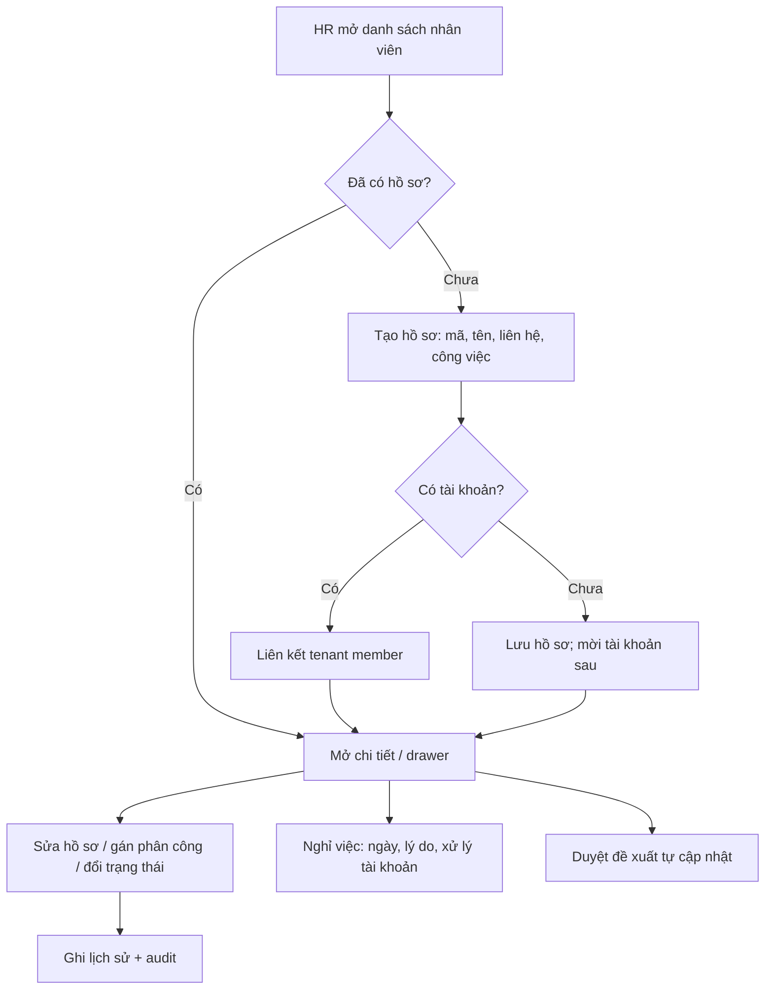
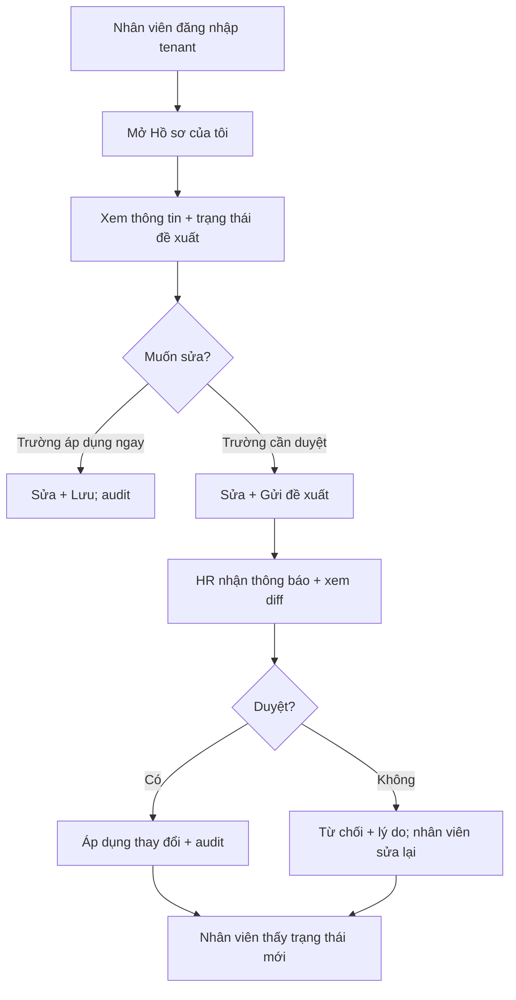
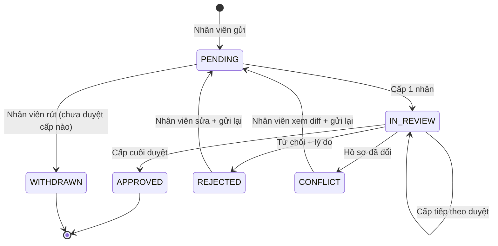

# [ANL-S07-002] Phân tích quản trị nhân viên theo tenant/chi nhánh & tự phục vụ

| Trường | Giá trị |
| :--- | :--- |
| ID / loại / sprint | ANL-S07-002 / Phân tích / Sprint 07 |
| Trạng thái / phiên bản / cập nhật | Draft / 0.1 / 2026-10-29 |
| Owner / reviewer | BA Agent / Chưa review |
| Đầu vào | [RAW-S07-001](../01_raw_notes/01_RAW-S07-001_employee_plugin_requirements.md) (R3–R4), [ANL-S07-001](01_ANL-S07-001_employee_identity_and_data_model.md) |
| Đọc trước / đọc tiếp | ANL-S07-001 / [BENCH-S07-001](../03_benchmarks/01_BENCH-S07-001_employee_profile_and_self_service.md), [CONF-S07-001](../04_confirmation/01_CONF-S07-001_sprint_07_scope_and_questions.md) |

## 1. Mục đích

Tài liệu này trả lời hai câu hỏi vận hành:

1. **HR/Tenant quản lý nhân viên như thế nào** — ai thấy ai, ai sửa gì, phạm vi tenant hay chi nhánh?
2. **Nhân viên tự quản lý hồ sơ của mình như thế nào** — được sửa trường nào, áp dụng ngay hay chờ duyệt, ai duyệt, thấy gì trên Web/Mobile?

Đây là cơ sở để chốt Q1–Q38 và thiết kế UI/API ở bước 06. **Q1–Q30 đã trả lời**; Q31–Q38 còn Pending.

## 2. Vai trò và nhu cầu

| Vai trò | Nhu cầu chính | Phạm vi dữ liệu | Ghi chú |
| :--- | :--- | :--- | :--- |
| **Tenant Owner/Admin** | Quản trị toàn bộ hồ sơ, cấu hình quyền, xử lý nghỉ việc | Toàn tenant | Có thể ủy quyền cho HR Admin |
| **HR Admin** | Tạo/sửa hồ sơ, gán phân công, duyệt đề xuất, import/export, xem trường nhạy cảm | Toàn tenant hoặc chi nhánh được giao | Là vai trò nghiệp vụ chính; gán qua RBAC Core |
| **Branch Manager** | Xem nhân viên thuộc chi nhánh, theo dõi trạng thái, đề xuất điều chỉnh | Chi nhánh (`BRANCH`) | Mặc định **read-only** ở v1; không xem trường nhạy cảm |
| **Direct Manager** | Xem hồ sơ cơ bản của nhân viên báo cáo trực tiếp/gián tiếp | `OWN_AND_SUBORDINATES` | Read-only; không duyệt thay HR |
| **Employee** | Xem hồ sơ của mình, cập nhật thông tin cá nhân, theo dõi đề xuất | Chỉ bản thân (`OWN`) | Không thấy hồ sơ người khác |
| **Platform Super Admin** | Cài/gỡ plugin, xem trạng thái plugin | Platform | **Không** đọc dữ liệu HR tenant nếu không có cơ chế hỗ trợ/audit riêng |

> Không tạo role cứng trong plugin. Plugin đăng ký **permission**; Tenant Admin gán permission vào role và data policy của Core.

## 3. Chế độ 1 — HR Admin quản lý nhân viên

### 3.1. Luồng chính

### 3.2. Chức năng quản trị (theo Q1–Q30)

| Chức năng | Mô tả | Trạng thái |
| :--- | :--- | :--- |
| Danh sách | Bảng mật độ cao: mã, họ tên, chức danh, phòng ban, chi nhánh, trạng thái, ngày vào làm, quản lý | Must |
| Tìm kiếm/lọc | Theo mã/tên/email; lọc chi nhánh, phòng ban, trạng thái, loại lao động; phân trang chuẩn | Must |
| Tạo hồ sơ | Drawer/route; mã tự động hoặc nhập; kiểm tra trùng; liên kết tài khoản tùy chọn | Must |
| Xem/sửa hồ sơ | Theo tab/nhóm; kiểm tra quyền theo trường; audit | Must |
| **Đa phân công + effective-dated** | Nhiều phân công, một chính; chi nhánh/phòng ban/chức danh/quản lý theo phân công; future-dated/as-of | Must (Q3/Q10) |
| **Hợp đồng** | Loại/số/ngày hiệu lực/hết hạn; lịch sử; cảnh báo hết hạn | Must (Q9) |
| Đổi trạng thái | Thử việc → chính thức → tạm hoãn → nghỉ việc; kiểm tra ngày | Must |
| Nghỉ việc | Ngày/lý do; tự động khóa tài khoản + gỡ membership/roles; chặn nếu còn cấp dưới | Must (Q11) |
| Duyệt đề xuất | Hộp thư, diff, chuỗi nhiều cấp, duyệt/từ chối, lý do, audit | Must (Q22) |
| **Cấu hình allowlist self-service** | Bật/tắt trường theo nhóm/role; template mặc định; preview | Must (Q20) |
| **Cấu hình chuỗi duyệt** | Theo nhóm trường/phòng ban; cấp/người duyệt; delegation/reminder | Must (Q22/Q36) |
| Lịch sử | Thay đổi công việc/trạng thái, người thao tác, nguồn, hiệu lực | Must |
| **Danh bạ + org chart đầy đủ** | Cây phòng ban/quản lý, dotted-line/ma trận, zoom/drill-down | Must (Q16/Q30) |
| **Tài liệu** | Upload/version/phân loại/quyền/virus scan/retention | Must (Q17) |
| **Self-onboarding** | Link mời, giới hạn trường/thời hạn, HR duyệt/tạo hồ sơ | Must (Q23) |
| **Chiến dịch cập nhật** | Chọn tất cả/nhóm, gửi thông báo, deadline, theo dõi | Must (Q24) |
| **Privacy** | Consent, DSAR export/delete, breach, retention, audit | Must (Q29) |
| Import/Export | CSV; dry-run; báo lỗi theo dòng; quyền riêng | Must (Q19) |
| Custom fields | Trường do tenant tự định nghĩa | **Out** (Q18) |

### 3.3. Quy tắc quản trị

1. **Danh sách chỉ trả dữ liệu trong phạm vi**: Tenant Admin/HR toàn tenant; Branch Manager theo `branch_id`; Direct Manager theo quan hệ báo cáo. Server kiểm tra, không tin filter client.
2. **Tạo hồ sơ** không tự tạo user. Nếu chọn “mời tài khoản”, dùng luồng invitation của Core (nếu có) hoặc yêu cầu Tenant Admin tạo trước.
3. **Liên kết tài khoản** chỉ với user đã là tenant member; nếu chưa, hiển thị hướng dẫn mời.
4. **Đa phân công**: kiểm tra department thuộc branch, manager cùng tenant/active, không cycle; đúng một phân công chính; khoảng hiệu lực không chồng lấn; mọi thay đổi effective-dated.
5. **Nghỉ việc**: chặn nếu còn cấp dưới chưa bàn giao, hoặc nếu là owner/admin cuối cùng/platform role; sau xác nhận tự động khóa tài khoản + gỡ tenant membership/roles; hồ sơ giữ; rehire phải mời lại.
6. **Xóa tenant membership** của employee đang active bị chặn; phải offboard trước (BR-18).
7. **Mọi thay đổi** ghi audit/history; không có thao tác “sửa im lặng”; sửa hồi tố phải có lý do.
8. **Always-on**: provisioning/backfill tenant idempotent; không cho gỡ; nếu catalog chưa cài dùng text fallback.
9. **Tài liệu**: kiểm tra loại/kích thước/virus trước khi lưu; version bất biến; quyền tải; retention.
10. **Privacy**: consent/DSAR/breach/retention theo Q29; audit truy cập dữ liệu nhạy cảm.

## 4. Chế độ 2 — Nhân viên tự phục vụ

### 4.1. Luồng chính

### 4.2. Quy tắc tự phục vụ

1. **Chỉ hồ sơ của chính mình**: endpoint self resolve employee từ `(tenant_id, user_id)` trong JWT; **không** nhận `employee_id` từ client. Nếu không có employee → `EMPLOYEE_PROFILE_NOT_FOUND`.
2. **Không thấy hồ sơ người khác**: không có endpoint self nào trả danh sách; tìm kiếm/danh bạ là quyền khác (nếu có).
3. **Allowlist tenant cấu hình**: HR Admin bật/tắt trường theo nhóm; server đọc cấu hình tenant, validate lại, không tin UI.
4. **Đề xuất thay đổi**: lưu diff từng trường (old/new), không ghi đè hồ sơ cho đến khi duyệt (nếu trường cần duyệt).
5. **Trạng thái đề xuất**: `PENDING`, `APPROVED`, `REJECTED`, `WITHDRAWN`, `CONFLICT`, `EXPIRED`; thêm `current_step` cho duyệt nhiều cấp. Nhân viên được rút khi còn `PENDING`; đề xuất đã duyệt không sửa/xóa.
6. **Không tự duyệt**: người gửi không được là người duyệt, kể cả có quyền `employee:change-request:approve`.
7. **Thông báo**: dùng plugin `in-app-notification` nếu đã cài; nếu không, hiển thị badge trong màn hình. Không hard-depend vào notification.
8. **Nhân viên `LEFT`/`SUSPENDED`**: chỉ đọc; không tạo đề xuất mới.
9. **Nhân viên chưa có tài khoản**: không có self-service; HR thấy trạng thái “Chưa có tài khoản”.
10. **Self-onboarding**: link mời có hạn/dùng một lần; chỉ điền trường cho phép; HR duyệt/tạo hồ sơ; chống trùng mã/email.
11. **Chiến dịch cập nhật**: HR chọn nhóm, gửi thông báo, theo dõi trạng thái; không tự sửa hồ sơ.

### 4.3. Ma trận trường mặc định: Admin vs Self

> Q20 = B: tenant tự cấu hình allowlist; bảng dưới là **template mặc định**, HR có thể bật/tắt từng nhóm. Q21 = C: hybrid áp dụng ngay/duyệt; Q22 = C: chuỗi duyệt cấu hình.

| Nhóm trường | Ví dụ | HR Admin | Nhân viên tự sửa | Cần duyệt? | Nhạy cảm |
| :--- | :--- | :--- | :--- | :--- | :--- |
| Công việc/phân công | Chi nhánh, phòng ban, chức danh, quản lý, loại lao động, ngày vào làm | Sửa | **Không** (read-only) | — | Thấp |
| Trạng thái | Thử việc/chính thức/tạm hoãn/nghỉ việc | Sửa | Không | — | Thấp |
| Định danh | Họ tên pháp lý, ngày sinh, giới tính, quốc tịch, hôn nhân, ảnh | Sửa | **Gửi đề xuất** | Có | Trung bình |
| Liên hệ | Phone, địa chỉ hiện tại/thường trú, email cá nhân | Sửa | **Có** | Hybrid: phone/địa chỉ áp dụng ngay; email cần duyệt | Trung bình |
| Liên hệ khẩn cấp | Tên, quan hệ, phone | Sửa | **Có** | Áp dụng ngay | Trung bình |
| Học vấn | Trình độ, trường, chuyên ngành, năm tốt nghiệp | Sửa | **Có** (gửi đề xuất) | Có | Thấp |
| Hợp đồng | Loại, số, ngày hiệu lực/hết hạn | Sửa | Chỉ đọc | Có (nếu cho) | Trung bình |
| Giấy tờ | CCCD/hộ chiếu, ngày cấp, nơi cấp | Sửa | Chỉ đọc; gửi đề xuất sửa nếu sai | Có | **Cao** |
| Thuế/BHXH/BHYT | Mã số thuế, số BHXH, số BHYT | Sửa | Chỉ đọc; gửi đề xuất nếu sai | Có | **Cao** |
| Ngân hàng | Ngân hàng, số tài khoản, chủ tài khoản | Phase 2 | Chỉ đọc | Có | **Cao** |
| Tài liệu | Scan CCCD/hợp đồng/bằng cấp | Sửa (upload/version/quyền) | Xem/tải của mình | — | **Cao** |
| Lương/phụ cấp | Lương, phụ cấp | **Ngoài scope** | Không | — | **Rất cao** |

## 5. Mô hình duyệt thay đổi

### 5.1. Ba phương án

| Phương án | Mô tả | Ưu | Nhược | Ví dụ |
| :--- | :--- | :--- | :--- | :--- |
| **A. Sửa trực tiếp** | Nhân viên sửa, áp dụng ngay, có audit | Ít ma sát; dữ liệu cập nhật tức thì | HR mất kiểm soát; sai dữ liệu pháp lý | Odoo “Employee Editing” |
| **B. Tất cả qua duyệt** | Mọi thay đổi tạo đề xuất; HR duyệt mới áp dụng | Kiểm soát cao; có diff/lý do | Chậm; HR tải duyệt nhiều | MISA, Base HRM |
| **C. Hybrid** | Trường ít rủi ro áp dụng ngay; trường định danh/nhạy cảm qua duyệt | Cân bằng; UX tốt | Phức tạp hơn; cần chốt danh sách trường | **Khuyến nghị** |

**Khuyến nghị C**, với phân nhóm mặc định:

- **Áp dụng ngay**: phone, địa chỉ hiện tại, liên hệ khẩn cấp, ảnh đại diện (nếu có).
- **Cần duyệt**: họ tên pháp lý, ngày sinh, giới tính, quốc tịch, CCCD/hộ chiếu, thuế/BHXH/BHYT, email cá nhân, học vấn.
- **Không cho self-sửa**: công việc, chi nhánh/phòng ban, chức danh, quản lý, trạng thái, lương.

### 5.2. Người duyệt

**Đã chốt Q22 = C: cấu hình nhiều cấp.** Mô hình đề xuất (chờ Q36):

| Thành phần | Mô tả |
| :--- | :--- |
| **Approval chain** | Cấu hình theo nhóm trường/phòng ban/loại yêu cầu; thứ tự cấp 1 → cấp 2… |
| **Approver** | Role hoặc user cụ thể; mỗi cấp một người duyệt (hoặc một nhóm, một người duyệt là đủ) |
| **Delegation** | Ủy quyền khi approver vắng; thời hạn/người nhận |
| **Reminder** | Nhắc trước/quá hạn; dùng notification plugin |
| **Escalation** | Chuyển cấp trên khi quá hạn (nếu Q36 chốt) |

**Quy tắc:** không cho tự duyệt; mỗi cấp ghi audit ai duyệt/lúc nào; nếu cấu hình thiếu approver, chặn gửi request thay vì treo vô hạn.

### 5.3. Vòng đời đề xuất

- `APPROVED` không thể chuyển ngược sang `REJECTED`/`WITHDRAWN`.
- `REJECTED` có thể gửi lại (tạo request mới, giữ lịch sử request cũ).
- `CONFLICT` không tự ghi đè; nhân viên phải xem diff và gửi lại.
- `IN_REVIEW` có `current_step`; cấp đã duyệt không được rút (trừ khi Q36 chốt khác).
- Mỗi employee tối đa **một request đang mở**; gửi request mới khi đang mở → yêu cầu rút hoặc gộp.

## 6. Phân quyền đề xuất

### 6.1. Permission (functional)

| Permission | Ý nghĩa | Ghi chú |
| :--- | :--- | :--- |
| `employee:profile:read` | Xem danh sách/chi tiết hồ sơ | Kèm data scope |
| `employee:profile:create` | Tạo hồ sơ | |
| `employee:profile:update` | Sửa hồ sơ | Không bao gồm trường nhạy cảm nếu thiếu quyền |
| `employee:profile:archive` | Nghỉ việc/archive | Không xóa cứng |
| `employee:profile:export` | Xuất danh sách/hồ sơ | Tách khỏi read |
| `employee:profile:import` | Import CSV | Q19 = A |
| `employee:sensitive:read` | Xem trường nhạy cảm | CCCD, thuế, BHXH, ngân hàng… |
| `employee:field-config:manage` | Cấu hình allowlist self-service | Q20 = B |
| `employee:approval-config:manage` | Cấu hình chuỗi duyệt | Q22 = C |
| `employee:change-request:read` | Xem đề xuất | HR; nhân viên luôn xem của mình |
| `employee:change-request:approve` | Duyệt/từ chối | Không tự duyệt |
| `employee:self:read` | Xem hồ sơ của mình | Self endpoint |
| `employee:self:update` | Gửi/sửa đề xuất của mình | Self endpoint |
| `employee:directory:read` | Xem danh bạ | Q16/Q30 |
| `employee:org-chart:read` | Xem org chart | Q16/Q30 |
| `employee:document:read` | Xem/tải tài liệu | Q17; self xem của mình |
| `employee:document:manage` | Upload/version/xóa tài liệu | Q17 |
| `employee:onboarding:manage` | Gửi/quản lý link self-onboarding | Q23 |
| `employee:campaign:manage` | Tạo/chạy chiến dịch cập nhật | Q24 |
| `employee:privacy:manage` | Consent/DSAR/breach/retention | Q29 |

### 6.2. Ma trận vai trò (đề xuất)

| Permission | Tenant Owner/Admin | HR Admin | Branch Manager | Direct Manager | Employee |
| :--- | :---: | :---: | :---: | :---: | :---: |
| `employee:profile:read` | ✅ | ✅ | ✅ (branch) | ✅ (subordinates) | ❌ (dùng self) |
| `employee:profile:create` | ✅ | ✅ | ❌ | ❌ | ❌ |
| `employee:profile:update` | ✅ | ✅ | ❌ | ❌ | ❌ |
| `employee:profile:archive` | ✅ | ✅ | ❌ | ❌ | ❌ |
| `employee:profile:export` | ✅ | ✅ | ❌ | ❌ | ❌ |
| `employee:profile:import` | ✅ | ✅ | ❌ | ❌ | ❌ |
| `employee:field-config:manage` | ✅ | ✅ | ❌ | ❌ | ❌ |
| `employee:approval-config:manage` | ✅ | ✅ | ❌ | ❌ | ❌ |
| `employee:document:manage` | ✅ | ✅ | ❌ | ❌ | ❌ |
| `employee:onboarding:manage` | ✅ | ✅ | ❌ | ❌ | ❌ |
| `employee:campaign:manage` | ✅ | ✅ | ❌ | ❌ | ❌ |
| `employee:privacy:manage` | ✅ | ✅ | ❌ | ❌ | ❌ |
| `employee:sensitive:read` | ✅ | ✅ | ❌ | ❌ | Chỉ của mình |
| `employee:change-request:read` | ✅ | ✅ | ❌ | ❌ | Chỉ của mình |
| `employee:change-request:approve` | ✅ | ✅ | ❌ | ❌ | ❌ |
| `employee:self:read` | — | — | — | — | ✅ |
| `employee:self:update` | — | — | — | — | ✅ |
| `employee:directory:read` | ✅ | ✅ | ✅ | ✅ | ✅ |
| `employee:org-chart:read` | ✅ | ✅ | ✅ | ✅ | ✅ |
| `employee:document:read` | ✅ | ✅ | ❌ | ❌ | Của mình |

> Tenant Owner nhận toàn bộ permission plugin khi cài (quy tắc platform). Các role khác do Tenant Admin gán. Data scope lấy từ Core (`TENANT`, `BRANCH`, `OWN`, `OWN_AND_SUBORDINATES`), không tự chế cơ chế mới.
>
> **Lưu ý self-service:** endpoint self không dùng `employee:profile:read` hay `employee:sensitive:read`; chúng dùng `employee:self:read`/`employee:self:update` và luôn resolve hồ sơ từ JWT. Nhân viên luôn thấy trường nhạy cảm **của chính mình** (trừ khi tenant cấu hình ẩn); `employee:sensitive:read` chỉ dành cho xem hồ sơ người khác.

### 6.3. Quy tắc kiểm tra quyền

1. **Functional permission** kiểm tra trước (có được gọi API không).
2. **Data scope** kiểm tra sau (bản ghi có thuộc phạm vi không).
3. **Field-level permission** kiểm tra khi serialize (trường nhạy cảm có được trả không).
4. **Self endpoint** không dùng `employee:profile:read`; resolve từ JWT và chỉ trả hồ sơ của mình.
5. **Branch Manager** mặc định chỉ đọc; nếu Q26 chọn “được sửa”, cần permission riêng + giới hạn trường.

## 7. UI/UX đề xuất

### 7.1. HR Admin (Desktop)

- **Route danh sách**: `/apps/employee` — bảng mật độ cao, filter bar, page size, export.
- **Chi tiết**: nested route `/apps/employee/:id` hoặc Drawer xếp tầng; tab:
  - `Tổng quan`: ảnh, mã, tên, trạng thái, công việc hiện tại, liên hệ nhanh.
  - `Công việc`: chi nhánh, phòng ban, chức danh, quản lý, loại lao động, ngày tháng.
  - `Cá nhân`: định danh, giấy tờ, thuế/BHXH (mask theo quyền).
  - `Liên hệ`: phone, email, địa chỉ, liên hệ khẩn cấp.
  - `Học vấn`: trình độ, trường, chuyên ngành.
  - `Lịch sử`: thay đổi công việc/trạng thái.
  - `Đề xuất`: các request của nhân viên.
- **Tạo/sửa**: Drawer trượt phải, section rõ ràng; không modal; validate inline.
- **Nghỉ việc**: Drawer riêng, cảnh báo cấp dưới/chưa bàn giao.
- **Hộp thư duyệt**: `/apps/employee/approvals` — danh sách đang mở, diff 2 cột (cũ/mới), chuỗi cấp, duyệt/từ chối, lý do.
- **Org chart**: `/apps/employee/org-chart` — cây phòng ban/quản lý, zoom/drill-down, dotted-line.
- **Tài liệu**: tab trong chi tiết; upload/version/quyền/virus scan/retention.
- **Cấu hình**: `/apps/employee/settings` — allowlist self-service, chuỗi duyệt, tài liệu, privacy.
- **Self-onboarding**: `/apps/employee/onboarding` — tạo link, theo dõi trạng thái.
- **Chiến dịch**: `/apps/employee/campaigns` — chọn nhóm, deadline, theo dõi.
- **Privacy**: `/apps/employee/privacy` — consent, DSAR, breach, retention.

### 7.2. Nhân viên (Desktop + Mobile)

- **Route**: `/apps/employee/me` — hồ sơ của tôi.
- **Header**: ảnh, tên, mã, chức danh, phòng ban, trạng thái.
- **Tab/section**: Tổng quan, Liên hệ, Cá nhân (read-only), Học vấn, Tài liệu của tôi, Đề xuất của tôi.
- **Sửa**: Drawer hoặc form theo section; hiển thị rõ trường nào áp dụng ngay, trường nào gửi duyệt.
- **Pending banner**: “Bạn có 1 đề xuất đang chờ duyệt” + link.
- **Self-onboarding**: trang điền hồ sơ trước ngày vào làm (nếu có link); không vào được menu HR.
- **Chiến dịch**: banner “HR yêu cầu cập nhật hồ sơ” + deadline/trạng thái.
- **Danh bạ/org chart**: read-only, chỉ thông tin công khai.
- **Mobile**: view + sửa trường allowlist + gửi/rút đề xuất + xem trạng thái; touch ≥40px, không tràn ngang, safe-area.
- **Không** hiển thị menu quản trị HR trên mobile cho employee.

### 7.3. Component & i18n

- Dùng shared component: bảng, drawer, tab, badge, form field, date picker, empty state, confirm dialog (nếu cần).
- Nếu thiếu component, bổ sung vào `src/frontend/shared/` trước; Web/Mobile dùng chung.
- Toàn bộ chuỗi dùng i18n key namespace `employee.*`; enum trạng thái/loại lao động/nhóm trường khai báo chung, không hardcode.
- Không dùng modal cho form/danh sách; ưu tiên nested route + drawer.

## 8. Edge case vận hành

| # | Tình huống | Hướng xử lý |
| :--- | :--- | :--- |
| O1 | Nhân viên không có quyền `employee:self:read` | 403 `EMPLOYEE_SELF_FORBIDDEN`; không lộ dữ liệu |
| O2 | Nhân viên gọi self endpoint với `employee_id` người khác | Bỏ qua/không nhận tham số; luôn resolve từ JWT |
| O3 | HR duyệt request của chính mình | Chặn `EMPLOYEE_SELF_APPROVAL_FORBIDDEN` |
| O4 | Request bị trùng khi đang PENDING | Trả `EMPLOYEE_CHANGE_REQUEST_PENDING`; cho rút/gộp |
| O5 | Hồ sơ đổi trong lúc request chờ | `CONFLICT`; không ghi đè; nhân viên gửi lại |
| O6 | Nhân viên đổi chi nhánh | Data scope của manager cũ/mới thay đổi; kiểm tra lại quyền khi đọc |
| O7 | Branch Manager xem nhân viên chi nhánh khác | 403/404 theo data scope; không lộ tồn tại |
| O8 | HR xem trường nhạy cảm | Cần `employee:sensitive:read`; ghi audit view |
| O9 | Export danh sách có trường nhạy cảm | Chặn hoặc loại trường nhạy cảm mặc định; cần quyền riêng |
| O10 | Notification plugin chưa cài | Vẫn hoạt động; badge trong màn hình; không lỗi |
| O11 | Mobile mất mạng khi gửi request | Giữ draft cục bộ; retry; không tạo request trùng nhờ idempotency key |
| O12 | Nhân viên `LEFT` còn request đang mở | Tự động `EXPIRED`/`WITHDRAWN`; HR không duyệt |
| O13 | Quản lý trực tiếp nghỉ việc | Chặn offboard đến khi chuyển cấp dưới; hoặc tự động yêu cầu chọn |
| O14 | Tenant đổi theme/ngôn ngữ | UI dùng token/i18n chung; không hardcode |
| O15 | Chuỗi duyệt thiếu approver/hết hiệu lực | Chặn gửi request; yêu cầu cấu hình lại; không treo |
| O16 | Tài liệu sai loại/có virus | Từ chối trước khi lưu; không public; audit |
| O17 | Link self-onboarding hết hạn/đã dùng | Từ chối; HR tạo link mới; chống trùng mã/email |
| O18 | Chiến dịch gửi nhầm nhóm | Preview trước khi gửi; audit; không tự sửa hồ sơ |
| O19 | DSAR/consent request | Theo quy trình privacy; audit; thời hạn xử lý |
| O20 | Org chart quá lớn | Lazy load/giới hạn độ sâu/cache; không tải toàn bộ |
| O21 | Offboard owner/admin cuối cùng hoặc platform role | Chặn; yêu cầu chuyển quyền; audit (Q55) |

## 9. Phạm vi chức năng đề xuất

| Mức | Nội dung |
| :--- | :--- |
| **Must (đã chọn)** | Danh sách/tìm kiếm/lọc; tạo/sửa hồ sơ; liên kết tài khoản; **đa phân công + effective-dated**; hợp đồng; trạng thái/nghỉ việc tự động khóa/gỡ quyền; self-service **allowlist tenant cấu hình**; **duyệt nhiều cấp**; audit/lịch sử; quyền + data scope; mask trường nhạy cảm; **org chart + danh bạ**; **tài liệu**; **self-onboarding**; **chiến dịch cập nhật**; **privacy đầy đủ**; import/export CSV; mobile self-service |
| **Later** | Ngân hàng/người phụ thuộc/kinh nghiệm/chứng chỉ; hợp đồng điện tử; custom fields; import nâng cao; HR cấp platform |

## 10. Câu hỏi cần chốt (ánh xạ CONF)

| Nhóm | Câu hỏi |
| :--- | :--- |
| Mô hình | Q1–Q6 |
| Vòng đời | Q7–Q12 |
| Dữ liệu | Q13–Q19 |
| Self-service | Q20–Q25 |
| Quyền/bảo mật | Q26–Q29 |
| Scope | Q30 |
| Phát sinh | Q31–Q38 (phasing, effective-dated, đa phân công, offboarding, always-on, duyệt, tài liệu, privacy) |

Chi tiết và câu trả lời tại [CONF-S07-001 §4–§5](../04_confirmation/01_CONF-S07-001_sprint_07_scope_and_questions.md).

## 11. Lịch sử

| Phiên bản | Ngày | Thay đổi | Người review/phê duyệt và nguồn |
| :--- | :--- | :--- | :--- |
| 0.1 | 2026-10-29 | Bản nháp: vai trò, luồng admin/self, ma trận trường/quyền, duyệt, UI, edge case | BA Agent; chưa review |
| 0.2 | 2026-10-29 | Cập nhật theo 30/30 câu trả lời: allowlist tenant, duyệt nhiều cấp, org chart, tài liệu, self-onboarding, campaign, privacy | BA Agent; CONF-S07-001 0.2 |
| 0.3 | 2026-10-30 | Bổ sung Q55 offboarding guard; tham chiếu mô hình 2 lớp assignment | BA Agent; CONF-S07-001 0.6 |
