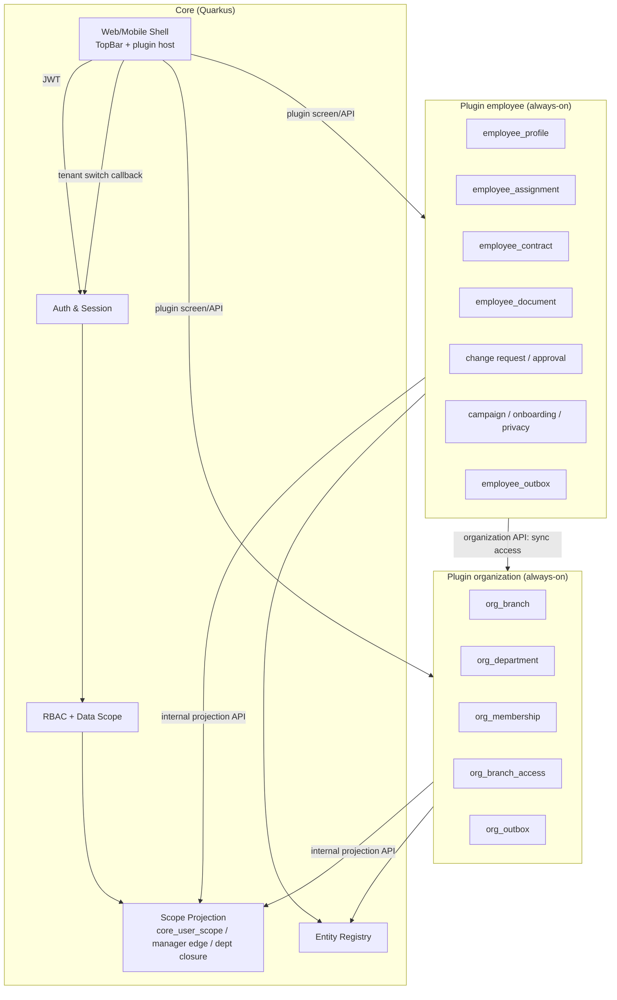

# [SOL-S07-001] Giải pháp kiến trúc: Employee + Organization plugin + Tenant switcher

| Trường | Giá trị |
| :--- | :--- |
| ID / loại / sprint | SOL-S07-001 / Giải pháp / Sprint 07 |
| Trạng thái / phiên bản / cập nhật | Approved / 1.0 / 2026-10-30 |
| Owner / reviewer | Architect Agent / Chủ dự án + BA |
| Đầu vào | [CONF-S07-001 1.0](../04_confirmation/01_CONF-S07-001_sprint_07_scope_and_questions.md) (APPROVED 2026-10-30) |
| Đọc trước / đọc tiếp | CONF-S07-001 / [ADR-S07-001](02_ADR-S07-001_two_layer_assignment_projection.md), [ADR-S07-002](03_ADR-S07-002_organization_extraction_cutover.md), [ADR-S07-003](04_ADR-S07-003_tenant_switcher_header.md), [DES-ARCH-S07-001](../06_designs/arch/01_DES-ARCH-S07-001_components_and_flows.md) |

## 1. Mục đích và phạm vi

Sprint 07 gồm ba khối liên kết:

1. **Plugin `employee`** — hồ sơ nhân sự, HR assignment effective-dated, self-service, duyệt nhiều cấp, org chart/danh bạ, tài liệu, self-onboarding, chiến dịch cập nhật, privacy.
2. **Plugin `organization`** — tách branch/department + access membership khỏi Core; always-on.
3. **Tenant switcher** — UI contribution từ employee plugin; auth/session switch ở Core.

Tài liệu này chốt **kiến trúc tổng thể**, **ranh giới sở hữu dữ liệu**, **luồng đồng bộ**, **các quyết định lớn** và **rủi ro triển khai**. Chi tiết DB/API/UI ở các DES.

## 2. Nguyên tắc kiến trúc

| # | Nguyên tắc | Hệ quả |
| :--- | :--- | :--- |
| A1 | **Hai lớp assignment** | `organization` giữ access membership cho mọi tenant member; `employee` giữ HR assignment cho employee; Core projection merge |
| A2 | **Core không query bảng plugin** | Core chỉ đọc projection; plugin cập nhật qua internal API/outbox |
| A3 | **Một nguồn sự thật cho mỗi loại dữ liệu** | Branch/department/access membership → organization; HR profile/assignment/contract/docs → employee |
| A4 | **Tenant isolation** | Mọi bảng plugin có `tenant_id`; gateway/service token xác thực tenant; không tin client |
| A5 | **Always-on** | organization + employee không gỡ; provisioning/backfill idempotent; text fallback nếu catalog thiếu |
| A6 | **Effective-dated** | Assignment/contract/status dùng khoảng hiệu lực; as-of/future/retroactive có audit |
| A7 | **UI contribution, auth Core** | Tenant switcher render trong employee header nhưng gọi callback/API Core; token không lộ vào plugin |
| A8 | **Big-bang cutover có kỷ luật** | Q43 = big-bang; vẫn có freeze/backup/verify/rollback drill nội bộ |

## 3. Kiến trúc thành phần

### 3.1. Ranh giới sở hữu

| Dữ liệu | Nguồn sự thật | Core có giữ? | Ghi chú |
| :--- | :--- | :--- | :--- |
| Branch, department | `organization` | Không (chỉ projection closure) | Core không query bảng plugin |
| Access membership (user↔branch/department/manager) | `organization` | Projection | Dùng cho RBAC/data scope; non-employee có membership |
| Employee profile | `employee` | Không | Có thể không có user |
| HR assignment (employee↔branch/department/title/manager/hiệu lực) | `employee` | Projection | Gọi organization API để sync access membership |
| Contract/document/change request | `employee` | Không | Tenant-scoped |
| Tenant list/session | Core | Có | Auth switch endpoint |
| Scope projection | Core | Có | Read model, rebuild được |

## 4. Luồng chính

### 4.1. Tạo/cập nhật nhân viên

1. HR tạo `employee_profile` (có thể chưa có `user_id`).
2. HR tạo `employee_assignment` (branch/department/title/manager/hiệu lực).
3. Employee gọi organization API `PUT /memberships/by-user/{userId}` để upsert access membership **nếu đã liên kết tài khoản**.
4. Organization cập nhật `org_membership`/`org_branch_access`, ghi outbox.
5. Organization gọi Core internal projection API (hoặc Core consumer xử lý outbox) để cập nhật `core_user_scope`, `core_user_manager_edge`.
6. Core data scope dùng projection.

### 4.2. Đổi phòng ban/chức danh (effective-dated)

1. HR tạo assignment mới với `valid_from`; đóng assignment cũ `valid_to`.
2. Ghi `employee_job_history` + audit.
3. Nếu assignment hiện tại thay đổi, sync access membership organization (cùng hiệu lực hoặc ngay).
4. Projection cập nhật; quyền data scope của user/manager được invalidate/cache refresh.

### 4.3. Self-service cập nhật

1. Nhân viên mở `/apps/employee/me`; server resolve employee từ JWT, không nhận `employee_id`.
2. Trường áp dụng ngay → cập nhật profile + audit.
3. Trường cần duyệt → tạo `employee_change_request` + steps theo config.
4. HR duyệt tuần tự; cấp cuối duyệt → áp dụng diff + history + audit.
5. Từ chối phải có lý do; conflict nếu hồ sơ đổi giữa lúc chờ.

### 4.4. Nghỉ việc

1. HR mở offboarding; hệ thống chặn nếu còn cấp dưới, last owner/admin, hoặc platform role.
2. Xác nhận → `LEFT` + `exit_date`/reason; đóng assignment; khóa tài khoản + gỡ tenant membership/roles theo Q11/Q34/Q55.
3. Organization cập nhật access membership (kết thúc), projection; employee giữ hồ sơ.
4. Rehire dùng lại hồ sơ/mã; mời lại tài khoản; tạo giai đoạn mới.

### 4.5. Switch tenant

1. Employee header WC hiển thị tenant hiện tại + danh sách tenant từ `PluginContext`.
2. User chọn tenant → guard unsaved → gọi host callback `switchTenant(tenantId)`.
3. Host gọi `POST /api/v1/auth/switch-tenant`; Core validate membership, revoke session cũ, cấp token mới.
4. Host replace session, clear tenant cache/plugin session/manifest, reload route/data.
5. Plugin employee reload hồ sơ theo tenant mới; nếu không có hồ sơ → trạng thái trống.

## 5. Quyết định kiến trúc

| ID | Quyết định | Lý do | ADR |
| :--- | :--- | :--- | :--- |
| D1 | Hai lớp assignment | Tách access/RBAC khỏi HR; non-employee vẫn có scope; Core không phụ thuộc hoàn toàn employee | ADR-S07-001 |
| D2 | Core projection read model | Core không query bảng plugin; hiệu năng/tenant isolation | ADR-S07-001 |
| D3 | Organization plugin always-on, big-bang cutover | Q44/Q43; giảm thời gian dual-write | ADR-S07-002 |
| D4 | Đổi namespace API/quyền/entity | Q45/Q46; làm sạch boundary plugin | ADR-S07-002 |
| D5 | Tenant switcher UI trong employee header, auth Core | Q47/Q48; không lộ token; vẫn đúng lựa chọn UI | ADR-S07-003 |
| D6 | Big-bang nhưng có freeze/backup/rollback nội bộ | Q43; giảm rủi ro data scope | ADR-S07-002 |
| D7 | Document storage qua object storage + virus scan | Q17/Q37; bảo mật tài liệu | DES-DB/API |

## 6. Rủi ro kiến trúc

| Rủi ro | Mức | Giảm thiểu |
| :--- | :--- | :--- |
| Projection stale/sai | **Critical** | Outbox + retry + rebuild job + verify; fail-safe; test data scope |
| Big-bang cutover | **High** | Freeze/backup/checksum/rollback drill; QA regression |
| Đổi namespace/entity phá consumer | **High** | Inventory consumer; migration grant; frontend/plugin test |
| Sync hai lớp assignment drift | **High** | Một chiều employee→organization; reconciliation job; audit |
| Tenant switcher rò rỉ chéo tenant | **Critical** | Token mới, revoke session, clear cache; test multi-tab |
| Document malware/PII | **High** | Virus scan, permission, retention, audit |
| Privacy full + legal | **High** | Legal review; data map; DSAR/breach test |
| All-at-once release | **Critical** | Baseline/AC; QA regression; báo cáo rủi ro tiến độ |

## 7. Không thuộc giải pháp

- Payroll, attendance, leave, recruitment, performance, training.
- E-signature; bank/dependents fields (phase 2).
- Custom fields.
- Platform-level HR.
- Multi-currency/multi-country HR policy.

## 8. Điều kiện Design ready

1. ADR-S07-001/002/003 được review.
2. DES-ARCH/DB/API/UI có contract + migration + test mapping.
3. Data scope projection có kịch bản rebuild/verify.
4. Tenant switcher có contract host callback + session revoke.
5. Rủi ro accepted được ghi trong CONF/REV.

## 9. Lịch sử

| Phiên bản | Ngày | Thay đổi | Người review/phê duyệt và nguồn |
| :--- | :--- | :--- | :--- |
| 0.1 | 2026-10-30 | Giải pháp tổng thể cho employee + organization + tenant switcher | Architect; CONF-S07-001 1.0 |
| 1.0 | 2026-10-30 | Approved cùng Design review | Chủ dự án; design review 2026-10-30 |
