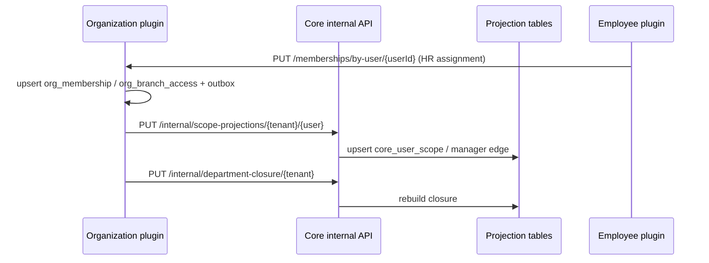

# [ADR-S07-001] Hai lớp assignment & Core scope projection

| Trường | Giá trị |
| :--- | :--- |
| ID / loại / sprint | ADR-S07-001 / Architecture Decision Record / Sprint 07 |
| Trạng thái / phiên bản / cập nhật | Approved / 1.0 / 2026-10-30 |
| Owner / reviewer | Architect Agent / Chủ dự án + BA |
| Đầu vào | [CONF-S07-001 1.0](../04_confirmation/01_CONF-S07-001_sprint_07_scope_and_questions.md) (Q41/Q42/Q53/Q54), [SOL-S07-001](01_SOL-S07-001_employee_organization_architecture.md) |
| Đọc trước / đọc tiếp | SOL-S07-001 / [ADR-S07-002](03_ADR-S07-002_organization_extraction_cutover.md), [DES-DB-S07-001](../06_designs/db/01_DES-DB-S07-001_employee_organization_schema.md), [DES-API-S07-001](../06_designs/api/01_DES-API-S07-001_employee_organization_auth_api.md) |

## 1. Bối cảnh

Core hiện query trực tiếp `user_department_memberships`, `user_branch_assignments`, `departments` trong `SecurityContextService` để tính:

- `primaryBranchId`, `memberBranchIds`, `managedBranchIds`
- `departmentId`, `departmentIds`, `departmentAndChildIds`
- `subordinateUserIds`

Nếu tách organization khỏi Core mà không có read model, Core sẽ phải gọi plugin mỗi request hoặc query bảng plugin — trái nguyên tắc Core không phụ thuộc plugin. Q53/Q54 ban đầu chọn employee giữ toàn bộ assignment, nhưng điều đó làm Core data scope phụ thuộc employee plugin và đưa non-employee vào employee plugin. Chủ dự án đã chuyển sang **hai lớp** (S2, 2026-10-30).

## 2. Quyết định

### 2.1. Hai lớp dữ liệu

| Lớp | Chủ sở hữu | Dữ liệu | Mục đích |
| :--- | :--- | :--- | :--- |
| **Access membership** | `organization` plugin | `org_membership`, `org_branch_access`; user→branch/department/manager, primary, can_manage | RBAC/data scope cho **mọi tenant member**, kể cả non-employee |
| **HR assignment** | `employee` plugin | `employee_assignment`; employee→branch/department/title/manager, hiệu lực | Hồ sơ HR, lịch sử công tác, effective-dated |

- **Organization** là nguồn sự thật cho access membership.
- **Employee** là nguồn sự thật cho HR assignment.
- Khi HR assignment thay đổi và employee đã liên kết tài khoản, employee gọi API organization để upsert access membership (một chiều, idempotent, audit).
- Non-employee chỉ có access membership; không cần hồ sơ nhân viên.

### 2.2. Core projection

Core giữ **read model** trong schema Core, không phải nguồn sự thật:

| Bảng | Mục đích |
| :--- | :--- |
| `core_user_scope` | Một dòng/user/tenant: primary branch/department, mảng member/managed branch, mảng department |
| `core_user_manager_edge` | Cạnh manager→subordinate để tính cấp dưới |
| `core_department_closure` | ancestor→descendant của department để tính subtree |

`SecurityContextService` chỉ đọc 3 bảng này. Không query bảng plugin.

### 2.3. Luồng cập nhật



- Cập nhật projection phải **idempotent** theo `(tenant_id, user_id, version)`.
- Nếu gọi Core thất bại: outbox retry; UI hiển thị “chưa đồng bộ quyền” cho HR; không im lặng.
- Projection có `updated_at`, `version`; Core cache (Redis) key theo tenant/user + version.

### 2.4. Fail-safe

| Tình huống | Hành vi |
| :--- | :--- |
| Projection thiếu user | Từ chối thao tác dữ liệu nhạy cảm với `CORE_SCOPE_PROJECTION_MISSING`; không mở rộng quyền |
| Projection stale | Dùng version/updated_at; job rebuild; cảnh báo |
| Organization/employee lỗi | Projection cũ vẫn dùng; không xóa; retry/outbox |
| Department tree đổi | Rebuild closure; invalidate cache |
| Membership bị gỡ | Xóa projection row + manager edge; audit |

## 3. Phương án đã cân nhắc

| Phương án | Ưu | Nhược | Kết luận |
| :--- | :--- | :--- | :--- |
| A. Core gọi plugin mỗi request | Không projection | Coupling runtime, chậm, plugin lỗi ⇒ mất scope | Loại |
| B. Employee giữ toàn bộ assignment | Một nguồn | Core phụ thuộc business plugin; non-employee sai chỗ | Loại (Q53 revised) |
| C. Organization giữ tất cả assignment | Core phụ thuộc organization | Employee HR assignment vẫn cần; hai lớp tự nhiên hơn | Không chọn |
| **D. Hai lớp + projection** | Tách bạch, Core ổn định, non-employee OK | Cần sync/rebuild | **Chọn** |

## 4. Hệ quả

### 4.1. Tích cực

- Core data scope không phụ thuộc employee plugin.
- Non-employee có access membership đúng chỗ.
- HR assignment vẫn effective-dated, nhiều assignment.
- Projection rebuild/verify được; dễ test.

### 4.2. Tiêu cực / chi phí

- Cần outbox/retry và reconciliation giữa employee→organization.
- Cần internal API + service token/mTLS.
- Cần migration big-bang và rebuild projection.
- Cần test drift hai lớp.

## 5. Contract tối thiểu

### 5.1. Internal projection API (Core)

`PUT /api/v1/internal/scope-projections/{tenant_id}/{user_id}`

Request:
```json
{
  "primary_branch_id": "uuid",
  "primary_department_id": "uuid",
  "member_branch_ids": ["uuid"],
  "managed_branch_ids": ["uuid"],
  "department_ids": ["uuid"],
  "version": 12
}
```

Response (Single Resource):
```json
{
  "success": true,
  "code": "CORE_SCOPE_PROJECTION_UPSERTED",
  "message": "Scope projection upserted.",
  "params": {},
  "data": { "tenant_id": "uuid", "user_id": "uuid", "version": 12 }
}
```

- Auth: service token/mTLS; không public.
- Idempotency: nếu `version` <= version hiện tại, bỏ qua và trả code `CORE_SCOPE_PROJECTION_STALE_SKIPPED`.
- Delete: `DELETE /api/v1/internal/scope-projections/{tenant_id}/{user_id}` khi membership bị gỡ.

### 5.2. Department closure

`PUT /api/v1/internal/department-closure/{tenant_id}` với toàn bộ cạnh ancestor/descendant; Core thay thế closure của tenant trong transaction.

## 6. Traceability

| AC | Cách đáp ứng |
| :--- | :--- |
| AC-30 | Organization access membership + employee HR assignment; Core projection |
| AC-36 | Non-employee có access membership organization |
| AC-05/AC-15 | Data scope đọc projection; branch/manager đúng |
| AC-31 | Migration backfill + projection rebuild |

## 7. Lịch sử

| Phiên bản | Ngày | Thay đổi | Người review/phê duyệt và nguồn |
| :--- | :--- | :--- | :--- |
| 0.1 | 2026-10-30 | Chốt hai lớp assignment + projection; contract internal API | Architect; CONF-S07-001 1.0 |
| 1.0 | 2026-10-30 | Approved cùng Design review | Chủ dự án; design review 2026-10-30 |
