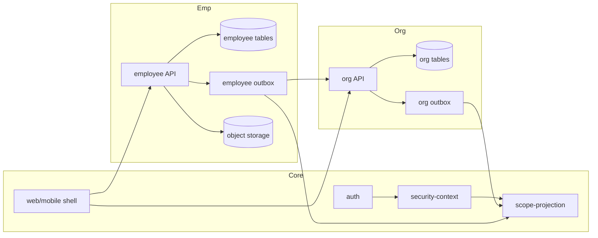

# [DES-ARCH-S07-001] Kiến trúc thành phần & luồng

| Trường | Giá trị |
| :--- | :--- |
| ID / loại / sprint | DES-ARCH-S07-001 / Thiết kế kiến trúc / Sprint 07 |
| Trạng thái / phiên bản / cập nhật | Approved / 1.0 / 2026-10-30 |
| Owner / reviewer | Architect Agent / Chủ dự án + BA |
| Đầu vào | [SOL-S07-001](../../05_solutions/01_SOL-S07-001_employee_organization_architecture.md), [ADR-S07-001](../../05_solutions/02_ADR-S07-001_two_layer_assignment_projection.md), [ADR-S07-002](../../05_solutions/03_ADR-S07-002_organization_extraction_cutover.md), [ADR-S07-003](../../05_solutions/04_ADR-S07-003_tenant_switcher_header.md) |
| Đọc trước / đọc tiếp | SOL/ADR / [DES-DB-S07-001](../db/01_DES-DB-S07-001_employee_organization_schema.md), [DES-API-S07-001](../api/01_DES-API-S07-001_employee_organization_auth_api.md), [DES-UI-S07-001](../ui/01_DES-UI-S07-001_employee_organization_ui.md) |

## 1. Thành phần

| Thành phần | Công nghệ | Trách nhiệm |
| :--- | :--- | :--- |
| Core Auth/Session | Quarkus | Login, select/switch tenant, session revoke, JWT |
| Core RBAC/Data Scope | Quarkus | Functional permission + data scope từ projection |
| Core Projection | PostgreSQL + service | `core_user_scope`, `core_user_manager_edge`, `core_department_closure` |
| Core Plugin Host | Angular shared | TopBar, **UserMenu slot `core.layout.user-menu.items`**, slot/WC loader, `PluginContext` |
| Plugin organization | Quarkus zero-DB + WC | Branch/department/access membership; projection outbox |
| Plugin employee | Quarkus zero-DB + WC | Employee profile/HR assignment/contract/docs/self-service/approval |
| Plugin notification | Quarkus zero-DB + WC | Thông báo đề xuất/campaign (optional, đã có) |
| Storage | MinIO/S3 profile | Tài liệu employee; virus scan hook |
| Redis | Cache | Session/permission/projection cache, rate limit |

## 2. Ranh giới module

## 3. Luồng request

### 3.1. Data scope request

1. JWT → `tenant_id`, `user_id`, permissions.
2. `SecurityContextService` đọc `core_user_scope` + `core_user_manager_edge` + `core_department_closure`; không query plugin.
3. Nếu projection thiếu → `CORE_SCOPE_PROJECTION_MISSING`; fail-safe.
4. Cache context theo `(tenant,user,scope_version)`; invalidate khi projection update.

### 3.2. Tạo employee + assignment

1. `POST /employee/employees` (permission `employee:profile:create`).
2. Validate employee_code unique/tenant; user optional; branch/department from org plugin API; manager same tenant/active.
3. Insert profile; audit.
4. `POST /employee/employees/{id}/assignments`; effective range; insert assignment/history.
5. Nếu linked user → employee outbox → organization API upsert `org_membership`; organization outbox → Core projection.
6. Response single resource; async sync status field `scope_sync_status`.

### 3.2.1. Org chart ma trận

- `employee_assignment.manager_employee_id` là primary manager snapshot.
- `employee_reporting_relationship` giữ PRIMARY/DOTTED/MATRIX + hiệu lực.
- Org chart API trả cây phòng ban + node nhân viên + edge type; UI render legend/đường khác nhau.
- Chống cycle PRIMARY; DOTTED/MATRIX cảnh báo; lazy load theo department/depth.

### 3.3. Self-service update

1. `GET /employee/me` resolve employee from JWT; no client employee_id.
2. Config `employee_field_config` determines direct/approval.
3. Direct: update + audit.
4. Approval: validate approver chain; create request/steps; notify; no profile change.
5. Approve last step → apply diff in transaction + history + audit.
6. Reject → reason required; notify; status.

### 3.4. Switch tenant

1. User menu item (employee contribution slot `core.layout.user-menu.items`) hiển thị tenant hiện tại + danh sách tenant từ `PluginContext`.
2. Guard unsaved; host calls `POST /auth/switch-tenant`.
3. Core validate membership, revoke old session, issue new tokens.
4. Host replaces session, clears cache/plugin sessions, reloads route/data.
5. Employee self-service reloads; no profile → empty state.

### 3.5. Offboarding

1. HR offboard; guard last owner/admin/platform role, subordinates.
2. `LEFT` + exit date; close assignment; audit.
3. Employee outbox → organization remove access membership; projection delete.
4. Host revoke sessions of target user (Core API); account disable; membership/roles removed after guard.
5. Employee data retained; rehire reuses profile.

## 4. Projection

| Bảng | Khóa | Cập nhật bởi | Rebuild |
| :--- | :--- | :--- | :--- |
| `core_user_scope` | `(tenant_id,user_id)` | organization/employee projection API | Từ org membership + employee assignment |
| `core_user_manager_edge` | `(tenant_id,manager,subordinate)` | organization | Từ manager quan hệ |
| `core_department_closure` | `(tenant_id,ancestor,descendant)` | organization | Từ department tree |

- `version` tăng mỗi update; cache key dùng version.
- Internal API auth: service token/mTLS; audit.
- Rebuild job chạy theo tenant; có dry-run/count.

## 5. Bảo mật

- Tenant isolation: mọi bảng plugin có `tenant_id`; gateway/service token; không tin client.
- Self endpoints resolve employee từ JWT; bỏ `employee_id` client.
- Sensitive fields mask + `employee:sensitive:read` + audit view.
- Documents: virus scan, permission, signed URL ngắn hạn, retention.
- Switch tenant: revoke session cũ, clear cache, rate limit, audit.
- Privacy: consent/DSAR/breach/retention; không log dữ liệu nhạy cảm.

## 6. Lỗi & fail-safe

| Tình huống | Mã/hành vi |
| :--- | :--- |
| Projection thiếu | `CORE_SCOPE_PROJECTION_MISSING`; từ chối thao tác nhạy cảm |
| Sync organization lỗi | `EMPLOYEE_SCOPE_SYNC_PENDING`; retry outbox; HR thấy trạng thái |
| Switch tenant sai | `AUTH_TENANT_ACCESS_DENIED`; giữ session cũ |
| Token cũ dùng lại | `AUTH_SESSION_REVOKED` |
| Document virus | `EMPLOYEE_DOCUMENT_SCAN_FAILED`; không public |
| Approval thiếu người duyệt | `EMPLOYEE_APPROVAL_CHAIN_INVALID`; chặn submit |
| Employee self không có hồ sơ | `EMPLOYEE_PROFILE_NOT_FOUND`; empty state |

## 7. Versioning & migration

- Organization plugin `1.0.0`; employee `1.0.0`; both always-on.
- Core migration tạo projection + auth endpoint; cutover job copy legacy org.
- Migration checksum trong manifest; rollback backup.
- Entity Registry: `OrgBranch`, `OrgDepartment`, `OrgMembership`, `OrgBranchAccess`; `Employee`, `EmployeeAssignment`, `EmployeeContract`, `EmployeeDocument`, `EmployeeChangeRequest`.
- Breaking namespace/entity: inventory consumer + migration grant; no runtime alias.

## 8. Test strategy

| Lớp | Nội dung |
| :--- | :--- |
| Backend unit/integration | Projection rebuild, data scope, assignment overlap, approval state, switch session, tenant isolation; PostgreSQL/Redis thật |
| Contract | 4 response templates; permission codes; error codes |
| Migration | Count/checksum, rollback drill, tenant mới/cũ |
| Browser | Desktop 1440 + mobile 390×844; drawer/route; switcher; 0 console error |
| Security | IDOR self endpoints, cross-tenant, sensitive mask, document access, token revoke |

## 9. Traceability

AC-01…AC-37 tại [CONF-S07-001 §3](../../04_confirmation/01_CONF-S07-001_sprint_07_scope_and_questions.md). Mapping chi tiết ở DES-DB/API/UI và item.

## 10. Lịch sử

| Phiên bản | Ngày | Thay đổi | Người review/phê duyệt và nguồn |
| :--- | :--- | :--- | :--- |
| 0.1 | 2026-10-30 | Thiết kế thành phần/luồng/projection/security/test | Architect; CONF 1.0 |
| 0.2 | 2026-10-30 | Thêm user-menu slot cho switcher, reporting relationship matrix | Architect; UI interactive |
| 1.0 | 2026-10-30 | Approved cùng Design review | Chủ dự án; design review 2026-10-30 |
