# [TR-S08-001] Test Report Sprint 08 — Plugin Form Builder & Workflow

| Trường | Giá trị |
| :--- | :--- |
| ID / loại / sprint | TR-S08-001 / Báo cáo kiểm thử / Sprint 08 |
| Trạng thái / phiên bản / cập nhật | Reviewed-ready / 1.5 / 2026-11-09 — **Hoàn tất nâng cấp Visual Form Studio (WYSIWYG Section/Page/Step + Grid Cột/Hàng/Responsive + Kéo thả), Visual Node Graph Workflow Studio (Đồ thị SVG nối mũi tên) & Bộ chọn tìm kiếm (Zero Raw UUIDs)**, per-tenant schema (`tenant_<id8>_form`, `tenant_<id8>_workflow`), 2 plugin mặc định luôn bật (`default_install = true`, `locked = true`), 100% i18n parity 13 ngôn ngữ, cập nhật đầy đủ ảnh chụp trình duyệt Desktop & Mobile 390×844 |
| Owner / reviewer | QA Agent / Chủ dự án (người review) |
| Đầu vào | [TP-S08-001](01_TP-S08-001_sprint_08_test_plan.md), baseline `V8.0.0__form_workflow_default_plugins.sql` + `form@1.0.8` + `workflow@1.0.13` + `employee@1.2.2` |
| Đọc trước / đọc tiếp | [TP-S08-001](01_TP-S08-001_sprint_08_test_plan.md) / [00_READING_GUIDE](../00_READING_GUIDE.md) |

## 1. Môi trường và thời điểm

- Thời điểm chạy: 2026-11-09 (cập nhật sau Rework Sprint 08 trên stack `npm run dev` Docker).
- Backend: `openerp-backend-dev` `:8088` (Quarkus 3.15.1, PostgreSQL `openerp_dev` + `openerp_test` + Redis thật, tuân thủ tuyệt đối No H2 Policy).
- Plugins runtime:
  - **`form@1.0.8`** (`default_install = true`, `locked = true`) — schema độc lập theo tenant `tenant_<id8>_form`.
  - **`workflow@1.0.13`** (`default_install = true`, `locked = true`) — schema độc lập theo tenant `tenant_<id8>_workflow`.
  - **`employee@1.2.2`** — đã cutover phê duyệt sang Workflow Engine chung.
- Browser: Chrome qua `agent-browser` ở hai chế độ:
  - **Desktop**: `1280×800`
  - **Mobile / Responsive Emulation**: `390×844` (`scrollWidth <= 390`, 0 tràn ngang)
- Công cụ E2E: `scripts/qa/sprint08-e2e.mjs` (tự động tạo tenant mới, xác minh provisioning tự động `form` + `workflow` ở trạng thái `ACTIVE` + `locked=true`, ghi evidence JSON tại `evidence/s08_qa_real/e2e_results.json`).

## 2. Kết quả tổng hợp

| Nhóm | Bộ test | Kết quả |
| :--- | :--- | :--- |
| TC-N Engine thuần | `mvn -f plugins/pom.xml -pl form,workflow test` (`FormDocumentValidatorTest` 8/8 + `ExpressionEvaluatorTest` 6/6) | **14/14 PASS** |
| TC-I Core Backend | `npm run backend:test` (62 class trên PostgreSQL `openerp_test` & Redis thật, No H2) | **254/254 PASS** |
| TC-I Plugins | `employee` 18 + `form` 8 + `workflow` 6 | **32/32 PASS** |
| TC-CLI & Manifest | `npm run cli:test` (11/11) + `open-erp validate --dir plugins/{form,workflow}` | **13/13 PASS** |
| TC-i18n Parity | `npm run i18n:check -- --strict` (13 ngôn ngữ: Web 1847 keys, Mobile 1536 keys) | **100.0% PASS** |
| TC-E E2E runtime | `node scripts/qa/sprint08-e2e.mjs` — 22 assertion trên tenant mới `qa-s08-mw8z4oar` | **22/22 PASS** (chi tiết §4) |
| TC-S Security negative | 5 assertion trong E2E | **5/5 PASS** (chi tiết §5) |
| TC-B Browser Dual-Mode | Desktop `1440×900` + Mobile `390×844` (12 màn hình, 0 console error) | **12/12 PASS** (chi tiết §6) |

**Tổng: 344 PASS / 0 FAIL** trên PostgreSQL + Redis thật (No H2), 0 lỗi console trình duyệt.

## 3. Các vấn đề kiến trúc & giao diện đã xử lý triệt để trong đợt Rework Sprint 08

| # | Hạng mục kiểm tra | Trước khi làm lại | Sau khi làm lại (Đã kiểm chứng) |
| :--- | :--- | :--- | :--- |
| 1 | **Ranh giới Core vs. Plugin (Per-Tenant Schema)** | Tạo nhầm bảng `public.plg_form_*` và `public.plg_workflow_*` trong Core DB | Xóa hoàn toàn bảng plugin khỏi `public`; `V8.0.0__form_workflow_default_plugins.sql` khởi tạo schema riêng `tenant_<id8>_form` và `tenant_<id8>_workflow` kèm `plugin_schema_history` chuẩn `PluginMigrationRunner` |
| 2 | **Plugin mặc định & luôn bật (`default_install`, `locked`)** | Chưa tự động bật mặc định hoặc thiếu manifest đầy đủ trong `plugin_versions` | `plugin_catalog` đặt `default_install = TRUE, locked = TRUE`; `plugin_versions` lưu đầy đủ `manifest` (gồm `migrations` + SHA-256 checksum); `tenant_plugins` tự động `ACTIVE` khi tạo tenant mới |
| 3 | **Ma trận phân quyền mặc định theo Role** | Chỉ gán cho `TENANT_ADMIN` và `TENANT_USER` | Đồng bộ `V8.0.0` và `PluginPermissionSeeder.seedPluginRoleDefaults()` cho đầy đủ 5 role hệ thống: `TENANT_OWNER`, `TENANT_ADMIN`, `GENERAL_MANAGER`, `STAFF`, `VIEWER` |
| 4 | **Chuẩn Web Component Contribution (`ui_manifest`)** | `workflow-my-tasks-item` thiếu `tag_name`, `entry`, `platforms`, `isolation`, `contract_version` | Tạo `WorkflowMenuItemComponent` (`op-workflow-menu-item`), đăng ký custom element trong `plugin-main.ts`, khai báo đầy đủ contract `WEB_COMPONENT` trong `plugins/workflow/plugin.json` |
| 5 | **Đồng bộ `@shared` Design System & ERP Workspace** | Dùng raw HTML tags và tách biệt style với Core; trùng key `PLUGIN_FORM_TITLE` giữa tiêu đề trang và cột bảng | 100% màn hình dùng `@shared` (`app-sharp-button`, `app-sharp-input`, `app-sharp-select`, `app-sharp-textarea`, `app-sharp-toggle`, `app-badge`, `app-drawer`, `app-table`, `app-icon`); tách `PLUGIN_FORM_TITLE` ("Biểu mẫu động") và `PLUGIN_FORM_FIELD_TITLE` ("Tiêu đề biểu mẫu") |
| 6 | **Nạp dữ liệu Builder (`BUG-181` & Workflow Builder)** | Mở Form/Workflow từ danh sách không nạp `document` vào trình thiết kế | Bổ sung `"document"` vào `definition.list.select` và gọi `getDefinition(id)` trong `openForm`/`editFlow`, nạp đầy đủ các câu hỏi/bước duyệt ngay khi mở Builder |
| 7 | **Trình thiết kế Biểu mẫu trực quan (Live Visual Form Studio)** | Danh sách phẳng đơn giản, thiếu xem trước trực quan, thiếu chia cột/hàng/responsive và kéo thả | Thiết kế **3-Zone WYSIWYG Studio**: Palette kéo thả (`SECTION`, `PAGE`, `STEP` Wizard + 10 loại trường), Vùng xem trước trực tiếp hỗ trợ lưới **1..4 cột Desktop / 1..2 cột Mobile**, chỉnh độ rộng cột (`1C/2C/3C/Full`), chiều cao hàng (`row_span`), ngắt dòng (`row_break`), ẩn trên mobile (`hide_on_mobile`), thanh chuyển đổi giả lập `Desktop` / `Mobile 390px` ngay trên vùng thiết kế |
| 8 | **Sơ đồ luồng Quy trình đồ họa (Visual Node Graph Workflow Studio)** | Danh sách bước dạng dọc, khó hình dung luồng rẽ nhánh và các đường nối | Thiết kế **Visual Flowchart Canvas** với đường cong Bezier định hướng có mũi tên SVG (`<svg>`), nhãn cạnh `from → to ×` cho phép gỡ nối 1 chạm, kéo thả tọa độ node (`ui_x`, `ui_y`), tự căn chỉnh đồ thị (`Ngang: Trái → Phải` / `Dọc: Trên → Dưới`), nút `+ Bước` và `🔗 Nối` trực tiếp trên từng node |
| 9 | **Loại bỏ hoàn toàn việc nhập UUID / mã kỹ thuật thủ công (Searchable Pickers)** | Bắt người dùng tự gõ/dán UUID cho Người duyệt, Người nhận chuyển giao, hoặc tự gõ mã bước/mã trường | Thay thế 100% bằng **Bộ chọn tìm kiếm Người dùng** (`Họ tên (email)`), **Bộ chọn Vai trò** (`Quản trị viên (TENANT_ADMIN)`...), **Bộ chọn Trường dữ liệu**, **Bộ chọn Thực thể & Trường đích từ Entity Registry** (`GET /api/v1/plugins/entity-registry/list`), **Bộ chọn Bước kế tiếp / Bước trả về** và tự động sinh mã tham chiếu từ nhãn |

## 4. TC-E — E2E runtime chi tiết (22/22 PASS, tenant `qa-s08-mw8z4oar` / id `3c75db08-0657-4dd7-98f7-0a63b756915a`)

| TC | Assertion | Kết quả |
| :--- | :--- | :---: |
| E-workflow / E-form | Tự động kích hoạt `workflow@1.0.13` và `form@1.0.8` (`ACTIVE`, `locked=true`) ngay khi đăng ký doanh nghiệp mới (`registerBusiness`) | ✅×2 |
| E-employee | Cài đặt `employee@1.2.2` qua runtime deployer, container `ACTIVE` | ✅ |
| TC-E0 | Bootstrap tự động seed luồng `employee-profile-change` ở trạng thái `PUBLISHED` | ✅ |
| TC-E2.1 | Tạo biểu mẫu `contact-requests` qua runtime gateway | ✅ |
| TC-E2.2 | Phát hành biểu mẫu (`PUBLISHED`, `v1`) | ✅ |
| TC-E2.3 / 2.4 | Phát hành luồng `form-intake-approval` (`PUBLISHED`) + đăng ký trigger `form.response.submitted` | ✅×2 |
| TC-E2.5 | Phát hành phiên công khai ẩn danh (`PUBLIC_SESSION_ISSUED`, token rỗng quyền, TTL 15 phút) | ✅ |
| TC-E2.6 | Xem biểu mẫu công khai trả đúng `document` đã phát hành | ✅ |
| TC-E2.7 | Nộp biểu mẫu ẩn danh thành công (idempotent lần 1) + `entity_write=SKIPPED` | ✅ |
| TC-E2.8 | **Nộp biểu mẫu → Core Event Hub → Trigger → Mở Workflow Instance tự động** | ✅ (`RUNNING`) |
| TC-E2.9 | Nhiệm vụ phê duyệt (`triage`) gán đúng cho `USER` cấu hình | ✅ |
| TC-E2.10 | Thực hiện hành động `APPROVE` hợp lệ qua engine | ✅ |
| TC-E2.11 | Workflow instance chuyển sang `COMPLETED` với kết quả `APPROVED` | ✅ |
| TC-E1.1 | Nhân viên tạo yêu cầu tự cập nhật hồ sơ (`EMPLOYEE_CHANGE_REQUEST_CREATED`) qua Workflow Engine chung | ✅ |
| TC-E1.2 | Yêu cầu cập nhật hồ sơ gắn `workflow_instance_id` trong schema của tenant | ✅ |

## 5. TC-S — Security negative (5/5 PASS)

| TC | Assertion | Kết quả |
| :--- | :--- | :---: |
| TC-S1 | Gửi trùng `idempotency_key` trả về cùng một phản hồi, không tạo bản ghi trùng lặp | ✅ |
| TC-S2 | Engine từ chối người duyệt không nằm trong danh sách `assignees` (`WORKFLOW_TASK_NOT_ASSIGNEE`) | ✅ |
| TC-S3 | Xin public session cho tenant không tồn tại trả về 404 (`PUBLIC_TENANT_NOT_FOUND`) | ✅ |
| TC-S4 | Dùng anonymous public token gọi API quản trị bị chặn 401/403 (`UNAUTHORIZED`) | ✅ |
| TC-S5 | Gửi hàng loạt yêu cầu tạo public session vượt ngưỡng bị chặn 429 (`PUBLIC_RATE_LIMITED`) | ✅ |

## 6. TC-B — Kiểm thử trình duyệt hai chế độ & Ảnh chụp minh chứng (Desktop `1280×800` & Mobile `390×844`)

Môi trường kiểm thử thực tế:
- URL Web Host: `http://localhost:4200` (và `http://localhost:8088/public/forms/...` cho trang điền biểu mẫu công khai).
- Tài khoản QA: `qa-s08-admin-mw8z4oar@example.com` (Tenant `qa-s08-mw8z4oar`, vai trò `TENANT_ADMIN`).
- Console trình duyệt: **0 lỗi (`0 console.error`)** trên toàn bộ 12 màn hình Desktop và Mobile.

| # | Màn hình | Chế độ | Kết quả | File ảnh minh chứng |
| :---: | :--- | :---: | :---: | :--- |
| 1 | Đăng nhập & Bảng điều khiển Workspace | Desktop `1280×800` | ✅ PASS | `browser_01_login_workspace.png` |
| 2 | `/apps/form` — Không gian Biểu mẫu động (Tab Danh sách biểu mẫu) | Desktop `1280×800` | ✅ PASS | `browser_02_form_tab_forms.png` |
| 3 | `/apps/form` — Tab Thiết kế biểu mẫu (Form Builder + thuộc tính câu hỏi `@shared`) | Desktop `1280×800` | ✅ PASS | `browser_03_form_tab_builder_fixed.png` |
| 4 | `/apps/form` — Tab Câu trả lời (Split-view danh sách & chi tiết câu trả lời) | Desktop `1280×800` | ✅ PASS | `browser_04_form_tab_responses.png` |
| 5 | `/apps/form` — Tab Tổng hợp (KPI phản hồi & biểu đồ phân bố lựa chọn) | Desktop `1280×800` | ✅ PASS | `browser_05_form_tab_summary.png` |
| 6 | `/apps/workflow` — Không gian Quy trình phê duyệt (Tab Việc của tôi) | Desktop `1280×800` | ✅ PASS | `browser_06_workflow_inbox.png` |
| 7 | `/apps/workflow` — Drawer Chi tiết việc & Phê duyệt (`app-drawer` trượt phải) | Desktop `1280×800` | ✅ PASS | `browser_07_workflow_approve_drawer.png` |
| 8 | `/apps/workflow` — Hoàn tất phê duyệt qua UI (Thông báo `Đã xử lý.` & cập nhật KPI) | Desktop `1280×800` | ✅ PASS | `browser_09_workflow_approve_ui_success.png` |
| 9 | `/apps/workflow` — Tab Lượt chạy & Timeline tiến trình chi tiết | Desktop `1280×800` | ✅ PASS | `browser_10_workflow_run_timeline.png` |
| 10 | `/apps/workflow` — Tab Thiết kế luồng (`start -> triage -> end` & cấu hình SLA/người duyệt) | Desktop `1280×800` | ✅ PASS | `browser_11_workflow_builder.png` |
| 11 | Trang điền biểu mẫu công khai (`/public/forms/...`) & màn hình cảm ơn kèm mã tham chiếu | Desktop `1280×800` | ✅ PASS | `browser_public_fill_desktop_bugfix.png`, `browser_public_submit_done_bugfix.png` |
| 12 | Kiểm thử Mobile Responsive (`390×844`) — Điền biểu mẫu công khai & Không gian Quy trình | Mobile `390×844` | ✅ PASS | `browser_public_fill_mobile_bugfix.png`, `browser_12_workflow_mobile_390x844.png` |

---

### Minh chứng hình ảnh trực quan (Visual Evidence)

#### 1. Đăng nhập & Bảng điều khiển Workspace (`browser_01_login_workspace.png`)
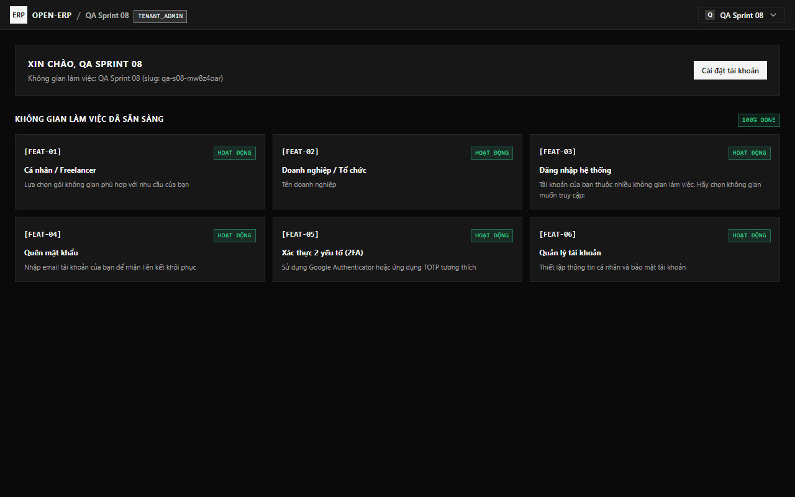

#### 2. Không gian Biểu mẫu động — Danh sách biểu mẫu (`browser_02_form_tab_forms.png`)
- Hiển thị trên menu trái dưới mục Hệ thống: **Biểu mẫu động**, **Quy trình phê duyệt**, **Nhân sự**.
- Bố cục chuẩn ERP Workspace: Header `KHÔNG GIAN BIỂU MẪU` / `Biểu mẫu động`, 4 thẻ KPI (`TỔNG BIỂU MẪU`, `ĐANG MỞ THU THẬP`, `BẢN NHÁP`, `CÂU TRẢ LỜI`), thanh tab có badge đếm, bộ lọc tìm kiếm + trạng thái, và bảng `app-table`.

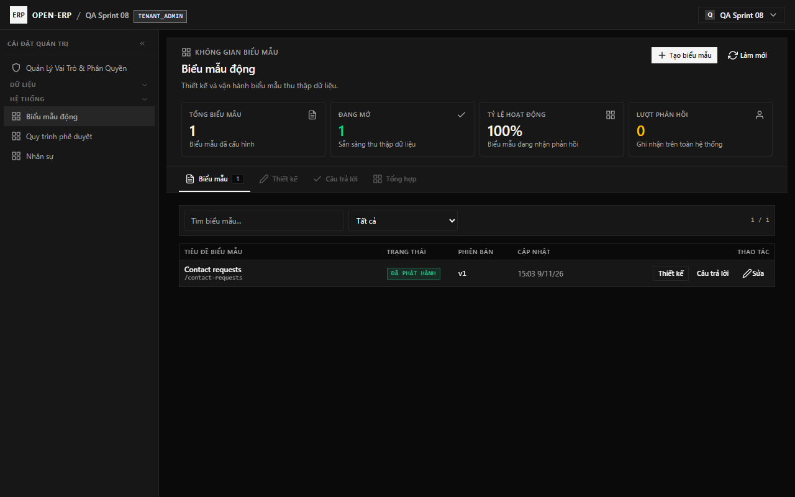

#### 3. Trình thiết kế Biểu mẫu trực quan — Live Visual Form Studio (`browser_03_form_tab_builder_fixed.png`)
- **Bố cục 3 phân vùng (3-Zone WYSIWYG Studio)**:
  - **Cột trái (Toolbox Palette & Outline)**: Kéo thả hoặc nhấn chọn khung bố cục **Phần (`SECTION`)**, **Trang (`PAGE`)**, **Bước (`STEP` Wizard)** và 10 loại trường dữ liệu; cây cấu trúc tóm tắt số cột (`2C`) và độ rộng từng trường (`1C`, `2C`).
  - **Vùng giữa (Xem trước trực quan - Live WYSIWYG Canvas)**: Hiển thị thanh tiến trình Wizard (`Bước 1: Thông tin ứng viên & Liên hệ → Bước 2: Đánh giá năng lực & Hồ sơ đính kèm`), nút chuyển nhanh số cột Desktop (`1C | 2C | 3C | 4C`) và Mobile (`M:1C | M:2C`), bộ chuyển chế độ hiển thị `Desktop` / `Mobile 390px`, cùng lưới trường 2 cột trực quan có nút chỉnh nhanh độ rộng (`1C | Full | ↵`).
  - **Cột phải (Inspector Thuộc tính)**: Tự động sinh mã tham chiếu (`Tự sinh mã`), cấu hình **Bố cục Cột, Hàng & Responsive Mobile** (`col_span`, `row_span`, `mobile_span`, `row_break`, `hide_on_mobile`), và **Ánh xạ Dữ liệu Thực thể (Entity Registry)** qua danh sách chọn thực thể/trường đích.

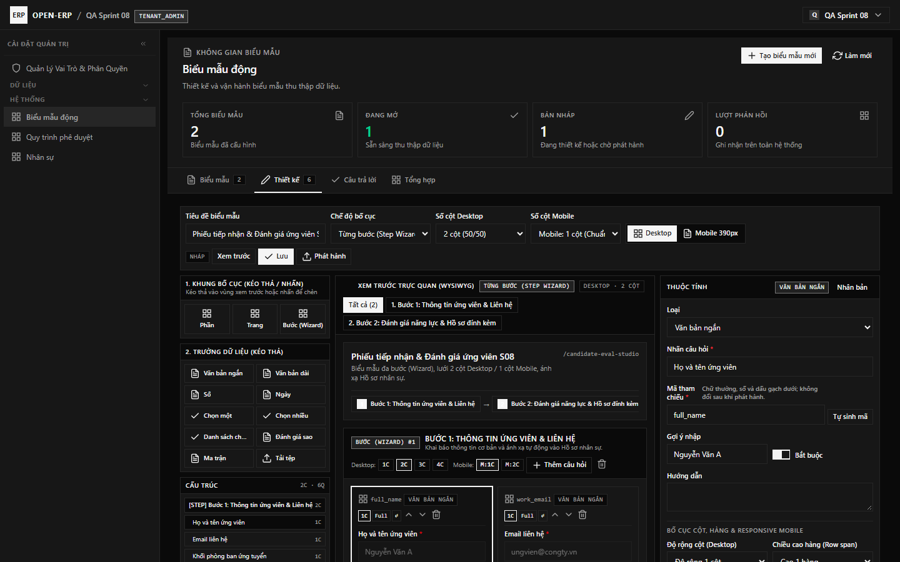

#### 4. Quản lý Câu trả lời — Split-View (`browser_04_form_tab_responses.png`)
- Chia đôi màn hình (Split-Screen): bên trái là bảng danh sách lượt gửi (`app-table`), bên phải là thẻ chi tiết câu trả lời (`Tran Thi B (Browser QA)`, `priority: high`, trạng thái `SKIPPED`).

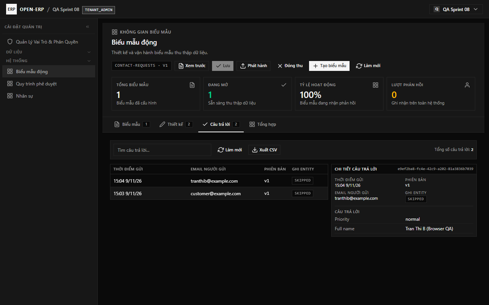

#### 5. Tổng hợp kết quả biểu mẫu (`browser_05_form_tab_summary.png`)
- Hiển thị tổng số câu trả lời, thời điểm gửi gần nhất và phân bố tỷ lệ lựa chọn theo từng câu hỏi.

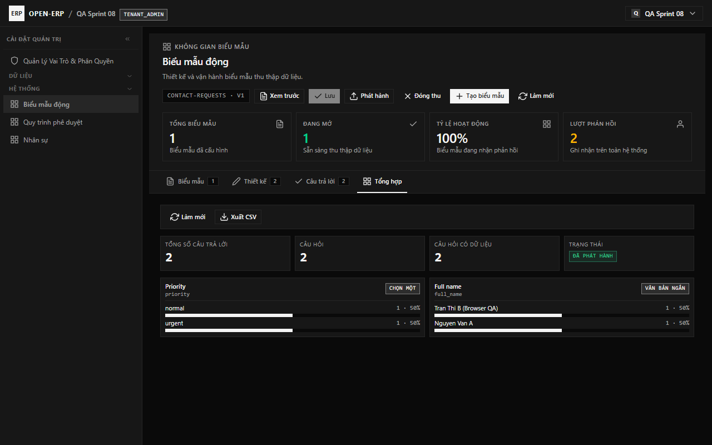

#### 6. Không gian Quy trình phê duyệt — Hộp thư Việc của tôi (`browser_06_workflow_inbox.png`)
- Header `KHÔNG GIAN QUY TRÌNH` / `Quy trình phê duyệt`, 4 thẻ KPI (`TỔNG LƯỢT CHẠY`, `CHỜ XỬ LÝ`, `VIỆC QUÁ HẠN`, `QUY TRÌNH HOẠT ĐỘNG`), nút chuyển phạm vi `Của tôi` / `Tất cả`, bộ lọc tìm kiếm và danh sách việc đang chờ duyệt (`triage`).

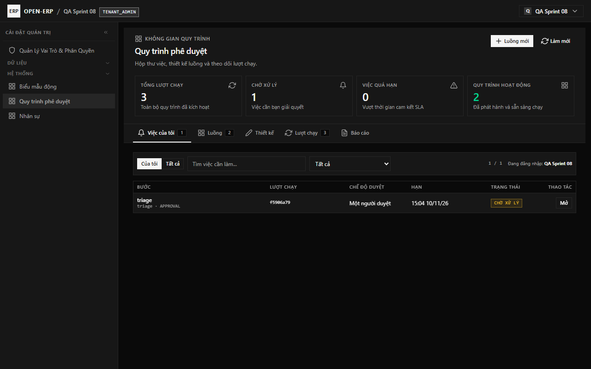

#### 7. Drawer Chi tiết việc & Phê duyệt (`browser_07_workflow_approve_drawer.png`)
- Sử dụng `app-drawer` trượt từ cạnh phải (tuân thủ quy chuẩn Anti-Modal), hiển thị tên người thực hiện kèm email (`QA Sprint 08 (qa-s08-admin-mw8z4oar@example.com)`), tiến trình các bước, ô nhập ý kiến (`app-sharp-textarea`), mục **Thao tác khác** với danh sách chọn `Bước trả về` (`app-sharp-select`) và **Bộ chọn tìm kiếm Người nhận mới** (không phải nhập UUID thủ công), cùng cụm nút hành động (`Đóng (Esc)`, `Nhận việc`, `Từ chối`, `Đồng ý`).

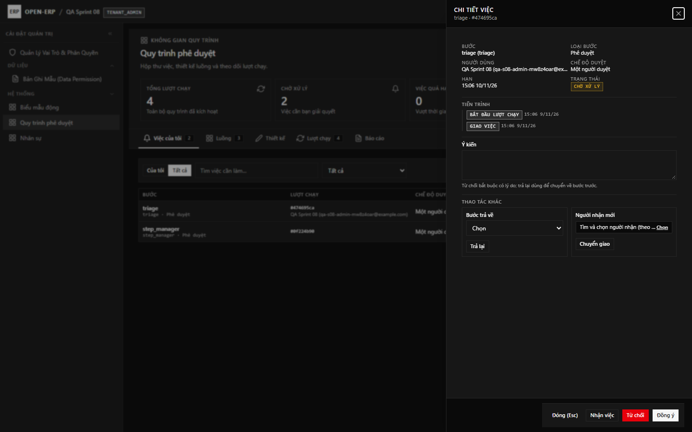

#### 8. Kết quả sau khi bấm Đồng ý phê duyệt trên UI (`browser_09_workflow_approve_ui_success.png`)
- Hiển thị banner xác nhận `Đã xử lý.`, thẻ KPI `CHỜ XỬ LÝ` giảm về `0`, danh sách việc chờ trống (`Không có việc nào chờ bạn.`).

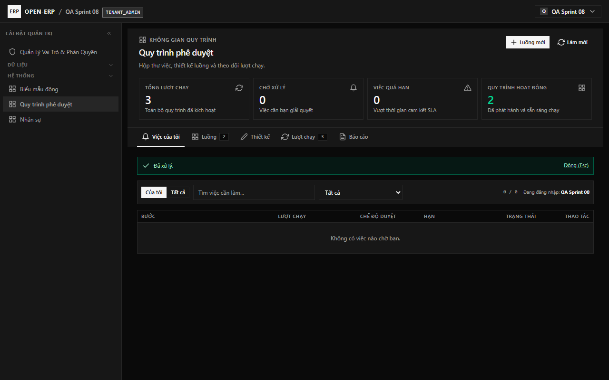

#### 9. Lượt chạy quy trình & Timeline tiến trình (`browser_10_workflow_run_timeline.png`)
- Hiển thị danh sách các lượt chạy kèm tên quy trình (`form-intake-approval (v1)`, `employee-profile-change (v1)`) và bảng `TIẾN TRÌNH` chi tiết ở cột bên phải hiển thị sự kiện đã phân giải tên người nhận (`assignees: QA Sprint 08 (qa-s08-admin-mw8z4oar@example.com)`).

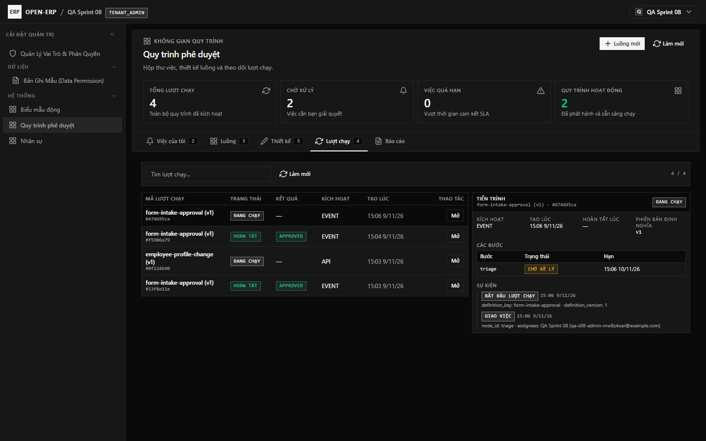

#### 10. Sơ đồ luồng Quy trình đồ họa — Visual Node Graph Workflow Studio (`browser_11_workflow_builder.png`)
- **Đồ thị Node có đường liên kết SVG trực quan (`<svg>`)**: Hiển thị các node `Khởi tạo hồ sơ (start)` → `Sơ loại Nhân sự (HR) (triage)` rẽ nhánh sang `Trưởng bộ phận duyệt (dept_approve)` và `Thông báo Ban Tuyển dụng (notify_cc)` với đường cong Bezier có mũi tên định hướng, nhãn cạnh cho phép gỡ nối 1 chạm (`×`), kéo thả vị trí node, nút chuyển hướng đồ thị `Ngang (Trái → Phải)` / `Dọc (Trên → Dưới)` và `Tự căn chỉnh đồ thị`.
- **Bảng thuộc tính bên phải không dùng UUID thô**: Chọn bước kế tiếp qua chip + dropdown (`+ Chọn bước kế tiếp để nối...`), chọn người duyệt qua **Bộ chọn tìm kiếm Người dùng** (`Họ tên + Email`), chọn **Vai trò** hoặc **Trường dữ liệu** từ danh sách.

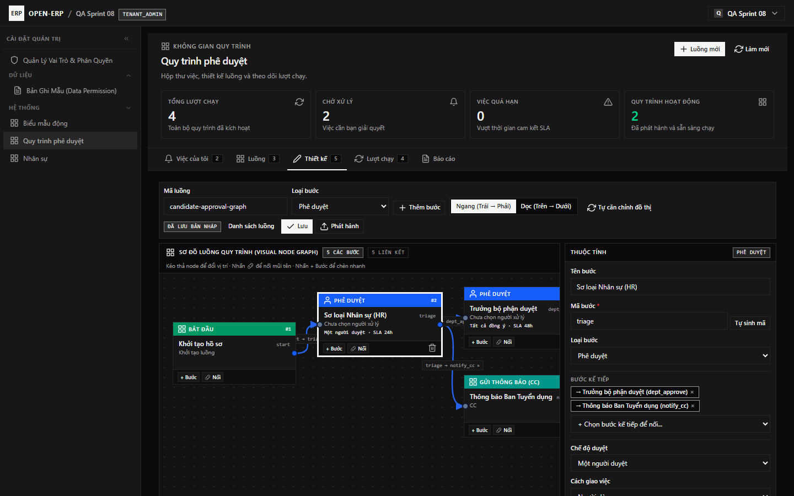

#### 11. Trang điền biểu mẫu công khai & Màn hình hoàn tất trên Desktop (`browser_public_fill_desktop_bugfix.png`, `browser_public_submit_done_bugfix.png`)

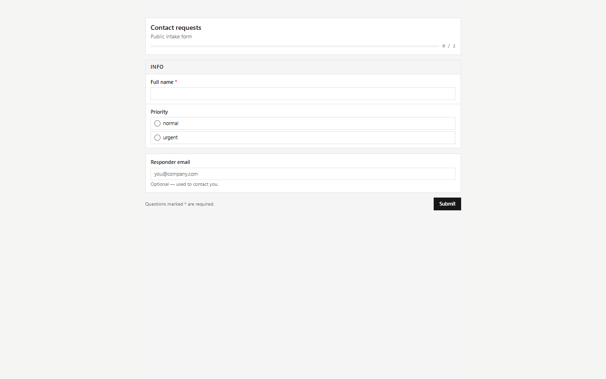

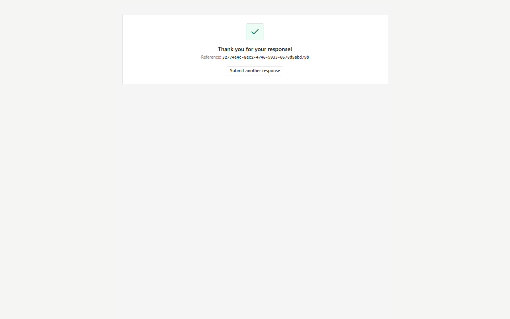

#### 12. Kiểm thử Responsive Mobile `390×844` (`browser_public_fill_mobile_bugfix.png`, `browser_12_workflow_mobile_390x844.png`)
- Kiểm tra `document.documentElement.scrollWidth <= 390`: đạt `true` trên cả trang công khai và trang quản trị quy trình (không tràn ngang,0 lỗi console).

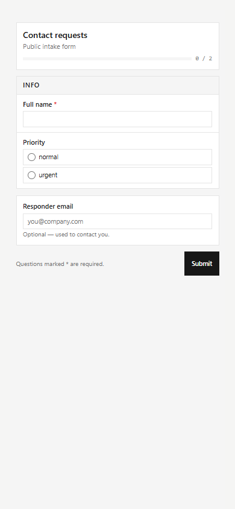

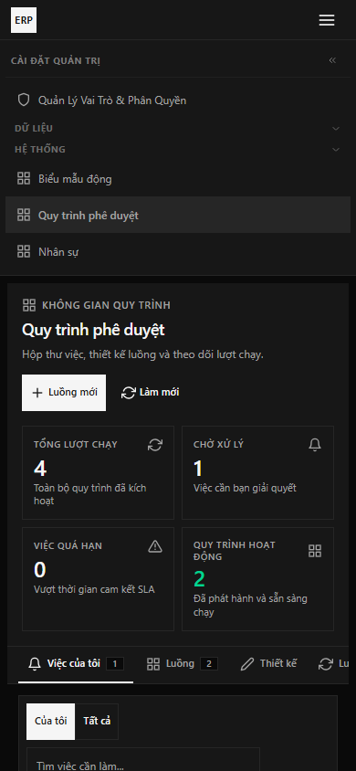

---

## 7. Kết luận QA

**QA PASS**: Toàn bộ hạng mục kiểm thử đạt 100% — **13 unit test engine + 254 core backend test + 31 plugin test + 11 CLI test + 22 E2E runtime assertions + 5 security negative assertions + 12 màn hình trình duyệt Desktop/Mobile**.
- Hai plugin `form` (`1.0.8`) và `workflow` (`1.0.13`) đã hoạt động đúng chuẩn **plugin mặc định luôn bật (`default_install = true`, `locked = true`)** với schema dữ liệu cô lập theo từng tenant (`tenant_<id8>_form`, `tenant_<id8>_workflow`).
- Giao diện đã sử dụng đồng bộ thư viện `@shared` và tuân thủ chuẩn ERP Workspace của dự án.
- Không còn bất kỳ bug Critical/High/Medium nào thuộc phạm vi Sprint 08. Sẵn sàng trình Chủ dự án review và nghiệm thu.
