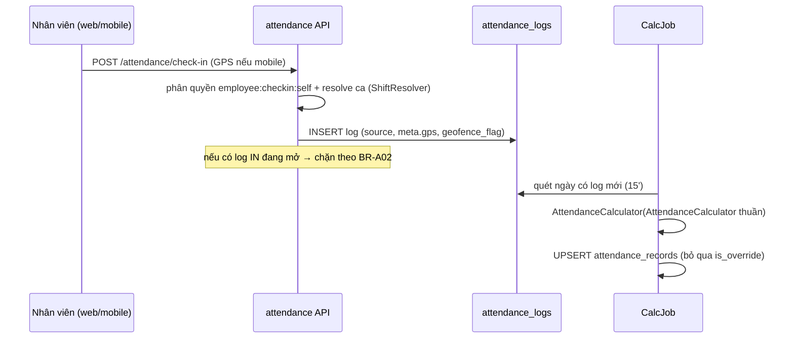

# [DES-ARCH-S09-001] Kiến trúc thành phần & luồng: Plugin attendance

| Trường | Giá trị |
| :--- | :--- |
| ID / loại / sprint | DES-ARCH-S09-001 / Thiết kế kiến trúc / Sprint 09 |
| Trạng thái / phiên bản / cập nhật | Draft / 0.1 / 2026-11-02 |
| Owner / reviewer | Solution Architect / Chủ dự án (design review) |
| Đầu vào | [SOL-S09-001](../../05_solutions/01_SOL-S09-001_attendance_architecture.md) APPROVED, [ADR-S09-001…005](../../05_solutions/02_ADR-S09-001_shift_structure_in_plugin.md), [DES-DB-S09-001](../db/01_DES-DB-S09-001_attendance_schema.md) |
| Đọc trước / đọc tiếp | [DES-DB-S09-001](../db/01_DES-DB-S09-001_attendance_schema.md) / [DES-API-S09-001](../api/01_DES-API-S09-001_attendance_api.md) |

## 1. Thành phần plugin attendance

```
plugins/attendance (Maven module, com.vn9melody.openerp.plugins.attendance)
├── engine/            # hàm thuần, không phụ thuộc DB
│   ├── ShiftResolver        # resolve ca ngày D: assignment → dept → branch → tenant → default (ADR-001)
│   ├── AttendanceCalculator # (logs, shift, ot_window, holiday) → record (ADR-003)
│   ├── MappingExecutor      # status_mapping của RequestType → tác động attendance (ADR-002)
│   └── LeaveLedgerService   # derive balance, kiểm tra duyệt, entry append-only (ADR-004)
├── service/           # orchestration + repository qua PluginDataClient
│   ├── CheckInService, LogIngestionService (web/mobile/kiosk/import/push), HangingCheckJob
│   ├── ShiftScheduleService (template/assignment/holiday), CalcJob (Quarkus Scheduler)
│   ├── RequestService (nộp đơn, mở instance/fallback, consume event), LeaveService
│   ├── TimesheetService (4 bước, xác nhận, chốt/mở khóa), ExportService, ReportService
│   └── EmployeeRefSyncJob (projection), NotificationClient (in-app-notification)
├── resource/          # REST theo DES-API; InternalResource cho Core Event Hub delivery
└── api/AttendanceErrorCode.java  # enum UPPER_SNAKE_CASE
```

Core bổ sung: `AttendanceIngestResource` (route public push — xác thực secret/nonce/rate limit rồi forward gateway; **không nghiệp vụ** — ADR-S09-005). Không đụng module eventhub đang chạy của Sprint 08.

## 2. Luồng chính (sequence)

### 2.1. Check-in web/mobile và tính công



### 2.2. Đơn từ → workflow → mapping

```mermaid
sequenceDiagram
    participant E as Nhân viên
    participant A as attendance
    participant F as form (Sprint 08)
    participant W as workflow (Sprint 08)
    participant C as Core Event Hub
    E->>A: POST /attendance/requests {type, response}
    A->>A: validate window_days + kỳ chốt + số dư (LEAVE)
    A->>F: (nộp qua API form theo form_ref; pin form_version)
    A->>W: internal API mở instance (source_ref = request)
    W-->>C: workflow.instance.completed (outcome)
    C->>A: deliver event (manifest subscription)
    A->>A: MappingExecutor theo status_mapping (idempotent request_id)
    A->>A: ledger + record + ot_windows + shift_assignments (tuỳ loại)
```

Fallback (engine chưa release): `approval_mode=INTERNAL_FALLBACK` — manager từ `EmployeeAssignment.manager_employee_id` (fallback HR) duyệt trực tiếp trên API attendance; khi engine release đổi sang `ENGINE` không migration (ADR-S09-002 §2.3).

### 2.3. Bảng công 4 bước + chốt

```mermaid
sequenceDiagram
    participant H as HR
    participant T as TimesheetService
    H->>T: POST /timesheets {period, scope, wage_calc_mode}
    H->>T: bước 1-4: S1_LOGS→S2_SCHEDULE→S3_CALCULATE→S4_ADJUST→DONE
    Note over T: S3 chạy CalcJob + snapshot; quay lại bước trước cảnh báo ghi đè (Base pattern)
    H->>T: POST /timesheets/{id}/send-confirmations
    T->>T: insert confirmations + notification từng người
    E->>T: POST /confirmations/{id} {confirm|reject, comment}
    H->>T: POST /timesheets/{id}/lock (quá hạn vẫn chốt, đánh dấu chưa xác nhận)
    T->>T: khóa records (timesheet_id), snapshot, event attendance.timesheet.locked
```

### 2.4. Push ingestion (middleware máy chấm công)

Core `AttendanceIngestResource` xác thực secret hash + nonce + timestamp (±5 phút) + rate limit theo device → forward runtime gateway → `LogIngestionService` ghi log nguồn `PUSH` idempotent → trả số dòng ghi/bỏ qua. Không trả dữ liệu nhân sự qua endpoint này.

## 3. Phân quyền & tenant isolation

| Nhóm quyền (RBAC) | Ai | Phạm vi dữ liệu |
| :--- | :--- | :--- |
| `attendance:checkin:self` | mọi nhân viên có assignment active | bản thân |
| `attendance:record:read` | manager (team theo assignment), HR | data scope Core (tenant/branch/department) |
| `attendance:record:override`, `attendance:log:manage` | HR + manager (team) | theo scope; override bắt buộc lý do |
| `attendance:kiosk:operate` | token thiết bị (không user) | đúng branch của kiosk |
| `attendance:shift:manage`, `attendance:leave:manage`, `attendance:settings:manage` | HR/Tenant Admin | tenant |
| `attendance:request:submit` | nhân viên | bản thân; window_days |
| `attendance:request:approve` | manager (MANAGER_OF) / HR fallback / luồng engine | theo engine + scope |
| `attendance:timesheet:manage` | HR | scope; `...:lock` chỉ Tenant Admin; `...:confirm` nhân viên nhận bảng |
| `attendance:report:read` | manager (team) / HR (tenant) | scope |

Isolation: mọi query qua descriptor `tenant_scope: TENANT`; job lấy tenant list từ Core và chạy trong context riêng; kiosk/push không bao giờ nhận dữ liệu ngoài chi nhánh/thiết bị; test isolation là hạng mục nghiệm thu (AC-T07).

## 4. Tương tác plugin khác

| Plugin | Hướng | Cách |
| :--- | :--- | :--- |
| employee | attendance đọc | internal READ API (descriptor `employee.list`, `employee.get_by_user`, assignment) + projection `employee_refs` sync job |
| workflow | attendance gọi + consume | internal API mở instance; Event Hub subscription `workflow.instance.completed` (fallback INTERNAL_FALLBACK) |
| form | attendance tham chiếu | `form_ref` JSONB; nộp đơn gọi API form, pin version |
| in-app-notification | attendance gọi | internal notification API (pattern employee) — 4 nhóm thông báo CONF Q16 |
| organization | soft ref | `branch_id` trong devices/holidays scope; geofence theo chi nhánh |
| catalog | soft ref | `catalog_shift_id` (tên ca) |
| core eventhub | publish | 3 sự kiện `attendance.*` qua internal plugin-events (idempotency key) |

## 5. Chiến lược test (No H2)

1. **Engine thuần (unit, JUnit 5)**: ShiftResolver precedence + ca đêm + lễ; AttendanceCalculator ≥ 20 case biên (grace 2 chiều, OT dưới ngưỡng, log lộn xộn, ca đêm, chưa có ca); MappingExecutor từng loại chuẩn; LedgerService derive (grant/usage/reversal/adjust/expiry/carry-over, chặn âm).
2. **Integration (PostgreSQL/Redis thật)**: ingestion 5 nguồn idempotent; job multi-tenant; push secret/nonce/replay; import trùng; timesheet 4 bước + chốt/mở khóa; event consume → mapping; fallback duyệt; notification.
3. **QA browser**: Desktop ≥1280px + Mobile emulation 390×844 (chấm GPS, đơn, duyệt, xác nhận); 0 console error; ảnh minh chứng TR.

## 6. Rủi ro triển khai

| Rủi ro | Biện pháp |
| :--- | :--- |
| Engine đơn từ phụ thuộc Sprint 08 chưa release | Cờ `approval_mode` theo tenant; feature toggle khi scaffold; fallback đã thiết kế (ADR-002 §2.3) |
| Job tính công tràn khi tenant lớn | Chạy theo batch (tenant × ngày), index `(work_date, needs_review)`, chỉ tính ngày đổi; test 10k nhân viên giả lập |
| Event fan-out best-effort mất mapping | `mapping_status=PENDING` + job đối soát instance completed chưa mapping; idempotency theo request_id |
| Projection employee_refs lệch | Sync trước job tính công + cờ synced_at stale cảnh báo; nguồn quyền luôn qua Core, không dùng projection cho authz |

## 7. Truy vết AC → thành phần

AC-A01…A07 → CheckInService/LogIngestionService/HangingCheckJob; AC-S01…S04 → ShiftScheduleService/ShiftResolver; AC-C01…C03 → AttendanceCalculator/CalcJob/TimesheetService; AC-R01…R04 + AC-Đ01…Đ06 → RequestService/MappingExecutor/workflow adapter; AC-L01…L05 → LeaveService/LedgerService; AC-T01…T07 → TimesheetService/ExportService/ReportService; AC-M01 → WC mobile (DES-UI).
