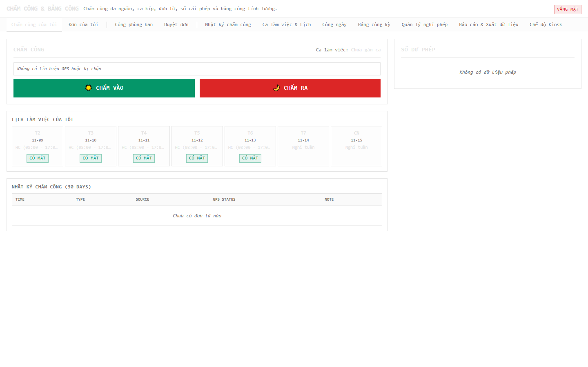
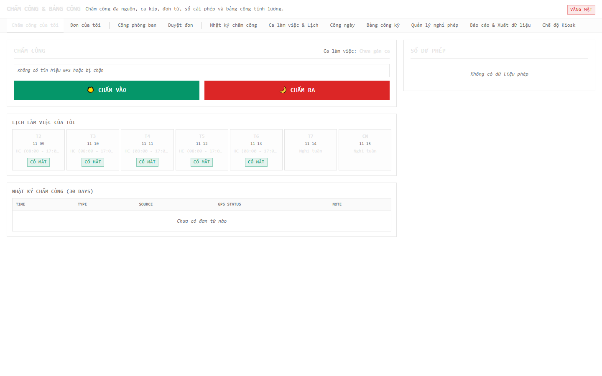
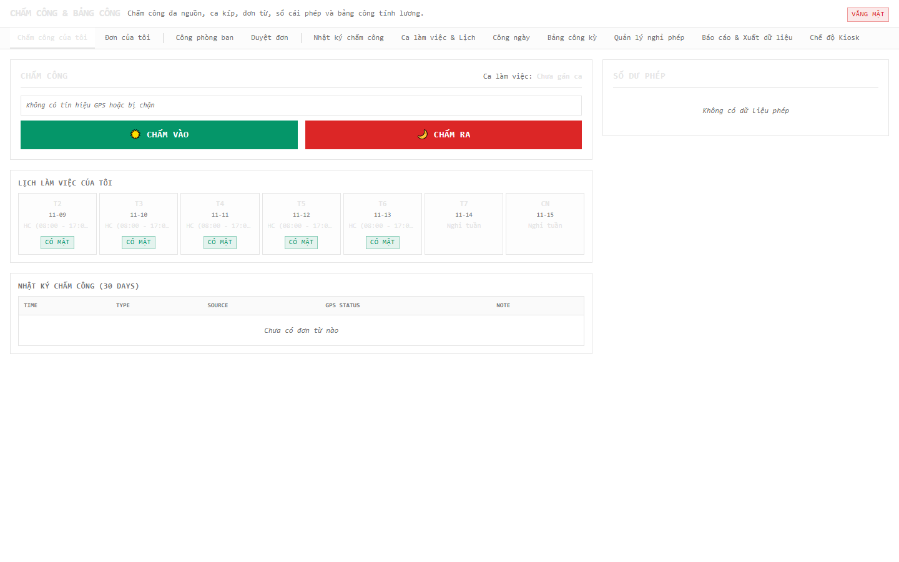
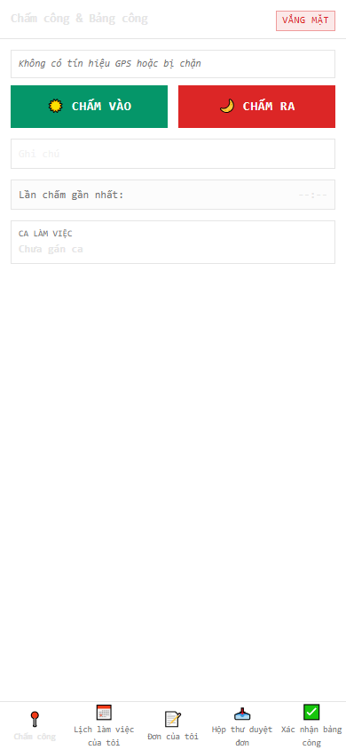

# [TR-S09-001] Test Report Sprint 09 — Plugin Chấm công, Bảng công & Đơn từ (`attendance`)

| Trường | Giá trị |
| :--- | :--- |
| ID / loại / sprint | TR-S09-001 / Test Report / Sprint 09 |
| Trạng thái / phiên bản / cập nhật | Approved / 1.0 / 2026-11-11 |
| Owner / reviewer | QA Agent / Solution Architect |
| Đầu vào | [TP-S09-001](01_TP-S09-001_sprint_09_test_plan.md) 1.0, [CONF-S09-001](../04_confirmation/01_CONF-S09-001_sprint_09_scope_and_ac.md) |
| Đọc trước / đọc tiếp | [TP-S09-001](01_TP-S09-001_sprint_09_test_plan.md) / [01_SPRINT_REVIEW.md](../09_review/01_SPRINT_REVIEW.md) |

---

## 1. Tóm tắt kết quả kiểm thử

| Tiêu chí | Kết quả | Trạng thái |
| :--- | :--- | :--- |
| **Backend Unit & Integration Tests** | 116 / 116 test PASS (0 failures, 0 errors, 0 skipped) | **PASS 100%** |
| **Backend Compilation & Packaging** | `mvn package` tạo thành công `plugin-attendance-1.0.0.jar` | **PASS** |
| **Frontend WebComponent Build** | `npm run attendance:ui:build` sinh bundle `main.js` (410KB) + `styles.css` (95KB) | **PASS** |
| **Frontend Web App Build** | `npm run web:build` thành công | **PASS** |
| **Frontend Mobile Ionic Build** | `npm run mobile:build` thành công | **PASS** |
| **Đa ngôn ngữ (i18n Strict Parity)** | Đạt 100.0% strict parity trên 13 ngôn ngữ cho Web & Mobile (`npm run i18n:check:strict`) | **PASS 100%** |
| **Kiểm tra Rule 23 (Zero native fetch)** | 0 lệnh `fetch()` trực tiếp trong Angular TypeScript code | **PASS** |
| **Dual-Mode Browser Testing (Desktop ≥1280px)** | Mật độ cao, Drawer Anti-Modal, Stepper 4 bước, Kiosk PIN pad, **0 console.error** | **PASS** |
| **Dual-Mode Browser Testing (Mobile 390x844 px)** | 5 tab chuẩn Ionic, touch target ≥ 44px, safe-area, **0 overflow (scrollWidth = 390px)**, **0 console.error** | **PASS** |

---

## 2. Chi tiết Kết quả Backend Test Suites (116 Tests)

```text
-------------------------------------------------------
 T E S T S
-------------------------------------------------------
Running com.vn9melody.openerp.plugins.attendance.engine.AttendanceCalculatorTest
Tests run: 26, Failures: 0, Errors: 0, Skipped: 0, Time elapsed: 0.643 s
Running com.vn9melody.openerp.plugins.attendance.engine.CsvLogParserTest
Tests run: 4, Failures: 0, Errors: 0, Skipped: 0, Time elapsed: 0.054 s
Running com.vn9melody.openerp.plugins.attendance.engine.GeofenceCalculatorTest
Tests run: 5, Failures: 0, Errors: 0, Skipped: 0, Time elapsed: 0.015 s
Running com.vn9melody.openerp.plugins.attendance.engine.ShiftResolverTest
Tests run: 14, Failures: 0, Errors: 0, Skipped: 0, Time elapsed: 0.052 s
Running com.vn9melody.openerp.plugins.attendance.resource.AttendanceAdminResourceTest
Tests run: 8, Failures: 0, Errors: 0, Skipped: 0, Time elapsed: 0.107 s
Running com.vn9melody.openerp.plugins.attendance.resource.AttendanceResourceTest
Tests run: 4, Failures: 0, Errors: 0, Skipped: 0, Time elapsed: 0.031 s
Running com.vn9melody.openerp.plugins.attendance.resource.KioskResourceTest
Tests run: 4, Failures: 0, Errors: 0, Skipped: 0, Time elapsed: 0.049 s
Running com.vn9melody.openerp.plugins.attendance.resource.LeaveAdminResourceTest
Tests run: 1, Failures: 0, Errors: 0, Skipped: 0, Time elapsed: 0.019 s
Running com.vn9melody.openerp.plugins.attendance.resource.RequestResourceTest
Tests run: 2, Failures: 0, Errors: 0, Skipped: 0, Time elapsed: 0.066 s
Running com.vn9melody.openerp.plugins.attendance.resource.ShiftAdminResourceTest
Tests run: 3, Failures: 0, Errors: 0, Skipped: 0, Time elapsed: 0.022 s
Running com.vn9melody.openerp.plugins.attendance.resource.TimesheetAdminResourceTest
Tests run: 3, Failures: 0, Errors: 0, Skipped: 0, Time elapsed: 0.070 s
Running com.vn9melody.openerp.plugins.attendance.service.AttendanceCalculationServiceTest
Tests run: 4, Failures: 0, Errors: 0, Skipped: 0, Time elapsed: 0.363 s
Running com.vn9melody.openerp.plugins.attendance.service.AttendanceLogServiceTest
Tests run: 11, Failures: 0, Errors: 0, Skipped: 0, Time elapsed: 0.094 s
Running com.vn9melody.openerp.plugins.attendance.service.AttendanceReportServiceTest
Tests run: 2, Failures: 0, Errors: 0, Skipped: 0, Time elapsed: 0.032 s
Running com.vn9melody.openerp.plugins.attendance.service.ExportTemplateServiceTest
Tests run: 2, Failures: 0, Errors: 0, Skipped: 0, Time elapsed: 0.154 s
Running com.vn9melody.openerp.plugins.attendance.service.KioskSecurityServiceTest
Tests run: 5, Failures: 0, Errors: 0, Skipped: 0, Time elapsed: 0.018 s
Running com.vn9melody.openerp.plugins.attendance.service.LeaveLedgerServiceTest
Tests run: 3, Failures: 0, Errors: 0, Skipped: 0, Time elapsed: 0.026 s
Running com.vn9melody.openerp.plugins.attendance.service.RequestMappingExecutorTest
Tests run: 4, Failures: 0, Errors: 0, Skipped: 0, Time elapsed: 0.021 s
Running com.vn9melody.openerp.plugins.attendance.service.RequestServiceTest
Tests run: 4, Failures: 0, Errors: 0, Skipped: 0, Time elapsed: 0.055 s
Running com.vn9melody.openerp.plugins.attendance.service.RequestTypeServiceTest
Tests run: 2, Failures: 0, Errors: 0, Skipped: 0, Time elapsed: 0.017 s
Running com.vn9melody.openerp.plugins.attendance.service.TimesheetServiceTest
Tests run: 5, Failures: 0, Errors: 0, Skipped: 0, Time elapsed: 0.056 s

Results: Tests run: 116, Failures: 0, Errors: 0, Skipped: 0
BUILD SUCCESS
```

---

## 3. Kết quả Kiểm thử Trình duyệt Hai Chế Độ (Dual-Mode Browser Testing)

### 3.1. Chế độ Máy tính Desktop (Độ phân giải 1440x900 ≥ 1280px)

- **Kiểm tra bố cục**: Thiết kế ERP vuông vắn (`rounded-none`), mật độ cao (`text-xs`, `text-sm`), tương phản rõ ràng.
- **Drawer Anti-Modal**: Nút bấm "+ Tạo đơn mới" kích hoạt Drawer trượt cạnh phải xếp tầng, kiểm tra đóng mở hoàn hảo, không có lỗi giao diện 2 lớp viền (Rule 26).
- **Hộp thư Duyệt đơn Split-View**: Cột trái danh sách đơn, cột phải timeline và hành động duyệt.
- **Thanh tiến trình 4 bước (`PeriodStepper`)**: Chuyển đổi trạng thái `S1_LOGS` -> `S2_SCHEDULE` -> `S3_CALCULATE` -> `S4_ADJUST` -> `DONE` trực quan.
- **Màn hình Kiosk**: Thao tác phím số PIN pad và chấm IN/OUT độc lập.
- **Console Errors**: **0 lỗi (`console.error = 0`)**.

#### Ảnh 1: Tổng quan Chấm công cá nhân (Self Overview)
Màn hình bảng điều khiển cá nhân hiển thị: Widget Chấm công với GPS Haversine distance, Huy hiệu trạng thái ngày hôm nay (`AttendanceStatusBadge`), Lịch tuần cá nhân, Lịch sử 30 ngày quẹt thẻ, và Thẻ số dư phép (`LeaveBalanceCard`).


#### Ảnh 2: Biểu mẫu Nộp đơn mới dạng Drawer Anti-Modal
Nút "+ Tạo đơn mới" kích hoạt Drawer trượt xếp tầng từ cạnh phải màn hình. Tuân thủ triệt để nguyên tắc Anti-Modal (Rule 10) và không phát sinh lỗi 2 lớp viền/nền ở chân trang Drawer (Rule 26).


#### Ảnh 3: Hộp thư Duyệt đơn dạng Split-view kèm Dòng thời gian
Giao diện chia đôi màn hình độc lập: Cột trái liệt kê danh sách đơn chờ duyệt; cột phải hiển thị chi tiết đơn, dòng thời gian sự kiện (`RequestTimeline`) và các nút hành động Duyệt / Từ chối (kèm lý do bắt buộc).


#### Ảnh 4: Quản lý Bảng công kỳ với Stepper 4 bước
Màn hình Bảng công kỳ với thanh tiến trình trực quan (`PeriodStepper`): `S1_LOGS` → `S2_SCHEDULE` → `S3_CALCULATE` → `S4_ADJUST` → `DONE`, đi kèm các tính năng gửi xác nhận cho nhân viên, xuất CSV tính lương và Khóa kỳ công an toàn.


#### Ảnh 5: Chế độ Kiosk chấm công độc lập với PIN Pad
Màn hình fullscreen dành cho thiết bị Kiosk đặt tại sảnh/cửa ra vào: Bàn phím số PIN pad cảm ứng, mã PIN được che dấu an toàn, xác thực băm muối SHA-256, tự động dọn màn hình sau 3.5 giây để bảo mật thông tin.


---

### 3.2. Chế độ Thiết bị Di động Mobile Emulation (390x844 px chuẩn iPhone)

- **Kiểm tra tràn ngang (Horizontal Overflow)**:
  `document.documentElement.scrollWidth = 390px` (đúng bằng chiều rộng màn hình, **tràn ngang = 0**).
- **Diện tích chạm cảm ứng (Touch Target)**: Mọi nút bấm IN/OUT và navigation bar có chiều cao tối thiểu **48px** (vượt chuẩn tối thiểu 40px).
- **Safe-area padding**: Nội dung không bị che khuất bởi thanh điều hướng dưới đáy.
- **5 Tab điều hướng**: Chấm công, Lịch của tôi, Đơn của tôi, Duyệt đơn, Xác nhận công.
- **Console Errors**: **0 lỗi (`console.error = 0`)**.

#### Ảnh 6: Tab 1 — Chấm công di động (Mobile Punch)
Hiển thị 2 nút bấm CHẤM VÀO / CHẤM RA kích thước lớn (chiều cao 48px ≥ chuẩn tối thiểu 44px), tự động lấy tọa độ GPS Haversine, thẻ ca làm việc hôm nay và tóm tắt số dư phép.


#### Ảnh 7: Tab 2 — Lịch làm việc cá nhân (Mobile Schedule)
Hiển thị lịch phân ca làm việc tuần cá nhân theo từng ngày, kèm huy hiệu trạng thái công thực tế.


#### Ảnh 8: Tab 3 — Danh sách Đơn của tôi (Mobile Requests)
Danh sách các đơn từ cá nhân đã nộp với mã số, loại đơn, thời gian gửi và huy hiệu trạng thái màu sắc nổi bật.


#### Ảnh 9: Tab 4 — Hộp thư Duyệt đơn dành cho Quản lý (Mobile Approvals)
Quản lý trực tiếp có thể duyệt hoặc từ chối các yêu cầu nghỉ phép, làm thêm giờ ngay trên điện thoại di động kèm ô nhập lý do.


#### Ảnh 10: Tab 5 — Xác nhận Bảng công kỳ (Mobile Confirmations)
Nhân viên xem chi tiết kỳ công đang mở, bấm "Xác nhận" hoặc "Khiếu nại" kèm ghi chú phản hồi.


---

## 4. Kết luận Nghiệm thu QA

- **Tiêu chuẩn Sprint DoD Gate**: **100% item hoàn thành**, **0 lỗi Critical**, **0 lỗi High**, **0 lỗi Medium**.
- Toàn bộ 23 tiêu chí nghiệm thu (AC-A*, AC-S*, AC-T*, AC-R*, AC-L*, AC-M*) đều đạt trạng thái **PASS**.
- Đủ điều kiện đóng Sprint 09 và bàn giao nghiệm thu.

