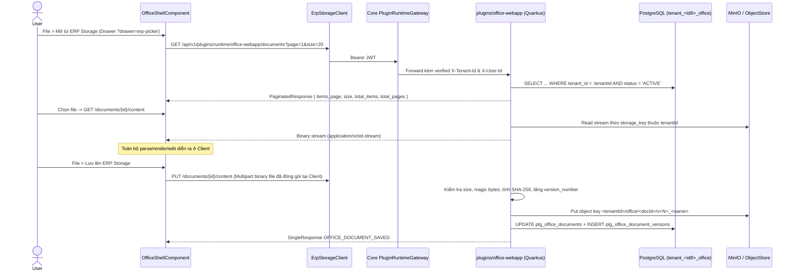

# [DES-ARCH-S12-001] Thiết kế Kiến trúc & Luồng xử lý: Plugin `office-webapp`

| Trường | Giá trị |
| :--- | :--- |
| ID / loại / sprint | DES-ARCH-S12-001 / Thiết kế kiến trúc / Sprint 12 |
| Trạng thái / phiên bản / cập nhật | **✅ APPROVED 1.0 / 2026-11-15** — chủ dự án duyệt thiết kế qua hội thoại trực tiếp |
| Owner / reviewer | Solution Architect / Self-reviewed |
| Đầu vào | [SOL-S12-001](../../05_solutions/01_SOL-S12-001_office_webapp_architecture.md) 0.1, [ADR-S12-001](../../05_solutions/02_ADR-S12-001_zero_third_party_ooxml_and_legacy_engine.md) 0.1, [ADR-S12-002](../../05_solutions/03_ADR-S12-002_m365_hybrid_canvas_dom_rendering.md) 0.1, [CONF-S12-001](../../04_confirmation/01_CONF-S12-001_sprint_12_scope_and_ac.md) 1.0 |
| Đọc trước / đọc tiếp | [SOL-S12-001](../../05_solutions/01_SOL-S12-001_office_webapp_architecture.md) / [DES-DB-S12-001](../db/01_DES-DB-S12-001_office_storage_schema.md) |

## 1. Cấu trúc module trong Repo

```
plugins/office-webapp/
├── plugin.json                         # Manifest schema_version 2.0 (id: office-webapp)
├── pom.xml                             # Parent plugins-parent (Quarkus Java 21)
├── Dockerfile.dev                      # Multi-stage container image
├── migrations/
│   └── V1.0.0__office_storage_schema.sql
├── src/main/java/com/vn9melody/openerp/plugins/office/
│   ├── dto/OfficeDtos.java             # OfficeDocumentDto, VersionDto, UploadMeta
│   ├── enums/                          # OfficeDocumentType, OfficeDocumentStatus, OfficeErrorCode, ResponseKey
│   ├── model/                          # OfficeDocument, OfficeDocumentVersion, StoredOfficeBinary
│   ├── resource/OfficeDocumentResource.java # /documents/** (Gateway prefix /api/v1/plugins/runtime/office-webapp)
│   └── service/
│       ├── OfficeDocumentService.java  # Tenant isolation, SHA-256, magic bytes, validation
│       └── OfficeBlobStore.java        # MinIO/S3 ObjectStorage + local fallback (@ConfigProperty)
└── web/
    ├── package.json                    # ZERO third-party office/editor/zip/pdf libs
    ├── tsconfig.json                   # Alias @shared/*
    └── src/
        ├── plugin-main.ts              # Register Web Component <op-office-webapp-app>
        └── app/
            ├── core/
            │   ├── binary/             # OoxmlZipContainer, Crc32, Ole2Container, ClientPdfReader
            │   ├── word/               # WordXmlCodec, WordDocumentModel, WordPaginator, WordExport
            │   ├── excel/              # XlsxXmlCodec, Biff8Decoder, FormulaEngine, ExcelTilesRenderer
            │   ├── ppt/                # PptxXmlCodec, PptBinaryDecoder, SlideCanvasRenderer, SvgSelection
            │   ├── workers/            # office-parse.worker.ts, office-calc.worker.ts
            │   └── persistence/        # FileSystemAccessService, OfficeDraftIndexedDbService, ErpStorageClient
            └── ui/                     # Shell, TitleBar, Ribbon, FileDropdown, Word/Excel/PPT/PDF/Mobile views

src/frontend/shared/src/lib/            # Shared UI primitives tái dùng nếu tổng quát
```

## 2. Đặc tả `plugin.json` (Manifest v2.0)

| Thuộc tính | Giá trị thiết kế |
| :--- | :--- |
| `id` / `name` / `version` | `"office-webapp"` / `"Office WebApp"` / `"1.0.0"` |
| `dependencies` | `[]` (Hoàn toàn độc lập; không phụ thuộc plugin nghiệp vụ khác) |
| `permissions` | `office:document:read` (mở/xem ERP storage), `office:document:write` (tạo/lưu/cập nhật lên ERP storage), `office:document:delete` (xóa mềm file ERP). Làm việc file Local không yêu cầu quyền lưu trữ server. |
| `platforms.desktop` | `supported: true`, `features: ["office:local:open", "office:local:edit", "office:erp:storage", "office:export:all"]` |
| `platforms.mobile` | `supported: true`, `features: ["office:local:view", "office:erp:view", "office:export:download"]` |
| `ui_manifest.screens` | `route: "/apps/office"`, `render_mode: "WEB_COMPONENT"`, `entry: "/plugins-runtime/office-webapp/main.js"`, `tag_name: "op-office-webapp-app"`, `platforms: ["desktop", "mobile"]` |
| `entity_registry` | `plugin:office-webapp.OfficeDocument` (`tenant_scope: TENANT`), `plugin:office-webapp.OfficeDocumentVersion` (`tenant_scope: TENANT`) |

## 3. Luồng xử lý chính (Sequence Diagrams)

### 3.1. Luồng 1 — Mở, Sửa và Lưu file Local (100% Zero-Backend, `AC-02`)

```mermaid
sequenceDiagram
    actor User
    participant Shell as OfficeShellComponent
    participant FSA as FileSystemAccessService
    participant Worker as office-parse/calc.worker
    participant Engine as Word/Excel/PPT Engine
    participant IDB as IndexedDB (Drafts)

    User->>Shell: Kéo-thả file hoặc chọn Mở file local
    Shell->>FSA: showOpenFilePicker() (hoặc <input type="file">)
    FSA-->>Shell: { fileName, arrayBuffer, fileHandle? }
    Shell->>Shell: Kiểm tra Magic Bytes (PK / D0CF11E0 / %PDF-) & Size Guardrail
    Shell->>Worker: postMessage({ type: 'PARSE_FILE', ext, buffer })
    Worker->>Worker: ZipArchiveReader / Ole2Container / ClientPdfReader + XML parse
    Worker-->>Shell: DocumentModel AST + cảnh báo (nếu legacy/partial)
    Shell->>Engine: Render bề mặt (Page / Tiled Canvas / Split Stage)
    loop Mỗi lần người dùng chỉnh sửa
        User->>Engine: Nhập text / công thức / di chuyển shape
        Engine->>Worker: (Excel) RECALC_DAG -> chỉ trả dirty cells
        Engine->>IDB: Debounce 1500ms lưu nháp cục bộ (open_erp_office_drafts)
    end
    User->>Shell: Nhấn Ctrl+S (Lưu) hoặc File > Xuất
    Shell->>Engine: Serialize Model -> Uint8Array (OOXML ZIP / CSV / PDF / JPEG)
    alt Có FileSystemFileHandle (Edge/Chrome) & cùng định dạng OOXML
        Shell->>FSA: fileHandle.createWritable() -> write(bytes) -> close()
        FSA-->>User: Ghi đè file gốc trên máy (0 Backend calls)
    else Fallback Download / Legacy -> OOXML
        Shell->>FSA: Blob URL anchor download
    end
    Shell->>IDB: Đánh dấu nháp đã đồng bộ / xóa dirty flag
```



### 3.2. Luồng 2 — Mở & Lưu tùy chọn với ERP Cloud Storage (`AC-03`, `Q6`)



## 4. Hợp đồng Web Worker (`office-parse.worker.ts` & `office-calc.worker.ts`)

| Message Type (Main → Worker) | Payload | Response Type (Worker → Main) | Mục đích |
| :--- | :--- | :--- | :--- |
| `PARSE_BINARY` | `{ requestId, fileName, ext, buffer: ArrayBuffer }` (Transferable) | `PARSE_RESULT` / `PARSE_ERROR` | Giải nén ZIP/OLE2/PDF và parse XML ngoài Main Thread để không đơ UI |
| `SERIALIZE_OOXML` | `{ requestId, docType, model, preservedEntries }` | `SERIALIZE_RESULT { buffer }` | Đóng gói lại `.docx`/`.xlsx`/`.pptx` thành `Uint8Array` |
| `EXCEL_INIT_WORKBOOK` | `{ requestId, sheets }` | `EXCEL_CALC_DONE { dirtyCells }` | Dựng đồ thị phụ thuộc công thức (DAG) và tính toàn bộ giá trị ban đầu |
| `EXCEL_SET_CELL` | `{ requestId, sheetId, row, col, rawValue }` | `EXCEL_CALC_DONE { dirtyCells, errors }` | Cập nhật 1 ô → chỉ tính lại các ô phụ thuộc trong DAG |

## 5. Lịch sử

| Phiên bản | Ngày | Thay đổi | Nguồn |
| :--- | :--- | :--- | :--- |
| 0.1 | 2026-11-15 | Thiết kế kiến trúc tổng thể, cấu trúc thư mục, manifest và sequence diagrams | Solution Architect |
