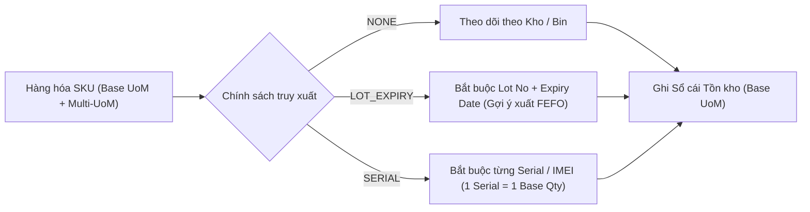
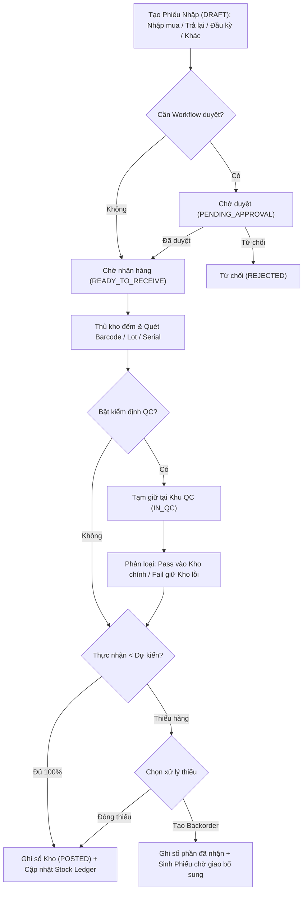
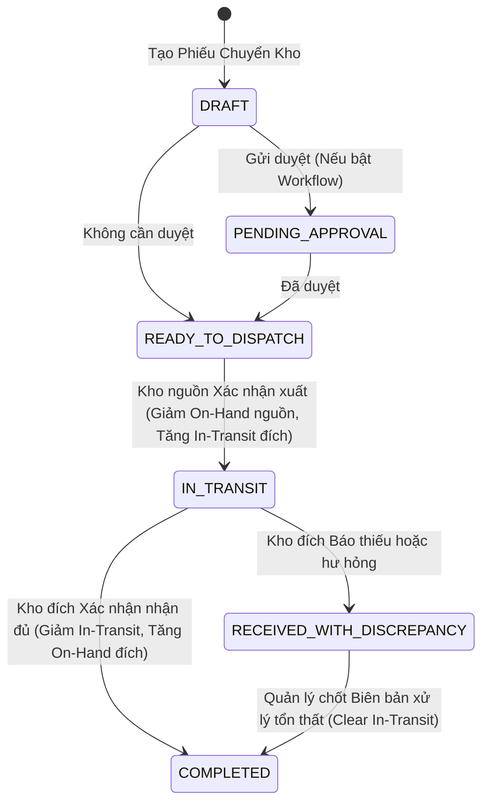
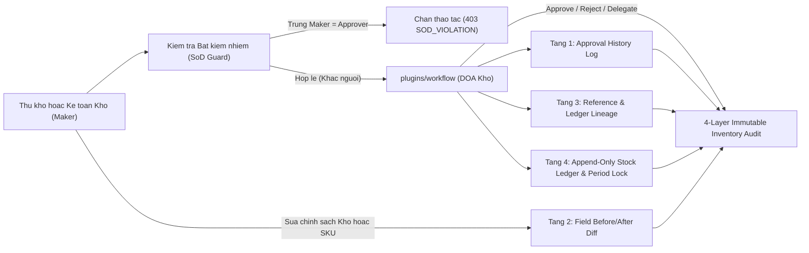
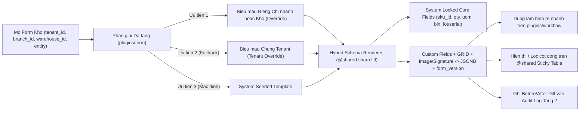

# Đặc Tả Luồng Xử Lý Nghiệp Vụ — Plugin Quản Lý Kho, Xuất/Nhập Kho & Tồn Kho (`plugins/inventory`) (Sprint 13)

| Thuộc tính | Giá trị |
| :--- | :--- |
| ID | ANL-S13-001 |
| Sprint | Sprint 13 (`sprint_13_plugin_inventory`) |
| Tác giả | AI Business Analyst (BA) |
| Trạng thái | Draft / Chờ khách hàng review nghiệp vụ |
| Phiên bản | 0.5 |
| Tài liệu liên quan | [00_READING_GUIDE.md](../00_READING_GUIDE.md) · [RAW-S13-001](../01_raw_notes/01_RAW-S13-001_inventory_requirements.md) · [BENCH-S13-001](../03_benchmarks/01_BENCH-S13-001_inventory_warehouse_benchmarks.md) · [CONF-S13-001](../04_confirmation/01_CONF-S13-001_sprint_13_scope_and_ac.md) |

---

## 1. Kiến Trúc Nghiệp Vụ Lõi: Sổ Cái Bất Biến & Mô Hình 5 Chỉ Số Tồn Kho

### 1.1. Tách 2 Tầng Dữ Liệu Tồn Kho (Auditability + High-Speed Query)
Kế thừa mô hình chuẩn ERP Quốc tế (`L01`, `L02`, `L08`), hệ thống không lưu một con số tồn kho có thể ghi đè trực tiếp, mà vận hành trên **2 tầng dữ liệu đồng bộ chặt chẽ trong cùng một Transaction PostgreSQL**:
1. **Sổ cái Tồn kho Bất biến (`Stock Ledger Entry`)**:
   - Lưu append-only mọi biến động thực tế của hàng hóa (`+` Nhập, `-` Xuất; riêng thao tác Khóa/Mở khóa giữ hàng ghi nhận tại `Stock Reservation`).
   - Mỗi dòng ghi rõ: `tenant_id`, `warehouse_id`, `bin_id`, `product_id`, `lot_id / serial_no`, `posting_at` (thời điểm ghi sổ nghiệp vụ), `qty_delta` (theo Đơn vị cơ bản `Base UoM`), `qty_after`, `unit_cost`, `value_delta`, `voucher_type`, `voucher_id`, `movement_type`, `reference_type`, `reference_id`, `created_by`.
   - **Bất biến tuyệt đối**: Cấm `UPDATE` hoặc `DELETE` các dòng đã ghi sổ; mọi sai sót phải xử lý bằng **Chứng từ đảo (`Reversal`)** hoặc **Điều chỉnh (`Adjustment`)**.
2. **Bảng Tổng Hợp Tồn Kho Tức Thời (`Stock Balance Snapshot`)**:
   - Đáp ứng truy vấn O(1) cho màn hình Danh sách Tồn kho, Kiểm tra hàng khả dụng khi lập phiếu xuất/giữ hàng và Mobile Thủ kho.
   - Tách bạch **5 chỉ số cốt lõi** tại từng cấp `(Warehouse, Bin, SKU, Lot)`:

| Chỉ số | Ký hiệu / Thuật ngữ | Công thức / Ý nghĩa nghiệp vụ | Ai / Khi nào sử dụng |
| :--- | :--- | :--- | :--- |
| **1. Tồn thực tế** | `On-Hand Qty` | Tổng số lượng vật lý thực tế đang nằm trong kho/ô kệ (`Sum Ledger qty_delta`). | Thủ kho kiểm kê, Kế toán tính giá trị tồn kho. |
| **2. Đang giữ hàng** | `Reserved Qty` | Số lượng đã được khóa cho Lệnh giữ hàng / Phiếu xuất đã duyệt nhưng **chưa xuất ra khỏi cửa kho**. | Điều phối kho, Thủ kho soạn hàng (`Picking`). |
| **3. Tồn khả dụng** | `Available Qty` | `Available = On-Hand - Reserved`. Lượng hàng tối đa còn có thể cấp phát hoặc tạo lệnh giữ/xuất mới. | Bộ phận tạo phiếu xuất/giữ hàng, API cung cấp tồn khả dụng. |
| **4. Đang đi đường** | `In-Transit Qty` | Hàng đã xuất rời kho gửi (`Bước 1` Chuyển kho) nhưng kho nhận chưa xác nhận nhập (`Bước 2`). | Thủ kho nhận theo dõi hàng sắp tới, Kế toán đối soát tài sản lưu thông. |
| **5. Đang chờ về** | `Incoming / Ordered Qty` | Hàng trên Phiếu đề nghị nhập / Lệnh nhập chờ về hoặc đang nằm ở khu vực chờ kiểm định `QC`. | Bộ phận Mua hàng / Thủ kho theo dõi hàng sắp nhập kho. |

### 1.2. Ranh Giới Nghiệp Vụ Giữa `plugins/inventory` & Hệ Sinh Thái Open-ERP

| Thành phần | Sở hữu dữ liệu & Trách nhiệm | Hình thức liên kết |
| :--- | :--- | :--- |
| **Core Platform & IAM** | `tenant_id`, tài khoản, RBAC chức năng, phân quyền phạm vi kho (`warehouse_ids`), Entity Registry. | JWT Context + Policy Scope |
| **Plugin `organization`** | Chi nhánh (`branch_id`), Phòng ban (`department_id`). Kho vật lý gắn trực tiếp vào Chi nhánh. | `PluginDataServiceGrpc` / Sync Cache |
| **Plugin `catalog`** | Danh mục Đơn vị tính (`UoM`), Nhóm hàng hóa, Danh mục Lý do xuất/nhập dùng chung. | `PluginDataServiceGrpc` |
| **Plugin `employee`** | Hồ sơ Thủ kho, Người đề nghị xuất nội bộ, Thành viên Hội đồng kiểm kê. | `PluginDataServiceGrpc` |
| **Plugin `workflow`** | Luồng phê duyệt nhiều cấp cho Đề nghị nhập/xuất/chuyển/kiểm kê vượt hạn mức. | Workflow Trigger & Callback Event |
| **Plugin `in-app-notification`** | Gửi cảnh báo tồn kho dưới `Min`, hàng cận hạn `FEFO`, phiếu `In-Transit` quá hạn. | Kafka / Outbox Event |
| **Plugin `inventory` (Sprint 13)** | Sở hữu độc lập toàn bộ Master Kho/Bin/SKU/Lot/Serial, Chứng từ Nhập/Xuất/Chuyển/Kiểm kê, Giữ hàng, Sổ cái & Báo cáo Kho. | Module độc lập; cung cấp gRPC/Kafka contract |
| **Các Plugin Nghiệp vụ Ngoài** *(Tương lai: Mua hàng, Bán hàng...)* | Tách biệt khỏi Sprint 13; khi có nhu cầu giữ/trừ tồn sẽ gọi sang `inventory` thông qua tham chiếu đa hình (`reference_type`, `reference_code`, `reference_id`). | `PluginDataServiceGrpc` / Kafka |

---

## 2. Chi Tiết 7 Luồng Xử Lý Nghiệp Vụ Trọng Tâm

---

### Luồng 1: Quản Trị Kho, Cây Vị Trí (`Zone -> Rack -> Bin`) & Hàng Hóa (`SKU / UoM / Lot / Serial`)

#### Mục tiêu & Quy tắc
- Cho phép mỗi Tenant tạo nhiều **Kho (`Warehouse`)** gắn với Chi nhánh (`branch_id`), phân loại rõ:
  - `PHYSICAL` (Kho vật lý thông thường: Kho tổng, Kho chi nhánh, Kho dự án).
  - `QUARANTINE` (Kho/Khu cách ly hàng chờ kiểm định QC hoặc hàng lỗi chờ trả/hủy — **không tính vào `Available`**).
  - `VIRTUAL_TRANSIT` (Kho trung gian logic dùng ghi nhận hàng đang luân chuyển giữa 2 kho).
  - `CONSIGNMENT` (Kho hàng gửi đối tác nếu bật).
- Bên trong mỗi kho vật lý cho phép tùy chọn bật **Quản lý theo Vị trí (`Bin Tracking`)**: `Kho -> Khu vực (Zone) -> Dãy/Kệ (Rack) -> Tầng/Ô (Bin)`. Nếu doanh nghiệp/chi nhánh nhỏ chưa quản lý tới từng ô kệ, hệ thống tự tạo 1 `DEFAULT_BIN` ẩn danh để thao tác nhập/xuất nhanh mà cấu trúc DB vẫn sẵn sàng nâng cấp lên Bin-level về sau.
- Mỗi **Hàng hóa (`Product/SKU`)** khai báo:
  - Định danh: `sku_code` (duy nhất theo `tenant_id`), `barcode` (EAN/QR), tên hàng, nhóm hàng (`catalog`), hình ảnh, mô tả ngắn.
  - **Đa đơn vị tính (`Multi-UoM`)**: 1 Đơn vị cơ bản (`Base UoM`, VD: `Cái`) + N Đơn vị quy đổi (`Hộp = 10 Cái`, `Thùng = 240 Cái`), gắn `barcode` riêng cho từng quy cách đóng gói.
  - **Chính sách truy xuất (`Tracking Mode`)**:
    1. `NONE`: Chỉ theo dõi tổng số lượng (phù hợp vật tư tiêu hao, hàng phổ thông).
    2. `LOT_EXPIRY`: Bắt buộc nhập `Số Lô (Lot No)` + `Ngày sản xuất` + `Hạn sử dụng (Expiry Date)` -> Xuất mặc định ưu tiên **FEFO**.
    3. `SERIAL`: Bắt buộc khai báo danh sách từng `Serial / IMEI` duy nhất (`1 Serial = 1 Base UoM`) -> Truy vết vòng đời từ lúc nhập -> lưu trữ -> điều chuyển -> xuất kho -> trả lại.
  - **Định mức tồn**: `min_stock` (điểm cảnh báo đặt hàng), `max_stock`, `safety_stock`, trạng thái hoạt động (`ACTIVE` / `INACTIVE`).



---

### Luồng 2: Nhập Kho (`Inbound / Goods Receipt`) — Kèm QC & Nhập Thiếu (`Backorder`)

#### Các kịch bản nhập kho được hỗ trợ
1. **Nhập mua từ Nhà cung cấp (`PURCHASE_IN`)**: Nhập mới hàng hóa/nguyên vật liệu từ nhà cung cấp kèm mã tham chiếu chứng từ nhập (`PO` hoặc nhập tay).
2. **Nhập hàng trả lại (`RETURN_IN`)**: Hàng đã xuất trước đó được trả về kho (tham chiếu Phiếu xuất gốc nếu có); bắt buộc giữ đúng `Lot/Serial` gốc nếu hàng hóa cấu hình theo Lô/Serial.
3. **Nhập chuyển kho đến (`TRANSFER_IN`)**: Sinh tự động từ Bước 2 của Luồng Điều chuyển kho.
4. **Nhập điều chỉnh thừa / Nhập đầu kỳ / Nhập khác (`STOCKTAKE_GAIN`, `OPENING_BALANCE`, `OTHER_IN`)**: Gắn mã lý do chuẩn hóa từ `catalog`.

#### Quy trình xử lý chi tiết & Nhập qua QC / Backorder
1. **Bước 1 — Khởi tạo Phiếu Nhập (`DRAFT`)**: Người phụ trách tạo Phiếu đề nghị nhập với danh sách `(SKU, UoM, Expected Qty, Unit Cost dự kiến)` và Kho nhận.
2. **Bước 2 — Phê duyệt (Nếu bật `Workflow`)**: Tùy cấu hình Tenant, phiếu có thể đi thẳng sang chờ nhận hoặc qua duyệt `plugins/workflow`.
3. **Bước 3 — Thủ kho Kiểm đếm & Đón hàng (`RECEIVING / IN_QC`)**:
   - Thủ kho mở phiếu trên Web hoặc **Mobile Ionic quét Barcode/QR** từng kiện hàng, nhập số lượng **Thực nhận (`Actual Qty`)**, nhập thông tin `Lot + Hạn sử dụng` hoặc quét danh sách `Serial`.
   - **Tùy chọn QC**: Nếu SKU hoặc Kho yêu cầu Kiểm tra chất lượng (`require_qc = true`), hàng thực nhận tạm đưa vào **Khu cách ly (`QUARANTINE`)** để nhân viên QC phân loại: số lượng `Đạt (Pass)` chuyển vào Bin chính (`On-Hand` & `Available` tăng), số lượng `Không đạt (Fail)` giữ tại kho lỗi chờ trả NCC hoặc hủy.
4. **Bước 4 — Xử lý Nhập thiếu (`Partial Receipt & Backorder`)**:
   - Nếu `Actual Qty < Expected Qty` (giao thiếu so với dự kiến): Hệ thống cho phép chọn:
     - *(a) Đóng phiếu tại đây* (`COMPLETE_SHORT`): Chốt số lượng thực nhận, phần còn thiếu kết thúc không chờ nữa.
     - *(b) Tạo Backorder*: Ghi sổ kho phần `Actual Qty` đã về (`PARTIAL_POSTED`), đồng thời **tự động sinh 1 Phiếu Nhập chờ (`Backorder Receipt`)** cho phần chênh lệch còn lại để theo dõi đợt giao sau.
5. **Bước 5 — Ghi sổ kho (`POSTED`)**: Khóa chứng từ, cộng `Stock Balance` (`On-Hand` & `Available`), trừ `Incoming`, ghi bất biến vào `Stock Ledger Entry`.



---

### Luồng 3: Giữ Hàng (`Stock Reservation`) & Xuất Kho (`Outbound / Goods Issue`)

Để đảm bảo nhiều bộ phận hoặc nhiều phiếu xuất không cấp phát trùng vào cùng một số lượng tồn cuối cùng (`Double Allocation / Overselling`), phân hệ Kho tích hợp sẵn cơ chế **Giữ hàng Độc lập (`Stock Reservation`)** gắn với mã tham chiếu chứng từ tổng quát (`reference_type`, `reference_code`, `reference_id`).

#### Cơ chế Giữ Hàng (`Stock Reservation`)
- **Khởi tạo Lệnh Giữ Hàng (`Reserve Stock`)**: Điều phối viên kho tạo lệnh giữ hàng trực tiếp trên Kho (hoặc nhận yêu cầu từ hệ thống/plugin ngoài qua gRPC) với tham chiếu nguồn (`reference_type`, `reference_id`), `warehouse_id`, danh sách `(SKU, Qty, optional Lot/Expiry deadline)`, và tùy chọn thời hạn giữ (`hold_expires_at`).
- **Xử lý Khóa Đồng Thời**:
  1. Gọi dịch vụ Kho với khóa đồng thời (`PostgreSQL SELECT FOR UPDATE` trên dòng `Stock Balance` + `Redis Lock` theo `(tenant_id, warehouse_id, sku_id)`).
  2. Kiểm tra `Available >= Requested Qty (Base UoM)`:
     - Đủ hàng: Tạo bản ghi `StockReservation (ACTIVE)`, tăng `Reserved Qty` -> giảm tức thì `Available Qty` đối với các phiếu khác. Nếu là hàng `LOT_EXPIRY`, hệ thống tự **gợi ý/giữ trước Lô theo FEFO** hoặc giữ ở cấp `(Warehouse, SKU)` tùy cấu hình Tenant (`Q3`).
     - Thiếu hàng: Trả mã lỗi chuẩn `ERR_INSUFFICIENT_AVAILABLE_STOCK` kèm chi tiết tồn hiện tại ở các kho khác để điều phối viên chủ động tạo Phiếu chuyển kho bổ sung.
- **Giải phóng Giữ hàng (`Release Reservation`)**: Tự động giải phóng khi (a) Hủy lệnh giữ/Phiếu xuất nguồn, (b) Quá `hold_expires_at` với giữ hàng có thời hạn, hoặc (c) Phiếu xuất kho tương ứng đã chuyển sang `POSTED` (`Reserved` giảm đồng thời `On-Hand` giảm, nên `Available` giữ nguyên).

#### Chiến Lược Gợi Ý Lấy Hàng & Thực Thi Xuất Kho (`Picking & Outbound`)
1. **Loại phiếu xuất hỗ trợ**:
   - `DELIVERY_OUT`: Xuất giao hàng / xuất bán theo chứng từ tham chiếu nguồn (`reference_type`, `reference_code`, `reference_id`).
   - `INTERNAL_ISSUE`: Xuất sử dụng nội bộ / cấp phát vật tư cho Nhân viên (`employee_id`) hoặc Phòng ban (`department_id`).
   - `SUPPLIER_RETURN`: Xuất trả hàng lỗi cho Nhà cung cấp.
   - `DISPOSAL_OUT`: Xuất hủy hàng hư hỏng, quá hạn sử dụng (bắt buộc duyệt Workflow).
   - `TRANSFER_OUT` / `STOCKTAKE_LOSS` / `OTHER_OUT`: Xuất chuyển kho, xuất cân bằng thiếu kiểm kê hoặc xuất khác theo mã lý do `catalog`.
2. **Thuật toán gợi ý Lô/Vị trí xuất (`Picking Allocation`)**:
   - Với `LOT_EXPIRY`: Tự động sắp xếp và phân bổ từ **hạn sử dụng gần nhất còn hiệu lực (`FEFO`)**, bỏ qua lô đã quá hạn (`expiry_date < today`) trừ khi đang lập phiếu **Xuất hủy (`DISPOSAL_OUT`)** và bỏ qua hàng trong khu `QUARANTINE`.
   - Với `NONE`: Tự động ưu tiên theo thứ tự nhập (**FIFO**) hoặc Bin mặc định.
   - Với `SERIAL`: Yêu cầu Thủ kho **quét đúng `Serial/IMEI`** đang ở trạng thái `IN_STOCK` tại đúng kho xuất (hỗ trợ quét liên tục trên Mobile hoặc nhập dải serial).
3. **Kiểm tra Âm Kho & Ghi sổ (`POSTED`)**:
   - Mặc định chặn tuyệt đối xuất quá `On-Hand` (hoặc quá `Available` của phần không thuộc lệnh giữ tương ứng). Nếu `on_hand < issue_qty` -> chặn với lỗi tường minh (chỉ cho phép ghi nợ nếu Tenant bật tùy chọn *Cho phép xuất âm tạm thời* tại `Q4`).
   - Ghi nhận vào `Stock Ledger Entry` với `qty_delta < 0`, trừ `On-Hand`, giải phóng `Reserved`, ghi nhận giá vốn xuất tại thời điểm ghi sổ.

```mermaid
sequenceDiagram
    participant REQ as Điều phối / Chứng từ Nguồn
    participant INV as Service Kho (Lock + Ledger)
    participant WH as Thủ kho (Desktop / Mobile)

    REQ->>INV: 1. Yêu cầu giữ hàng (SKU, Qty, Warehouse, reference_type, reference_id)
    Note over INV: Khóa đồng thời (DB Row Lock + Redis)
    INV-->>REQ: Đủ Available -> Tạo Reservation (Tăng Reserved, Giảm Available)
    REQ->>INV: 2. Lập Phiếu Xuất Kho tham chiếu Reservation
    INV->>WH: 3. Sinh danh sách Picking (Gợi ý Bin & Lô FEFO/FIFO)
    WH->>INV: 4. Quét Barcode/Lot/Serial xác nhận thực xuất
    Note over INV: Transaction: Kiểm tra On-Hand >= Thực xuất; Trừ On-Hand, Giải phóng Reserved, Ghi Stock Ledger Entry
    INV-->>REQ: 5. Phát Event OUTBOUND_POSTED (Cập nhật trạng thái đã xuất kho)
```

---

### Luồng 4: Điều Chuyển Kho Nội Bộ (`1-Step` & `2-Step In-Transit`)

Để tránh việc kho nguồn vừa bấm chuyển là kho đích tự nhiên có hàng ngay dù hàng vẫn đang di chuyển trên đường (gây sai lệch kiểm kê thực tế tại cả 2 đầu kho), hệ thống tách rõ 2 mô hình:

#### 4.1. Chuyển Vị Trí Trong Cùng 1 Kho (`Putaway / Bin-to-Bin Transfer`)
- Dùng khi Thủ kho dọn hàng từ khu vực nhận hàng (`Staging`) lên Kệ (`Rack/Bin`), hoặc gom hàng giữa các Bin trong cùng 1 `warehouse_id`.
- **Thực thi 1 bước**: Tạo phiếu chuyển nội bộ -> Xác nhận -> Ghi giảm Bin nguồn và tăng Bin đích ngay lập tức trong 1 Transaction.

#### 4.2. Chuyển Giữa 2 Kho / 2 Chi Nhánh (`Inter-Warehouse 2-Step In-Transit`)
1. **Bước 1 — Khởi tạo & Phê duyệt**: Kho cần hàng hoặc Điều phối viên tạo `Phiếu Chuyển Kho` (`Kho nguồn` -> `Kho đích`, danh sách SKU + SL yêu cầu).
2. **Bước 2 — Kho Nguồn Xuất Chuyển (`DISPATCHED / IN_TRANSIT`)**:
   - Kho nguồn chọn Bin/Lô/Serial thực xuất và nhấn **Xác nhận Xuất chuyển**.
   - **Hệ thống ghi sổ lần 1**: Giảm `On-Hand` tại **Kho nguồn** -> Tăng **`In-Transit Qty`** hướng về **Kho đích** (giá trị và số lượng vẫn thuộc tài sản doanh nghiệp, gắn vào kho logic `VIRTUAL_TRANSIT`).
3. **Bước 3 — Kho Đích Kiểm Đếm & Xác Nhận Nhận Hàng (`COMPLETED / DISCREPANCY`)**:
   - Trên màn hình Kho đích hiện danh sách phiếu `Đang chuyển đến (Incoming Transit)` và nhận thông báo từ `in-app-notification`.
   - Thủ kho đích kiểm đếm thực nhận:
     - **Trường hợp 3a (Nhận đủ)**: `Actual Received == Dispatched` -> **Hệ thống ghi sổ lần 2**: Trừ `In-Transit`, cộng `On-Hand` (và `Available`) tại **Kho đích**, giữ nguyên Lô/Date/Serial và giá vốn chuyển sang. Trạng thái phiếu = `COMPLETED`.
     - **Trường hợp 3b (Thiếu/Vỡ trên đường vận chuyển)**: `Actual Received < Dispatched` -> Thủ kho đích nhập số thực nhận + số hư hỏng/mất + lý do/ảnh biên bản -> Phần thực nhận tốt vào `On-Hand` Kho đích; phần chênh lệch đưa vào trạng thái `RECEIVED_WITH_DISCREPANCY` để Quản lý chốt xử lý (Xuất hủy tổn thất vận chuyển hoặc Ghi nhận bồi thường) nhằm **đưa `In-Transit` về 0 sạch sẽ**.



---

### Luồng 5: Kiểm Kê & Cân Bằng Kho (`Cycle Count & Physical Stocktake`)

Hỗ trợ cả **Kiểm kê Định kỳ toàn kho (Cuối tháng/năm)** lẫn **Kiểm kê Cuốn chiếu (`Cycle Count`)** theo từng khu vực `Zone/Bin` hoặc Nhóm hàng để không phải đóng băng toàn bộ hoạt động xuất nhập.

#### Quy trình 5 bước chuẩn Kiểm toán
1. **Lập Đợt Kiểm Kê & Chốt Ảnh Sổ Sách (`DRAFT -> COUNTING`)**:
   - Quản lý kho chọn phạm vi (`warehouse_id`, tùy chọn `bin_ids` hoặc `category_ids`), chọn thành viên hội đồng kiểm kê (`employee_ids`) và bật/tắt tùy chọn **Kiểm kê mù (`Blind Count`)**.
   - Khi nhấn **Bắt đầu kiểm kê**, hệ thống chụp ngay `System Snapshot Qty` (`On-Hand` tại thời điểm `snapshot_at`) kèm lưu ý riêng nếu đang có lượng `Reserved Qty` chưa xuất để tổ đếm tính cả phần hàng đã đóng gói trên bàn giao nhận.
   - *(Tùy chọn)* Cho phép **Tạm khóa giao dịch (`Freeze Bin/Warehouse`)** đối với khu vực đang kiểm kê để số liệu không nhảy trong lúc đếm.
2. **Thực Hiện Kiểm Đếm (`COUNTING`)**:
   - Tổ kiểm kê dùng Web hoặc **Mobile Ionic quét Barcode/Serial** nhập `Counted Qty`. Khi bật `Blind Count`, giao diện nhân viên đếm **ẩn hoàn toàn `System Snapshot Qty`** để đảm bảo đếm trung thực.
   - Hỗ trợ **gộp nhiều lần quét/nhiều người đếm** trên cùng 1 phiếu (cộng dồn hoặc phân chia theo Zone/Bin phụ trách).
3. **Tổng Hợp & Đối Chiếu Chênh Lệch (`REVIEWING`)**:
   - Khi tổ kiểm kê chốt đếm, Quản lý kho xem Bảng chênh lệch:
     - `Variance Qty = Counted Qty - Snapshot/Current Book Qty` (Lệch dương = **Thừa**, Lệch âm = **Thiếu**, Bằng 0 = **Khớp**).
   - Có thể yêu cầu **Đếm lại (`Recount`)** cho các mã hàng có độ lệch bất thường trước khi trình duyệt.
4. **Phê Duyệt Cân Bằng Kho (`PENDING_APPROVAL -> POSTED`)**:
   - Nếu có chênh lệch, gửi duyệt qua `plugins/workflow` (theo ngưỡng % hoặc giá trị lệch).
5. **Tự Động Sinh Chứng Từ Bù Trừ (`Auto-Reconciliation`)**:
   - Sau khi được duyệt: Hệ thống tự động sinh **Phiếu Nhập Xử Lý Thừa (`STOCKTAKE_GAIN`)** cho toàn bộ dòng `Variance > 0` và **Phiếu Xuất Tổn Thất Kiểm Kê (`STOCKTAKE_LOSS`)** cho toàn bộ dòng `Variance < 0`, ghi thẳng vào `Stock Ledger Entry` và đưa trạng thái đợt kiểm kê về `POSTED / RECONCILED`.

---

### Luồng 6: Đảo Chứng Từ (`Reversal`), Điều Chỉnh & Khóa Kỳ Kho (`Period Lock`)

- **Nguyên tắc Chứng từ Bất biến**: Một khi Phiếu Nhập / Xuất / Chuyển / Kiểm kê đã ở trạng thái `POSTED`:
  - **CẤM** nút Sửa (`Edit`) hoặc Xóa (`Delete`) trực tiếp làm thay đổi bản ghi lịch sử.
- **Quy trình Sửa Sai Sau Khi Ghi Sổ (Trong Kỳ Mở)**:
  1. Người có quyền nhấn **Hủy/Đảo chứng từ (`Reverse Document`)** kèm bắt buộc nhập **Lý do hủy** trên Drawer xác nhận.
  2. Hệ thống kiểm tra:
     - Ngày ghi sổ gốc chưa nằm trong kỳ đã khóa (`posting_at > period_closed_until`).
     - Với Phiếu Nhập đã ghi sổ: Hàng từ lô đó **chưa bị xuất đi hết hoặc bị giữ chỗ (`Reserved`)** gây âm tồn nếu đảo ngược. Nếu đã lỡ xuất đi 1 phần -> Chặn đảo phiếu nhập, hướng dẫn lập **Đảo phiếu xuất trước** hoặc **Phiếu Điều chỉnh**.
  3. Khi hợp lệ: Hệ thống chuyển trạng thái phiếu gốc sang `REVERSED`, đồng thời **tự động sinh 1 Phiếu Đảo (`REVERSAL_VOUCHER`)** có toàn bộ `qty_delta` ngược dấu, tham chiếu `reversed_voucher_id`, cập nhật `Stock Balance` và `Stock Ledger`.
- **Khóa Kỳ Kho (`Period Closing`)**:
  - Kế toán/Quản trị kho định kỳ chốt sổ (VD: Khóa hết ngày `31/10/2026`).
  - Mọi thao tác Nhập/Xuất/Chuyển/Kiểm kê/Đảo chứng từ có `posting_at <= 31/10/2026 23:59:59` bị chặn ở tầng Backend (`ERR_PERIOD_CLOSED`).
  - Nếu phát hiện sai sót số liệu của kỳ đã khóa -> Chỉ được phép tạo **Phiếu Điều Chỉnh Kho** ghi sổ vào ngày thuộc kỳ hiện tại đang mở, giữ nguyên báo cáo lịch sử đã chốt của tháng trước.

---

### Luồng 7: Định Giá, Thẻ Kho (`Stock Card`), Báo Cáo `XNT` & Cảnh Báo Chủ Động

1. **Tính Giá Vốn & Giá Trị Tồn Kho (`Costing`)**:
   - Đề xuất hỗ trợ **Bình quân gia quyền tức thời (`AVCO / Moving Weighted Average`)** làm mặc định ở Sprint 13 (dễ hiểu, nhanh, phù hợp đa số DN thương mại/sản xuất vừa) và giữ cột `unit_cost` trên Lô để mở rộng **FIFO theo Lô** *(chốt cụ thể tại `Q5` trong `CONF-S13-001`)*.
   - Giá vốn chỉ hiển thị cho vai trò được cấp quyền (`INVENTORY_VIEW_COST`), ẩn hoàn toàn đối với Thủ kho thực địa nếu cấu hình phân quyền không cho xem giá nhập.
2. **Thẻ Kho Chi Tiết (`Stock Card`)**:
   - Cho phép bấm vào bất kỳ mã SKU/Kho nào (hoặc qua **Context Menu chuột phải -> Xem Thẻ kho**) để xem toàn bộ lịch sử biến động từ Sổ cái `Stock Ledger Entry`: Thời gian, Mã phiếu, Loại nghiệp vụ, Tham chiếu nguồn, SL Nhập, SL Xuất, Tồn lũy kế sau giao dịch.
3. **Báo cáo Xuất - Nhập - Tồn (`XNT Report`)**:
   - Truy vấn theo khoảng thời gian `[from_date, to_date]`, lọc theo `Chi nhánh`, `Kho`, `Nhóm hàng`, `SKU`, `Lô`:
     - `Tồn đầu kỳ` -> `Tổng nhập trong kỳ` (tách nhập mua / hàng trả / chuyển đến / kiểm kê thừa) -> `Tổng xuất trong kỳ` (tách xuất giao hàng / nội bộ / trả NCC / chuyển đi / hủy) -> `Tồn cuối kỳ` + Giá trị tương ứng.
   - Hỗ trợ xuất Excel / CSV đồng bộ theo đúng bộ lọc và cột đang hiển thị trên giao diện.
4. **Cảnh báo Chủ động (`Proactive Inventory Alerts` via `in-app-notification`)**:
   - **Dưới định mức (`Low Stock / Reorder`)**: Khi `Available Qty <= min_stock`.
   - **Cận hạn sử dụng (`Near-Expiry FEFO`)**: Lô hàng còn `< N` ngày tới `expiry_date` (cấu hình theo nhóm hàng/Tenant, VD: 30/60/90 ngày).
   - **Phiếu Chuyển kho Treo (`Stale In-Transit`)**: Phiếu `IN_TRANSIT` quá X ngày chưa được Kho đích xác nhận nhận.
   - **Hàng tồn lâu (`Slow-Moving / Aging`)**: Lô hàng nằm quá `30 / 60 / 90 / >180` ngày không có phát sinh xuất.

### Luồng 8: Ma Trận Phê Duyệt Kho (`DOA / SoD`) & Kiến Trúc Lưu Vết Kiểm Toán 4 Tầng (`Immutable Audit Trail & Stock Lineage`)

Mọi chứng từ điều chỉnh, xuất hủy, chênh lệch và thay đổi chính sách kho nhạy cảm trong `plugins/inventory` đều kiểm soát qua **Ma trận Phê duyệt (`plugins/workflow` — Sprint 08)** kết hợp nguyên tắc **Bất kiêm nhiệm (`Segregation of Duties — SoD`)** và lưu vết **4 tầng bất biến**:



1. **Ma Trận Phê Duyệt Kho (`DOA`) & Nguyên Tắc Bất Kiêm Nhiệm (`SoD`)**:

| Nghiệp vụ / Thay đổi nhạy cảm | Luồng duyệt `DOA` (`plugins/workflow`) | Quy tắc Bất kiêm nhiệm (`SoD`) & Điều kiện bắt buộc |
| :--- | :--- | :--- |
| **Chính sách Kho & SKU Nhạy cảm** *(Bật cho phép Xuất âm `ALLOW_NEGATIVE`, Mở lại kỳ đã khóa `Period Unlock`, Đổi phương pháp giá vốn / `tracking_type`)* | **Maker -> Checker** (Quản lý Kho / Kế toán trưởng + Admin Tenant duyệt 2 mắt) | Cấm người cấu hình tự duyệt (`Maker != Checker`); bắt buộc ghi rõ `reason` trước khi áp dụng. |
| **Nhập Đầu kỳ (`OPENING_BALANCE`) & Nhập/Xuất Khác (`OTHER_IN / OTHER_OUT`)** | Quản lý Kho -> Kế toán Kho | `Approver != Creator`; bắt buộc nhập mã lý do chuẩn hóa từ `catalog`. |
| **Xuất Hủy Hàng hỏng / Hết hạn (`DISPOSAL_OUT`)** | Trưởng Kho -> Kế toán trưởng / Hội đồng Thanh lý | `Disposal Approver != Creator`; bắt buộc đính kèm biên bản/ảnh hiện trường và chọn đúng Lô hết hạn/hỏng. |
| **Chênh lệch Chuyển kho 2 bước (`TRANSFER_DISCREPANCY`) & Xuất Nội bộ vượt ngưỡng** | Quản lý Chi nhánh / Quản lý Kho | Thủ kho xuất kho nguồn không tự chốt miễn trừ chênh lệch thiếu tại Kho đích; `Approver != Requester`. |
| **Cân bằng Kiểm kê (`STOCKTAKE_GAIN / STOCKTAKE_LOSS`) vượt ngưỡng lệch** | Quản lý Kho -> Kế toán trưởng / Giám đốc | Người trực tiếp đếm thực tế (`Counter`) không tự duyệt chốt bút toán bù trừ chênh lệch lớn. |
| **Đảo chứng từ đã ghi sổ (`POSTED Reversal`)** | Kế toán Kho / Quản lý Kho | `Reversal Approver != Original Poster`; chặn cứng nếu chứng từ thuộc kỳ đã `Period Lock`. |

2. **Kiến Trúc 4 Tầng Lưu Vết Kiểm Toán Bất Biến (`4-Layer Immutable Audit Trail`)**:
   - **Tầng 1 — Nhật ký Phê duyệt (`Approval History Log`)**: Ghi nhận mọi bước `SUBMIT / APPROVE / REJECT / DELEGATE / ESCALATE` đồng bộ từ `plugins/workflow` (`actor_id`, `role`, `step_no`, `decision`, `comment`, `timestamp`).
   - **Tầng 2 — Lưu vết Cấp trường Trước/Sau (`Field-Level Before/After Diff`)**: Ghi nhận JSON snapshot Trước/Sau khi thay đổi chính sách Kho (`allow_negative_stock`, `require_qc`, `bin_mode`), định mức SKU (`min_qty`, `max_qty`, `safety_stock`, `tracking_type`), khóa/mở khóa Lô (`QC Hold` / `Expiry Override`) hoặc trạng thái khóa `Bin`.
   - **Tầng 3 — Đồ thị Truy vết Chuỗi Kho (`Inventory Lineage Graph`)**: Liên kết bất biến hai chiều giữa Chứng từ nguồn đa hình (`reference_type / reference_id` từ `purchasing`, `crm`, nội bộ) -> `StockReservation` -> Phiếu Nhập/Xuất/Chuyển 2 bước/Kiểm kê -> từng dòng `Stock Ledger Entry` -> `Reversal Ledger`.
   - **Tầng 4 — Sổ cái Tồn kho Bất biến & Khóa Kỳ (`Append-Only Ledger`)**: `Stock Ledger Entry` chỉ `INSERT` (cấm `UPDATE/DELETE`); mọi sai sót phải lập chứng từ đảo trái dấu trong kỳ đang mở.

### Luồng 9: Tùy Biến Biểu Mẫu Kho Động (`Dynamic Form Builder` qua `plugins/form`) Theo Tenant, Chi Nhánh & Kho

Để các Tenant (Dược phẩm, Thực phẩm, Điện tử, Vật tư kỹ thuật, Bán lẻ) và từng Chi nhánh / Kho (`branch_id` từ `plugins/organization` hoặc `warehouse_id`) thu thập đúng thông số đặc thù khi nhập/xuất/kiểm kê mà không cần sửa code, toàn bộ biểu mẫu Kho sử dụng **`plugins/form` (Sprint 08 — 32 loại trường qua 6 nhóm, `GRID` Excel công thức RPN, `IMAGE_UPLOAD`, `SIGNATURE`, `Skip Logic`)**:



| Nhóm Form Kho (`Entity Registry`) | Trường Lõi Hệ thống (`system_locked = true`) | Ví dụ Tùy biến Động theo Ngành / Chi nhánh / Kho (`plugins/form`) |
| :--- | :--- | :--- |
| **`Warehouse / Bin & SKU Master`** | `warehouse_code`, `branch_id`, `sku_code`, `base_uom_id`, `tracking_mode`, `min_qty` | Nhiệt độ/Độ ẩm kho lạnh (`NUMBER`), Nhóm nguy hiểm hóa chất (`DROPDOWN`), Tài liệu MSDS (`FILE_UPLOAD`). |
| **`Phiếu Nhập Kho & Biên bản QC`** | `warehouse_id`, `movement_type`, `sku_id`, `qty`, `uom_id`, `lot_no/expiry/serial`, `qc_status` | Biển số xe / Tên tài xế / Số container, Checklist kiểm định ngoại quan (`GRID`), Ảnh hàng vỡ/niêm phong (`IMAGE_UPLOAD`), Chữ ký QC (`SIGNATURE`). |
| **`Giữ hàng / Xuất Kho / Xuất Hủy`** | `warehouse_id`, `reference_type`, `sku_id`, `qty`, `lot/serial_id`, `bin_id` | Mã công trình / Ca sản xuất nhận vật tư, Biên bản tiêu hủy hội đồng ký (`FILE_UPLOAD` + `SIGNATURE`). |
| **`Chuyển Kho 2 Bước & Kiểm Kê`** | `from_warehouse_id`, `to_warehouse_id`, `sku_id`, `counted_qty`, `variance_qty` | Lý do hao hụt vận chuyển chi tiết (`Skip Logic`), Ảnh hiện trạng kiện hàng tại Kho đích (`IMAGE_UPLOAD`). |

---

## 3. Bộ Quy Tắc Nghiệp Vụ (`BR-W01` – `BR-W18`)

| Mã BR | Quy tắc bắt buộc |
| :--- | :--- |
| `BR-W01` | **Cô lập Đa Tenant tuyệt đối**: Mọi bảng Kho, Bin, SKU, Phiếu, Giữ hàng, Sổ cái đều bắt buộc lọc theo `tenant_id` trích từ JWT đã xác thực; cấm cross-tenant lookup. |
| `BR-W02` | **Chuẩn hóa về Base UoM tại Sổ cái**: Giao dịch có thể nhập/xuất bằng bất kỳ `UoM` hợp lệ của SKU (`Thùng`, `Hộp`), nhưng hệ thống quy đổi và ghi Ledger bằng `Base UoM` (hệ số chính xác `BigDecimal`) để không bao giờ sai lệch do làm tròn. |
| `BR-W03` | **Chính sách Truy xuất Nhất quán**: Khi SKU đã cấu hình `LOT_EXPIRY` hoặc `SERIAL` và đã phát sinh giao dịch trên Ledger, cấm đổi `Tracking Mode` trực tiếp nếu vẫn còn `On-Hand != 0` hoặc chứng từ dở dang. |
| `BR-W04` | **Bắt buộc `Available >= Qty` khi Giữ hàng / Xuất kho**: Mọi lệnh giữ hàng hoặc xuất kho thông thường đều phải thỏa điều kiện đủ tồn khả dụng (hoặc đủ lượng đã giữ riêng cho chính chứng từ nguồn đó). |
| `BR-W05` | **Kiểm soát Âm kho theo cấu hình**: Mặc định `STRICT_BLOCK` (cấm tuyệt đối `On-Hand < 0` tại mọi điểm thời gian); chỉ cho phép xuất âm nếu Tenant bật cờ cấu hình cho kho cụ thể và có log cảnh báo rõ ràng. |
| `BR-W06` | **Khóa Đồng Thời Chống Xuất Trùng (`Concurrency Safe`)**: Mọi thao tác giữ hàng, ghi sổ xuất kho, chuyển kho phải sử dụng khóa giao dịch (PostgreSQL `FOR UPDATE` theo thứ tự `(warehouse_id, sku_id)` tránh deadlock + Redis lock khi cần) để đảm bảo kết quả tuần tự đúng 100%. |
| `BR-W07` | **Cách ly Hàng QC & Hàng Hỏng**: Hàng nằm tại Kho/Khu `QUARANTINE` hoặc Lô có trạng thái `BLOCKED / EXPIRED` vẫn nằm trong tổng tài sản kế toán (`Total Physical`) nhưng **loại khỏi `Available Qty`** (không cho giữ hàng hay xuất sử dụng thông thường). |
| `BR-W08` | **Không Mất Dấu Hàng Chuyển Kho (`In-Transit Conservation`)**: Tổng lượng hàng trước và sau bước 1 chuyển kho phải bảo toàn: `Delta_OnHand_Source + Delta_InTransit_Target = 0`. Chỉ khi kho nhận xác nhận mới dịch chuyển từ `In-Transit` sang `On-Hand`. |
| `BR-W09` | **Độc lập Giá trị Kiểm Kê Mù (`Blind Count`)**: Khi bật `blind_count = true`, API cấp cho người đi đếm trên Mobile/Web **không trả về trường `system_qty` và `variance`** cho tới khi đợt kiểm kê được chuyển sang bước `REVIEWING`. |
| `BR-W10` | **Bất biến Sổ cái & Đảo phiếu**: Cấm `UPDATE`/`DELETE` dòng trên `Stock Ledger Entry` và chứng từ trạng thái `POSTED`. Chỉ hủy bằng thao tác `REVERSE` sinh phiếu đảo ngược dấu. |
| `BR-W11` | **Tuân thủ Khóa kỳ (`Period Lock`)**: Mọi chứng từ có `posting_at <= period_closed_until` bị từ chối ghi sổ hoặc đảo phiếu; bắt buộc ghi nhận điều chỉnh vào ngày thuộc kỳ đang mở. |
| `BR-W12` | **Phân quyền Phạm vi Kho & Ẩn Giá vốn**: Người dùng chỉ thao tác được với danh sách `warehouse_ids` thuộc quyền được gán; chỉ vai trò có quyền `INVENTORY_VIEW_COST` mới nhận được dữ liệu `unit_cost / stock_value` từ API. |
| `BR-W13` | **Bảo toàn Tham chiếu Nguồn Đa Hình**: Mọi lệnh giữ hàng/phiếu xuất có `reference_type / reference_id` phải giữ tham chiếu 2 chiều; khi hủy chứng từ nguồn hoặc quá hạn `hold_expires_at` mà hàng chưa xuất -> bắt buộc tự động nhả `Reserved Qty`; nếu đã xuất -> hướng dẫn thực hiện quy trình `RETURN_IN`. |
| `BR-W14` | **Tách biệt Độc lập & Liên thông Chuẩn**: `plugins/inventory` hoàn toàn độc lập, không phụ thuộc ngược vào các phân hệ nghiệp vụ bên ngoài. Mọi tham chiếu sang `organization`, `catalog`, `employee`, `workflow` thực hiện qua `PluginDataServiceGrpc` hoặc Kafka Event (không gọi REST chéo trực tiếp hay fix cứng `size = 100`). |
| `BR-W15` | **Bất Kiêm Nhiệm Phê Duyệt Kho (`Segregation of Duties — SoD`)**: Engine phê duyệt qua `plugins/workflow` kiểm tra `actor_id`: *(a)* người tạo không tự duyệt `OPENING_BALANCE`, `DISPOSAL_OUT`, `OTHER_IN/OUT`, `Reversal` hoặc `INTERNAL_ISSUE` vượt ngưỡng; *(b)* người đếm kiểm kê không tự duyệt cân bằng chênh lệch lớn; *(c)* bật xuất âm kho (`ALLOW_NEGATIVE`), mở lại kỳ đã khóa (`Period Unlock`) và xóa/sửa cấu hình nhạy cảm bắt buộc `Maker-Checker` 2 mắt. |
| `BR-W16` | **Lưu Vết Kiểm Toán 4 Tầng Bất Biến**: Mọi thay đổi cấu hình Kho/SKU (`allow_negative_stock`, `min/max`, `tracking_type`, `qc_hold`), mọi quyết định `workflow` và mọi giao dịch đảo sổ phải sinh bản ghi bất biến (`actor_id`, `timestamp`, `before/after snapshot`, `reason`), nối chuỗi `Lineage` và hiển thị trong Drawer `Audit & Lineage` (cấm `UPDATE/DELETE` bảng log & `Stock Ledger`). |
| `BR-W17` | **Bảo Vệ Trường Lõi Kho & Đa Phiên Bản Form Builder (`Hybrid Form Schema`)**: Biểu mẫu `Warehouse/SKU`, Phiếu Nhập/QC/Xuất/Chuyển/Kiểm kê kết xuất qua `plugins/form`; các trường lõi sổ cái (`sku_id`, `warehouse_id`, `bin_id`, `qty`, `uom_id`, `lot/serial`) khóa `system_locked = true`; dữ liệu mở rộng lưu `custom_fields_data` (`JSONB`) gắn `(form_id, form_version)`. |
| `BR-W18` | **Kế Thừa Form 3 Tầng (`System -> Tenant -> Branch/Warehouse`) & Liên Thông Workflow/Table**: Phân giải form theo `(branch_id / warehouse_id)` -> `tenant_id` -> `System Default`; trường động dùng được trong điều kiện rẽ nhánh `plugins/workflow`, bật cột lọc trên `@shared/*` Sticky Table và ghi Before/After Diff vào Audit Log. |

---

## 4. Phân Tích 10 Tình Huống Biên Quan Trọng (`Edge Cases`)

| STT | Tình huống biên (Edge Case) | Cách xử lý chuẩn hóa |
| :--- | :--- | :--- |
| `EC-01` | **2 điều phối viên cùng lúc giữ/xuất chiếc cuối cùng (`Available = 1`)** | Giao dịch A khóa row `Stock Balance`, trừ `Available` từ `1 -> 0` thành công. Giao dịch B chờ nhả khóa, đọc thấy `Available = 0`, thất bại có kiểm soát với mã `ERR_INSUFFICIENT_AVAILABLE_STOCK` và gợi ý kho khác còn hàng. |
| `EC-02` | **Hủy hoặc Giảm số lượng chứng từ nguồn khi Kho đang `PICKING` hoặc đã `POSTED`** | Nếu Kho chưa ghi sổ xuất: Nhả ngay `Reserved Qty` phần giảm/hủy và gửi notification cảnh báo Thủ kho dừng đóng gói phiếu đang picking. Nếu Kho đã `POSTED` (hàng đã rời kho): Chặn sửa phiếu xuất; hướng dẫn tạo **Phiếu Nhập Trả Lại (`RETURN_IN`)** đối với phần hàng quay đầu. |
| `EC-03` | **Hàng nhập `Thùng 24 Lon`, xuất lẻ `1 Lon` làm sao tách?** | Ledger quy đổi ngay lúc nhập `1 Thùng -> +24 Base UoM (Lon)`, lúc xuất `-1 Lon -> Còn 23 Lon`; giao diện cho phép hiển thị song song quy cách quy đổi (VD: `0 Thùng, 23 Lon`) không cần thao tác tách thùng thủ công trừ khi quản lý theo nhãn thùng vật lý riêng. |
| `EC-04` | **Nhập hàng về kho trước nhưng NCC chưa gửi hóa đơn / chưa chốt giá nhập** | Cho phép Thủ kho ghi sổ số lượng với cờ `cost_status = PROVISIONAL` (giá tạm tính theo đề nghị hoặc giá gần nhất) để hàng có thể xuất ngay; khi Kế toán chốt đơn giá sẽ chạy **Điều chỉnh giá nhập bổ sung** vào giá trị tồn mà không làm sai số lượng. |
| `EC-05` | **Hàng `Serial/IMEI` đã xuất trước đó được nhập trả lại (`RETURN_IN`)** | Kiểm tra `Serial` đó phải từng thuộc trạng thái `ISSUED / OUT` (khớp phiếu xuất gốc nếu có) và hiện tại **không đang nằm sẵn trong bất kỳ kho nào (`IN_STOCK`)** để chống nhập trùng IMEI khống. |
| `EC-06` | **Chuyển kho 2 bước bị thất thoát/vỡ 2 cái trên xe vận chuyển** | Kho đích nhập số thực nhận tốt (VD: xuất 10, nhận tốt 8, báo hỏng/thiếu 2). Hệ thống đưa 8 vào `On-Hand` kho đích, chuyển 2 sang xử lý chênh lệch (`DISCREPANCY`) để xuất hủy/bồi thường, giải phóng sạch toàn bộ `10 In-Transit`. |
| `EC-07` | **Kiểm kê khi kho có hàng đã giữ/đóng gói chờ xuất (`Reserved = 5, On-Hand = 20`)** | Chốt kiểm kê luôn đối chiếu trên tổng **Vật lý trong kho (`On-Hand = 20`)**, nhưng giao diện phiếu kiểm kê đánh dấu rõ khu vực/chú thích có `5 SP đã giữ cho Phiếu chờ xuất` để tổ đếm tính cả phần đang nằm ở khu vực chờ xuất (`Staging`), tránh tưởng nhầm thiếu 5 cái. |
| `EC-08` | **Lùi ngày ghi sổ chứng từ quá khứ (`Backdated Posting`)** | Kiểm tra ngày lùi không vượt quá `period_closed_until`; đồng thời kiểm tra **chuỗi tồn lũy kế (`Running Balance`)** tại mọi mốc thời gian từ ngày lùi đến hiện tại đảm bảo không làm phát sinh đoạn âm kho lịch sử (nếu âm -> từ chối). |
| `EC-09` | **Yêu cầu Ngưng sử dụng / Xóa một Kho hoặc SKU** | Chỉ cho phép chuyển sang trạng thái `INACTIVE` (ngưng tạo giao dịch mới) khi thỏa: `On-Hand == 0`, `Reserved == 0`, `In-Transit == 0` và không còn phiếu nháp/chờ duyệt; cấm `DELETE` cứng nếu đã có dòng trong `Stock Ledger Entry`. |
| `EC-10` | **Thao tác Mobile ở kho sóng yếu khi đang quét Barcode kiểm kê / nhận hàng** | Mobile Ionic giữ danh sách hàng đã quét trong bộ nhớ tạm có trạng thái rõ ràng (`Draft Local Session`), đồng bộ từng dòng hoặc gửi lô (`Batch Submit`) kèm `idempotency_key` để tránh mạng chập chờn gây cộng đúp 2 lần cùng 1 lần quét. |

---

## 5. Danh Sách 24 User Stories (`US-S13-01` – `US-S13-24`)

### Nhóm A: Danh Mục Kho, Vị Trí & Hàng Hóa (Master Data)
- **`US-S13-01`** (*Quản trị Kho*): Tạo và cấu hình Nhiều Kho theo Chi nhánh (`organization`), phân loại Kho Vật lý / Kho QC Cách ly, phân quyền Thủ kho phụ trách từng kho.
- **`US-S13-02`** (*Quản trị Kho*): Bật/tắt quản lý cây vị trí `Zone -> Rack -> Bin` cho từng kho; khóa tạm thời 1 Bin (`Freeze Bin`) khi bảo trì hoặc kiểm kê.
- **`US-S13-03`** (*Quản lý Danh mục Kho*): Khai báo Hàng hóa lưu kho (`SKU`, `Barcode`, nhóm hàng `catalog`), cấu hình Đa đơn vị tính (`Multi-UoM`) kèm hệ số quy đổi và định mức `Min/Max/Safety Stock`.
- **`US-S13-04`** (*Quản lý Danh mục Kho*): Cấu hình phương thức truy xuất (`NONE`, `LOT_EXPIRY` theo hạn sử dụng, hoặc `SERIAL/IMEI`) cho từng SKU.

### Nhóm B: Nhập Kho & Kiểm Định (`Inbound & QC`)
- **`US-S13-05`** (*Thủ kho / Điều phối nhập*): Lập Phiếu Nhập kho từ NCC, Hàng trả lại (`RETURN_IN`), Đầu kỳ hoặc Nhập khác bằng nguồn gốc rõ ràng.
- **`US-S13-06`** (*Thủ kho Mobile/Desktop*): Quét Barcode/QR kiểm đếm số thực nhận, nhập thông tin Lô/Date hoặc danh sách Serial hàng loạt khi nhận hàng.
- **`US-S13-07`** (*Nhân viên QC / Thủ kho*): Đưa hàng nhập cần kiểm định qua Khu `QUARANTINE`, tách lô Đạt (`Pass`) nhập vào kho khả dụng và lô Lỗi (`Fail`) giữ tại kho cách ly.
- **`US-S13-08`** (*Thủ kho / Điều phối nhập*): Xác nhận Nhập thiếu so với dự kiến (`Partial Receipt`) và cho phép hệ thống tự sinh `Backorder` chờ giao phần còn lại.

### Nhóm C: Giữ Hàng & Xuất Kho (`Reservation & Outbound`)
- **`US-S13-09`** (*Điều phối kho / Hệ thống ngoài via gRPC*): Tra cứu tức thời `On-Hand`, `Reserved`, `Available` theo từng kho và tạo Lệnh giữ hàng (`Stock Reservation`) theo chứng từ tham chiếu nguồn.
- **`US-S13-10`** (*Điều phối kho*): Giải phóng hàng đã giữ khi hủy/đổi chứng từ nguồn hoặc hệ thống tự động nhả khi quá hạn giữ tạm (`hold_expires_at`).
- **`US-S13-11`** (*Thủ kho*): Nhận Phiếu Xuất giao hàng (`DELIVERY_OUT`) / Xuất nội bộ (`employee_id`) / Xuất trả NCC / Xuất hủy, xem gợi ý lấy hàng tự động theo **FEFO / FIFO** và xác nhận quét `Barcode/Serial` ghi sổ xuất.
- **`US-S13-12`** (*Quản lý Kho*): Cấu hình quy tắc chặn xuất âm kho (`STRICT_BLOCK`) và bắt buộc duyệt `Workflow` đối với Phiếu Xuất hủy hoặc Xuất nội bộ vượt ngưỡng.

### Nhóm D: Điều Chuyển Kho & Kiểm Kê (`Transfer & Stocktake`)
- **`US-S13-13`** (*Thủ kho*): Thực hiện điều chuyển vị trí Bin-to-Bin (Putaway) trong cùng 1 kho với 1 bước ghi sổ tức thì.
- **`US-S13-14`** (*Thủ kho Nguồn*): Lập và xác nhận Xuất điều chuyển liên kho (`Bước 1` chuyển sang `In-Transit`) kèm danh sách Lô/Serial xuất đi.
- **`US-S13-15`** (*Thủ kho Đích*): Nhận cảnh báo hàng sắp tới, kiểm đếm thực tế và xác nhận Nhập kho đích (`Bước 2`), hoặc báo cáo chênh lệch hư hỏng/thiếu trên đường.
- **`US-S13-16`** (*Quản lý Kho*): Tạo Đợt kiểm kê toàn kho hoặc Cuốn chiếu theo Zone/Nhóm hàng; bật tùy chọn **Kiểm kê mù (`Blind Count`)** và khóa tạm Bin đang đếm.
- **`US-S13-17`** (*Tổ Kiểm kê Mobile/Desktop*): Quét mã vạch kiểm đếm độc lập nhiều khu vực, tổng hợp chênh lệch Thừa/Thiếu và trình duyệt tự động sinh chứng từ cân bằng kho.

### Nhóm E: Sổ Cái, Khóa Kỳ, Báo Cáo & Data View Chuẩn ERP
- **`US-S13-18`** (*Kế toán Kho / Quản lý*): Đảo chứng từ đã ghi sổ (`Reverse`) trong kỳ mở khi phát hiện sai sót; thực hiện **Khóa kỳ kho (`Period Lock`)** theo tháng/quý.
- **`US-S13-19`** (*Thủ kho / Kế toán / Quản lý*): Xem **Thẻ kho chi tiết (`Stock Card`)** của từng SKU/Lô và xuất **Báo cáo Xuất - Nhập - Tồn (`XNT`)**, **Tuổi tồn kho (`Aging`)** theo bộ lọc Kho/Chi nhánh.
- **`US-S13-20`** (*Quản lý Kho*): Nhận thông báo chủ động (`in-app-notification`) khi tồn kho dưới `Min`, lô hàng cận hạn `FEFO` hoặc phiếu chuyển kho treo `In-Transit` quá hạn.
- **`US-S13-21`** (*Tất cả người dùng Web Desktop*): Tùy chỉnh linh hoạt mọi bảng dữ liệu Kho/Phiếu/Thẻ kho: lọc sâu, sắp xếp đa cột, ẩn/hiện cột, kéo/đổi thứ tự cột, chọn số hàng/trang và giữ nguyên trạng thái khi F5 hoặc share link (`Route-Driven URL`).
- **`US-S13-22`** (*Tất cả người dùng Web Desktop*): Thao tác nhanh ngay trên dòng dữ liệu qua **Context Menu chuột phải** (Xem Thẻ kho, Tạo phiếu xuất/chuyển nhanh, Khóa lô, Phê duyệt, Đảo phiếu...) mà không cần mở sang trang khác.
- **`US-S13-23`** (*Thủ kho Mobile Ionic*): Sử dụng màn hình Mobile tối giản (`>= 40px` nút bấm) để quét mã vạch Kiểm đếm Nhập kho, Soạn hàng Xuất kho, Xác nhận Nhận chuyển kho và Đếm kiểm kê ngoài hiện trường.
- **`US-S13-24`** (*Quản trị Tenant*): Cấu hình chính sách Kho cấp Tenant (Phương pháp giá vốn, Chặn âm kho, Bắt buộc QC, Chuẩn mã chứng từ tự tăng `PN/PX/PC/KK`, Luồng duyệt Workflow & Ma trận `DOA/SoD`).
- **`US-S13-25`** (*Kiểm toán / Kế toán Kho / Quản lý Kho*): Mở Stacked Drawer **Lịch sử Duyệt & Lưu vết Kho (`Audit & Lineage`)** trên bất kỳ Kho/SKU hoặc Phiếu kho nào để xem Timeline phê duyệt (`Workflow`), Diff Trước/Sau khi sửa cấu hình nhạy cảm (như bật Xuất âm kho, sửa Min/Max, khóa/mở Lô QC) và Chuỗi truy vết `Source Ref -> Reservation -> Transfer 2-Step -> Stock Ledger -> Reversal`.
- **`US-S13-26`** (*Quản trị Tenant / Quản lý Chi nhánh / Quản lý Kho*): Dùng Form Studio của **`plugins/form` (Sprint 08)** để tùy biến trường/section, bảng tính `GRID`, ảnh kiểm định `IMAGE_UPLOAD`, chữ ký `SIGNATURE` trên `SKU`, `Phiếu Nhập/QC`, `Xuất kho`, `Chuyển kho`, `Kiểm kê` theo từng Tenant, Chi nhánh (`branch_id`) hoặc từng Kho.

---

## 6. Yêu Cầu Giao Diện (UI/UX), Quy Chuẩn Data View & Ma Trận Desktop vs. Mobile

### 6.1. Tuân Thủ Nghiêm Ngặt Chuẩn Data View & Sticky Scroll Table (`AGENTS.md` #33 & `ui_ux_standards.md` Mục 7)
Mọi màn hình hiển thị dữ liệu của `plugins/inventory` gồm **(1) Danh mục SKU, (2) Bảng Tồn kho tổng hợp 5 chỉ số & Tồn theo Lô/Serial, (3) Danh sách Phiếu Nhập/Xuất/Chuyển/Kiểm kê & Giữ hàng, (4) Thẻ kho & Báo cáo XNT** bắt buộc sử dụng Table component dùng chung tại `@shared/*` (tự xây dựng, **không cài thư viện ngoài**) và thỏa 5 yêu cầu sau:
1. **Cố định Header & Footer, chỉ cuộn Content bên trong**: Vùng chứa bảng tính toán chiều cao viewport (`flex-1 min-h-0 overflow-hidden`), cố định `thead` phía trên và thanh phân trang/tổng hợp số lượng (`Total Qty` / `Total Items`) tại `tfoot` phía dưới; **chỉ phần `tbody` cuộn dọc/ngang** bên trong, không làm trôi tiêu đề cột hay nút chuyển trang.
2. **Tùy biến Cột & Số Hàng Toàn Diện**: Người dùng được quyền mở Panel/Drawer cấu hình cột để **bật/tắt từng cột** (VD: ẩn cột Giá vốn, hiện cột Lot/Expiry/Bin/Reserved), **thay đổi thứ tự hiển thị các cột** (kéo thả hoặc nút lên/xuống), và chọn **số hàng/trang** (`20`, `50`, `100`, `200`).
3. **Bộ lọc & Sắp xếp Đồng bộ URL (Route-Driven State)**: Lọc theo Kho, Chi nhánh, Nhóm hàng, Trạng thái tồn (`Dưới Min`, `Sắp hết hạn FEFO`, `Hết hàng`), Khoảng ngày ghi sổ, Sắp xếp đa cột — toàn bộ đồng bộ 2 chiều lên URL Query Params (`?warehouseId=...&sort=availableQty,asc&page=1&size=50&tab=by-lot`).
4. **Context Menu Chuột Phải Đầy Đủ Chức Năng**: Click chuột phải lên bất kỳ dòng nào trên bảng mở Context Menu (hỗ trợ định vị thông minh không tràn viewport, có shortcut rõ ràng, **100% i18n, Zero-Emoji**):
   - *Trên Bảng Tồn kho*: Xem Thẻ kho, Tạo nhanh Phiếu Nhập, Tạo nhanh Phiếu Xuất, Tạo Phiếu Chuyển kho từ dòng này, Khóa/Mở khóa Lô (QC Hold), Xem chi tiết Giữ hàng đang hoạt động.
   - *Trên Bảng Chứng từ*: Xem chi tiết (mở Drawer), Chỉnh sửa (khi `DRAFT`), Gửi duyệt / Phê duyệt, Ghi sổ / Xác nhận nhận hàng, In phiếu, Đảo chứng từ (`POSTED`), Xem Lịch sử Duyệt & Audit Log (`?drawer=audit`).
5. **Fallback Mobile (`>= 40px`)**: Trên Mobile Ionic (`390x844 px`), cung cấp nút menu `...` (vùng chạm `>= 40x40 px`) hoặc thao tác nhấn giữ kích hoạt Bottom Sheet Action thay thế cho chuột phải Desktop.

### 6.2. Anti-Modal, Stacked Drawer & Zero-Emoji
- **Anti-Modal**: Cấm dùng popup Modal để tạo Phiếu Nhập/Xuất/Chuyển/Kiểm kê hay xem Thẻ kho. Sử dụng **Split-View / Nested Route** (màn hình lập phiếu nhiều dòng hoặc chia đôi Danh sách chứng từ bên trái — Chi tiết & Quét mã bên phải) kết hợp **Stacked Drawer** (`?drawer=stock-card&skuId=...`). Toàn bộ form nhập liệu kết xuất từ `plugins/form` bằng component chuẩn `@shared/*` (`app-sharp-input`, `app-sharp-select`, `app-sharp-textarea`, `app-sharp-toggle`, cấm HTML input thô) và cho phép bật/lọc cột `custom_fields_data` trên Sticky Table. Riêng Stacked Drawer **`Audit & Lineage`** (`?drawer=audit&auditTab=approval|diff|lineage`) hiển thị đầy đủ Timeline duyệt `Workflow & SoD`, Diff Trước/Sau cấp trường và Chuỗi liên kết Chứng từ nguồn -> `Stock Ledger Entry`.
- **High Density & Zero-Emoji**: Giao diện sắc nét (`text-xs` / `text-sm`, `rounded-none` / `rounded-sm`), không có banner mô tả dài dòng (dùng icon `info`/`help-circle` + Tooltip), không chèn bất kỳ emoji Unicode nào vào tên nút, badge trạng thái hay menu chuột phải.

### 6.3. Phân Tách Phạm Vi Desktop Web vs. Mobile Ionic (Bàn Giao Gọn Cho Thủ Kho Hiện Trường)

| Nhóm chức năng | Web Desktop (`src/frontend/web`, `>= 1280px`) | Mobile Ionic (`src/frontend/mobile`, `390x844 px`) |
| :--- | :---: | :---: |
| Cấu hình Kho, Cây Vị trí `Zone/Rack/Bin`, Danh mục SKU & Multi-UoM | Đầy đủ | Chỉ xem & Tra cứu nhanh bằng Quét mã |
| Bảng Tồn kho 5 chỉ số (`On-Hand`, `Reserved`, `Available`, `In-Transit`, `Incoming`) | Đầy đủ (Sticky Table + Tùy biến cột + Context Menu) | Danh sách thẻ gọn + Bộ lọc Kho/SKU + Action Sheet `>= 40px` |
| Nhập kho, Kiểm QC & Nhập thiếu Backorder | Đầy đủ | Thực thi thực địa: Quét Barcode/Lot/Serial nhập thực nhận |
| Giữ hàng (`Reservation`) & Xuất kho (`FEFO/FIFO/Serial`) | Đầy đủ (gồm quản lý danh sách Lệnh giữ hàng) | Thực thi thực địa: Xem danh sách Picking theo Bin, quét xuất |
| Điều chuyển kho (1 bước & 2 bước `In-Transit`) | Đầy đủ | Xác nhận xuất chuyển & Quét nhận hàng Kho đích |
| Kiểm kê kho (`Cycle Count` & `Blind Count`) | Lập đợt, Phân công, Review chênh lệch & Duyệt cân bằng | Quét mã vạch đếm trực tiếp tại kệ (hỗ trợ `Blind Count`) |
| Khóa kỳ, Đảo chứng từ, Thẻ kho, Báo cáo XNT & Export Excel | Đầy đủ | Tối giản (chỉ xem lịch sử giao dịch gần nhất của SKU) |
| Phê duyệt (`DOA/SoD`) & Drawer `Audit & Lineage` | Đầy đủ (Timeline + Diff Trước/Sau + Chuỗi Lineage + Export Log) | Thực hiện Duyệt/Từ chối phiếu trên `Workflow` & Xem lịch sử duyệt gần nhất |
| Tùy biến Biểu mẫu Kho Động (`plugins/form` theo Tenant/Chi nhánh/Kho) | Thiết kế & Publish Form Studio (`System -> Tenant -> Branch/Warehouse`) + Nhập liệu | Chỉ điền các trường Form động đã Publish khi Nhập/QC/Xuất/Kiểm kê (`>= 40px`) |
