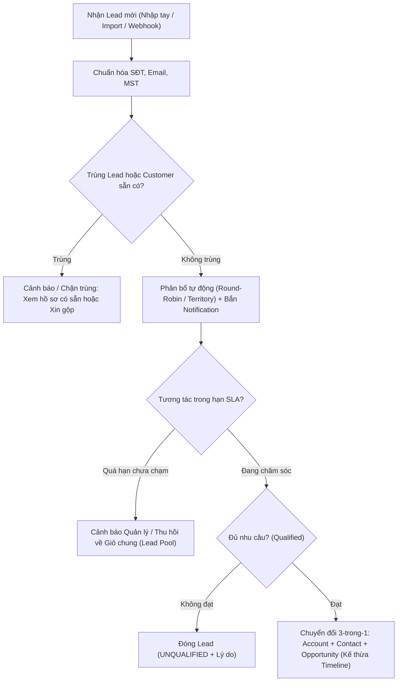
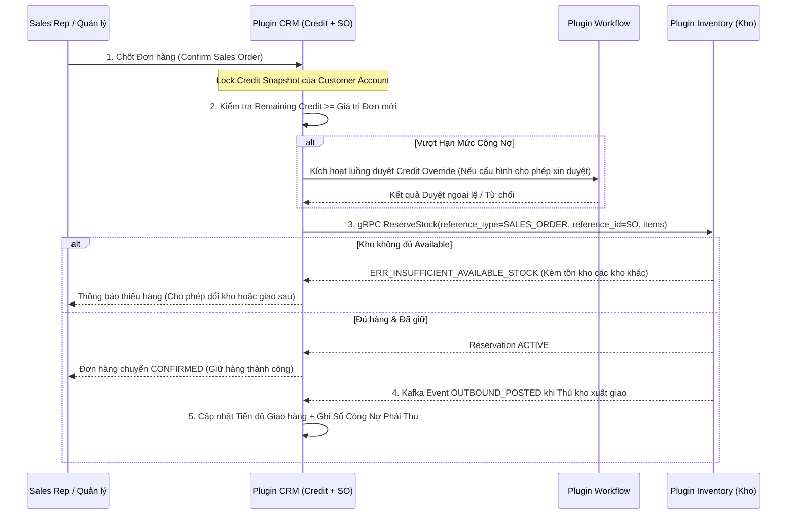
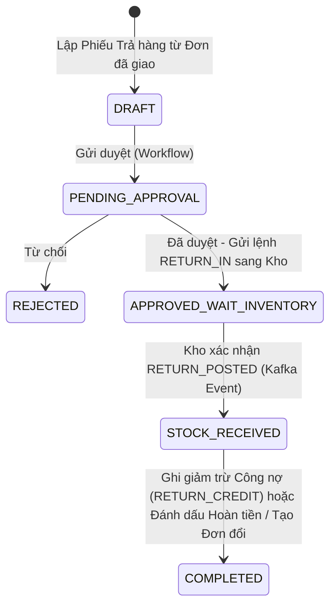

# Đặc Tả Luồng Xử Lý Nghiệp Vụ — Plugin Quản Lý & Nghiệp Vụ Khách Hàng (`plugins/crm`) (Sprint 14)

| Thuộc tính | Giá trị |
| :--- | :--- |
| ID | ANL-S14-001 |
| Sprint | Sprint 14 (`sprint_14_plugin_crm`) |
| Tác giả | AI Business Analyst (BA) |
| Trạng thái | Draft / Chờ khách hàng review nghiệp vụ |
| Phiên bản | 0.1 |
| Tài liệu liên quan | [00_READING_GUIDE.md](../00_READING_GUIDE.md) · [RAW-S14-001](../01_raw_notes/01_RAW-S14-001_crm_customer_requirements.md) · [BENCH-S14-001](../03_benchmarks/01_BENCH-S14-001_crm_customer_benchmarks.md) · [CONF-S14-001](../04_confirmation/01_CONF-S14-001_sprint_14_scope_and_ac.md) |

---

## 1. Kiến Trúc Nghiệp Vụ Lõi: Customer 360 & Sổ Công Nợ Phải Thu

### 1.1. Mô Hình Khách Hàng 360 (`Customer 360 Graph`)
Kế thừa chuẩn mực `Salesforce + HubSpot + MISA AMIS` (`L01`, `L02`, `L11`), toàn bộ dữ liệu xoay quanh thực thể trung tâm **`Customer Account`**:
- **`Lead` (Khách hàng tiềm năng)**: Dữ liệu đầu mối thô cần sàng lọc trước khi chuyển đổi thành `Customer Account` + `Contact` + `Opportunity` (hoặc bỏ qua bước Lead nếu tạo giao dịch thẳng cho khách hàng hiện hữu).
- **`Customer Account` (Hồ sơ Khách hàng B2B / B2C)**: Đơn vị chịu trách nhiệm thương mại, chính sách giá (`Price Tier`) và **Hạn mức Công nợ (`Credit Limit`)**; hỗ trợ phân cấp Công ty mẹ - Chi nhánh con (`parent_account_id`) và nhiều địa chỉ giao hàng/hóa đơn.
- **`Contact` (Người liên hệ)**: Nhiều cá nhân gắn với 1 `Customer Account` (VD: Giám đốc ký hợp đồng, Kế toán đối soát công nợ, Người nhận hàng), gắn vai trò trên từng Cơ hội/Đơn hàng.
- **Nhánh Thương mại (`Commercial Stream`)**: `Opportunity` -> `Quotation` (Versioning) -> `Sales Order` -> `Contract` -> `Payment Schedule` -> `Sales Return (RMA)`.
- **Nhánh Tương tác & Hậu mãi (`Engagement & Service Stream`)**: `Activity Timeline` (Call, Meeting, Check-in, Email, Note, Task) + `Support Ticket (SLA)`.

### 1.2. Sổ Công Nợ Phải Thu Bất Biến (`Customer Receivable Ledger`) & 4 Chỉ Số Hạn Mức
Để tránh sai lệch công nợ khi sửa đơn hay hủy thanh toán, mọi phát sinh tăng/giảm nợ được ghi append-only trên **`Customer Receivable Ledger`** kết hợp bảng tổng hợp tức thời **`Customer Credit Snapshot`**:

| Chỉ số Công nợ / Hạn mức | Công thức / Ý nghĩa nghiệp vụ | Ai / Khi nào kiểm tra |
| :--- | :--- | :--- |
| **1. Hạn mức tín dụng** | `Credit Limit` | Giá trị dư nợ tối đa cho phép đối với `Customer Account` (thiết lập bởi Kế toán/Quản lý). | Sales tạo Đơn hàng, Kế toán kiểm soát rủi ro. |
| **2. Dư nợ chưa thu** | `Open Receivable` | Tổng giá trị đã giao hàng/phát sinh công nợ trừ đi tổng tiền đã thu & giảm trừ trả hàng (`Sum Receivable Ledger`). | Kế toán đối chiếu công nợ, Báo cáo Tuổi nợ (`Aging`). |
| **3. Nợ treo chờ thực hiện** | `Pending Exposure` | Tổng giá trị các `Sales Order` đã xác nhận (`CONFIRMED`) nhưng chưa tất toán/hủy (chống việc tạo cùng lúc 5 đơn nhỏ lách hạn mức). | Hệ thống kiểm tra tự động trước khi xác nhận Đơn hàng mới. |
| **4. Hạn mức còn lại** | `Remaining Credit` | `Credit Limit - (Open Receivable + Pending Exposure)`. Nếu giá trị đơn mới lớn hơn `Remaining Credit` -> Chặn hoặc chuyển duyệt `Credit Override`. | Kiểm tra đồng thời (`Lock`) tại bước `Confirm Sales Order`. |

### 1.3. Ranh Giới Tích Hợp Giữa `plugins/crm` & Hệ Sinh Thái Open-ERP

| Thành phần | Sở hữu dữ liệu & Trách nhiệm | Hình thức giao tiếp |
| :--- | :--- | :--- |
| **Plugin `crm` (Sprint 14)** | Toàn bộ `Lead`, `Customer Account`, `Contact`, `Opportunity`, `Pipeline`, `Price List`, `Quotation`, `Sales Order`, `Contract`, `Payment Milestone`, `Receivable Ledger`, `Sales Return`, `Ticket SLA`, `Activities`. | Module độc lập; đăng ký vào Entity Registry |
| **Plugin `inventory` (Sprint 13)** | Nguồn chân lý về `SKU` chi tiết & `Available Qty`; giữ hàng (`StockReservation`), xuất giao hàng (`DELIVERY_OUT`) và nhập trả hàng (`RETURN_IN`). | `PluginDataServiceGrpc` (Query tồn, Reserve/Release) & Kafka (`OUTBOUND_POSTED`, `RETURN_POSTED`) |
| **Plugin `organization`** | Chi nhánh, Phòng ban/Nhóm kinh doanh (`branch_id`, `team_id`). | `PluginDataServiceGrpc` / Sync Cache |
| **Plugin `catalog`** | Nhóm khách hàng, Nguồn khách (`Lead Source`), Ngành nghề, Điều khoản thanh toán, Loại Ticket, Lý do Thắng/Thua/Trả hàng. | `PluginDataServiceGrpc` |
| **Plugin `employee`** | Nhân viên Kinh doanh (`Owner`), CSKH, Quản lý nhóm. | `PluginDataServiceGrpc` |
| **Plugin `workflow` (Sprint 08)** | Phê duyệt Báo giá vượt khung chiết khấu, Duyệt Đơn vượt Hạn mức công nợ (`Credit Override`), Duyệt Đổi/Trả hàng `RMA`. | Workflow Trigger & Callback Event |
| **Plugin `in-app-notification`** | Cảnh báo Lead mới / sắp quá hạn thu hồi, Hợp đồng sắp hết hạn, Công nợ quá hạn, Ticket sắp vi phạm `SLA`. | Kafka / Outbox Event |

---

## 2. Chi Tiết 7 Luồng Xử Lý Nghiệp Vụ Trọng Tâm

---

### Luồng 1: Quản Lý Tiềm Năng (`Lead`), Chống Trùng, Phân Bổ & Chuyển Đổi 3-Trong-1

#### Quy trình xử lý
1. **Tiếp nhận & Chuẩn hóa (`CAPTURE`)**:
   - Tạo `Lead` từ nhập tay, Import bảng tính, hoặc API Webhook (Landing Page/Form).
   - Chuẩn hóa tự động Số điện thoại (VD: `+84`/`0`), Email (lowercase), và Mã số thuế (`MST`).
2. **Kiểm tra Trùng lặp (`DUPLICATE CHECK`)**:
   - Trước khi lưu, hệ thống quét trùng trên cả bảng `Lead` đang mở và `Customer Account` / `Contact` hiện hữu của Tenant theo `MST`, `SĐT`, `Email`.
   - Nếu phát hiện trùng: hiển thị Drawer cảnh báo cho người dùng chọn **Mở hồ sơ sẵn có**, **Gửi yêu cầu xin chia sẻ/chuyển quyền**, hoặc **Tạo mới (nếu cấu hình chỉ Cảnh báo thay vì Chặn cứng)**.
3. **Phân bổ Tự động & Thu hồi SLA (`ROUTING & RECLAIM`)**:
   - Nếu `Lead` chưa có người phụ trách (`unassigned`), hệ thống áp quy tắc: chia xoay vòng (`Round-Robin`) trong Nhóm kinh doanh phụ trách Khu vực/Nguồn tương ứng và bắn notification ngay cho Sales được gán.
   - Nếu quá thời gian SLA (VD: `4 giờ` hoặc `24 giờ` tùy cấu hình) mà Sales chưa có tương tác đầu tiên (`Call / Note / Status Change`): bắn cảnh báo nhắc nhở, và nếu cấu hình tự thu hồi -> trả Lead về `Lead Pool (Giỏ chung)` hoặc chia lại cho người tiếp theo.
4. **Sàng lọc & Chuyển đổi 3-trong-1 (`QUALIFY & CONVERT`)**:
   - Khi Lead đủ điều kiện (`QUALIFIED`), Sales bấm **Chuyển đổi (`Convert Lead`)** mở Drawer xác nhận:
     - Chọn **Tạo mới `Customer Account`** hoặc **Gộp vào `Customer Account` đã có** (tạo thêm `Contact` mới cho công ty đó).
     - Tùy chọn tạo kèm **1 `Opportunity` mới** gắn vào `Pipeline` khởi đầu.
     - Toàn bộ `Activity / Notes` trước đó của Lead tự động chuyển nối liền mạch vào dòng thời gian của Khách hàng & Cơ hội mới. Trạng thái Lead = `CONVERTED` (chỉ đọc).

---

### Luồng 2: Quản Trị Cơ Hội Bán Hàng (`Opportunity Pipeline`) & Dự Báo Doanh Thu

- **Hỗ trợ Đa Quy trình (`Multi-Pipeline`)**: Mỗi Tenant định nghĩa 1 hoặc nhiều Pipeline (VD: *Bán lẻ B2C*, *Dự án B2B*, *Gia hạn hợp đồng*). Mỗi Stage gồm: Thứ tự, Tên giai đoạn, `Win Probability %` (VD: Tiếp nhận 10% -> Khảo sát 30% -> Gửi Báo giá 60% -> Thương lượng 80% -> Thắng 100% / Thua 0%), và trạng thái đóng (`OPEN`, `WON`, `LOST`).
- **`Stage Guardrails` (Điều kiện Bắt buộc khi Chuyển Bước)**:
  - Cấu hình quy tắc chuyển giai đoạn: muốn chuyển sang bước X bắt buộc điền các trường tương ứng (VD: chuyển sang `Gửi Báo giá` phải có giá trị kỳ vọng `expected_amount > 0` và tối thiểu 1 `Quotation`; chuyển sang `CLOSED_LOST` bắt buộc chọn `lost_reason` chuẩn hóa từ `catalog`). Nếu thiếu -> UI mở Drawer bổ sung nhanh ngay tại bước kéo Kanban hoặc cập nhật trong bảng.
- **Dự báo Doanh thu Trọng số (`Weighted Forecast`)**:
  - Tự động tính `weighted_amount = expected_amount * stage_probability / 100`, tổng hợp theo `Nhân viên`, `Nhóm/Chi nhánh`, và `Tháng/Quý dự kiến chốt (expected_close_date)`.

---

### Luồng 3: Bảng Giá (`Price List`), Lập Báo Giá (`Quotation`) & Kiểm Tra Tồn Khả Dụng

1. **Cơ chế Bảng giá (`Price Book / Price List`)**:
   - Một Tenant có Bảng giá chuẩn mặc định + nhiều Bảng giá ưu đãi theo **Nhóm Khách hàng / Hạng VIP**, **Chi nhánh**, hoặc **Chương trình khuyến mãi theo ngày hiệu lực (`valid_from`..`valid_to`)**.
   - Thứ tự ưu tiên lấy đơn giá: *Bảng giá riêng Khách hàng/Nhóm còn hiệu lực -> Bảng giá Chi nhánh -> Bảng giá chuẩn mặc định*.
2. **Kiểm Tra Tồn Khả Dụng Tức Thời Từ Kho (`plugins/inventory`)**:
   - Trên từng dòng hàng hóa của Báo giá, UI/Backend gọi `PluginDataServiceGrpc` sang `plugins/inventory` hiển thị ngay **`Available Qty`** theo từng kho (quy đổi đúng `UoM` đang chọn trên báo giá) để Sales tư vấn chính xác thời gian giao hàng, **chưa khóa giữ hàng ở bước Báo giá**.
3. **Chiết khấu & Phê duyệt Vượt Ngưỡng (`workflow`)**:
   - Hỗ trợ chiết khấu theo từng dòng (`%` hoặc số tiền) và chiết khấu tổng đơn + Thuế VAT (`0%`, `5%`, `8%`, `10%`).
   - Kiểm tra hạn mức chiết khấu theo vai trò (VD: Sales Rep được giảm tối đa `5%`; giảm `5%–15%` cần Trưởng nhóm duyệt; `> 15%` cần Giám đốc Kinh doanh duyệt) thông qua **`plugins/workflow`**.
4. **Phiên bản Báo giá (`Versioning`)**:
   - Khi Báo giá ở trạng thái `SENT` hoặc `EXPIRED` mà khách yêu cầu thương lượng lại giá -> Bấm **Tạo phiên bản mới (`New Revision v2`)** giữ nguyên bản `v1` dạng chỉ đọc (`SUPERSEDED`) để tra cứu lại lịch sử đàm phán.
   - Khi khách đồng ý -> Bấm **Khách chấp nhận (`ACCEPTED`)** và chuyển sang tạo `Sales Order` chỉ bằng 1 click.

---

### Luồng 4: Đơn Đặt Hàng (`Sales Order`), Hạn Mức Công Nợ & Phối Hợp Kho (`plugins/inventory`)

Đây là điểm giao thoa nghiệp vụ tài chính + kho vận chặt chẽ nhất của `plugins/crm`:

#### Quy tắc xử lý trạng thái Đơn hàng & Đồng bộ 2 chiều với Kho
- **Bước Xác nhận Đơn (`DRAFT / APPROVED -> CONFIRMED`)**:
  1. Nếu đơn vượt mức chiết khấu -> Phải qua duyệt chiết khấu trước (`APPROVED`).
  2. Khóa kiểm tra **Hạn mức Công nợ (`Credit Limit`)**: Đảm bảo `Open Receivable + Pending Exposure + Order Total <= Credit Limit` (hoặc đã có `Credit Override Approved` từ Kế toán/Quản lý).
  3. Gọi gRPC sang `plugins/inventory` yêu cầu **Giữ hàng (`StockReservation`)** với `reference_type = SALES_ORDER`, `reference_code = order_no`, `reference_id = order_id`. Nếu Kho báo thiếu hàng -> Không chuyển `CONFIRMED` được (trừ khi bật chế độ *Đặt trước không giữ hàng — Pre-order* do Khách hàng chọn ở `Q5` tại `CONF-S14-001`).
- **Theo dõi Giao hàng (`CONFIRMED -> PARTIAL_DELIVERED -> DELIVERED`)**:
  - `plugins/inventory` thực hiện soạn hàng và ghi sổ Phiếu Xuất (`DELIVERY_OUT`) -> Bắn Kafka Event `OUTBOUND_POSTED` về `plugins/crm`.
  - `plugins/crm` tự động cộng dồn `delivered_qty` trên từng dòng `Sales Order`: giao đủ 100% -> `DELIVERED`, giao một phần -> `PARTIAL_DELIVERED`.
- **Hủy Đơn hàng (`CANCEL`)**:
  - Nếu Kho **chưa xuất giao (`delivered_qty == 0`)**: `plugins/crm` gọi gRPC `ReleaseReservation` sang `plugins/inventory` nhả ngay lượng hàng đang giữ, đồng thời giải phóng `Pending Exposure` công nợ.
  - Nếu Kho **đã xuất giao 1 phần hoặc toàn phần (`delivered_qty > 0`)**: **Cấm hủy ngang đơn**; phần đã giao bắt buộc xử lý qua Luồng **Đổi/Trả hàng (`RMA`)**, phần còn lại chưa giao được phép **Đóng phần dư (`Close Remaining`)** và nhả giữ hàng tương ứng.

---

### Luồng 5: Hợp Đồng (`Contract`), Đợt Thanh Toán & Quản Trị Công Nợ Phải Thu (`AR`)

1. **Quản lý Hợp đồng (`Contract`)**:
   - Gắn với 1 `Customer Account` và 1 hoặc nhiều `Sales Order`: Lưu Số hợp đồng, Ngày ký, Hiệu lực (`start_date`, `end_date`), Giá trị hợp đồng, Tệp đính kèm/bản scan, Trạng thái (`DRAFT`, `ACTIVE`, `EXPIRING_SOON`, `EXPIRED`, `TERMINATED`).
   - Tự động gửi cảnh báo qua `in-app-notification` trước ngày hết hạn hợp đồng `30 / 15 / 7 ngày` để Sales chăm sóc gia hạn (`Contract Renewal`).
2. **Đợt Thanh Toán (`Payment Milestones`) & Phiếu Thu (`Payment Receipt`)**:
   - Chia lịch thanh toán linh hoạt trên Hợp đồng/Đơn hàng: VD *Đợt 1: Tạm ứng 30% khi ký; Đợt 2: 50% khi giao hàng; Đợt 3: 20% sau 30 ngày nghiệm thu (`Net 30`)*.
   - Kế toán ghi nhận **Phiếu Thu / Thanh toán (`Payment Receipt`)** kèm chứng từ ngân hàng/tiền mặt và phân bổ vào 1 hoặc nhiều Đơn hàng/Đợt thanh toán.
   - Bút toán ghi nhận giảm `Open Receivable` vào **`Customer Receivable Ledger`**, tự động mở lại `Remaining Credit` cho khách hàng mua tiếp.
3. **Báo Cáo Tuổi Nợ (`AR Aging`) & Nhắc Nợ Chủ Động**:
   - Phân loại tự động dư nợ của từng Khách hàng vào 5 rổ tuổi nợ: **Trong hạn (`Current`)**, **Quá hạn `1–30 ngày`**, **`31–60 ngày`**, **`61–90 ngày`**, **`> 90 ngày`**.
   - Bắn cảnh báo nhắc Sales & Kế toán khi khoản thanh toán sắp tới hạn hoặc vừa chuyển sang quá hạn.

---

### Luồng 6: Nghiệp Vụ Đổi / Trả Hàng (`Sales Return / RMA`) Khép Kín Với Kho & Công Nợ

1. **Khởi tạo Phiếu Đổi/Trả (`DRAFT -> PENDING_APPROVAL -> APPROVED`)**:
   - Tạo từ `Sales Order` ở trạng thái `PARTIAL_DELIVERED` hoặc `DELIVERED`.
   - Ràng buộc cứng: `Tổng SL yêu cầu trả cho từng dòng <= SL đã thực giao - SL đã trả các phiếu RMA trước đó` (chống trả khống vượt số đã mua).
   - Chọn Hình thức xử lý: **(a) Trả hàng giảm trừ Công nợ (`CREDIT_NOTE`)**, **(b) Trả hàng hoàn tiền mặt/CK (`REFUND`)**, hoặc **(c) Đổi sản phẩm khác (`EXCHANGE` — sinh 1 đơn giao bù mới)**.
   - Phê duyệt qua `plugins/workflow` theo quy định công ty.
2. **Liên thông Nhập Lại Kho (`APPROVED -> WAITING_WAREHOUSE -> RETURNED`)**:
   - Sau khi RMA được duyệt, `plugins/crm` gửi yêu cầu sang `plugins/inventory` tạo **Phiếu Nhập Trả Lại (`RETURN_IN`, `reference_type = SALES_RETURN`)** — giữ đúng `Serial/IMEI` hoặc `Lot` gốc đã giao nếu SKU quản lý theo Lô/Serial.
   - Khi Thủ kho kiểm đếm/QC thực tế (hàng nguyên vẹn vào kho chính hoặc hàng hỏng vào khu `QUARANTINE`) và ghi sổ `RETURN_POSTED`: Kho bắn event về `plugins/crm`.
3. **Tự Động Cấn Trừ Công Nợ / Hoàn Tiền (`COMPLETED`)**:
   - Ngay khi Kho xác nhận đã nhận lại hàng, `plugins/crm` ghi 1 dòng **`RETURN_CREDIT`** âm nợ vào `Customer Receivable Ledger` theo đúng số lượng & đơn giá được chấp nhận trả, hoàn trả lại `Remaining Credit` cho Khách hàng.

---

### Luồng 7: Lịch Sử Tương Tác (`Activities`), Chăm Sóc & Ticket Khiếu Nại / Bảo Hành (`SLA`)

1. **Dòng Thời Gian Tương Tác Thống Nhất (`Activity Timeline` & `Follow-up Tasks`)**:
   - Gắn thống nhất trên `Lead`, `Customer Account`, `Opportunity`, `Ticket`: Ghi log Cuộc gọi, Email, Ghi chú nội bộ (`@mention` đồng nghiệp), Lịch họp và **Check-in Gặp khách (lưu vị trí/ảnh/nội dung trên Mobile Ionic cho Sales thị trường)**.
   - Nhắc việc `Follow-up Task` quá hạn hiển thị nổi bật trên Dashboard cá nhân & `in-app-notification`.
2. **Quản Lý Ticket Hỗ Trợ / Khiếu Nại / Bảo Hành & `SLA`**:
   - Tiếp nhận Ticket gắn với `Customer Account`, tùy chọn gắn `Sales Order` hoặc `Serial/IMEI` sản phẩm lỗi.
   - Phân loại Mức độ ưu tiên (`LOW`, `MEDIUM`, `HIGH`, `URGENT`) để tự động gán **Chính sách SLA**:
     - `First Response SLA` (Thời gian phản hồi lần đầu, VD: `2 giờ` với `HIGH`).
     - `Resolution SLA` (Thời gian giải quyết dứt điểm, VD: `24 giờ` với `HIGH`).
   - **Cơ chế Tạm dừng đồng hồ SLA (`SLA Pause`)**: Khi chuyển trạng thái sang **`WAITING_CUSTOMER`** (chờ khách gửi thêm thông tin/hình ảnh), đồng hồ SLA tạm dừng và tự chạy tiếp khi khách phản hồi hoặc nhân viên mở lại trạng thái `IN_PROGRESS`.
   - Cảnh báo qua `in-app-notification` khi SLA đạt `75%` (Sắp vi phạm) và `100%` (Vi phạm SLA — leo thang lên Trưởng bộ phận CSKH); cho phép ghi nhận đánh giá hài lòng `CSAT` sau khi đóng Ticket.

---

## 3. Bộ Quy Tắc Nghiệp Vụ (`BR-C01` – `BR-C14`)

| Mã BR | Quy tắc bắt buộc |
| :--- | :--- |
| `BR-C01` | **Cô lập Đa Tenant & Data Scope Kinh doanh**: Mọi thực thể bắt buộc lọc theo `tenant_id` từ JWT; Sales Rep mặc định chỉ thấy hồ sơ thuộc `Own / Shared`, Trưởng nhóm thấy toàn `Team/Branch` (`organization`), cấm truy cập chéo ngoài phạm vi quyền. |
| `BR-C02` | **Chuẩn hóa Chống Trùng Khách hàng (`Duplicate Guard`)**: Hệ thống chuẩn hóa SĐT, Email, MST và tự động kiểm tra trùng trên toàn bộ `Lead` đang mở & `Customer Account` trong Tenant trước khi tạo/chuyển đổi, bảo toàn lịch sử chủ sở hữu rõ ràng. |
| `BR-C03` | **Bảo toàn Dữ liệu khi Chuyển đổi Lead**: Thao tác `Convert Lead` phải chạy trong một Transaction DB để đảm bảo `Account + Contact + Opportunity + Chuyển Activity Timeline` thành công trọn vẹn; Lead đã `CONVERTED` chuyển sang chế độ chỉ đọc. |
| `BR-C04` | **Bắt buộc Tuân thủ `Stage Guardrails`**: Mọi bước chuyển giai đoạn trên Pipeline (kể cả kéo thả Kanban) đều phải validate đủ các trường bắt buộc của giai đoạn đích và bắt buộc `lost_reason` khi đóng `CLOSED_LOST`. |
| `BR-C05` | **Kiểm tra Tồn Khả Dụng Thực Từ `plugins/inventory`**: `plugins/crm` tuyệt đối không tự lưu cache số tồn bán riêng làm nguồn sự thật; mọi thao tác kiểm tra tồn trên Báo giá hoặc giữ hàng khi chốt Đơn hàng phải gọi trực tiếp `PluginDataServiceGrpc` sang `plugins/inventory`. |
| `BR-C06` | **Bất biến Báo giá Đã Gửi & Versioning**: Báo giá đã chuyển trạng thái `SENT` hoặc `ACCEPTED` không được sửa đè làm mất nội dung gửi khách; thay đổi giá/số lượng bắt buộc tạo phiên bản mới (`Revision`). |
| `BR-C07` | **Kiểm soát Hạn Mức Công Nợ Có Khóa Đồng Thời (`Credit Concurrency`)**: Khi xác nhận `Sales Order`, phải khóa `Customer Credit Snapshot` (`SELECT FOR UPDATE` theo `customer_id`) để cộng kiểm tra `Open Receivable + Pending Exposure + Order Total <= Credit Limit`, chặn 2 đơn xác nhận song song cùng vượt hạn mức. |
| `BR-C08` | **Trình tự Hủy Đơn Gắn Kho An Toàn**: Chỉ được hủy trực tiếp `Sales Order` khi `delivered_qty == 0` (đồng thời gửi lệnh nhả `StockReservation` sang Kho). Khi đã giao hàng >= 1 phần, cấm hủy ngang; phải xử lý trả hàng qua luồng `RMA` hoặc đóng phần dư chưa giao. |
| `BR-C09` | **Sổ Công Nợ Phải Thu Bất Biến (`AR Ledger`)**: Cấm sửa/xóa trực tiếp dòng đã ghi trên `Customer Receivable Ledger` hoặc `Payment Receipt` đã chốt; sai sót phải lập bút toán Điều chỉnh / Hủy tham chiếu. |
| `BR-C10` | **Khớp Toàn Vẹn Đổi/Trả Hàng (`RMA Cap`)**: Tổng số lượng hàng trả của tất cả phiếu RMA không bị từ chối trên cùng 1 `Sales Order` không bao giờ vượt quá tổng `delivered_qty` thực tế từ Kho. |
| `BR-C11` | **Giảm trừ Công nợ Trả hàng Chỉ Sinh Sau Khi Kho Nhận Hàng**: Việc ghi nhận giảm trừ nợ `RETURN_CREDIT` chỉ kích hoạt sau khi nhận event `RETURN_POSTED` xác nhận hàng đã nhập lại Kho từ `plugins/inventory`, tránh giảm nợ trước khi thu hồi được hàng. |
| `BR-C12` | **Tính Toán SLA Chính Xác Theo Giờ Làm Việc & Trạng thái Chờ Khách**: Bộ đếm SLA Ticket tự động tạm dừng khi trạng thái là `WAITING_CUSTOMER` và chỉ cảnh báo/leo thang theo khung giờ làm việc cấu hình của Tenant (VD: T2–T6 08:00–17:30 hoặc 24/7). |
| `BR-C13` | **Kiểm soát Chiết khấu & Duyệt Ngoại lệ Qua `plugins/workflow`**: Cấm viết cây phê duyệt ad-hoc; mọi luồng duyệt chiết khấu vượt khung, duyệt vượt hạn mức công nợ (`Credit Override`) và duyệt `RMA` đều gọi thống nhất qua `plugins/workflow`. |
| `BR-C14` | **Liên thông Liên Plugin Chuẩn Hợp Đồng**: Mọi giao tiếp giữa `crm` và `inventory`, `organization`, `catalog`, `employee`, `workflow`, `in-app-notification` dùng `PluginDataServiceGrpc` hoặc Kafka (cấm gọi REST chéo, cấm `size = 100` fix cứng). |

---

## 4. Phân Tích 10 Tình Huống Biên Quan Trọng (`Edge Cases`)

| STT | Tình huống biên (Edge Case) | Cách xử lý chuẩn hóa |
| :--- | :--- | :--- |
| `EC-01` | **2 nhân viên kinh doanh cùng lúc bấm Xác nhận 2 Đơn hàng cho 1 Khách hàng sắp chạm trần Hạn mức Công nợ** | Nhờ khóa hàng `SELECT FOR UPDATE` trên `Customer Credit Snapshot` theo `customer_id`, Đơn A xác nhận thành công trước làm tăng `Pending Exposure`; Đơn B chạy ngay sau thấy `Remaining Credit` không đủ -> bị chặn hoặc chuyển sang luồng `Credit Override`. |
| `EC-02` | **Đơn hàng đã chốt (`CONFIRMED` & đã giữ hàng Kho) nhưng bị Khách hàng hủy gấp khi Kho đang đóng gói** | Nếu Kho chưa `POSTED` Phiếu Xuất: `crm` gọi gRPC nhả giữ hàng, Kho hủy/dừng picking và nhận notification khẩn. Nếu Kho vừa `POSTED` trước đó vài giây: `crm` nhận event `OUTBOUND_POSTED`, khóa thao tác Hủy đơn và chuyển Sales sang tạo phiếu Thu hồi / Trả hàng `RMA`. |
| `EC-03` | **Đã chốt Đơn hàng CRM nhưng Kho giữ hàng thất bại giữa chừng do có giao dịch kho khác vừa lấy mất chiếc cuối** | Nếu bước `ReserveStock` gRPC từ `inventory` trả `ERR_INSUFFICIENT_AVAILABLE_STOCK`, giao dịch `Confirm Sales Order` rollback hoàn toàn phần `Pending Exposure` công nợ (tránh treo nợ ảo) và hiển thị tồn kho của các chi nhánh khác cho Sales xử lý. |
| `EC-04` | **Chuyển đổi Lead từ một Khách hàng cũ quay lại mua tiếp (MST hoặc SĐT đã có sẵn trên `Customer Account`)** | Khi bấm `Convert Lead`, UI mặc định chọn chế độ **Gắn vào `Customer Account` hiện hữu** -> giữ nguyên công nợ & lịch sử cũ của công ty đó, chỉ thêm `Contact` mới (nếu khác người liên hệ) và tạo `Opportunity` mới. |
| `EC-05` | **Một Đơn hàng giao làm 3 đợt (`Partial Delivery`) và Khách thanh toán rải rác không khớp từng đợt** | Hệ thống theo dõi `delivered_qty` theo tiến độ Kho ở cấp từng dòng Đơn hàng, tách độc lập với tiến độ `Payment Milestones` trên Hợp đồng/Đơn hàng; Kế toán phân bổ tiền thu từ `Payment Receipt` theo thứ tự FIFO đơn cũ nhất hoặc chỉ định đích danh từng đợt. |
| `EC-06` | **Khách hàng trả lại hàng nhiều lần trên cùng 1 Đơn hàng (Mua 10, lần 1 trả 2, lần 2 trả 3)** | Mỗi lần tạo RMA kiểm tra `Max Returnable = Delivered - Sum(Active/Completed RMA Qty)` trên từng line item; đảm bảo lần 2 tối đa chỉ trả được `10 - 2 = 8`, tổng trả không vượt quá số đã nhận. |
| `EC-07` | **Khách trả hàng bị hư hỏng bao bì nên chỉ đồng ý hoàn 80% giá trị (`Restocking Fee` / Khấu trừ)** | Cho phép cấu hình `accepted_return_amount` / `restocking_fee` trên Phiếu RMA khi chốt duyệt; Kho vẫn nhập lại đúng số lượng vật lý (có thể đưa vào khu QC), còn Sổ Công nợ ghi nhận đúng giá trị cấn trừ sau khấu trừ phí. |
| `EC-08` | **Cần sửa hoặc thay thế Báo giá sau khi đã gửi cho Khách (`Revision Control`)** | Không sửa đè bản `v1`; tạo bản `v2` sao chép toàn bộ dòng sản phẩm -> `v1` chuyển thành `SUPERSEDED` (chỉ đọc). Khi `v2` được chuyển sang `Sales Order`, các phiên bản chưa chốt khác thuộc cùng Opportunity tự khóa không cho chốt trùng 2 đơn từ 1 cơ hội (trừ khi bật tùy chọn nhiều đơn/cơ hội). |
| `EC-09` | **Nhân viên kinh doanh nghỉ việc hoặc chuyển nhóm (`employee` offboard)** | Không làm gãy dữ liệu lịch sử; Quản lý chọn nhiều Lead/Customer/Opportunity trên Data Table -> Dùng **Context Menu chuột phải / Bulk Action -> Chuyển quyền phụ trách (`Reassign Owner`)** sang nhân viên mới trong 1 thao tác. |
| `EC-10` | **Khách hàng liên tục hỏi qua lại kéo dài trên Ticket khiến bộ đếm SLA sắp hết giờ** | Nhân viên CSKH chuyển Ticket sang trạng thái **`WAITING_CUSTOMER`** khi đã gửi câu hỏi phản hồi cho khách -> Đồng hồ SLA tự động tạm dừng (`Paused`) và lưu tổng thời gian tạm dừng để tính toán `Net SLA` công bằng cuối tháng. |

---

## 5. Danh Sách 24 User Stories (`US-S14-01` – `US-S14-24`)

### Nhóm A: Lead, Khách Hàng 360 & Tương Tác (`Customer Management`)
- **`US-S14-01`** (*Telesales / Sales*): Tạo mới/Import `Lead`, nhận cảnh báo trùng lặp tức thì theo `MST / SĐT / Email` trước khi lưu trùng.
- **`US-S14-02`** (*Quản trị CRM*): Cấu hình quy tắc phân bổ `Lead` tự động (`Round-Robin` / Theo khu vực) và thời hạn thu hồi SLA nếu chưa tương tác.
- **`US-S14-03`** (*Sales Rep*): Chuyển đổi `Lead` (`Convert`) thành `Customer Account` (tạo mới hoặc gộp hồ sơ sẵn có) + `Contact` + `Opportunity` giữ nguyên lịch sử chăm sóc.
- **`US-S14-04`** (*Sales Rep / CSKH*): Xem toàn cảnh **Customer 360** (Nested Route) gồm thông tin B2B/B2C, danh bạ `Contacts`, địa chỉ giao hàng, lịch sử tương tác, đơn hàng, công nợ và Ticket bảo hành tại 1 nơi.
- **`US-S14-05`** (*Sales Rep Mobile/Desktop*): Ghi nhận lịch sử Cuộc gọi, Ghi chú, Lịch hẹn và Check-in gặp khách trên Mobile Ionic; đặt Task nhắc việc follow-up.

### Nhóm B: Cơ Hội Pipeline, Bảng Giá & Báo Giá (`Sales Execution`)
- **`US-S14-06`** (*Quản trị CRM*): Thiết lập nhiều `Pipeline`, cấu hình % xác suất thắng theo từng bước và quy tắc bắt buộc trường thông tin (`Stage Guardrails`).
- **`US-S14-07`** (*Sales Rep*): Kéo/thả Cơ hội trên bảng **Kanban Pipeline** (đồng bộ URL) hoặc lọc trên Data Table; xem dự báo doanh số trọng số (`Weighted Forecast`).
- **`US-S14-08`** (*Quản lý Kinh doanh*): Thiết lập Bảng giá (`Price List`) theo nhóm/hạng khách hàng và khoảng thời gian khuyến mãi.
- **`US-S14-09`** (*Sales Rep*): Lập Báo giá (`Quotation`), tra cứu trực tiếp **Tồn khả dụng (`Available Qty`)** từng kho từ `plugins/inventory`, sinh nhiều phiên bản (`Revision`) khi đàm phán.
- **`US-S14-10`** (*Trưởng nhóm / Quản lý*): Nhận thông báo và phê duyệt Báo giá chiết khấu vượt ngưỡng thông qua `plugins/workflow`.

### Nhóm C: Đơn Hàng, Hạn Mức Công Nợ & Phối Hợp Kho (`Order & Credit Control`)
- **`US-S14-11`** (*Sales Rep*): Chuyển đổi Báo giá (hoặc tạo thẳng cho khách cũ) thành **Đơn đặt hàng (`Sales Order`)** và xác nhận giữ hàng tự động sang `plugins/inventory`.
- **`US-S14-12`** (*Kế toán Công nợ*): Thiết lập **Hạn mức Công nợ (`Credit Limit`)** cho từng khách hàng; hệ thống tự động chặn hoặc đẩy xin duyệt `Credit Override` khi đơn hàng vượt hạn mức khả dụng.
- **`US-S14-13`** (*Sales Rep / Điều phối*): Theo dõi trạng thái giao hàng thời gian thực (`Pending -> Partial Delivered -> Delivered`) đồng bộ từ `plugins/inventory` ngay trên chi tiết Đơn hàng; hủy đơn nhả giữ hàng tự động khi kho chưa xuất.

### Nhóm D: Hợp Đồng, Thanh Toán & Đổi Trả (`Contracts, AR & RMA`)
- **`US-S14-14`** (*Sales Rep / Hành chính*): Tạo Hợp đồng gắn 1 hoặc nhiều Đơn hàng, thiết lập `Payment Milestones` và nhận cảnh báo gia hạn trước ngày hết hạn.
- **`US-S14-15`** (*Kế toán Công nợ*): Ghi nhận Phiếu Thu / Thanh toán từ khách hàng, phân bổ cấn trừ vào Đơn hàng/Đợt thanh toán và xem `Sổ Công Nợ Phải Thu`.
- **`US-S14-16`** (*Kế toán / Quản lý*): Theo dõi **Báo cáo Tuổi nợ (`AR Aging`: Trong hạn, 1-30, 31-60, 61-90, >90 ngày)** và nhận cảnh báo khoản nợ quá hạn.
- **`US-S14-17`** (*CSKH / Sales Rep*): Tạo Phiếu **Đổi / Trả hàng (`RMA`)** từ Đơn đã giao, trình duyệt `workflow`, tự động gửi yêu cầu nhập trả `RETURN_IN` sang `plugins/inventory` và ghi giảm trừ công nợ khi Kho xác nhận đã nhận lại hàng.

### Nhóm E: Hỗ Trợ Ticket SLA, Báo Cáo & Chuẩn Data View (`Service & UX`)
- **`US-S14-18`** (*CSKH / Bảo hành*): Tiếp nhận và xử lý Ticket gắn Khách hàng / Đơn hàng / Serial sản phẩm theo mức ưu tiên và **Chính sách SLA** (hỗ trợ tạm dừng `WAITING_CUSTOMER`).
- **`US-S14-19`** (*Quản lý CSKH*): Nhận cảnh báo leo thang qua `in-app-notification` khi Ticket sắp vi phạm SLA và ghi nhận đánh giá `CSAT`.
- **`US-S14-20`** (*Quản lý Kinh doanh*): Xem Dashboard & Báo cáo: Phễu chuyển đổi, Lý do thắng/thua, Doanh số theo Nhân viên/Chi nhánh, Doanh số thực thu vs Công nợ phải thu.
- **`US-S14-21`** (*Tất cả người dùng Web Desktop*): Tùy chỉnh toàn diện mọi bảng dữ liệu (`Lead`, `Customer`, `Opportunity`, `Quotation`, `Sales Order`, `Contract`, `AR Ledger`, `Ticket`): lọc đa điều kiện, sắp xếp đa cột, ẩn/hiện cột, kéo/đổi thứ tự cột, chọn số hàng/trang đồng bộ URL Query Params.
- **`US-S14-22`** (*Tất cả người dùng Web Desktop*): Thao tác nhanh qua **Context Menu chuột phải** trên từng dòng bảng (Mở Customer 360, Ghi chú/Cuộc gọi, Chuyển đổi Lead, Tạo Báo giá, Tạo Đơn hàng, Ghi nhận Thu tiền, Chuyển người phụ trách `Reassign`).
- **`US-S14-23`** (*Sales / CSKH Mobile Ionic*): Tra cứu nhanh Customer 360, Check-in gặp khách, Xem tồn kho/Tạo Báo giá nháp, Xem tiến độ Đơn hàng & Cập nhật Ticket ngay trên Mobile (`>= 40px` touch target).
- **`US-S14-24`** (*Quản trị Tenant*): Cấu hình linh hoạt bộ thông số CRM (Bật/tắt tầng Lead, Chính sách Duplicate Warning/Block, Ngưỡng chiết khấu cần duyệt, Chính sách vượt Hạn mức công nợ, SLA Ticket).

---

## 6. Yêu Cầu Giao Diện (UI/UX), Quy Chuẩn Data View & Ma Trận Desktop vs. Mobile

### 6.1. Tuân Thủ Nghiêm Ngặt Chuẩn Data View & Sticky Scroll Table (`AGENTS.md` #33 & `ui_ux_standards.md` Mục 7)
Tất cả các màn hình danh sách của `plugins/crm` (**`Leads`, `Customers`, `Contacts`, `Opportunities (Table Mode)`, `Quotations`, `Sales Orders`, `Contracts`, `Receivables / AR Aging`, `Sales Returns (RMA)`, `Support Tickets`**) bắt buộc dùng Table component `@shared/*` (tự xây dựng, **không cài thư viện ngoài**):
1. **Cố định Header & Footer, chỉ cuộn Content bên trong**: Vùng bảng khóa chiều cao flex container (`flex-1 min-h-0 overflow-hidden`); cố định `thead` phía trên và thanh phân trang + tổng hợp dòng (VD: *Tổng giá trị đơn*, *Tổng dư nợ còn lại*) tại `tfoot`; chỉ vùng `tbody` cuộn bên trong.
2. **Tùy biến Cột & Số Hàng**: Cho phép người dùng **ẩn/hiện cột**, **thay đổi thứ tự cột** (VD: đưa cột *Dư nợ còn lại* hoặc *Ngày tương tác gần nhất* lên đầu), và chọn số hàng/trang (`20`, `50`, `100`, `200`).
3. **Bộ lọc, Sắp xếp & Kanban Sync URL**: Mọi bộ lọc (Trạng thái, Pipeline Stage, Sales Owner, Chi nhánh, Hạng khách, Khoảng ngày tạo/chốt, Sắp xếp) và chế độ xem (`?view=kanban|table&pipelineId=...&stage=...&sort=...&page=1`) đồng bộ 2 chiều lên URL Query Params.
4. **Context Menu Chuột Phải Đầy Đủ Nghiệp Vụ (100% i18n, Zero-Emoji)**:
   - *Trên `Leads`*: Gọi/Ghi chú nhanh, Chuyển đổi Lead, Gán/Chuyển người phụ trách (`Reassign`), Đánh dấu Không đạt (`Disqualify`).
   - *Trên `Customers`*: Mở Customer 360, Tạo Cơ hội mới, Tạo Báo giá nhanh, Tạo Đơn hàng, Ghi nhận Phiếu Thu, Mở Ticket mới.
   - *Trên `Quotations / Sales Orders`*: Xem chi tiết (Drawer/Split-View), Tạo Revision mới, Xác nhận Đơn / Kiểm tra giữ hàng Kho, Tạo Đổi trả RMA, Ghi nhận Thanh toán.
5. **Fallback Mobile (`>= 40px`)**: Trên Mobile Ionic (`390x844 px`), cung cấp nút hành động `...` hoặc bấm thẻ mở Action Sheet chuẩn chạm `>= 40px`.

### 6.2. Anti-Modal, Customer 360 Nested Route & Zero-Emoji
- **Anti-Modal**: Thay toàn bộ modal tạo/sửa bằng **Nested Routes** (VD: `/crm/customers/:id/overview|deals|orders|debt|tickets`), **Split-Screen** (Danh sách bên trái + Chi tiết tương tác bên phải), và **Stacked Drawers** (`?drawer=quotation&id=...&subDrawer=credit-check`).
- **High Density & Zero-Emoji**: Cấm emoji Unicode trên badge trạng thái, nhãn cột hay context menu; dùng SVG icon + i18n keys (`vi.json`/`en.json`) đầy đủ.

### 6.3. Ma Trận Phạm Vi Desktop Web vs. Mobile Ionic

| Nhóm chức năng | Web Desktop (`src/frontend/web`, `>= 1280px`) | Mobile Ionic (`src/frontend/mobile`, `390x844 px`) |
| :--- | :---: | :---: |
| Quản lý `Lead`, Lọc trùng, Import & Phân bổ | Đầy đủ | Xem Lead được giao, Gọi/Cập nhật trạng thái, Chuyển đổi nhanh |
| Customer 360 (`Account + Contacts + Timeline`) | Đầy đủ (Nested Tabs + Sticky Tables) | Tra cứu 360 rút gọn, gọi nhanh SĐT, Check-in gặp khách |
| Cơ hội (`Kanban Pipeline + Data View`) | Đầy đủ (Kéo thả Kanban + Sticky Table) | Danh sách Cơ hội + Cập nhật bước/Ghi chú nhanh |
| Báo giá & Đơn hàng + Kiểm tồn Kho (`inventory`) | Đầy đủ (Multi-line + Duyệt + Giữ hàng) | Xem trạng thái Đơn, Báo giá nhanh & Theo dõi tiến độ giao hàng |
| Hợp đồng, Thanh toán & Tuổi nợ `AR Aging` | Đầy đủ (Milestones + Sổ nợ + Export) | Xem cảnh báo Công nợ tới hạn để Sales nhắc khách |
| Đổi/Trả hàng (`RMA`) & Ticket `SLA` | Đầy đủ (Cấu hình SLA + Duyệt RMA) | Tạo/Cập nhật Ticket khi đi thị trường, đính kèm ảnh |
| Cấu hình Pipeline, Bảng giá, Hạn mức & Báo cáo | Đầy đủ | Không hỗ trợ cấu hình hệ thống (chỉ KPI cá nhân) |
