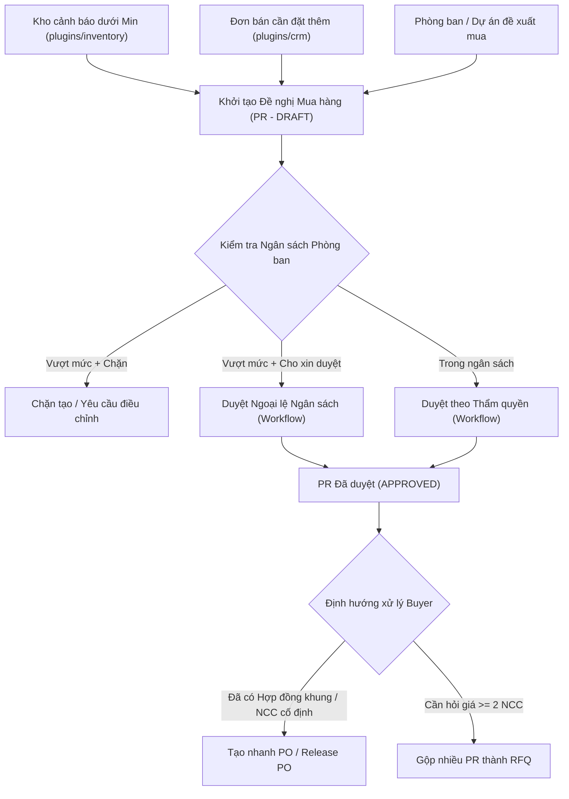
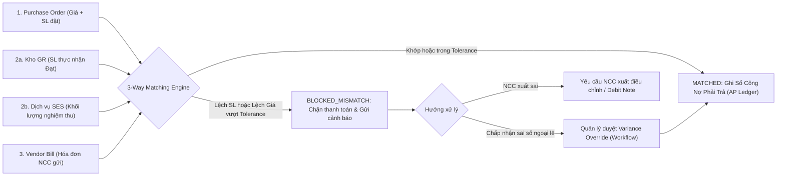
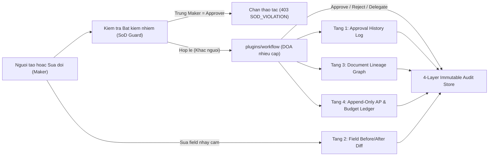
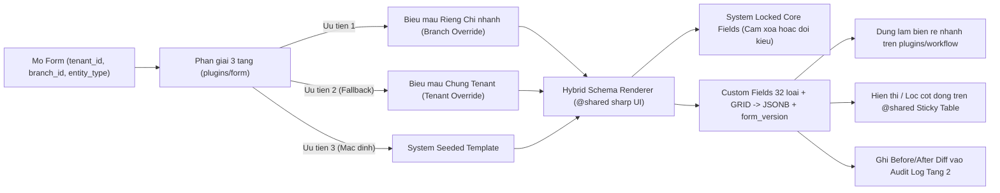
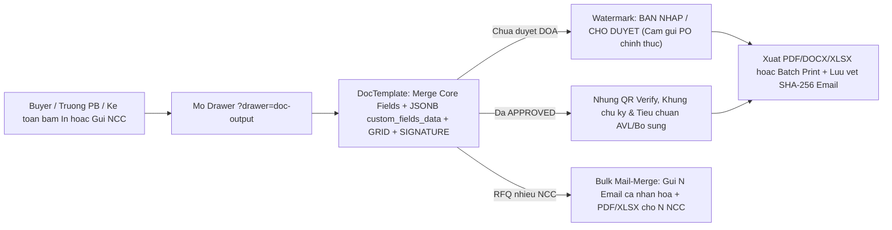

# Đặc Tả Luồng Xử Lý Nghiệp Vụ — Plugin Mua Hàng & Cung Ứng (`plugins/purchasing`) (Sprint 15)

| Thuộc tính | Giá trị |
| :--- | :--- |
| ID | ANL-S15-001 |
| Sprint | Sprint 15 (`sprint_15_plugin_purchasing`) |
| Tác giả | AI Business Analyst (BA) |
| Trạng thái | Draft / Chờ khách hàng review nghiệp vụ |
| Phiên bản | 0.4 |
| Tài liệu liên quan | [00_READING_GUIDE.md](../00_READING_GUIDE.md) · [RAW-S15-001](../01_raw_notes/01_RAW-S15-001_purchasing_supply_requirements.md) · [BENCH-S15-001](../03_benchmarks/01_BENCH-S15-001_purchasing_supply_benchmarks.md) · [CONF-S15-001](../04_confirmation/01_CONF-S15-001_sprint_15_scope_and_ac.md) |

---

## 1. Kiến Trúc Nghiệp Vụ Lõi: Supplier 360, Ngân Sách, Đối Chiếu 3 Chiều & Sổ Công Nợ Phải Trả

### 1.1. Mô Hình Dữ Liệu Phục Vụ Đa Hình Thái (Sản Xuất · Thương Mại · Dịch Vụ)
Để tránh tình trạng ép doanh nghiệp dịch vụ phải nhập kho ảo hoặc ép nhà máy sản xuất mua tự do không kiểm soát chất lượng, `plugins/purchasing` thiết kế tách bạch nhưng đồng nhất theo **Loại mục mua (`Purchase Item Type`)**:
- **`STOCKABLE` (Hàng hóa / Nguyên vật liệu qua Kho)**: Có `sku_id` từ `plugins/inventory`, kiểm soát `MOQ / Lead-time / AVL`, đồng bộ `Incoming Qty` & `PURCHASE_IN` (+ QC) sang `plugins/inventory`, hỗ trợ phân bổ `Landed Cost`.
- **`SERVICE_OR_EXPENSE` (Dịch vụ thuê ngoài / Chi phí trực tiếp / Mua sắm nội bộ)**: Không qua kho vật lý, gắn `department_id / cost_center_id / project_ref`, nghiệm thu bằng **Service Entry Sheet (`SES`)** và kiểm soát **Ngân sách phòng ban (`Budget Check`)**.

### 1.2. Quản Trị Ngân Sách Mua Sắm (`Budget Control`) & Sổ Công Nợ Phải Trả (`Supplier Payable Ledger`)
1. **4 Chỉ số Ngân sách theo Phòng ban / Trung tâm Chi phí (`Cost Center + Period`)**:

| Chỉ số Ngân sách | Ý nghĩa & Công thức | Thời điểm kiểm tra |
| :--- | :--- | :--- |
| **`Budget Limit`** | Hạn mức ngân sách được cấp trong kỳ (Tháng / Quý / Năm) cho Phòng ban / Hạng mục. | Thiết lập bởi Tài chính / Ban Giám đốc. |
| **`Committed Amount`** | Tổng giá trị các `PO` đã duyệt (`CONFIRMED`) nhưng chưa xuất hóa đơn/quyết toán hết. | Cộng ngay khi `PO` được duyệt (tránh xé lẻ nhiều đơn vượt trần). |
| **`Actual Spent`** | Tổng giá trị đã ghi nhận trên `Vendor Bill` đã khớp (`POSTED`) trừ các `Debit Note`. | Cộng khi hóa đơn hoàn tất `3-Way Match`. |
| **`Remaining Budget`** | `Budget Limit - (Committed Amount + Actual Spent)`. | Kiểm tra đồng thời tại bước Duyệt `PR` & Duyệt `PO`. |

2. **Sổ Công Nợ Phải Trả Bất Biến (`Supplier Payable Ledger — AP`)**:
   - Append-only theo từng `Supplier`: ghi Có (+) khi `Vendor Bill` đạt `3-Way Match`, ghi Nợ (-) khi Thanh toán (`Vendor Payment`) hoặc Giảm trừ trả hàng (`Debit Note`). Cấm sửa/xóa trực tiếp.

### 1.3. Ranh Giới Tích Hợp Liên Plugin

| Thành phần | Sở hữu dữ liệu & Trách nhiệm | Hình thức giao tiếp |
| :--- | :--- | :--- |
| **Plugin `purchasing` (Sprint 15)** | `Supplier 360`, `AVL`, `Vendor Pricelist`, `Supplier Scorecard`, `Department Budget`, `PR`, `RFQ`, `Supplier Quotation`, `PO`, `Blanket Order`, `SES`, `Landed Cost Allocation`, `Vendor Bill (3-Way Match)`, `Debit Note`, `Supplier Payable Ledger`. | Module độc lập; đăng ký Entity Registry |
| **Plugin `inventory` (Sprint 13)** | Nguồn `SKU` & tồn `Available`; phát cảnh báo dưới `Min`; giữ `Incoming Qty` khi `PO` xác nhận; thực thi `PURCHASE_IN` (+ QC) & `SUPPLIER_RETURN`; nhận phân bổ điều chỉnh giá vốn `Landed Cost`. | `PluginDataServiceGrpc` & Kafka Events (`LOW_STOCK_ALERT`, `INBOUND_POSTED`, `OUTBOUND_POSTED`) |
| **Plugin `crm` (Sprint 14)** | Khi `Sales Order` thiếu hàng cần mua thẳng theo đơn (`Back-to-Back`) -> tạo `PR` gắn `reference_type = SALES_ORDER`. | `PluginDataServiceGrpc` / Kafka |
| **Plugin `organization`** | Chi nhánh, Phòng ban (`department_id` làm Trung tâm chi phí kiểm tra Ngân sách). | `PluginDataServiceGrpc` |
| **Plugin `catalog`** | Nhóm NCC, Đơn vị tính (`UoM`), Tiền tệ, Thuế suất VAT, Điều khoản thanh toán, Loại chi phí. | `PluginDataServiceGrpc` |
| **Plugin `employee` & `workflow`** | `Requester`, `Buyer`, Người nghiệm thu `SES`; Phê duyệt `PR`, Chọn thầu, `PO` theo hạn mức & Vượt ngân sách. | `PluginDataServiceGrpc` & Workflow Event |
| **Plugin `in-app-notification`** | Cảnh báo `PR/PO` chờ duyệt, `PO` trễ giao (`Overdue`), `Blanket Order` sắp cạn trần/hết hạn, Nợ NCC sắp đến hạn chi. | Kafka / Outbox Event |
| **Plugin `document-template` (Sprint 16 — Ưu tiên trước Sprint 15)** | Thiết kế mẫu, kết xuất PDF/DOCX/XLSX (`PR`, `RFQ`, `PO / Blanket / Change Order`, `SES`, `Debit Note`), đóng `Watermark`, `QR Verify` & `Bulk Mail-Merge` mời thầu/gửi PO cho NCC. | `PluginDataServiceGrpc` / Kafka + Drawer `?drawer=doc-output` |

---

## 2. Chi Tiết 7 Luồng Xử Lý Nghiệp Vụ Trọng Tâm

---

### Luồng 1: Quản Trị Nhà Cung Cấp (`Supplier 360`), `AVL`, Bảng Giá & Chấm Điểm (`Scorecard`)

- **Hồ sơ Nhà cung cấp (`Supplier 360`)**:
  - Định danh pháp nhân (`MST` chống trùng theo Tenant), Địa chỉ xuất hóa đơn/kho lấy hàng, Đa tài khoản ngân hàng thụ hưởng, Danh sách Người liên hệ (`Contact`), Điều khoản thanh toán mặc định (`COD`, `Net 15/30/60`), Trạng thái vòng đời:
    - `PROBATION` (Đang thử việc/đánh giá mẫu thử).
    - `ACTIVE` (Đang giao dịch bình thường).
    - `WATCH` (Cảnh báo do điểm chất lượng/giao trễ tụt dưới ngưỡng).
    - `BLACKLISTED` (Cấm phát hành `RFQ` và `PO` mới).
- **Approved Vendor List (`AVL`) & Vendor Pricelist** *(Trọng yếu cho Doanh nghiệp Sản xuất & Thương mại)*:
  - Khai báo cặp `(Product/SKU, Supplier)`: Mã hàng phía NCC (`vendor_sku_code`), Đơn vị mua (`Purchase UoM` quy đổi `Base UoM`), **Số lượng đặt tối thiểu (`MOQ`)**, **Thời gian giao hàng chuẩn (`Lead-time days`)**, và Cờ `is_approved_avl = true`.
  - Bảng giá theo bậc số lượng (`Tiered Pricing`): VD `1–99 cái: 100.000đ`, `100–499 cái: 92.000đ`, `>= 500 cái: 85.000đ` kèm khoảng ngày hiệu lực.
  - Chính sách doanh nghiệp: Cho phép Tenant bật chế độ *Chỉ mua SKU từ NCC nằm trong danh sách `AVL` đã duyệt* (`strict_avl_required`).
- **Chấm điểm Tự động (`Supplier Scorecard`)**:
  - Định kỳ (Tháng/Quý) hoặc real-time sau mỗi lần giao dịch, hệ thống tính điểm `0–100` từ 3 chỉ số trọng số cấu hình được:
    1. **Giao hàng đúng hạn (`On-Time Delivery — OTD %`)**: Tỷ lệ lần nhập kho `actual_receipt_date <= po_expected_date`.
    2. **Chất lượng đạt chuẩn (`Quality Acceptance %`)**: Tỷ lệ `(Received - QC Failed) / Received` từ `plugins/inventory` & `SES`.
    3. **Tuân thủ giá & chứng từ (`Price/Match Compliance %`)**: Tỷ lệ hóa đơn không bị sai lệch giá/số lượng khi `3-Way Match`.
  - Điểm giảm dưới ngưỡng -> Tự động chuyển trạng thái `WATCH` hoặc đề xuất khóa `BLACKLISTED`.

---

### Luồng 2: Đề Nghị Mua Hàng (`Purchase Requisition — PR`), Kiểm Tra Ngân Sách & Gộp Yêu Cầu

#### 3 Nguồn Khởi Tạo `PR` Thực Tế
1. **Đề xuất Tự động Tồn kho (`MIN_REPLENISHMENT`)**: Định kỳ hoặc khi nhận event `LOW_STOCK_ALERT` (`Available <= Min`) từ `plugins/inventory`, hệ thống gợi ý danh sách SKU cần đặt bù kèm gợi ý NCC mặc định trong `AVL` và lượng `Reorder Qty` -> Nhân viên Kho/Mua hàng rà soát tạo `PR` chỉ với 1 click.
2. **Mua theo Đơn hàng Bán (`BACK_TO_BACK`)**: Khi Đơn hàng từ `plugins/crm` có hàng đặt riêng hoặc thiếu tồn kho, chuyển sang tạo `PR` gắn `reference_type = SALES_ORDER` để theo dõi hàng về giao thẳng cho đơn đó.
3. **Đề xuất Phòng ban / Nội bộ (`DEPARTMENT_PR`)**: Phòng ban (Sản xuất cần NVL bảo trì `MRO`, Hành chính cần VPP, Marketing cần thuê agency dịch vụ) tạo `PR` kèm `department_id / cost_center_id`, ngày cần hàng (`required_date`) và diễn giải lý do.

#### Kiểm Soát Ngân Sách (`Budget Check`) & Gộp PR (`Consolidation`)
- Khi gửi duyệt `PR`: Hệ thống kiểm tra `Remaining Budget` của `department_id / cost_center_id`:
  - Trong ngân sách: Chuyển `plugins/workflow` duyệt theo cấp thẩm quyền.
  - Vượt ngân sách: Tùy cấu hình Tenant -> **Chặn cứng (`STOP`)** hoặc đánh dấu `BUDGET_EXCEEDED` và **leo thang lên cấp Tài chính/Giám đốc duyệt ngoại lệ**.
- **Gộp PR (`PR Consolidation`)**: Buyer xem danh sách các dòng `PR` trạng thái `APPROVED` (nhiều phòng ban cùng xin mua cùng 1 mã hàng) -> Gom lại vào 1 `RFQ` hoặc 1 `PO` tổng để đạt ngưỡng `MOQ` và hưởng đơn giá sỉ theo bậc số lượng, vẫn giữ link truy vết về từng `PR` nguồn.

---

### Luồng 3: Yêu Cầu Báo Giá (`RFQ`) & Ma Trận So Sánh Báo Giá (`Bid Comparison Matrix`)

1. **Phát hành `RFQ` (`DRAFT -> SENT`)**:
   - Từ các `PR` đã duyệt, Buyer tạo `RFQ` gồm danh sách mặt hàng, quy cách kỹ thuật/UoM, ngày mong muốn nhận hàng, hạn chót nộp báo giá (`quote_deadline`) và chọn `>= 2` NCC (chặn chọn NCC `BLACKLISTED`).
   - Hỗ trợ xuất PDF/Excel mời chào giá tiêu chuẩn hoặc gửi email cho từng NCC.
2. **Nhập & Chuẩn hóa Chào giá NCC (`Supplier Quotation`)**:
   - Khi các NCC phản hồi, Buyer nhập chào giá vào từng thẻ NCC (hoặc import sheet chào giá): Đơn giá, `UoM` chào (tự động quy đổi về cùng `Base UoM` để so sánh công bằng), Chiết khấu, VAT, Phí vận chuyển dự kiến, `Lead-time (ngày)`, Điều khoản thanh toán, Ngày hết hạn báo giá.
3. **Ma Trận So Sánh Báo Giá (`Bid Comparison Split-View`)**:
   - Hệ thống dựng bảng so sánh ngang: Dòng = Mặt hàng, Cột = Các NCC tham gia chào giá.
   - Tự động tính **Chi phí hạ cánh ước tính (`Effective Landed Unit Price`)** và highlight **(a) Giá thấp nhất**, **(b) Giao nhanh nhất**, **(c) Điểm Scorecard NCC cao nhất**.
   - **Awarding (Chốt chọn thầu)**: Buyer chọn **1 NCC thắng trọn gói** hoặc **Tách chọn theo dòng (`Split Award` — Mua SP A ở NCC 1, SP B ở NCC 2)**. Nếu lựa chọn NCC *không phải giá thấp nhất* -> Bắt buộc nhập **Lý do giải trình (`selection_justification`)** lưu audit và trình Quản lý duyệt trước khi sinh `PO`.

---

### Luồng 4: Đơn Đặt Hàng (`Purchase Order — PO`), Hợp Đồng Khung (`Blanket Order`) & Đồng Bộ Kho

1. **Hợp đồng Khung (`Blanket Purchase Agreement — BPA`) & Đơn gọi hàng (`Release PO`)**:
   - Dành cho Nhà máy mua NVL định kỳ hoặc Doanh nghiệp Dịch vụ ký hợp đồng năm: Lưu `vendor_id`, `valid_from..valid_to`, danh sách SKU/dịch vụ kèm đơn giá chốt, `max_amount` hoặc `max_qty`.
   - Khi cần nhập thực tế theo tuần/tháng: Tạo `Release PO` tham chiếu `blanket_order_id`; hệ thống dùng khóa đồng thời kiểm tra không vượt quá phần sản lượng/ngân sách còn lại của Hợp đồng khung (hoặc cảnh báo sắp cạn `>= 85%`), bỏ qua bước hỏi giá và rút ngắn luồng duyệt.
2. **Đơn Đặt Hàng Chuẩn (`Standard PO`) & Tách Luồng Hàng Hóa vs Dịch Vụ**:
   - Sinh từ kết quả `Bid Comparison`, từ `PR`, hoặc lập trực tiếp (duyệt `workflow` theo hạn mức giá trị đơn).
   - Khi `PO` chuyển trạng thái **`CONFIRMED`**:
     - Cộng giá trị đơn vào **`Committed Amount`** trên Ngân sách.
     - Đối với các dòng `Item Type = STOCKABLE`: Gửi sự kiện/gRPC sang **`plugins/inventory`** tăng **`Incoming Qty`** và mở lịch chờ nhập (`PURCHASE_IN`, `reference_type = PURCHASE_ORDER`, `reference_id = po_id`).
     - Đối với các dòng `Item Type = SERVICE_OR_EXPENSE`: Không gửi sang Kho, mở trạng thái sẵn sàng cho **Nghiệm thu Dịch vụ (`SES`)**.
3. **Thay đổi Đơn hàng Sau Khi Gửi (`PO Change Order`)**:
   - Nếu NCC báo tăng giá hoặc thay đổi số lượng sau khi `PO` đã `CONFIRMED`:
     - Cấm giảm số lượng xuống dưới mức đã nhập kho/đã nghiệm thu/đã xuất hóa đơn (`new_qty >= max(received_qty, billed_qty)`).
     - Lưu phiên bản thay đổi (`revision`), nếu tổng tiền tăng vượt ngưỡng cấu hình -> bắt buộc duyệt lại `workflow` rồi mới đồng bộ cập nhật lại `Incoming Qty` sang Kho.

---

### Luồng 5: Giao Nhận Qua Kho (`GR`), Nghiệm Thu Dịch Vụ (`SES`) & Phân Bổ `Landed Cost`

#### 5.1. Nhánh Hàng Hóa Vật Lý (`STOCKABLE` -> Phối hợp `plugins/inventory`)
- Thủ kho nhận hàng thực tế tại `plugins/inventory` (`PURCHASE_IN`, hỗ trợ **Kiểm định QC đầu vào** vào khu `QUARANTINE` và **Nhập thiếu nhiều đợt sinh `Backorder`**).
- Mỗi khi Kho ghi sổ `INBOUND_POSTED` (hoặc chốt kết quả QC Pass/Fail), Kafka đẩy event về `plugins/purchasing`:
  - Cập nhật `received_qty`, `accepted_qty`, `qc_failed_qty` trên từng dòng `PO`.
  - Cập nhật trạng thái giao hàng của `PO`: `CONFIRMED -> PARTIALLY_RECEIVED -> FULLY_RECEIVED`.
  - Tự động ghi nhận dữ liệu thực tế (`actual_date vs expected_date`, `qc_pass_rate`) vào **`Supplier Scorecard`**.

#### 5.2. Nhánh Dịch Vụ / Chi Phí Nội Bộ (`SERVICE` -> `Service Entry Sheet`)
- Dành cho dịch vụ bảo trì, vận tải, tư vấn, quảng cáo, thuê ngoài... không đi qua Kho:
  1. Người phụ trách chuyên môn / Trưởng dự án mở `PO` Dịch vụ, tạo chứng từ **`Service Entry Sheet (SES)`** ghi nhận **Số lượng / % Khối lượng đã hoàn thành nghiệm thu** kỳ này (VD: Nghiệm thu Đợt 1 = 40% gói thầu), đính kèm ảnh/biên bản nghiệm thu.
  2. Gửi duyệt `SES` qua `workflow` (trưởng bộ phận nghiệm thu xác nhận).
  3. Khi `SES` chuyển `APPROVED / POSTED`: cập nhật `accepted_qty` trên `PO` dịch vụ, làm căn cứ hợp lệ để Kế toán thực hiện `3-Way Matching` trả tiền cho NCC.

#### 5.3. Phân Bổ Chi Phí Mua Hàng (`Landed Cost Allocation`)
- Dùng cho hàng thương mại hoặc nguyên liệu nhập khẩu phát sinh thêm hóa đơn của bên vận chuyển/hải quan/bốc xếp ngoài đơn mua hàng chính:
  1. Kế toán / Buyer tạo **Phiếu Phân Bổ Chi Phí Mua Hàng (`Landed Cost Voucher`)**, chọn các dòng chi phí phụ trợ (Cước biển, Phí nâng hạ, Bảo hiểm, Thuế nhập khẩu không hoàn) và chọn `1..N` Phiếu Nhập Kho (`GR`) đích.
  2. Chọn phương pháp phân bổ cho từng khoản phí: **`BY_VALUE`** (Theo tỷ trọng giá trị), **`BY_QUANTITY`** (Theo số lượng `Base UoM`), hoặc **`BY_WEIGHT_VOLUME`** (Theo trọng lượng/thể tích).
  3. Xác nhận phân bổ -> Gửi lệnh điều chỉnh giá vốn sang **`plugins/inventory`** cộng vào giá trị tồn kho của các lô hàng tương ứng (hoặc ghi nhận chi phí nếu hàng đã xuất hết theo cơ chế Kho).

---

### Luồng 6: Hóa Đơn Nhà Cung Cấp (`Vendor Bill`), Đối Chiếu 3 Chiều (`3-Way Matching`) & Công Nợ Phải Trả (`AP`)

1. **Chống Trùng Hóa Đơn (`Duplicate Invoice Guard`)**: Khi Kế toán nhập `Vendor Bill`, kiểm tra bộ khóa `(tenant_id, supplier_id, invoice_series, invoice_number)` không cho nhập trùng cùng một hóa đơn 2 lần.
2. **Động cơ Đối Chiếu 3 Chiều (`3-Way Matching`)**:
   - Với mỗi dòng trên `Vendor Bill`, đối chiếu đồng thời:
     - **Kiểm tra Số lượng**: `Sum(Billed Qty cho dòng PO) <= Accepted Qty (GR/SES) + Qty Tolerance`. (Nếu chưa nhận hàng hoặc dịch vụ chưa nghiệm thu -> chặn không cho ghi nợ).
     - **Kiểm tra Đơn giá**: `|Bill Unit Price - PO Unit Price| <= Price Tolerance (% hoặc Số tiền cố định)`.
   - Nếu đạt -> Trạng thái `POSTED / READY_FOR_PAYMENT`, tự động giải phóng tương ứng phần `Committed Amount` ngân sách chuyển sang `Actual Spent`, và ghi Có (+) vào **`Supplier Payable Ledger`**.
   - Nếu vượt sai số -> Gắn trạng thái **`BLOCKED_MISMATCH`** kèm danh sách chi tiết từng dòng lệch (lệch giá bao nhiêu %, lệch lượng bao nhiêu) để Kế toán hoặc Quản lý giải quyết trước khi chi tiền.
3. **Thanh toán & Tuổi nợ Phải trả (`AP Aging`)**:
   - Ghi nhận **Phiếu Chi / Thanh toán NCC (`Supplier Payment`)**, hỗ trợ thanh toán tạm ứng trước (`Prepayment` gắn `PO` rồi cấn trừ khi hóa đơn về) và phân bổ vào nhiều hóa đơn.
   - Theo dõi **Báo cáo Tuổi nợ Phải trả (`AP Aging`: Trong hạn, 1-30, 31-60, 61-90, >90 ngày)** kèm nhắc lịch thanh toán đúng hạn để không mất chiết khấu thanh toán sớm hoặc bị NCC ngưng giao hàng.

---

### Luồng 7: Trả Lại Hàng Mua (`Purchase Return`) & Giảm Trừ Công Nợ (`Debit Note`)

- Khi kiểm định QC đầu vào thất bại (`Fail`) hoặc phát hiện hàng lỗi kỹ thuật/hết hạn sau khi nhập kho:
  1. Buyer/Thủ kho tạo **Phiếu Đề Nghị Trả Hàng NCC (`Purchase Return`)** tham chiếu `PO` & `GR` gốc (ràng buộc SL trả `<= accepted_qty + qc_failed_qty` chưa trả).
  2. Duyệt nội bộ (nếu bật `workflow`) -> Gửi lệnh xuất trả **`SUPPLIER_RETURN`** (`reference_type = PURCHASE_RETURN`) sang `plugins/inventory`.
  3. Khi Kho ghi sổ xuất trả rời kho thành công (`OUTBOUND_POSTED`) -> `plugins/purchasing` tự động cập nhật trạng thái `RETURNED` và (nếu hóa đơn hàng đó đã ghi nợ) tự sinh **Chứng từ Giảm trừ Công nợ (`Debit Note`)** trừ trực tiếp vào `Supplier Payable Ledger` của NCC đó (hoặc tạo khoản Phải thu hoàn tiền nếu đã thanh toán trước 100%).

### Luồng 8: Ma Trận Phê Duyệt Đa Cấp (`DOA / SoD`) & Kiến Trúc Lưu Vết Kiểm Toán 4 Tầng (`Immutable Audit Trail & Document Lineage`)

Mọi chứng từ và thay đổi dữ liệu chủ có rủi ro tài chính trong `plugins/purchasing` đều đi qua **Ma trận Ủy quyền Phê duyệt (`Delegation of Authority — DOA`)** cấu hình trên **`plugins/workflow` (Sprint 08)** kết hợp kiểm soát **Bất kiêm nhiệm (`Segregation of Duties — SoD`)** và ghi nhận **4 tầng lưu vết bất biến**:

1. **Ma Trận Phê Duyệt & Ràng Buộc Bất Kiêm Nhiệm (`SoD`)**:

| Đối tượng / Thao tác nhạy cảm | Luồng duyệt `DOA` (`plugins/workflow`) | Quy tắc Bất kiêm nhiệm (`SoD`) & Điều kiện bắt buộc |
| :--- | :--- | :--- |
| **Sửa Hồ sơ Nhạy cảm NCC** *(Số tài khoản ngân hàng, MST, Điều khoản TT, Mở `Blacklist`, Thêm `AVL`)* | **Maker -> Checker** (Kế toán trưởng / Giám đốc Tài chính duyệt 2 mắt) | Cấm người đề xuất sửa tự duyệt (`Maker != Checker`); tạm khóa tạo lệnh chi cho tới khi đổi STK được duyệt xong. |
| **Đề nghị Mua (`PR`) & Vượt ngân sách** | Trưởng bộ phận (`Cost Center`) -> (Nếu vượt trần ngân sách) Giám đốc Tài chính | `PR Approver != Requester`; nếu `Budget Override` bắt buộc nhập lý do + đính kèm tờ trình. |
| **Chốt Thầu `RFQ` / Chỉ định thầu** | Trưởng Mua hàng -> (Nếu giá trị cao hoặc `< 3` báo giá / không chọn giá thấp nhất) Hội đồng/Ban GĐ | Bắt buộc nhập `Justification Reason` khi chọn nhà cung cấp không có giá thấp nhất hoặc chỉ định thầu duy nhất (`Single Source`). |
| **`PO` / `Blanket Order` / `PO Change Order`** | Duyệt theo bậc giá trị (`Amount Tiers`: Trưởng Mua hàng -> CFO -> Tổng Giám đốc) | `PO Approver != PO Creator` và `!= PR Requester`; `Change Order` vượt ngưỡng `%` tăng giá trị tự động tái kích hoạt quy trình duyệt lại. |
| **Nghiệm thu Dịch vụ (`SES`)** | Trưởng bộ phận chuyên môn / Chủ nhiệm dự án nghiệm thu thực địa | `SES Acceptor != Buyer` người lập `PO` để chống nghiệm thu khống. |
| **Ngoại lệ `3-Way Match` (`Variance Override`) & `Purchase Return / Debit Note`** | Kế toán trưởng / CFO duyệt ngoại lệ sai số hoặc giảm trừ công nợ | Người duyệt ngoại lệ `!=` người lập `PO` và `!=` Kế toán nhập hóa đơn (`Bill Maker`). |

2. **Kiến Trúc Lưu Vết Kiểm Toán 4 Tầng Bất Biến (`4-Layer Immutable Audit Trail`)**:
   - **Tầng 1 — Nhật ký Phê duyệt (`Approval History Log`)**: Ghi nhận trọn vẹn mọi bước `SUBMIT / APPROVE / REJECT / REQUEST_CHANGES / DELEGATE / TIMEOUT_ESCALATE` đồng bộ từ `plugins/workflow` (`step_no`, `actor_id`, `role`, `decision`, `comment`, `timestamp`, `device_channel`); chỉ đọc (`Append-only`).
   - **Tầng 2 — Lưu vết Cấp trường Trước/Sau (`Field-Level Before/After Diff`)**: Ghi nhận JSON snapshot (`entity_type`, `entity_id`, `field_name`, `old_value`, `new_value`, `changed_by`, `changed_at`, `reason`) đối với các trường nhạy cảm: **Tài khoản ngân hàng NCC**, MST, Trạng thái `Blacklist/AVL`, Hạn mức ngân sách phòng ban, Ngưỡng `3-Way Match Tolerance %`, và các dòng thay đổi trên `PO Change Order`.
   - **Tầng 3 — Đồ thị Truy vết Chuỗi chứng từ (`Document Lineage Graph`)**: Bảo toàn liên kết đa chiều bất biến `PR -> RFQ/Bid Comparison -> PO / Blanket Release / Change Order v1..vN -> GR (plugins/inventory) / SES -> Vendor Bill -> Payment / Purchase Return / Debit Note`, cho phép kiểm toán viên truy ngược từ khoản tiền chi tới từng dòng nhu cầu ban đầu và biên bản nghiệm thu.
   - **Tầng 4 — Sổ cái Bất biến (`Append-Only Ledgers`)**: `AP Payable Ledger` và `Budget Encumbrance Ledger` cấm `UPDATE/DELETE`; mọi điều chỉnh kế toán bắt buộc tạo bút toán đảo/điều chỉnh (`Reversal` / `Debit Note`) tham chiếu chứng từ gốc.

### Luồng 9: Tùy Biến Biểu Mẫu Nhập Liệu Động (`Dynamic Form Builder` qua `plugins/form`) Theo Tenant & Chi Nhánh (`branch_id`)

Để đáp ứng sự khác biệt giữa các Tenant (Sản xuất vs Thương mại vs Dịch vụ) và giữa các Chi nhánh/Nhà máy (`branch_id` từ `plugins/organization`), toàn bộ biểu mẫu hồ sơ và chứng từ Mua hàng sử dụng **`plugins/form` (Sprint 08 — 32 loại trường qua 6 nhóm, `GRID` Excel công thức RPN, `IMAGE_UPLOAD`, `SIGNATURE`, `Skip Logic`)** theo mô hình phân giải 3 tầng và Schema lai:

1. **Cơ chế Phân giải 3 Tầng (`System -> Tenant -> Branch`) & Bảo toàn Lịch sử (`form_version`)**:
   - Khi mở chứng từ mới: ưu tiên nạp Form đã Publish theo `(tenant_id, branch_id, entity_type)`; nếu Chi nhánh chưa tách mẫu riêng -> kế thừa mẫu cấp `Tenant`; nếu Tenant chưa chỉnh sửa -> dùng `System Default`.
   - Khi mở lại chứng từ cũ đã lưu: bắt buộc render đúng cặp **`(form_id, form_version)`** tại thời điểm chứng từ được lập để tránh lệch cấu trúc trường khi Admin sửa biểu mẫu về sau.
2. **Mô hình Lai (`Hybrid Schema`) — Danh mục Form Tùy biến trong Mua hàng**:

| Nhóm Form Mua hàng (`Entity Registry`) | Trường Lõi Hệ thống (`system_locked = true`) | Ví dụ Tùy biến Động theo Ngành / Chi nhánh (`plugins/form` 32 loại trường) |
| :--- | :--- | :--- |
| **`Supplier Onboarding / KYC & AVL`** | `tax_code`, `bank_account`, `avl_status`, `payment_term`, `currency` | Giấy phép PCCC/VSATTP (`FILE_UPLOAD`), Tiêu chuẩn ISO/HACCP (`MULTI_SELECT` nối `catalog`), Đánh giá năng lực (`GRID`), Cam kết chất lượng (`SIGNATURE`). |
| **`Purchase Requisition (PR)`** | `department_id`, `branch_id`, `cost_center`, `sku_id/item`, `qty`, `required_date` | Thông số kỹ thuật bản vẽ (`FILE_UPLOAD`), Mã công trình/Hạng mục (`DROPDOWN`), Mức độ khẩn cấp & Giải trình đặc thù (`Skip Logic`). |
| **`RFQ & Báo giá NCC`** | `rfq_id`, `supplier_id`, `unit_price`, `lead_time_days`, `moq`, `validity_date` | Điều kiện Incoterms/Bảo hành mở rộng, Chi tiết cấu thành giá gói thầu (`GRID` công thức RPN), Tài liệu kỹ thuật chào thầu. |
| **`PO / Blanket / Change Order`** | `supplier_id`, `warehouse_id`, `sku_id`, `qty`, `unit_price`, `tax_rate`, `budget_check` | Điều khoản phạt chậm giao đặc thù chi nhánh, Checklist giao nhận an toàn cổng nhà máy, Phụ lục đính kèm (`FILE_UPLOAD`). |
| **`Nghiệm thu Dịch vụ (SES)`** | `po_id`, `service_line_id`, `accepted_qty`, `acceptance_date`, `acceptor_id` | Bảng kê khối lượng nghiệm thu theo hạng mục (`GRID` công thức `KL * ĐG`), Ảnh hiện trường trước/sau (`IMAGE_UPLOAD`), Chữ ký xác nhận 2 bên (`SIGNATURE`). |
| **`Vendor Bill & Purchase Return`** | `bill_no`, `po_id`, `gr_or_ses_id`, `net_amount`, `vat_amount`, `return_reason` | Số tờ khai Hải quan / Chứng nhận xuất xứ `C/O - C/Q`, Biên bản kiểm tra lỗi trả hàng kèm ảnh (`IMAGE_UPLOAD`). |

### Luồng 9.3: Kết Xuất `PR / RFQ / PO / Blanket / SES / Debit Note`, In Trình Ký & Gửi Email Hàng Loạt Cho NCC Qua `plugins/document-template` (Sprint 16)

Vì **Sprint 16 (`plugins/document-template`) được ưu tiên thực hiện trước Sprint 15**, `plugins/purchasing` kết xuất và phát hành toàn bộ chứng từ Mua hàng sang Nhà cung cấp qua `PluginDataServiceGrpc` / Kafka & Stacked Drawer `?drawer=doc-output` (không xây engine PDF/DOCX/mail riêng):

| Chứng từ Mua hàng | Năng lực Kế thừa từ `plugins/document-template` (Sprint 16) | Ràng buộc Nghiệp vụ & Dữ liệu trộn (`Merge Fields`) |
| :--- | :--- | :--- |
| **`Đề nghị Mua (PR)`** | In phiếu đề nghị xét duyệt kèm Bảng so sánh ngân sách (`Remaining vs Committed`). | Bản chưa duyệt gắn `Watermark = CHO DUYET`; hiển thị đầy đủ ghi chú kỹ thuật từ `plugins/form`. |
| **`Hỏi giá (RFQ) — Bulk Mail-Merge`** | Từ 1 `RFQ` gửi đồng thời thư mời chào giá cá nhân hóa kèm file `.pdf/.xlsx` bảng kê mời thầu cho `N` Nhà cung cấp trong `AVL`. | Tự động tách thông tin người nhận riêng từng NCC (NCC A không thấy danh sách NCC B/C); ghi nhận timestamp từng Email gửi. |
| **`PO / Blanket Order / Change Order`** | Xuất Đơn đặt hàng (`PDF`), Hợp đồng nguyên tắc (`.docx/.pdf`) có `QR Verify`; `PO Change Order` làm nổi bật phần thay đổi giá/lượng. | Chặn phát hành bản chính thức không Watermark khi `PO` chưa hoàn tất quy trình `DOA`; tự động gửi Email PO kèm lịch giao hàng sau khi duyệt (nếu bật). |
| **`Biên bản Nghiệm thu Dịch vụ (SES)`** | Trộn tự động bảng tính khối lượng `GRID`, ảnh hiện trường `IMAGE_UPLOAD` và 2 chữ ký `SIGNATURE` (`plugins/form`) vào mẫu Biên bản nghiệm thu chuẩn in trình ký. | Đảm bảo ảnh & chữ ký gắn đúng cặp `(form_id, form_version)` thời điểm nghiệm thu. |
| **`Purchase Return & Debit Note`** | Kết xuất Biên bản trả hàng lỗi & Chứng từ cấn trừ nợ gửi Email trực tiếp cho NCC từ Drawer `?drawer=doc-output`. | Lưu hash `SHA-256` tài liệu đính kèm làm chứng cứ đối soát công nợ `AP Ledger`. |

---

## 3. Bộ Quy Tắc Nghiệp Vụ (`BR-P01` – `BR-P19`)

| Mã BR | Quy tắc bắt buộc |
| :--- | :--- |
| `BR-P01` | **Cô lập Đa Tenant & Phân quyền Phòng ban**: Mọi thực thể bắt buộc lọc theo `tenant_id`; nhân viên phòng ban chỉ tạo/xem `PR` thuộc phạm vi phòng ban/chi nhánh mình (`organization`), Buyer mới được xem báo giá cạnh tranh và tạo `PO`. |
| `BR-P02` | **Phân tách Chuẩn `STOCKABLE` vs `SERVICE_OR_EXPENSE`**: Dòng hàng hóa bắt buộc tham chiếu `sku_id` từ Kho và chỉ hoàn tất nhận hàng qua event `INBOUND_POSTED` từ `plugins/inventory`; dòng dịch vụ không đi qua kho và bắt buộc nghiệm thu qua `SES`. |
| `BR-P03` | **Bảo vệ Hàng Rào `AVL` & `BLACKLISTED`**: Cấm phát hành `RFQ` hay `PO` cho Nhà cung cấp trạng thái `BLACKLISTED`. Khi Tenant bật `strict_avl_required = true`, các dòng `STOCKABLE` chỉ đặt mua được từ NCC có cặp `AVL` đang hiệu lực. |
| `BR-P04` | **Kiểm tra Ngân sách Đồng thời (`Budget Concurrency`)**: Khi duyệt `PR/PO` có gắn ngân sách phòng ban, khóa dòng `DepartmentBudget` bằng `SELECT FOR UPDATE` kiểm tra `Budget Limit >= Committed + Actual + New Request`, chống 2 đề xuất duyệt song song gây lố ngân sách. |
| `BR-P05` | **Kiểm soát Minh bạch Chọn Thầu (`Bid Award Governance`)**: Khi `RFQ` có >= 2 chào giá, nếu Buyer chọn NCC có tổng chi phí cao hơn lựa chọn rẻ nhất, bắt buộc nhập `selection_justification` và qua cấp trên duyệt `workflow`. |
| `BR-P06` | **Giới hạn Trần Hợp Đồng Khung (`Blanket Cap`)**: Tổng giá trị/số lượng tất cả `Release PO` (đã duyệt & đang xử lý) thuộc cùng một `Blanket Order` không được vượt trần `max_amount / max_qty` (kiểm tra đồng thời có khóa DB). |
| `BR-P07` | **Toàn vẹn Sửa Đơn Hàng (`PO Change Guard`)**: Sau khi `PO` đã `CONFIRMED`, mọi cập nhật không được giảm `ordered_qty` xuống thấp hơn `max(received_qty, billed_qty)`; tăng tổng tiền vượt ngưỡng cấu hình bắt buộc duyệt lại `workflow`. |
| `BR-P08` | **Cấm Chồng Chéo Dữ Liệu Kho**: `plugins/purchasing` không tự cộng/trừ `Stock Balance`; mọi thay đổi `Incoming`, `PURCHASE_IN`, `SUPPLIER_RETURN`, `Landed Cost` đều qua gRPC/Kafka với `plugins/inventory`. |
| `BR-P09` | **Chặn Hóa Đơn Trùng (`Invoice Deduplication`)**: Chặn tuyệt đối lưu 2 `Vendor Bill` trùng `(tenant_id, supplier_id, invoice_series, invoice_number)` ở trạng thái hiệu lực. |
| `BR-P10` | **Bắt Buộc `3-Way Matching` Trước Khi Thanh Toán**: Mọi `Vendor Bill` gắn `PO` mặc định phải qua kiểm tra 3 chiều `PO <-> GR/SES <-> Bill`; hóa đơn `BLOCKED_MISMATCH` bị khóa tạo Đề nghị thanh toán cho tới khi điều chỉnh hoặc có `Variance Override`. |
| `BR-P11` | **Ràng Buộc Trả Hàng NCC (`Return Cap`)**: Số lượng trả hàng trên `Purchase Return` không vượt quá số lượng đã nhận từ Kho chưa trả trên `PO/GR` gốc; chỉ ghi nhận `Debit Note` trừ công nợ sau khi Kho xác nhận đã xuất rời kho. |
| `BR-P12` | **Dữ liệu Khách quan Cho `Supplier Scorecard`**: Điểm `OTD %` và `Quality %` được tính toán hoàn toàn từ chứng từ hệ thống (`PO`, `GR/QC`, `SES`, `3-Way Match`), cấm chỉnh sửa điểm định lượng thủ công để đảm bảo minh bạch đấu thầu. |
| `BR-P13` | **Sổ Công Nợ Phải Trả Bất Biến (`AP Ledger`)**: Cấm `UPDATE/DELETE` các dòng đã ghi sổ trên `Supplier Payable Ledger`; sai sót phải lập chứng từ đảo/điều chỉnh tham chiếu chứng từ gốc. |
| `BR-P14` | **Liên thông Liên Plugin Chuẩn Hợp Đồng**: Giao tiếp giữa `purchasing` và `inventory`, `crm`, `organization`, `catalog`, `employee`, `workflow`, `in-app-notification` dùng `PluginDataServiceGrpc` hoặc Kafka (cấm gọi REST chéo, cấm `size = 100` fix cứng). |
| `BR-P15` | **Bất Kiêm Nhiệm Phê Duyệt (`Segregation of Duties — SoD`)**: Kiểm soát `actor_id` tại Engine: *(a)* người tạo `PR/RFQ/PO/Change Order` không được tự duyệt chính chứng từ đó; *(b)* `Buyer` lập `PO Dịch vụ` không được ký Nghiệm thu `SES`; *(c)* sửa Số tài khoản ngân hàng NCC, gỡ `Blacklist` và duyệt `Variance Override` 3-Way Match bắt buộc qua duyệt 2 mắt (`Maker-Checker` độc lập). |
| `BR-P16` | **Lưu Vết Kiểm Toán 4 Tầng Bất Biến (`Immutable Audit & Lineage`)**: Mọi thao tác phê duyệt, chuyển trạng thái và thay đổi trường nhạy cảm (`bank_account`, `tax_code`, `avl_status`, `budget_limit`, `tolerance_pct`, `po_change_diff`) bắt buộc ghi log bất biến gồm `actor_id`, `timestamp`, `before/after snapshot`, `reason`, nối chuỗi `Document Lineage` và hiển thị trong Drawer `Audit & Lineage` (cấm `UPDATE/DELETE` bảng log). |
| `BR-P17` | **Bảo Vệ Trường Lõi & Đa Phiên Bản Form Builder (`Hybrid Form Schema`)**: Mọi form nhập liệu Mua hàng dựng qua `plugins/form`; các trường lõi sổ cái/khóa ngoại (`system_locked = true`) cấm xóa hoặc đổi kiểu dữ liệu; trường mở rộng lưu `custom_fields_data` (`JSONB`) gắn chặt `(form_id, form_version)` để chứng từ lịch sử render chính xác. |
| `BR-P18` | **Kế Thừa Form 3 Tầng (`System -> Tenant -> Branch`) & Liên Thông Workflow/Table**: Phân giải form theo thứ tự `branch_id` (`plugins/organization`) -> `tenant_id` -> `System Default`; trường động được phép gắn làm biến điều kiện rẽ nhánh trên `plugins/workflow`, bật cột hiển thị/lọc trên `@shared/*` Sticky Table và ghi Before/After Diff vào Audit Log. |
| `BR-P19` | **Ủy Quyền Kết Xuất Chứng Từ Mua Hàng, In Ký & Gửi Email Hàng Loạt Sang `plugins/document-template` (Sprint 16)**: Toàn bộ in/xuất `PDF/DOCX/XLSX` (`PR`, `RFQ`, `PO / Blanket / Change Order`, `SES`, `Debit Note`) và gửi Email/Bulk Mail-Merge mời thầu NCC bắt buộc thực hiện qua `PluginDataServiceGrpc` / Drawer `?drawer=doc-output` của `plugins/document-template`. Chứng từ chưa duyệt `DOA` chỉ xuất bản nháp kèm `Watermark`; Email mời thầu `RFQ` gửi tách biệt từng NCC không lộ danh sách đối thủ. |

---

## 4. Phân Tích 10 Tình Huống Biên Quan Trọng (`Edge Cases`)

| STT | Tình huống biên (Edge Case) | Cách xử lý chuẩn hóa |
| :--- | :--- | :--- |
| `EC-01` | **2 Phòng ban cùng lúc trình duyệt `PR/PO` làm tổng chi vượt trần Ngân sách tháng** | Nhờ `SELECT FOR UPDATE` trên dòng `DepartmentBudget`, giao dịch A khóa thành công phần ngân sách còn lại; giao dịch B chạy sau thấy vượt `Remaining Budget` -> kích hoạt luồng cảnh báo/chặn hoặc xin duyệt ngoại lệ ngân sách. |
| `EC-02` | **Gộp 3 `PR` của 3 phòng ban thành 1 `PO` lớn, sau đó Phòng A hủy nhu cầu** | Chỉ cho phép hủy dòng phân bổ từ `PR` của Phòng A nếu `PO` chưa `CONFIRMED` hoặc NCC chưa giao phần đó; khi hủy phần chưa giao -> cập nhật giảm `PO qty`, trả ngân sách cho Phòng A và cập nhật giảm `Incoming` tại Kho. |
| `EC-03` | **NCC giao hàng làm 3 đợt (`Partial GR`) và gửi gộp 1 Hóa đơn cuối tháng hoặc tách 3 Hóa đơn** | `3-Way Matching` luôn tổng hợp lũy kế: `Sum(GR Accepted Qty)` vs `Sum(Billed Qty)` theo từng dòng `PO`. Dù NCC xuất 1 hóa đơn tổng hay 3 hóa đơn lẻ đều khớp chuẩn miễn không vượt tổng đã thực nhận đạt QC. |
| `EC-04` | **Hàng nhập kho có 100 cái: 95 cái `QC Pass`, 5 cái `QC Fail` ở kho cách ly -> Hóa đơn NCC vẫn tính tiền cả 100 cái** | `3-Way Match` phát hiện `Billed (100) > Accepted (95)` -> Tự động đánh dấu `BLOCKED_MISMATCH (5 SP lỗi QC)`. Buyer/Kế toán xử lý: trả lại 5 cái lỗi (`SUPPLIER_RETURN`) + yêu cầu NCC xuất `Debit Note` trừ tiền 5 cái, sau đó hóa đơn 95 cái được thông qua thanh toán. |
| `EC-05` | **Hóa đơn cước vận chuyển/hải quan (`Landed Cost`) về sau khi lô hàng nhập kho đã bán mất 60%** | `plugins/purchasing` gửi phiếu phân bổ `Landed Cost` sang `plugins/inventory`: Kho tự động phân bổ 40% phần giá vốn còn tồn vào `Stock Balance/Ledger` của lô hàng đang giữ, và ghi nhận 60% phần đã xuất vào chênh lệch giá vốn hàng bán (`COGS Adjustment`) thay vì bỏ sót. |
| `EC-06` | **Mua dịch vụ thuê ngoài 12 tháng thanh toán theo quý, nhưng giữa năm chấm dứt hợp đồng sớm** | Chốt `SES` cho các kỳ đã nghiệm thu (`3 tháng`), đóng phần còn lại của `PO` (`CLOSE_SHORT`) để giải phóng toàn bộ phần `Committed Amount` ngân sách chưa dùng trả lại cho Phòng ban/Dự án. |
| `EC-07` | **NCC tăng giá đột ngột 1% vì biến động tỷ giá/vận chuyển so với `PO` ban đầu** | Nếu 1% nằm trong **Ngưỡng sai số cho phép (`Price Tolerance`, VD <= 2% và <= 500.000đ)** -> `3-Way Match` tự động thông qua và ghi nhận phần chênh lệch vào tài khoản chênh lệch giá mua (`Price Variance`); nếu vượt ngưỡng -> chặn chờ Quản lý duyệt `Variance Override`. |
| `EC-08` | **Đặt mua bằng Thùng (`Purchase UoM = Thùng 24 Lon`), Kho đếm nhập theo `Lon`, Hóa đơn NCC xuất theo `Hộp 6 Lon`** | Toàn bộ `PO`, `GR` và `Vendor Bill` tự động quy đổi về `Base UoM (Lon)` thông qua cấu hình `Multi-UoM` chuẩn từ `inventory/catalog` khi chạy `3-Way Match`, tránh lệch đơn vị gây block oan hóa đơn. |
| `EC-09` | **2 Buyer cùng lúc tạo `Release PO` trừ vào cùng 1 Hợp đồng khung (`Blanket Order`) sắp hết trần** | Khóa `SELECT FOR UPDATE` trên dòng `Blanket Order` khi duyệt/xác nhận `Release PO`, đảm bảo giao dịch thứ 2 bị chặn chính xác nếu phần trần còn lại không đủ. |
| `EC-10` | **Trả lại hàng cho NCC (`Purchase Return`) nhưng đơn hàng đó Kế toán đã thanh toán 100% trước đó** | Khi Kho xác nhận xuất trả xong, `Debit Note` ghi nhận số dư **Ứng trước / Phải thu lại từ NCC (`Vendor Advance Balance`)**, tự động gợi ý cấn trừ vào `Vendor Bill` kế tiếp của chính NCC đó hoặc theo dõi phiếu hoàn tiền mặt/CK về. |

---

## 5. Danh Sách 27 User Stories (`US-S15-01` – `US-S15-27`)

### Nhóm A: Nhà Cung Cấp 360, `AVL` & Ngân Sách (`Supplier & Budget Governance`)
- **`US-S15-01`** (*Buyer / Quản trị*): Quản lý Hồ sơ `Supplier 360` (chống trùng `MST`, đa tài khoản ngân hàng, liên hệ, trạng thái `ACTIVE / WATCH / BLACKLISTED`).
- **`US-S15-02`** (*Quản lý Sản xuất / Buyer*): Thiết lập Danh mục NCC đạt chuẩn **`AVL`**, `Supplier SKU Code`, `MOQ`, `Lead-time` và Bảng giá theo bậc số lượng (`Tiered Pricing`).
- **`US-S15-03`** (*Kế toán / Quản lý*): Thiết lập Ngân sách Mua sắm theo Phòng ban / Trung tâm chi phí (`Cost Center`) và kỳ tài chính; cấu hình chặn/cảnh báo vượt ngân sách.
- **`US-S15-04`** (*Quản lý Mua hàng*): Xem **`Supplier Scorecard`** tự động chấm điểm từ `OTD %`, `QC Pass %`, `Match Compliance %` để ra quyết định chọn NCC.

### Nhóm B: Đề Nghị Mua (`PR`) & Hỏi Giá (`RFQ / Bid Comparison`)
- **`US-S15-05`** (*Nhân viên các Phòng ban*): Tạo Đề nghị Mua hàng (`PR`) cho hàng qua Kho hoặc dịch vụ/chi phí nội bộ kèm kiểm tra Ngân sách tức thì; trình duyệt trên `plugins/workflow`.
- **`US-S15-06`** (*Buyer / Thủ kho*): Tạo nhanh `PR` hàng loạt từ danh sách cảnh báo tồn dưới `Min` (`plugins/inventory`) hoặc thiếu hàng từ Đơn bán (`plugins/crm`).
- **`US-S15-07`** (*Buyer*): Gom nhiều `PR` đã duyệt cùng mặt hàng để phát hành `RFQ` tới nhiều NCC (lọc tự động `BLACKLISTED`), xuất/gửi yêu cầu báo giá.
- **`US-S15-08`** (*Buyer / Quản lý*): Nhập chào giá các NCC, xem **Ma trận So sánh Báo giá (`Bid Comparison Split-View`)**, tách chọn thắng thầu cho nhiều NCC (`Split Award`) và giải trình nếu không chọn giá thấp nhất.

### Nhóm C: Đơn Đặt Hàng (`PO`) & Hợp Đồng Khung (`Blanket Order`)
- **`US-S15-09`** (*Quản lý / Buyer*): Ký và theo dõi **Hợp đồng Khung (`Blanket Order`)** chốt giá + sản lượng/ngân sách trần; lập `Release PO` trừ dần hạn mức hợp đồng.
- **`US-S15-10`** (*Buyer*): Tạo và xác nhận `Standard PO` (tách dòng `STOCKABLE` đồng bộ `Incoming` sang Kho vs dòng `SERVICE` chờ `SES`), theo dõi trạng thái giao nhiều đợt.
- **`US-S15-11`** (*Buyer / Quản lý*): Thực hiện `PO Change Order` điều chỉnh số lượng/đơn giá sau xác nhận (giữ lịch sử revision, kích hoạt duyệt lại nếu tăng vượt ngưỡng).

### Nhóm D: Nhận Hàng, Nghiệm Thu Dịch Vụ (`SES`), `Landed Cost` & `3-Way Match`
- **`US-S15-12`** (*Buyer / Điều phối*): Theo dõi tiến độ nhận hàng & kết quả `QC Pass/Fail` đồng bộ thời gian thực từ `plugins/inventory` ngay trên chi tiết `PO`.
- **`US-S15-13`** (*Trưởng phòng ban / Giám sát Dịch vụ*): Lập và phê duyệt **Biên bản Nghiệm thu Dịch vụ (`SES`)** nhiều đợt (% hoặc khối lượng hoàn thành) kèm tệp biên bản đính kèm.
- **`US-S15-14`** (*Kế toán / Buyer*): Nhập hóa đơn phí vận chuyển/hải quan/bốc xếp (`Landed Cost`) phân bổ vào các phiếu nhập `GR` theo Giá trị / Số lượng / Trọng lượng và đẩy điều chỉnh giá vốn sang Kho.
- **`US-S15-15`** (*Kế toán Phải trả*): Nhập `Vendor Bill` (chống trùng số hóa đơn/MST), chạy tự động **`3-Way Matching` (`PO <-> GR/SES <-> Bill`)** với ngưỡng sai số `Tolerance`.
- **`US-S15-16`** (*Kế toán / Quản lý*): Xem danh sách hóa đơn bị khóa (`BLOCKED_MISMATCH`), đối chiếu chi tiết từng dòng lệch và xử lý duyệt `Variance Override` hoặc yêu cầu `Debit Note`.

### Nhóm E: Thanh Toán, Trả Hàng NCC, Báo Cáo & Data View Chuẩn ERP
- **`US-S15-17`** (*Kế toán Phải trả*): Lập Phiếu Chi / Thanh toán NCC (gồm tạm ứng theo `PO` và cấn trừ hóa đơn), theo dõi **Sổ Công nợ Phải trả (`AP Ledger`)** & **Tuổi nợ (`AP Aging`)**.
- **`US-S15-18`** (*Buyer / Thủ kho*): Tạo Phiếu Trả lại Hàng mua (`Purchase Return`) liên thông xuất trả `SUPPLIER_RETURN` sang `plugins/inventory` và tự sinh `Debit Note` trừ nợ khi Kho xuất xong.
- **`US-S15-19`** (*Quản lý Mua hàng / Tài chính*): Xem Báo cáo Chi tiêu theo Phòng ban / Nhóm hàng / NCC (`Spend Analytics`), Biến động giá mua theo thời gian và danh sách `PO` giao trễ.
- **`US-S15-20`** (*Buyer / Quản lý / Kế toán*): Nhận thông báo chủ động qua `in-app-notification` khi `PR/PO` chờ duyệt, `PO` quá hạn giao hàng, Hợp đồng khung gần hết hạn/hết trần, Hóa đơn tới hạn thanh toán.
- **`US-S15-21`** (*Tất cả người dùng Web Desktop*): Tùy chỉnh linh hoạt mọi bảng dữ liệu Mua hàng (`Suppliers`, `PR`, `RFQ`, `PO`, `Blanket`, `SES`, `Vendor Bills`, `AP Aging`): lọc sâu, sắp xếp đa cột, ẩn/hiện & đổi thứ tự cột, số hàng/trang đồng bộ URL Query Params.
- **`US-S15-22`** (*Tất cả người dùng Web Desktop*): Thao tác nhanh ngay trên dòng bảng qua **Context Menu chuột phải** (Xem Supplier 360, Gộp PR vào RFQ, Mở Ma trận so sánh, Lập SES, Nhập Hóa đơn 3-Way Match, Chuyển trả NCC...).
- **`US-S15-23`** (*Quản lý / Nhân viên Mobile Ionic*): Duyệt nhanh `PR/PO` (hiển thị sẵn ngân sách còn lại), Tạo `PR` nhanh hoặc Xác nhận Nghiệm thu Dịch vụ `SES` (kèm chụp ảnh hiện trường) trên Mobile (`>= 40px`).
- **`US-S15-24`** (*Quản trị Tenant*): Cấu hình linh hoạt chính sách Mua hàng (Bắt buộc `AVL` cho SKU sản xuất, Ngưỡng phải hỏi >= 3 báo giá, Ngưỡng `Tolerance %` của 3-Way Match, Luồng duyệt `Workflow` & Ma trận `DOA/SoD`).
- **`US-S15-25`** (*Kiểm toán Nội bộ / Kế toán trưởng / Quản lý*): Mở Stacked Drawer **Lịch sử Duyệt & Lưu vết (`Audit & Lineage`)** trên bất kỳ NCC hoặc chứng từ nào để xem Timeline phê duyệt (`Workflow`), Diff Trước/Sau khi sửa dữ liệu nhạy cảm (như đổi STK ngân hàng NCC) và Đồ thị Chuỗi chứng từ đầu-cuối (`PR -> RFQ -> PO -> GR/SES -> Bill -> Payment`).
- **`US-S15-26`** (*Quản trị Tenant / Quản lý Chi nhánh*): Dùng Form Studio của **`plugins/form` (Sprint 08)** để tùy biến trường/section, `Skip Logic`, bảng tính `GRID`, chữ ký `SIGNATURE` trên các biểu mẫu `Supplier KYC`, `PR`, `RFQ`, `PO`, `SES`, `Vendor Bill` theo từng Tenant hoặc từng Chi nhánh (`branch_id`) mà không chạm tới các trường lõi đã khóa.
- **`US-S15-27`** (*Buyer / Trưởng bộ phận / Kế toán AP*): Xem trước, kết xuất `.pdf/.docx/.xlsx` (có `QR Verify` hoặc `Watermark` bản nháp), **gửi `Bulk Mail-Merge` thư mời `RFQ` tới hàng loạt NCC**, xuất `PO / Blanket / Change Order`, in **Biên bản Nghiệm thu `SES`** (kèm `GRID`, ảnh, chữ ký) và gửi `Debit Note` cho NCC trực tiếp qua Drawer `?drawer=doc-output` của **`plugins/document-template` (Sprint 16)**.

---

## 6. Yêu Cầu Giao Diện (UI/UX), Quy Chuẩn Data View & Ma Trận Desktop vs. Mobile

### 6.1. Tuân Thủ Nghiêm Ngặt Chuẩn Data View & Sticky Scroll Table (`AGENTS.md` #33 & `ui_ux_standards.md` Mục 7)
Tất cả màn hình danh sách của `plugins/purchasing` (**`Suppliers`, `AVL Pricelists`, `Purchase Requisitions`, `RFQs`, `Purchase Orders`, `Blanket Orders`, `Service Entry Sheets (SES)`, `Vendor Bills & 3-Way Match`, `AP Ledger / Aging`, `Purchase Returns`**) bắt buộc sử dụng Table component `@shared/*` (tự xây dựng, **không cài thư viện ngoài**):
1. **Cố định Header & Footer, chỉ cuộn Content bên trong**: Vùng chứa bảng khóa chiều cao flex container (`flex-1 min-h-0 overflow-hidden`); cố định `thead` và thanh phân trang + tổng tiền/số lượng tại `tfoot`; chỉ phần `tbody` cuộn bên trong.
2. **Tùy biến Cột & Số Hàng**: Người dùng được quyền **bật/tắt cột**, **kéo/đổi thứ tự cột** (VD: đưa cột *% Đã nhận*, *Trạng thái 3-Way Match*, *Điểm Scorecard* lên trước), và chọn số hàng/trang (`20`, `50`, `100`, `200`).
3. **Bộ lọc & Sắp xếp Đồng bộ URL**: Lọc theo Trạng thái, Loại mua (`STOCKABLE` vs `SERVICE`), Phòng ban, NCC, Kho nhận, Trạng thái khớp 3 chiều (`MATCHED / BLOCKED_MISMATCH`), Khoảng ngày — toàn bộ đồng bộ 2 chiều lên URL Query Params (`?tab=po&itemType=SERVICE&matchStatus=BLOCKED&page=1&size=50`).
4. **Context Menu Chuột Phải Đầy Đủ Nghiệp Vụ (100% i18n, Zero-Emoji)**:
   - *Trên `Purchase Requisitions`*: Gửi duyệt / Phê duyệt, Gộp các PR đã chọn vào `RFQ`, Chuyển thẳng thành `PO`, Từ chối / Hủy.
   - *Trên `RFQs`*: Nhập báo giá NCC, Mở Ma trận So sánh Báo giá, **Gửi Email mời thầu hàng loạt (`Bulk Mail-Merge` qua `?drawer=doc-output`)**, Chốt NCC & Tạo `PO`.
   - *Trên `Purchase Orders`*: Xem tiến độ Kho (`GR`) / Nghiệm thu (`SES`), Tạo `PO Change Order`, Lập `SES` (nếu là dịch vụ), **In PO / Xuất DOCX Hợp đồng / Gửi Email NCC** (`?drawer=doc-output`), Nhập `Vendor Bill`, Đóng phần dư (`Close Short`), Lập Trả hàng NCC.
   - *Trên `Vendor Bills`*: Xem chi tiết Đối chiếu 3 chiều (`PO vs GR/SES vs Bill`), Duyệt ngoại lệ sai số, Ghi nhận Thanh toán.
   - *Trên mọi bảng NCC & Chứng từ*: Mở nhanh Stacked Drawer **`Lịch sử Duyệt & Audit Log`** (`?drawer=audit&entity=...&id=...`).
5. **Fallback Mobile (`>= 40px`)**: Trên Mobile Ionic (`390x844 px`), cung cấp nút `...` (`>= 40x40 px`) kích hoạt Bottom Action Sheet thay thế chuột phải.

### 6.2. Anti-Modal, Split-View & Zero-Emoji
- **Anti-Modal**: Cấm dùng popup modal tạo `PR/PO/Bill`. Dùng **Split-View** cho *Ma trận So sánh Báo giá (`Bid Comparison`)* và *Màn hình Đối chiếu 3 Chiều (`3-Way Match` đặt 3 cột PO - GR/SES - Bill song song để Kế toán nhìn ra chỗ lệch trong 3 giây)*, **Nested Routes** cho `Supplier 360`, và **Stacked Drawers** (`?drawer=...`). Toàn bộ form động kết xuất qua `plugins/form` sử dụng 100% component `@shared/*` (`app-sharp-input`, `app-sharp-select`, `app-sharp-textarea`, `app-sharp-toggle` — cấm HTML input thô) và cho phép bật/lọc cột `custom_fields_data` trên Sticky Table. Riêng Stacked Drawer **`Audit & Lineage`** đồng bộ tab qua URL (`?drawer=audit&auditTab=approval|diff|lineage`) hiển thị 3 góc nhìn: *Timeline duyệt & SoD*, *Diff Trước/Sau cấp trường*, và *Cây Chuỗi chứng từ liên thông*, kết hợp Stacked Drawer **`Print & Email`** (`?drawer=doc-output`) của **`plugins/document-template` (Sprint 16)** để xuất & gửi tài liệu NCC.
- **High Density & Zero-Emoji**: Mật độ cao (`text-xs` / `text-sm`, `rounded-none` / `rounded-sm`), icon SVG + Tooltip ngữ nghĩa, **100% i18n (`vi.json`/`en.json`)**, **0 emoji Unicode**.

### 6.3. Ma Trận Phạm Vi Desktop Web vs. Mobile Ionic

| Nhóm chức năng | Web Desktop (`src/frontend/web`, `>= 1280px`) | Mobile Ionic (`src/frontend/mobile`, `390x844 px`) |
| :--- | :---: | :---: |
| `Supplier 360`, `AVL`, Bảng giá Bậc & `Scorecard` | Đầy đủ (Nested Route + Sticky Table) | Tra cứu nhanh thông tin liên hệ/địa chỉ NCC |
| Đề nghị Mua hàng (`PR`) & Budget Check | Đầy đủ (Gộp PR, Import, Kiểm ngân sách) | Tạo nhanh `PR` nhu cầu phát sinh & Duyệt `PR` (`>= 40px`) |
| `RFQ` & Ma trận So sánh Báo giá (`Bid Matrix`) | Đầy đủ (Split-View so sánh đa NCC + Split Award) | Xem tóm tắt kết quả so sánh & Duyệt chọn thầu |
| `PO` & Hợp đồng Khung (`Blanket Order`) | Đầy đủ (`Standard PO`, `Release PO`, `Change Order`) | Duyệt `PO` theo hạn mức & Xem tiến độ giao hàng |
| Nghiệm thu Dịch vụ (`SES`) & `Landed Cost` | Đầy đủ | Tạo & Chụp ảnh hiện trường xác nhận Nghiệm thu `SES` |
| `Vendor Bill`, `3-Way Matching`, `AP` & Trả hàng NCC | Đầy đủ (3-Column Match Split-View + Export) | Không thao tác kế toán 3-Way Match trên Mobile (chỉ cảnh báo tới hạn) |
| Phê duyệt Đa cấp (`DOA/SoD`) & Drawer `Audit & Lineage` | Đầy đủ (Timeline + Diff Trước/Sau + Cây Lineage + Export Log) | Thực hiện Duyệt/Từ chối (`Workflow`) & Xem Timeline duyệt gần nhất (`>= 40px`) |
| Tùy biến Biểu mẫu Động (`plugins/form` theo Tenant/Chi nhánh) | Thiết kế & Publish Form Studio (`System -> Tenant -> Branch`) + Nhập liệu | Chỉ điền Form động đã Publish khi tạo `PR` / Nghiệm thu `SES` (`>= 40px`, cấm thiết kế form) |
| Kết xuất Mẫu in, Hợp đồng `.docx`, `RFQ` Bulk Mail & `SES` (`plugins/document-template` S16) | Template Studio + Preview PDF/DOCX + Bulk Mail-Merge `RFQ` + Email `PO/Debit Note` | Xem/Tải PDF `PO` hoặc Biên bản `SES` & Chia sẻ nhanh (`>= 40px`) |
