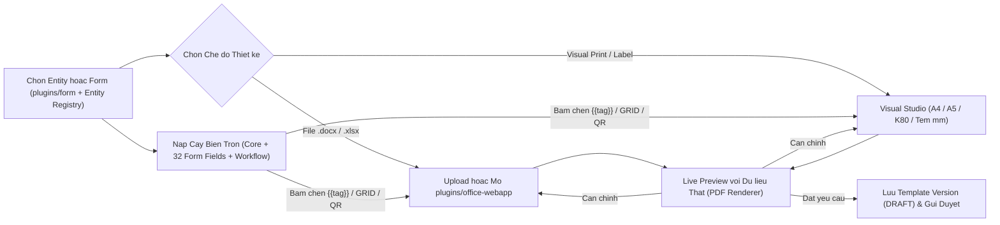
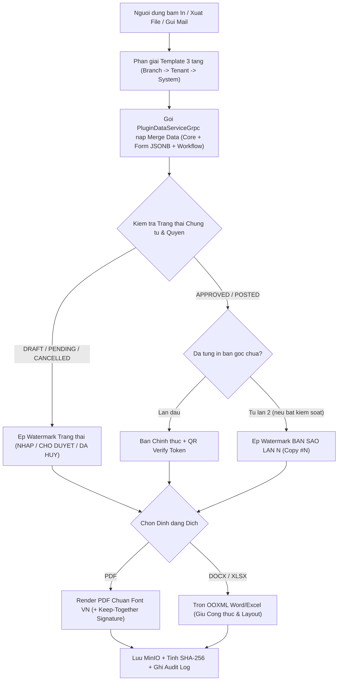
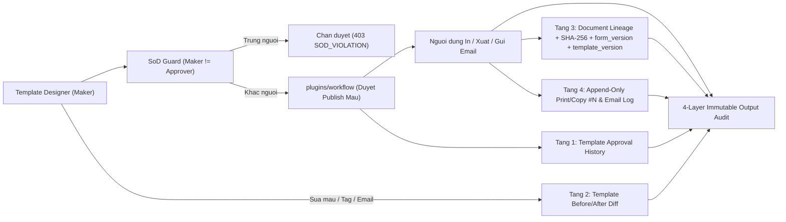

# Đặc Tả Luồng Xử Lý Nghiệp Vụ — Plugin Thiết Kế & Kết Xuất Tài Liệu (`plugins/document-template`) (Sprint 16)

| Thuộc tính | Giá trị |
| :--- | :--- |
| ID | ANL-S16-001 |
| Sprint | Sprint 16 (`sprint_16_plugin_document_template` — **Ưu tiên trước Sprint 13, 14, 15**) |
| Tác giả | AI Business Analyst (BA) |
| Trạng thái | Draft / Chờ khách hàng review nghiệp vụ |
| Phiên bản | 0.1 |
| Tài liệu liên quan | [00_READING_GUIDE.md](../00_READING_GUIDE.md) · [RAW-S16-001](../01_raw_notes/01_RAW-S16-001_document_template_requirements.md) · [BENCH-S16-001](../03_benchmarks/01_BENCH-S16-001_document_template_benchmarks.md) · [CONF-S16-001](../04_confirmation/01_CONF-S16-001_sprint_16_scope_and_ac.md) |

---

## 1. Kiến Trúc Nghiệp Vụ Lõi: Dữ Liệu Hợp Nhất, Kế Thừa 3 Tầng & Bản Phát Hành Bất Biến

`plugins/document-template` là phân hệ hạ tầng ngang (**Horizontal Platform Service**) cung cấp năng lực thiết kế mẫu, trộn dữ liệu, kết xuất tệp, in ấn, trình ký và phân phối Email thống nhất cho mọi phân hệ nghiệp vụ (**Sprint 13 `inventory`**, **Sprint 14 `crm`**, **Sprint 15 `purchasing`**, **Sprint 07/08 `employee / form / workflow`**):

1. **Hợp nhất Dữ liệu Trộn (`Unified Merge Data Graph`)**:
   - Từ cặp `(tenant_id, entity_type, record_id, branch_id)` (hoặc `form_response_id`), hệ thống gọi qua **`PluginDataServiceGrpc`** nạp một **Merge Context JSON chuẩn hóa** gồm 4 lớp:
     1. **`org` (Ngữ cảnh Tổ chức / Chi nhánh)**: Tên pháp nhân, Tên chi nhánh (`organization`), MST, Địa chỉ, SĐT, Tài khoản ngân hàng, Logo & Con dấu tham khảo (`Signed URL`).
     2. **`doc` (Trường Lõi Chứng từ từ `Entity Registry`)**: Số phiếu, Ngày chứng từ, Trạng thái, Đối tác/Khách hàng/NCC, Bảng dòng chi tiết chuẩn (`lines[]`), Thuế, Chiết khấu, Tổng tiền + hàm đọc số thành chữ (`num2words_vi / en`).
     3. **`custom` (Dữ liệu Động từ `plugins/form`)**: Toàn bộ **32 loại trường** lưu tại `custom_fields_data` (`JSONB`) theo đúng `form_version`, bao gồm các bảng lặp **`GRID`**, ảnh **`IMAGE_UPLOAD`** và chữ ký **`SIGNATURE`**.
     4. **`approval` (Chuỗi Phê duyệt từ `plugins/workflow`)**: Các bước đã duyệt, Người duyệt, Chức danh, Ngày giờ duyệt, Quyết định, Chữ ký mẫu tương ứng từng bước.
2. **Cơ chế Phân giải Mẫu 3 Tầng (`3-Tier Template Resolution`)**:
   - Ưu tiên: **`Branch Override` (`branch_id`) → `Tenant Override` (`tenant_id`) → `System Default Seed` (`PLATFORM`)**, tự động áp đúng phiên bản ngôn ngữ (`vi / en` hoặc song ngữ).
3. **Engine Kết Xuất Kép (`Dual Render Engine`) & Snapshot Phát Hành Bất Biến (`SHA-256`)**:
   - **Nhánh OOXML (`.docx / .xlsx`)**: Nạp mẫu Word/Excel (upload hoặc sửa trực tiếp trên **`plugins/office-webapp`**), trộn biến `{{field}}`, vòng lặp `{{#each lines}}...{{/each}}`, giữ nguyên định dạng bảng/công thức Excel -> xuất `.docx` / `.xlsx` hoặc chuyển đổi sang `.pdf`.
   - **Nhánh Visual Print & Label (`HTML/CSS Paged Media` & `Barcode/QR`)**: Kết xuất chứng từ `A4`, `A5`, hóa đơn nhiệt `K80/K58`, Tem nhãn mã vạch `mm` -> xuất `PDF` nhúng font Unicode tiếng Việt.
   - Mọi bản phát hành chính thức (`Issued`) đều đóng dấu `Watermark` (nếu là nháp/chờ duyệt/bản sao) + `QR Code` xác thực -> lưu file kết quả tại **MinIO** kèm bản ghi **Audit Output Log (`SHA-256`, `template_version`, `form_version`, `data_snapshot`)**.

---

## 2. Đặc Tả 9 Luồng Xử Lý Nghiệp Vụ Chi Tiết

### Luồng 1: Thiết Kế Mẫu Đa Chế Độ (`Dual-Mode Designer`), Gắn Biến Trộn & Live Preview
1. Quản trị viên / Template Designer mở Studio thiết kế mẫu (Split-View: **Cây Biến Trộn & Thuộc tính bên trái — Trình soạn thảo / Xem trước PDF bên phải**).
2. Chọn đối tượng áp dụng (`Entity Type` từ `Entity Registry` hoặc `Form ID` từ `plugins/form`) -> hệ thống tự động nạp **Cây Biến Trộn (`Merge Field Picker`)** kèm nút *Chèn thẻ* hoặc *Copy cú pháp `{{...}}`* (hỗ trợ cả `custom.*`, `GRID` table rows, `IMAGE_UPLOAD`, `SIGNATURE`, `approval.steps`).
3. Chọn 1 trong 2 chế độ thiết kế:
   - **Chế độ File Office (`.docx` / `.xlsx`)**: Upload file mẫu từ máy hoặc bấm **"Sửa trực tiếp trên Trình duyệt"** để mở **`plugins/office-webapp` (Sprint 12)** kết hợp panel Cây Biến Trộn đặt kế bên; giữ nguyên style bảng biểu, lề, tab, công thức Excel.
   - **Chế độ Visual Print & Label Studio**: Chọn khổ giấy (`A4 Portrait/Landscape`, `A5`, `K80/K58`, hoặc kích thước tem tùy biến tính theo `mm` như `50x30`, `100x80`); kéo thả Logo/Header Chi nhánh, Khối thông tin 2-3 cột, Bảng lặp dòng (`Auto-repeat thead on page break`), Khối Chữ ký 3–5 cột (`keep-together`), `Barcode 1D / QR Code`, Đọc số thành chữ (`{{num2words_vi(doc.grand_total)}}`) và `VietQR`.
4. Bấm **Xem thử (`Live Preview`)**: Chọn một bản ghi thật có sẵn (hoặc bộ JSON mẫu tự sinh từ schema Form) -> render PDF ngay khung bên phải để kiểm tra xuống dòng, font tiếng Việt, ngắt trang và công thức.

---

### Luồng 2: Phân Giải Mẫu 3 Tầng (`System -> Tenant -> Branch`) & Quản Lý Phiên Bản (`Versioning`)
1. Hệ thống đóng gói sẵn **Kho Mẫu Chuẩn (`System Seeded Templates`)** (ví dụ: *Phiếu Nhập/Xuất Kho Thông tư 200*, *Tem Barcode Lô/Serial*, *Báo giá CRM*, *Đơn đặt hàng PO*, *Hợp đồng Kinh tế*, *Biên bản Nghiệm thu SES*).
2. Khi một **Tenant** hoặc một **Chi nhánh (`branch_id`)** muốn dùng bố cục, logo, điều khoản pháp lý hoặc mẫu Email khác:
   - Chọn **"Tạo Bản Tùy Biến (`Clone & Override`)"** ở cấp `TENANT` hoặc gán cụ thể cho `BRANCH` (`branch_id` thuộc `organization`).
   - Phiên bản mẫu tăng tuần tự (`v1`, `v2`, `v3...`); mỗi lần chỉnh sửa chỉ tạo bản `DRAFT` mới mà không làm hỏng bản `PUBLISHED` đang chạy ngoài sản xuất.
3. Khi người dùng tại một chứng từ bấm **In / Xuất / Gửi Mail**, Resolver tìm mẫu theo quy tắc:
   - `Active Template (tenant_id, branch_id, entity_type, template_code, lang)` -> nếu không có -> `Active Template (tenant_id, branch_id = NULL, ...)` -> nếu không có -> `System Default`.

---

### Luồng 3: Kết Xuất Tài Liệu Đa Định Dạng (`PDF / DOCX / XLSX`) Từ Dữ Liệu Thực & Form Builder
1. Người dùng mở chứng từ trên bất kỳ phân hệ nào (`PR`, `PO`, `GR`, `DO`, `Quotation`, `Sales Order`, `Contract`, `Employee Form`...) và nhấn **In / Xuất tài liệu** (mở Stacked Drawer `?drawer=doc-output&template=...`).
2. Hệ thống lấy dữ liệu hợp nhất (`org + doc + custom_fields_data + approval`), đối khớp **`form_version`** để đọc đúng nhãn/định nghĩa bảng `GRID`, ảnh đính kèm, chữ ký từ `plugins/form`.
3. Nếu mẫu có cấu hình **Form Tham số Nhập thêm** (Luồng 9 — VD: *Ghi chú giao hàng đặc biệt*, *Người ký thay*), người dùng điền nhanh trước khi render.
4. Thực thi chuyển đổi theo định dạng đích:
   - **`PDF`**: Render trực tiếp từ Visual HTML/CSS (`@page`) hoặc trộn `.docx/.xlsx` -> convert sang PDF nhúng đủ font Unicode tiếng Việt (`>= 300 DPI` cho tem nhãn QR).
   - **`DOCX`**: Xuất file Word sạch giữ nguyên mục lục, heading, bảng chi tiết để đối tác biên tập/track-changes điều khoản hợp đồng.
   - **`XLSX`**: Xuất file Excel giữ nguyên các ô công thức (`SUM`, `SUBTOTAL`), tự chèn dòng động trong vùng lặp bảng mà không xê dịch dòng tổng bên dưới.

---

### Luồng 4: Phục Vụ In Ra Ký, Khối Chữ Ký Chuẩn VN, `Watermark` & `QR` Xác Thực Bản Giấy
1. **Khối Chữ Ký Chuẩn Thông tư / Hợp đồng (`Signature Block`)**:
   - Hỗ trợ bố trí 2–5 cột chữ ký (*Người lập phiếu - Thủ kho / Kinh doanh - Đại diện Bên B / Đối tác - Kế toán trưởng - Giám đốc*), tự động dùng CSS `break-inside: avoid` để **cả khối chữ ký không bị cắt ngang qua trang mới**.
   - Nếu chứng từ đã duyệt qua `plugins/workflow` hoặc có trường `SIGNATURE` từ `plugins/form`: tự động điền `(Họ tên, Chức danh, Ngày giờ duyệt, Ảnh chữ ký tay/mẫu số)` nếu mẫu bật `embed_approval_signature = true`; nếu thiết kế để **in ra ký tươi (mực xanh + đóng dấu đỏ)** -> giữ khoảng trống chiều cao chuẩn (`>= 28 mm`) kèm tiêu đề *"(Ký, ghi rõ họ tên và đóng dấu)"*.
2. **Đóng dấu `Watermark` Chống In Lậu Phiếu Nháp**:
   - Phiếu chưa duyệt (`DRAFT`, `PENDING_APPROVAL`, `REJECTED`) mặc định **cấm in/gửi bản sạch**; hệ thống ép watermark chìm chéo xuyên trang hoặc chặn hẳn nút Xuất chính thức (tùy cấu hình từng loại mẫu theo `DOA`).
3. **Mã `QR Code` Xác Thực Chứng Từ Giấy (`Document Paper Verification`)**:
   - Tùy chọn chèn khối nhỏ góc trên/dưới mẫu in: **`QR Verify`** trỏ tới URL/Endpoint xác thực kèm chữ ký HMAC (`verify_token`). Khi cầm bản giấy Hợp đồng, Đơn hàng hoặc Phiếu Xuất kho ký tay, Thủ kho/Quản lý/Kiểm toán quét QR để xem ngay thông số bản gốc trên ERP (`Số phiếu`, `Đối tác`, `Tổng tiền`, `Trạng thái hiện tại`, `Hash SHA-256`) nhằm phát hiện ngay nếu bản giấy bị tẩy sửa.

---

### Luồng 5: Trộn & Gửi Email Cho Đối Tác, Khách Hàng & Nhà Cung Cấp (`Mail-Merge & Distribution`)
1. Mỗi Mẫu tài liệu hỗ trợ cấu hình **Mẫu Email Đi Kèm (`Email Template Companion`)**:
   - Biến trộn dùng chung cho `Subject` (VD: `[Open-ERP] Đơn đặt hàng {{doc.code}} - {{org.branch_name}}`) và `Body HTML` (hỗ trợ đa ngôn ngữ `vi/en`).
   - Tự động cấu hình danh sách đính kèm: file vừa kết xuất (`PDF` hoặc `DOCX`/`XLSX`) + tùy chọn đính kèm thêm file phụ lục từ chứng từ nguồn (VD: bản vẽ kỹ thuật trên `RFQ/PO`, catalogue trên `Quotation`).
2. **Hai chế độ kích hoạt gửi**:
   - **Thủ công (Interactive Send Drawer)**: Trên màn hình chứng từ (`Quotation`, `Sales Order`, `PO`, `RFQ`, `Debt Statement`), mở Drawer *Gửi Email* -> hệ thống tự gợi ý Email người liên hệ chính của Khách hàng/NCC từ `crm`/`purchasing` -> cho phép sửa nội dung, thêm `CC/BCC`, xem lại PDF đính kèm -> bấm Gửi.
   - **Tự động theo `Workflow Event`**: Sau khi chứng từ chuyển trạng thái `APPROVED` trên `plugins/workflow` (VD: duyệt xong `PO` hoặc `Báo giá`), lắng nghe sự kiện Kafka -> render PDF bản chính thức mới nhất -> đẩy qua Hàng đợi Email Outbox.
3. **Theo dõi Trạng thái Gửi**: Lưu lịch sử `QUEUED -> SENT / DELIVERED / FAILED / BOUNCED`, mã `Message-ID` SMTP, chi tiết lỗi (nếu sai email đối tác) và nút **Gửi lại (`Resend`)** đồng bộ cảnh báo cho người phụ trách qua `in-app-notification`.

---

### Luồng 6: In & Kết Xuất Hàng Loạt (`Batch Print / Merged PDF / Bulk ZIP`)
1. Tại mọi bảng dữ liệu của Sprint 13, 14, 15, nhân viên tick chọn nhiều dòng (VD: 50 Phiếu Xuất kho trong buổi sáng hoặc 30 Đề nghị Đối chiếu Công nợ cuối tháng) -> Mở **Context Menu chuột phải -> In / Xuất hàng loạt**.
2. Chọn 1 trong 2 phương thức:
   - **In gộp 1 file PDF (`Merged Multi-Page PDF`)**: Nối các PDF riêng lẻ thành **1 file PDF duy nhất** có chèn `page-break` rành mạch (hỗ trợ làm tròn số trang chẵn khi in 2 mặt để phiếu sau không dính vào mặt sau phiếu trước!).
   - **Xuất gói `.zip` nhiều file (`Bulk Archive`)**: Render từng file độc lập đặt tên theo pattern cấu hình (`{{doc.code}}_{{doc.partner_code}}.pdf` hoặc `.xlsx`) và đóng gói `.zip`.
3. Nếu tổng số chứng từ `<= 20`: xử lý đồng bộ, tải/mở tab in ngay. Nếu `> 20` (tối đa cấu hình `500` phiếu/lô): đẩy vào **`Kafka Async Job`**, hiển thị tiến độ và bắn thông báo `in-app-notification` kèm link tải MinIO (Signed URL hết hạn sau 24h) khi hoàn tất.

---

### Luồng 7: Bộ Mẫu Chuẩn Dựng Sẵn Cho Sprint 13, Sprint 14, Sprint 15 & Core/HR
Ngay khi cài đặt Sprint 16 (migration + System Seed Templates), hệ thống cung cấp bộ mẫu chuẩn (có sẵn `System Default` để các Sprint sau dùng ngay và các Tenant/Chi nhánh chỉ cần *Clone & Override*):

| Phân hệ tiêu thụ | Bộ Mẫu Tài liệu & Email Chuẩn Đi Kèm (`System Seeded`) | Định dạng & Khổ giấy mặc định |
| :--- | :--- | :--- |
| **Sprint 13 (`inventory`)** | 1. Phiếu Nhập kho / Biên bản Kiểm định QC (kèm ảnh lỗi `IMAGE_UPLOAD`) 2. Phiếu Xuất kho / Danh sách Picking theo Bin 3. Phiếu Điều chuyển Liên kho `In-Transit` & Biên bản Kiểm kê 4. **Tem Nhãn Mã Vạch / QR Lô-HSD-Serial** (`50x30 mm`, `100x80 mm`) | `PDF A4/A5`, `Tem Thermal mm` (Barcode/QR), `XLSX` (Bảng XNT/Thẻ kho) |
| **Sprint 14 (`crm`)** | 1. **Báo giá (`Quotation`)** kèm ảnh SP & chữ ký duyệt + Mẫu Email gửi Khách hàng 2. **Đơn đặt hàng (`Sales Order`)** & **Hợp đồng Kinh tế B2B** (File `.docx` chuẩn thương thảo) 3. **Thông báo Công nợ / Đề nghị Thanh toán kèm mã `VietQR`** + Mẫu Email nhắc nợ 4. **Biên bản Đổi / Trả hàng (`RMA`)** | `PDF A4` (có `VietQR`), `DOCX` (Hợp đồng), `HTML Email + PDF` |
| **Sprint 15 (`purchasing`)** | 1. **Thư Hỏi Giá (`RFQ`)** + Mẫu Email mời chào giá gửi đồng loạt nhiều NCC 2. **Đơn Đặt Hàng Mua (`PO / Blanket Release`)** + Mẫu Email xác nhận đơn gửi NCC 3. **Biên bản Nghiệm thu Dịch vụ (`SES`)** (bảng kê `GRID` + ảnh hiện trường + chữ ký 2 bên) 4. **Phiếu Trả Hàng NCC / `Debit Note`** | `PDF A4`, `DOCX` (Hợp đồng khung), `XLSX` (So sánh báo giá), `HTML Email + PDF` |
| **Sprint 07/08 (`employee` / `form`)** | 1. Hợp đồng Lao động, Quyết định Bổ nhiệm / Điều chuyển (`.docx -> .pdf`) 2. Tờ trình / Phiếu Đề xuất Động tổng quát từ `plugins/form` + Chữ ký `workflow` | `PDF A4`, `DOCX` |

---

### Luồng 8: Ma Trận Phê Duyệt (`DOA / SoD`) & Lưu Vết Kiểm Toán 4 Tầng (`Immutable Print & Distribution Audit`)

Để ngăn chặn rủi ro nhân viên tự sửa điều khoản Hợp đồng/Báo giá trên mẫu in, in phiếu nháp làm giả chứng từ đã duyệt hoặc gửi nhầm/lén tài liệu mật ra ngoài, `plugins/document-template` áp dụng kiểm soát chặt chẽ:

1. **Ma Trận Phê Duyệt & Ràng Buộc Bất Kiêm Nhiệm (`SoD`)**:

| Thao tác nhạy cảm | Luồng duyệt (`plugins/workflow`) | Quy tắc Bất kiêm nhiệm (`SoD`) & Chặn an toàn |
| :--- | :--- | :--- |
| **Publish Mẫu Tài liệu Mới / Sửa Phiên bản (`Hợp đồng, Hóa đơn, PO, Báo giá, Phiếu chi`)** | **Maker -> Checker** (Pháp chế / Kế toán trưởng / Quản lý Chi nhánh duyệt) | `Publisher != Template Designer`; bắt buộc kèm ghi chú lý do sửa phiên bản mới. |
| **Tắt `Watermark` hoặc Cấp quyền In Lại Bản Gốc (`Original Reprint Override`)** | Trưởng bộ phận / Kế toán trưởng duyệt ngoại lệ | `Override Approver != Requester`; bắt buộc nhập lý do (VD: *"Máy in kẹt giấy làm rách bản gốc lần 1"*). |
| **Thay đổi Cấu hình Kênh Gửi Email (`SMTP / Sender Domain`) & Chữ ký/Con dấu mẫu** | Admin Tenant / Giám đốc duyệt 2 mắt (`Maker-Checker`) | Cấm người thiết lập tự kích hoạt Sender Email hoặc tự tải ảnh Con dấu doanh nghiệp lên dùng ngay không qua duyệt. |

2. **Kiến Trúc 4 Tầng Lưu Vết Bất Biến (`4-Layer Immutable Audit Trail`)**:
   - **Tầng 1 — `Template Approval History Log`**: Ghi nhận toàn bộ lịch sử `SUBMIT / APPROVE / REJECT / ARCHIVE` các phiên bản mẫu qua `plugins/workflow`.
   - **Tầng 2 — `Field & Template Before/After Diff`**: Lưu lịch sử thay đổi cấu hình mẫu (`template_version v1 -> v2`), diff code HTML/CSS, thay đổi file `.docx/.xlsx` (hash trước/sau), thay đổi danh sách biến trộn, bật/tắt `Watermark`, chỉnh mẫu Email và thay đổi thông số Form tham số.
   - **Tầng 3 — `Document Output Lineage & Checksum (SHA-256)`**: Với mỗi tệp được phát hành chính thức (`PDF/DOCX/XLSX`), lưu bản ghi bất biến gắn chặt: `(source_entity_type, source_record_id, source_status, template_id, template_version, form_version, output_format, sha256_hash, minio_object_key, qr_verify_token)`. Đảm bảo kiểm chứng 100% file khách hàng nhận được khớp với file hệ thống đã xuất.
   - **Tầng 4 — `Append-Only Print, Reprint & Email Ledger`**: Mọi hành động *Xem trước có xuất file*, *Tải xuống*, *Bấm In lần 1 (`ORIGINAL`)*, *Bấm In lại (`REPRINT_COPY_#N`)* và *Gửi Email (`To, CC, Subject, Status`)* đều ghi bất biến (`actor_id`, `timestamp`, `ip_address`, `branch_id`, `copy_number`, `reason`), cấm `UPDATE/DELETE` dưới DB.

---

### Luồng 9: Tùy Biến Form Tham Số Kết Xuất & Email Qua `plugins/form` Theo Tenant & Chi Nhánh
1. Trước khi kết xuất tài liệu hoặc gửi Email, nhiều doanh nghiệp/chi nhánh cần nhập thêm thông tin ngữ cảnh không nằm trong chứng từ gốc (VD: *Người đại diện ký thay hôm nay*, *Số bản sao muốn in*, *Lý do cấp lại bản sao*, *Ghi chú giao hàng riêng cho Chi nhánh Miền Nam*, *Tùy chọn ẩn/hiện cột đơn giá khi xuất Phiếu giao hàng cho tài xế*).
2. Toàn bộ phần cấu hình này được gán một **`Runtime Parameter Form`** thiết kế bằng **`plugins/form` (Sprint 08 — 32 loại trường)** và phân giải theo 3 tầng **`System -> Tenant -> Branch Override`**.
3. Dữ liệu người dùng nhập lúc in/gửi mail lưu vào `runtime_params_data` (`JSONB`) gắn `form_version`, tự động truyền thẳng vào ngữ cảnh trộn `{{params.*}}` của mẫu tài liệu và mẫu Email, đồng thời được lưu lại trong `Document Output Lineage` để xem lại lý do/tham số của từng lần xuất.

---

## 3. Bộ Quy Tắc Nghiệp Vụ (`BR-D01` – `BR-D18`)

| Mã BR | Quy tắc bắt buộc |
| :--- | :--- |
| `BR-D01` | **Cô lập Đa Tenant & Phân cấp Chi nhánh**: Mọi Mẫu tài liệu, File MinIO, Bản phát hành và Nhật ký In/Gửi Email đều lọc theo `tenant_id` từ JWT; mẫu cấp `BRANCH` chỉ áp dụng cho `branch_id` tương ứng (`organization`), mẫu `SYSTEM` ở chế độ chỉ đọc (`Read-only`, chỉ được Clone để Override). |
| `BR-D02` | **Phân giải Mẫu 3 Tầng Chính Xác**: Khi gọi render theo `(tenant_id, branch_id, entity_type, template_code, lang)`, thứ tự ưu tiên bắt buộc là: `Branch Published` -> `Tenant Published` -> `System Seeded Default`. |
| `BR-D03` | **Đọc Hợp nhất Từ `Entity Registry` + `plugins/form` + `plugins/workflow`**: Cấm truy vấn SQL chéo sang DB của plugin khác; toàn bộ Merge Data phải nạp qua `PluginDataServiceGrpc` theo đúng `form_version` ghi trên chứng từ nguồn. |
| `BR-D04` | **Bắt buộc Hỗ Trợ Bảng Lặp `GRID` & Đọc Số Tiếng Việt/Anh**: Engine trộn bắt buộc duyệt đúng số dòng biến động từ bảng chi tiết chứng từ và trường `GRID` của `plugins/form`; hàm `num2words_vi` phải tuân thủ chuẩn đọc tiền kế toán Việt Nam (*linh/lẻ, mốt/tư/lăm, triệu/tỷ đồng chẵn*). |
| `BR-D05` | **Chống Vỡ Font Unicode & Cắt Đôi Khối Chữ Ký**: Mọi `PDF` kết xuất bắt buộc nhúng sẵn bộ font Unicode đầy đủ dấu tiếng Việt; phần tiêu đề bảng tự lặp lại ở trang mới và Khối Chữ Ký bắt buộc đặt `break-inside: avoid` để không rách làm đôi giữa 2 trang. |
| `BR-D06` | **Bảo toàn Tài liệu Office Gốc (`.docx` / `.xlsx`)**: Khi chọn chế độ xuất `DOCX` hoặc `XLSX`, giữ nguyên định dạng bảng, font chữ và công thức Excel trên các ô không bị ghi đè; khi chỉnh sửa trực tuyến tích hợp qua `plugins/office-webapp`. |
| `BR-D07` | **Kiểm soát `Watermark` Theo Trạng thái Chứng từ Nguồn**: Khi chứng từ nguồn ở trạng thái `DRAFT`, `PENDING_APPROVAL`, hoặc `CANCELLED/REVERSED`, hệ thống tự động đóng chìm Watermark trạng thái lên PDF (hoặc chặn xuất `DOCX/XLSX` sạch nếu cấu hình cấm phát hành nháp). |
| `BR-D08` | **Kiểm soát Bản Gốc vs Bản Sao (`Original vs Copy #N`)**: Với các mẫu bật cờ `track_reprint_copy = true`, lần in chính thức đầu tiên ghi nhận `Copy #0 (BẢN GỐC)`; từ lần in thứ 2 trở đi tự động gắn nhãn/watermark `BẢN SAO LẦN N` trừ khi được Quản lý duyệt `Original Reprint Override`. |
| `BR-D09` | **Xác Thực Bản Giấy Qua `QR Verify Token`**: Khi bật `enable_qr_verification = true`, mỗi file phát hành gắn mã QR chứa `verify_token` ký HMAC; endpoint tra cứu công khai/nội bộ chỉ trả về metadata xác thực tối giản (`Số chứng từ, Trạng thái, Tổng tiền đã che/rõ theo cấu hình, SHA-256, Thời điểm phát hành`) mà không lộ dữ liệu nhạy cảm ngoài phạm vi. |
| `BR-D10` | **Khóa Bảo Toàn Phiên Bản Mẫu (`Immutable Published Version`)**: Mẫu đã `PUBLISHED` và đã có ít nhất 1 chứng từ xuất file từ đó trở thành bất biến; muốn sửa bắt buộc tạo bản nháp `v(N+1)` mới, không làm thay đổi lịch sử đối chiếu của các chứng từ cũ. |
| `BR-D11` | **An toàn Khi Thiếu Biến / Lỗi Công Thức (`Graceful Missing Field`)**: Trong chế độ `Preview`, biến lỗi/thiếu tô sáng cảnh báo trực quan cho Designer sửa; trong chế độ phát hành thật với biến tùy chọn rỗng thì render chuỗi rỗng sạch sẽ (cấm in lộ thô `{{doc.undefined}}` hoặc `null` lên giấy gửi khách). |
| `BR-D12` | **Ràng Buộc Gửi Email Đối Tác (`Mail-Merge Guard`)**: Chỉ cho phép gửi Email tự động từ `Workflow` bằng mẫu đã `PUBLISHED` và đối với chứng từ đã `APPROVED`; mọi Email gửi đi phải lưu kèm file đính kèm (hoặc tham chiếu `SHA-256` file tại MinIO), địa chỉ nhận `To/CC` và trạng thái `SENT/BOUNCED`. |
| `BR-D13` | **Giới hạn & Hàng Đợi In/Xuất Hàng Loạt (`Batch Processing`)**: Tác vụ in gộp PDF hoặc tải `.zip` vượt quá ngưỡng đồng bộ (`> 20` chứng từ, tối đa `500`/lô) bắt buộc đẩy qua `Kafka Worker`, phát `in-app-notification` kèm MinIO Signed URL hết hạn sau `24h`. |
| `BR-D14` | **Liên thông Chuẩn Hợp đồng & Lưu trữ MinIO**: Toàn bộ file mẫu & PDF phát hành lưu trên **MinIO Object Storage** theo khóa `tenant_id` (cấm lưu BLOB lớn vào PostgreSQL); giao tiếp với `form`, `workflow`, `office-webapp`, `inventory`, `crm`, `purchasing` dùng `PluginDataServiceGrpc` & Kafka (cấm gọi REST chéo hoặc fix `size = 100`). |
| `BR-D15` | **Bất Kiêm Nhiệm Phê Duyệt Mẫu & Ngoại Lệ (`SoD`)**: Kiểm soát `actor_id` trên `plugins/workflow`: *(a)* Designer tạo/sửa mẫu không được tự duyệt `Publish` phiên bản mẫu đó (`Maker != Checker`); *(b)* Người yêu cầu in lại bản gốc (`Original Reprint Override`) hoặc thay đổi cấu hình SMTP/Chữ ký mẫu không được tự phê duyệt. |
| `BR-D16` | **Lưu Vết Kiểm Toán 4 Tầng & `SHA-256` Bất Biến**: Mọi quyết định duyệt mẫu, Diff Trước/Sau phiên bản mẫu, liên kết Output (`source + template_version + form_version + SHA-256`) và nhật ký In/Tải/Gửi Email đều ghi append-only (cấm `UPDATE/DELETE`), xem trực tiếp trong Stacked Drawer `Audit & Lineage`. |
| `BR-D17` | **Tùy Biến Form Tham Số Kết Xuất Qua `plugins/form`**: Toàn bộ Form nhập tham số lúc In/Gửi Email (`runtime_params`) và trường mở rộng trên Kho Mẫu dựng qua `plugins/form` (32 loại trường), khóa `system_locked = true` cho các trường lõi điều khiển in, lưu JSONB kèm `form_version`. |
| `BR-D18` | **Kế Thừa Form Tham Số 3 Tầng & Tích Hợp Sticky Table**: Form tham số áp dụng kế thừa `Branch -> Tenant -> System`; các cột dữ liệu mở rộng từ kho mẫu và log kết xuất cho phép bật/tắt, lọc và sắp xếp trên `@shared/* Sticky Table` đồng bộ URL Query Params. |

---

## 4. 10 Tình Huống Biên & Xử Lý Ngoại Lệ (`EC-01` – `EC-10`)

| Mã EC | Tình huống biên / Rủi ro thực tế | Cơ chế xử lý chuẩn hóa của hệ thống |
| :--- | :--- | :--- |
| **`EC-01`** | Chứng từ cũ dùng `form_version = 1` nhưng hiện tại Admin đã nâng Form Builder lên `form_version = 3` (đổi/xóa một trường động). | Pipeline nạp Merge Context đọc lại đúng định nghĩa `form_version = 1` kèm JSON đã lưu của chứng từ cũ; trường thiếu trong mẫu mới render sạch thành rỗng thay vì báo lỗi crash. |
| **`EC-02`** | Người dùng sửa file `.docx` trực tiếp trên Word/Office WebApp nhưng vô tình gõ sai cú pháp ngoặc nhọn (VD: `{ {doc.code}}` hoặc đặt con trỏ tách XML `w:r` giữa chữ). | Bộ Parser `.docx` chuẩn hóa hợp nhất các XML runs (`w:t`) bị Microsoft Word chia nhỏ trước khi match `{{tag}}`, đồng thời chạy Validator báo chính xác tên biến sai cú pháp ngay lúc Upload/Save. |
| **`EC-03`** | Chứng từ có `150` dòng hàng hóa + cột mô tả dài -> tràn nhiều trang A4, bảng bị mất tiêu đề ở trang 2 hoặc khối chữ ký bị rớt chữ *"Giám đốc"* sang trang cuối một mình. | Áp `thead { display: table-header-group }`, `tr { break-inside: avoid }`, và bọc toàn bộ khối Ký tên trong wrapper `break-inside: avoid` để nhảy nguyên khối ký sang đầu trang mới nếu không đủ chỗ. |
| **`EC-04`** | Chứng từ `DRAFT` chưa được duyệt nhưng nhân viên bấm "Xuất Word" rồi tự xóa dòng nháp để lừa đối tác ký. | Với mẫu bật chế độ bảo vệ: khi trạng thái chưa `APPROVED/POSTED`, hệ thống **khóa xuất file `.docx/.xlsx` có thể sửa**, chỉ cho xuất `PDF` có đóng dấu `Watermark BẢN NHÁP` lớn ngang trang. |
| **`EC-05`** | Nhân viên chọn `50` bản ghi in gộp `PDF`, trong đó phiếu số 1 có `3` trang (số lẻ); khi mang đi in 2 mặt hàng loạt, mặt sau của tờ 2 phiếu 1 bị dính trang 1 của phiếu 2! | Cung cấp tùy chọn **"Chèn trang trắng đệm cho in 2 mặt (`Duplex Blank Page Padding`)"** trong Form tham số khi chạy Batch Merged PDF để mỗi chứng từ mới luôn bắt đầu ở mặt trước tờ giấy mới. |
| **`EC-06`** | Ảnh chứng từ (`IMAGE_UPLOAD` từ Mobile) kích thước `4000x3000 px` (nặng `8 MB`), nhúng vào mẫu khiến file PDF nặng `40 MB` không gửi Email được. | Bộ xử lý trước khi nhúng PDF tự động nén và resize ảnh theo DPI cấu hình (`150 DPI` cho Email, `300 DPI` cho In nét) giữ nguyên tỷ lệ khung hình, đảm bảo file PDF gọn nhẹ `< 5 MB`. |
| **`EC-07`** | Nhân viên gửi Email Báo giá/PO cho Khách hàng/NCC nhưng gõ sai địa chỉ Email dẫn tới Bounce/SMTP lỗi. | Giao dịch chứng từ nguồn không bị rollback; bản ghi trên **Hàng đợi Email Log** chuyển trạng thái `FAILED/BOUNCED` kèm chi tiết mã lỗi SMTP, bắn thông báo `in-app-notification` để nhân viên sửa Email nhận và bấm *Gửi lại* trực tiếp. |
| **`EC-08`** | Hai chi nhánh `Hà Nội` và `TP.HCM` cùng in cùng 1 loại `Đơn đặt hàng PO`, muốn tự động đổi Logo, MST Chi nhánh, Số tài khoản ngân hàng nhận tiền (`VietQR`) và điều khoản cuối trang. | Template Resolver đọc `branch_id` trên chứng từ `PO`, ưu tiên nạp bản `Branch Override` (hoặc dùng mẫu chung nhưng tự lấy đúng `org.branch.*` của chi nhánh đó) — 0 nhầm lẫn thông tin chuyển khoản giữa các chi nhánh. |
| **`EC-09`** | Mẫu `.xlsx` (Bảng kê Báo giá / Công nợ) có công thức `=SUM(E10:E10)` trong vùng lặp dòng động; khi dữ liệu có `25` dòng thì công thức tổng có bị sai vùng? | Engine Excel OOXML tự động dịch chuyển (`Shift Rows`) toàn bộ các dòng bên dưới vùng lặp và tự động mở rộng dải công thức thành `=SUM(E10:E34)`. |
| **`EC-10`** | Sau khi in bản giấy đưa sếp ký hoặc giao tài xế đi giao hàng, phát hiện chứng từ đã bị ai đó vào chỉnh sửa/hủy trên ERP hoặc nghi ngờ bản giấy bị sửa số tiền. | Quét `QR Code` xác thực in trên góc giấy -> hệ thống so sánh trạng thái hiện tại trên ERP và `SHA-256` bản gốc -> cảnh báo đỏ ngay lập tức: *"Chứng từ gốc đã bị sửa/hủy sau thời điểm in bản giấy lúc HH:mm"*. |

---

## 5. Danh Sách 26 User Stories (`US-S16-01` – `US-S16-26`)

### Nhóm A: Kho Mẫu, Kế Thừa 3 Tầng & Tích Hợp Biến Trộn (`Merge Fields`)
- **`US-S16-01`** (*Template Designer*): Duyệt kho Mẫu hệ thống dựng sẵn (`System Seeded`), nhân bản (`Clone`) để tạo phiên bản tùy biến riêng cho **Tenant** hoặc từng **Chi nhánh (`branch_id`)**.
- **`US-S16-02`** (*Template Designer*): Xem toàn bộ **Cây Biến Trộn Tự Động** từ `Entity Registry` + **32 loại trường động của `plugins/form` (gồm `GRID`, `IMAGE_UPLOAD`, `SIGNATURE`)** + lịch sử duyệt `plugins/workflow` và bấm 1 chạm chèn vào mẫu.
- **`US-S16-03`** (*Template Designer*): Tải lên file `.docx` / `.xlsx` làm mẫu in hoặc bấm mở trực tiếp trình soạn thảo **`plugins/office-webapp` (Sprint 12)** ngay trên Split-View để chỉnh mẫu và giữ định dạng Word/Excel gốc.
- **`US-S16-04`** (*Template Designer*): Thiết kế mẫu trên **Visual Print & Label Studio** cho khổ `A4`, `A5`, cuộn nhiệt `K80/K58` và **Tem nhãn Mã vạch / QR Code (`mm`)** (căn lề, Header/Footer lặp trang, `Trang X / Y`).
- **`US-S16-05`** (*Template Designer*): Gắn hàm nghiệp vụ dựng sẵn (`num2words_vi`, `num2words_en`, `formatCurrency`, `formatDate`, `VietQR` động theo tài khoản & số tiền, `qrVerify`) và cấu hình **Khối Chữ Ký Chuẩn VN (3–5 cột)** không tách trang.
- **`US-S16-06`** (*Template Designer*): Chạy **Live Preview** trên Split-View bằng dữ liệu thật của một chứng từ để phát hiện và sửa ngay biến sai cú pháp hoặc lỗi tràn trang trước khi trình duyệt.

### Nhóm B: Kết Xuất File, In Ra Ký & Kiểm Soát Bản Giấy
- **`US-S16-07`** (*Nhân viên Nghiệp vụ S13/S14/S15/HR*): Từ bất kỳ chứng từ nào, bấm nút *In / Xuất File* mở Drawer xem trước `PDF` chuẩn font Unicode tiếng Việt và bấm In trực tiếp qua trình duyệt.
- **`US-S16-08`** (*Sales / Pháp chế / Kế toán*): Xuất chứng từ ra **`DOCX`** (để đối tác sửa góp ý điều khoản hợp đồng) hoặc **`XLSX`** (bảng kê nhiều dòng giữ nguyên công thức tổng kết) hoặc **`PDF`** khóa nội dung.
- **`US-S16-09`** (*Nhân viên / Thủ kho*): In mẫu kèm **Khối Chữ Ký Tươi** (chừa khoảng trống chuẩn ký mực & đóng dấu) hoặc tự động **nhúng chữ ký tay (`SIGNATURE` trên Form) và tên/chức danh người đã duyệt trên `workflow`**.
- **`US-S16-10`** (*Hệ thống / Quản trị*): Tự động đóng dấu chìm **`Watermark` (`BẢN NHÁP`, `CHỜ DUYỆT`, `ĐÃ HỦY`)** khi chứng từ chưa hoàn tất phê duyệt và đánh dấu **`BẢN SAO LẦN N`** từ lần in thứ 2 trở đi.
- **`US-S16-11`** (*Kiểm toán / Thủ kho / Khách hàng*): Quét mã **`QR Code` xác thực** in trên bản giấy bằng Mobile/Web để đối chiếu tức thì trạng thái gốc và tổng giá trị chứng từ trên ERP.
- **`US-S16-12`** (*Quản trị / Thủ kho*): In hàng loạt **Tem nhãn Mã vạch `Barcode / QR` (`mm`)** cho nhiều Lô/Serial SKU trong Kho (`Sprint 13`) trên máy in nhiệt/máy in A4 nhiều tem/trang.

### Nhóm C: Gửi Email Đối Tác / Khách Hàng & Xử Lý Hàng Loạt (`Batch`)
- **`US-S16-13`** (*Template Designer*): Thiết kế **Mẫu Email Đi Kèm (`Subject + HTML Body` hỗ trợ biến trộn & đa ngôn ngữ `vi/en`)** cho từng loại mẫu tài liệu và cấu hình bộ file đính kèm mặc định.
- **`US-S16-14`** (*Buyer / Sales / Kế toán*): Mở Stacked Drawer *Xem trước & Gửi Email* ngay trên chứng từ (`Quotation`, `SO`, `PO`, `RFQ`, `Công nợ`), chỉnh sửa nội dung, thêm `CC/BCC` & tài liệu phụ lục rồi gửi trực tiếp cho đối tác/khách hàng.
- **`US-S16-15`** (*Quản trị Tenant / Workflow*): Cấu hình **Auto-Mail Trigger** trên `plugins/workflow` (VD: duyệt xong `PO`/`Báo giá` tự động render PDF và gửi Email cho NCC/Khách hàng).
- **`US-S16-16`** (*Nhân viên Nghiệp vụ*): Tick chọn nhiều chứng từ trên bảng dữ liệu, chuột phải chọn **In Gộp (`Merged PDF`)** (có tùy chọn đệm trang trắng in 2 mặt) hoặc **Xuất Hàng Loạt (`.zip`)** theo quy tắc đặt tên file động.
- **`US-S16-17`** (*Nhân viên Nghiệp vụ*): Theo dõi tiến độ tác vụ Batch lớn chạy ngầm qua hàng đợi Kafka và nhận thông báo `in-app-notification` kèm link tải về khi hoàn tất.
- **`US-S16-18`** (*Sales / Buyer / CSKH*): Xem nhật ký gửi Email gắn theo chứng từ, biết chính xác Email đã `SENT` hay `FAILED/BOUNCED`, xem lý do lỗi và bấm **Gửi lại (`Resend`)**.

### Nhóm D: Phê Duyệt (`DOA/SoD`), Lưu Vết 4 Tầng, Form Động & Chuẩn UI ERP
- **`US-S16-19`** (*Pháp chế / Kế toán trưởng — Checker*): Nhận yêu cầu duyệt phiên bản mẫu mới (`Maker-Checker` `SoD`), xem **Diff Trước/Sau** phần sửa đổi nội dung/cấu hình so với bản đang chạy trước khi bấm `Publish`.
- **`US-S16-20`** (*Quản lý / Kế toán trưởng*): Phê duyệt ngoại lệ **Cho phép in lại Bản gốc (`Original Reprint Override`)** kèm lý do bắt buộc khi bản giấy lần 1 bị rách/kẹt máy in.
- **`US-S16-21`** (*Kiểm toán Nội bộ / Quản lý*): Mở Stacked Drawer **Lịch sử Duyệt & Lưu vết (`Audit & Lineage`)** trên bất kỳ Mẫu hoặc Chứng từ đã xuất để xem: Timeline duyệt mẫu, Diff Trước/Sau cấu hình mẫu, Bản chụp phát hành (`SHA-256`, `template_version`, `form_version`) và Nhật ký ai đã In / Tải / Gửi Email lúc mấy giờ.
- **`US-S16-22`** (*Quản trị Tenant / Quản lý Chi nhánh*): Dùng Form Studio của **`plugins/form` (Sprint 08)** để tùy biến **Form Nhập Tham Số Trước Khi In / Gửi Email** (VD: thêm trường ghi chú giao hàng, người ký thay, lý do in lại) theo cấp **Tenant hoặc Chi nhánh (`branch_id`)**.
- **`US-S16-23`** (*Tất cả người dùng Web Desktop*): Quản lý danh sách Kho Mẫu, Bản ghi Kết xuất & Hàng đợi Email trên **`@shared/*` Sticky Scroll Table** (cố định Header/Footer, chỉ cuộn Content, ẩn/hiện & kéo đổi thứ tự cột, lọc đa chiều, đồng bộ URL Query Params).
- **`US-S16-24`** (*Tất cả người dùng Web Desktop*): Thao tác nhanh qua **Context Menu chuột phải** trên bảng Mẫu và bảng Nhật ký Phát hành (Xem trước PDF, Nhân bản Override cho Chi nhánh, Trình duyệt Publish, So sánh phiên bản Diff, Tải lại file gốc `SHA-256`, Gửi lại Email, Xem Audit Log).
- **`US-S16-25`** (*Quản lý / Nhân viên Mobile Ionic*): Xem trước PDF chứng từ nhanh trên Mobile Ionic (`390x844 px`), bấm Gửi Email xác nhận cho Khách hàng/Đối tác, Quét `QR Verify` kiểm tra chứng từ bản giấy và Duyệt phiên bản mẫu qua `Workflow` với vùng chạm `>= 40px`.
- **`US-S16-26`** (*Quản trị Tenant*): Cấu hình chính sách tài liệu cấp Tenant/Chi nhánh (Ngưỡng cảnh báo Batch, Chính sách Watermark bắt buộc, Kênh gửi Email `SMTP/Provider`, Bật/Tắt kiểm soát `Bản gốc vs Bản sao`).

---

## 6. Yêu Cầu Giao Diện (UI/UX), Quy Chuẩn Data View & Ma Trận Desktop vs. Mobile

### 6.1. Tuân Thủ Nghiêm Ngặt Chuẩn Data View & Sticky Scroll Table (`AGENTS.md` #33 & `ui_ux_standards.md` Mục 7)
Mọi màn hình danh sách của `plugins/document-template` (**`Kho Mẫu Tài Liệu (Templates Registry)`**, **`Lịch Sử Kết Xuất & In Ấn (Output & Print Log)`**, **`Hàng Đợi & Nhật Ký Email (Mail Distribution Log)`**, **`Tác Vụ Hàng Loạt (Batch Jobs)`**) bắt buộc sử dụng Table component dùng chung `@shared/*` (tự xây dựng, **không cài thư viện ngoài**):
1. **Cố định Header & Footer, chỉ cuộn Content bên trong**: Container khóa chiều cao viewport (`flex-1 min-h-0 overflow-hidden`); cố định `thead` và thanh phân trang/thống kê tại `tfoot`; chỉ phần `tbody` cuộn bên trong.
2. **Tùy biến Cột & Số Hàng**: Cho phép người dùng **ẩn/hiện cột** (VD: hiện cột `Chi nhánh áp dụng`, `Phiên bản`, `Mã SHA-256`, `Số lần in`, `Trạng thái Email`), **kéo/đổi thứ tự cột**, và chọn số hàng/trang (`20`, `50`, `100`, `200`).
3. **Bộ lọc & Sắp xếp Đồng bộ URL**: Lọc theo Phân hệ nguồn (`inventory / crm / purchasing / form / employee`), Tầng áp dụng (`SYSTEM / TENANT / BRANCH`), Định dạng (`PDF / DOCX / XLSX / EMAIL`), Trạng thái mẫu/Email, Khoảng thời gian — đồng bộ 2 chiều lên URL Query Params (`?module=purchasing&scope=BRANCH&status=PUBLISHED&page=1&size=50`).
4. **Context Menu Chuột Phải Đầy Đủ Nghiệp Vụ (100% i18n, Zero-Emoji)**:
   - *Trên `Templates Registry`*: Mở Designer / Sửa trên `office-webapp`, Live Preview với bản ghi mẫu, Nhân bản Override cho Chi nhánh, Trình duyệt Publish, Xem `Diff & Audit Log` (`?drawer=audit`), Lưu trữ (`Archive`).
   - *Trên `Output & Print Log`*: Xem trước / Tải bản đã phát hành (`Signed URL`), Kiểm tra mã `SHA-256` / QR Verify, Duyệt In lại Bản gốc, Gửi lại Email đính kèm file này, Xem `Audit & Lineage` (`?drawer=audit`).
   - *Trên `Mail Distribution Log`*: Xem nội dung Email đã trộn & danh sách đính kèm, Xem chi tiết lỗi SMTP, Gửi lại (`Resend`), Xem chứng từ nguồn.
5. **Fallback Mobile (`>= 40px`)**: Trên Mobile Ionic (`390x844 px`), cung cấp nút `...` (`>= 40x40 px`) mở Action Sheet thay thế chuột phải Desktop.

### 6.2. Anti-Modal, Split-View Designer & Zero-Emoji
- **Anti-Modal**: Cấm dùng Modal popup để thiết kế mẫu, xem trước PDF hay soạn Email gửi khách hàng:
  - **Studio Thiết kế Mẫu**: Dùng **Nested Route + Split-View 3 phần/2 phần** (Panel Cây Biến trộn bên trái, Canvas `.docx/.xlsx` `office-webapp` hoặc Visual Studio ở giữa/trái, **Live Preview PDF** ở bên phải) đồng bộ trạng thái tab/zoom qua URL.
  - **Print / Export / Send Email Widget** nhúng vào các Sprint khác (`S13/S14/S15`): Dùng **Stacked Drawer** (`?drawer=doc-output&templateId=...&format=PDF&step=preview|email`) hoặc **Split-View** hiển thị song song *Form Tham số (render từ `plugins/form` bằng component `@shared/*` `app-sharp-*`, cấm HTML input thô) / Khung soạn Email* và *Bản xem trước PDF thật*.
  - **Stacked Drawer `Audit & Lineage`** (`?drawer=audit&auditTab=approval|diff|lineage|print-log`) hiển thị 4 lớp kiểm toán bất biến.
- **High Density & Zero-Emoji**: Giao diện vuông vắn sắc nét (`text-xs` / `text-sm`, `rounded-none` / `rounded-sm`), icon SVG + Tooltip ngữ nghĩa, **100% i18n (`vi.json`/`en.json`)**, **0 emoji Unicode**.

### 6.3. Ma Trận Phạm Vi Desktop Web vs. Mobile Ionic

| Nhóm chức năng | Web Desktop (`src/frontend/web`, `>= 1280px`) | Mobile Ionic (`src/frontend/mobile`, `390x844 px`) |
| :--- | :---: | :---: |
| Kho Mẫu, Kế thừa 3 tầng (`System -> Tenant -> Branch`) | Đầy đủ (Sticky Table + Filter + Context Menu) | Tra cứu danh sách mẫu hiệu lực theo Chi nhánh |
| Studio Thiết kế (`.docx/.xlsx` `office-webapp` & Visual/Label Studio) | Đầy đủ (Split-View Cây biến + Designer + Live PDF Preview) | Không thiết kế mẫu trên Mobile |
| Xem trước `PDF`, In ấn (`A4/A5/K80/Tem`), Xuất `PDF/DOCX/XLSX` | Đầy đủ (Stacked Drawer + Form Tham số `plugins/form`) | Xem `PDF` chứng từ nhanh, Chia sẻ / In qua hệ điều hành (`>= 40px`) |
| Trộn & Gửi Email Cho Đối tác / Khách hàng | Đầy đủ (Drawer soạn Email + đính kèm + Auto-Workflow) | Bấm Gửi nhanh theo mẫu Email đã cấu hình sẵn (`>= 40px`) |
| In & Xuất Hàng loạt (`Merged PDF` / `Bulk ZIP`) | Đầy đủ (Chọn nhiều dòng Sticky Table + Kafka Queue) | Không thao tác Bulk Export nhiều file trên Mobile |
| Quét `QR Verify` Xác Thực Bản Giấy | Kiểm tra từ URL xác thực | **Đầy đủ**: Mở Camera quét `QR Verify` trên tờ giấy trình ký/giao hàng |
| Phê duyệt (`DOA/SoD`) & Drawer `Audit & Lineage` | Đầy đủ (Timeline + Diff + Lineage `SHA-256` + Print Log) | Duyệt Publish mẫu / Duyệt in lại qua `Workflow` & Xem lịch sử gần nhất |
