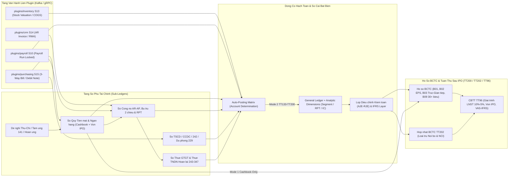
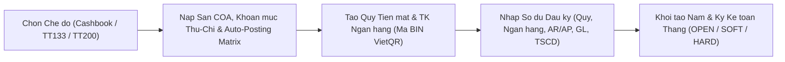
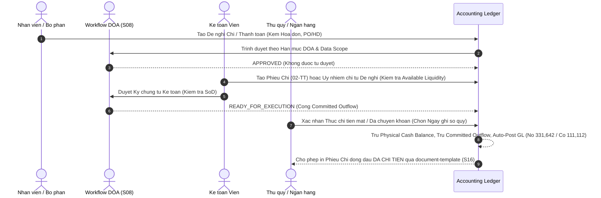
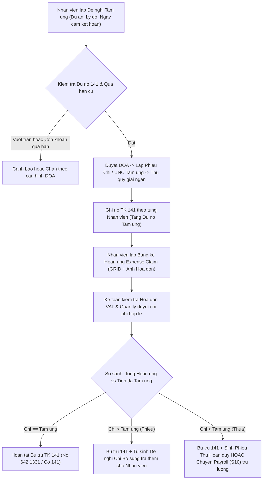
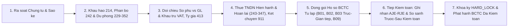
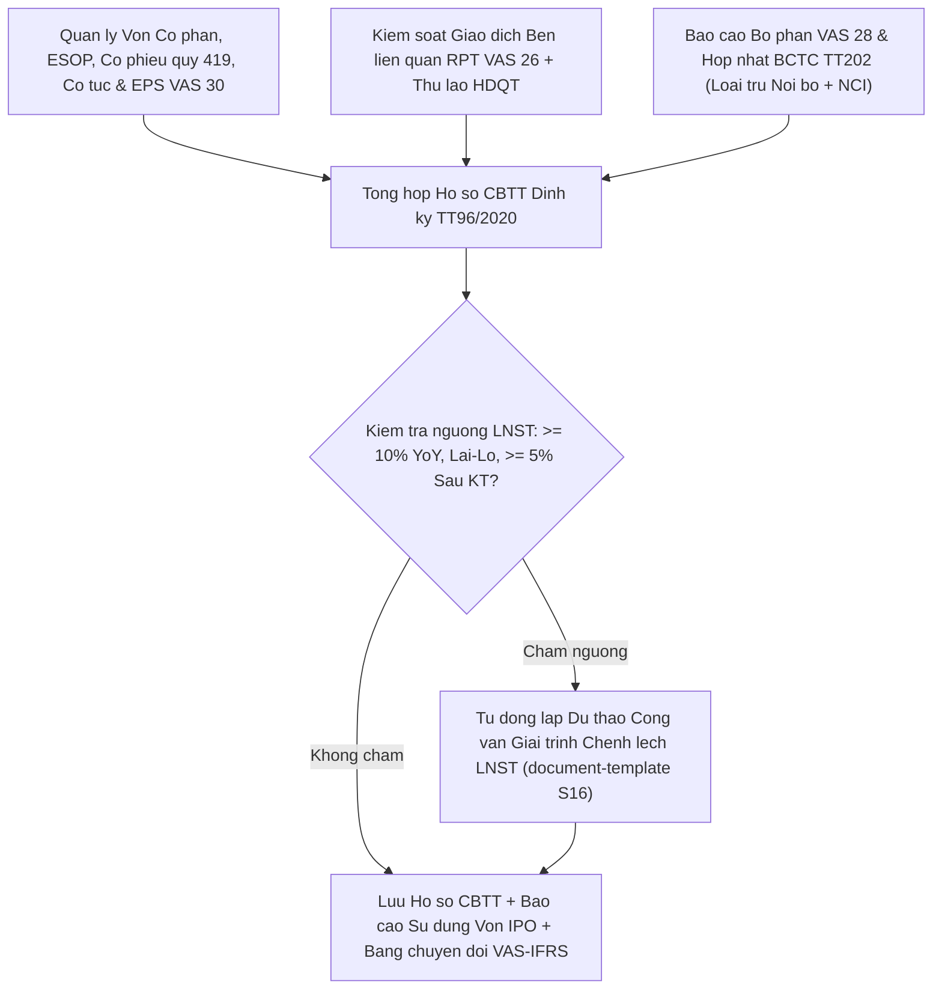

# Đặc Tả Luồng Xử Lý Nghiệp Vụ — Plugin Thu Chi & Kế Toán Doanh Nghiệp (`plugins/accounting`) (Sprint 17)

| Thuộc tính | Giá trị |
| :--- | :--- |
| ID | ANL-S17-001 |
| Sprint | Sprint 17 (`sprint_17_plugin_accounting`) |
| Tác giả | AI Business Analyst (BA) |
| Trạng thái | Draft / Chờ khách hàng review nghiệp vụ |
| Phiên bản | 0.2 |
| Tài liệu liên quan | [00_READING_GUIDE.md](../00_READING_GUIDE.md) · [RAW-S17-001](../01_raw_notes/01_RAW-S17-001_accounting_finance_requirements.md) · [BENCH-S17-001](../03_benchmarks/01_BENCH-S17-001_accounting_finance_benchmarks.md) · [CONF-S17-001](../04_confirmation/01_CONF-S17-001_sprint_17_scope_and_ac.md) |

---

## 1. Kiến Trúc Nghiệp Vụ Lõi: Dual-Mode Treasury, Thanh Khoản, Sổ Cái Kép & Hồ Sơ BCTC / IPO

### 1.1. Mô Hình Dữ Liệu 2 Chế Độ & Tầng Hồ Sơ BCTC / IPO (`Dual-Mode + Reporting Package`)

Để phục vụ trọn vẹn cả **5 loại hình doanh nghiệp** trong thực tế (*Thương mại & Phân phối*, *Sản xuất*, *Dịch vụ / Dự án*, *SME Tinh gọn*, và *Doanh nghiệp Đại chúng / Đã IPO & Niêm yết*), `plugins/accounting` không tách làm nhiều phần mềm rời rạc mà dùng một **lõi Sổ Tài chính Hợp nhất (`Unified Financial Engine`)** với lớp đóng gói Hồ sơ BCTC & Tuân thủ IPO ở tầng trên:

1. **Mode 1 — `CASHBOOK_ONLY` (Chế độ Thu - Chi & Công nợ Tinh gọn cho SME / Cửa hàng)**:
   - Người dùng chỉ chọn **Quỹ tiền / Tài khoản Ngân hàng**, **Đối tác**, **Khoản mục Thu/Chi** (ví dụ: `THU_BAN_HANG`, `CHI_MUA_HANG`, `CHI_LUONG`, `CHI_MARKETING`, `CHI_VAN_PHONG`) và **Chiều phân tích** (`Chi nhánh`, `Phòng ban`, `Dự án`).
   - Hệ thống tự động cập nhật **Sổ Quỹ thực tế**, **Công nợ Phải thu/Phải trả** và **Báo cáo Dòng tiền + Lãi/Lỗ quản trị**, không hiển thị hoặc bắt nhập cặp Tài khoản Nợ/Có.
2. **Mode 2 — `VAS_TT133` / `VAS_TT200` (Chế độ Kế toán Tổng hợp Sổ cái Kép)**:
   - Bật toàn bộ Cây Tài khoản chuẩn Bộ Tài chính (**Thông tư `133/2016/TT-BTC`** hoặc **Thông tư `200/2014/TT-BTC`**).
   - Mọi chứng từ Thu/Chi, Tạm ứng/Hoàn ứng, Khấu hao, Bảng kê Ngân hàng và sự kiện liên plugin tự động chạy qua **Auto-Posting Matrix** để sinh **Bút toán Sổ cái Nợ/Có cân bằng (`Sum(Debit) == Sum(Credit)`)**.
   - **Nâng cấp 1 chạm (Không mất dữ liệu lịch sử)**: Doanh nghiệp bắt đầu bằng `CASHBOOK_ONLY` sau này tuyển Kế toán trưởng chỉ cần chọn chuyển sang `VAS_TT133` hoặc `VAS_TT200`, ánh xạ Khoản mục Thu/Chi sang Tài khoản kế toán và chạy **`Retroactive GL Posting Job`** để sinh đầy đủ Sổ cái từ dữ liệu quá khứ.

### 1.2. Năm Chỉ Số Ngân Quỹ & Vốn Lưu Động Thời Gian Thực (`Real-Time Liquidity`)

Khắc phục triệt để sai lầm "xem số dư tài khoản ngân hàng nhưng quên các khoản Sếp đã ký chuẩn bị chi":

| Chỉ số | Công thức & Bản chất | Thời điểm biến động |
| :--- | :--- | :--- |
| **1. `Physical Cash & Bank Balance` (Tồn Quỹ Thực Tế)** | `Opening Balance + Sum(EXECUTED Receipts) - Sum(EXECUTED Disbursements)` | Chỉ cộng/trừ khi Thủ quỹ bấm **Đã thu/Đã chi tiền mặt** hoặc Ngân hàng **Đã chuyển / Khớp sao kê**. |
| **2. `Pending Inflow` (Tiền Đang Chờ Về)** | Tổng các `Phiếu Thu` đã `APPROVED` chờ Thủ quỹ nhận tiền + Giao dịch báo thu chờ đối soát. | Cộng khi duyệt Phiếu Thu; trừ khi Thủ quỹ ghi nhận Thực thu. |
| **3. `Committed Outflow` (Cam Kết Chi Chờ Xuất)** | Tổng `Đề nghị Chi / Phiếu Chi / Ủy nhiệm chi / Tạm ứng / Payment Run` đã `APPROVED` nhưng chưa thực chi. | Cộng ngay khi duyệt chi; trừ khi Thủ quỹ/Ngân hàng thực xuất. |
| **4. `Available Liquidity` (Khả Dụng Chi Tiêu Thực Tế)** | `Physical Cash & Bank Balance - Committed Outflow` | Hệ thống dùng chỉ số này để **chặn/cảnh báo xuất quỹ vượt tiền thực có**. |
| **5. `Net Working Capital` (Vốn Lưu Động Ngắn Hạn)** | `Available Liquidity + AR Due/Overdue (131) - AP Due/Overdue (331)` | Tính tức thời trên Dashboard Giám đốc Tài chính (`CFO Cockpit`). |

### 1.3. Chiều Phân Tích Quản Trị Đa Chiều (`Multi-Dimensional Analytics`)

Mỗi dòng giao dịch Thu - Chi và mỗi dòng Bút toán Sổ cái hỗ trợ gắn đồng thời các chiều độc lập (không cần đẻ tài khoản con):
- `branch_id` (Chi nhánh / Nhà máy / Cửa hàng từ `organization`).
- `department_id` (Phòng ban / Bộ phận / Phân xưởng — `Cost Center`).
- `project_id` / `contract_ref` (Dự án / Hợp đồng dịch vụ / Công trình xây lắp / Lệnh sản xuất).
- `partner_type + partner_id` (Khách hàng `crm`, Nhà cung cấp `purchasing`, Nhân viên `employee`) kèm cờ **`is_related_party` (Bên liên quan `VAS 26`)** và **`is_intercompany` (Đơn vị nội bộ Tập đoàn `TT202`)**.
- `business_segment_id` & `geographic_region_id` (**Bộ phận Lĩnh vực Kinh doanh / Khu vực Địa lý** phục vụ `VAS 28 / IFRS 8`).
- `cashflow_item_id` (Khoản mục Thu/Chi & Mã chỉ tiêu Lưu chuyển Tiền tệ `B03-DN`) và `ipo_proceed_item_id` *(nếu chi từ Quỹ Vốn IPO theo Bản cáo bạch)*.
- **Phân bổ tỷ lệ trên 1 chứng từ**: Một Phiếu Chi tiền điện văn phòng/nhà xưởng 50 triệu VNĐ có thể chia ngay trên lưới chi tiết: `60% -> Phân xưởng 1 (TK 627)`, `25% -> Phòng Kinh doanh (TK 641)`, `15% -> Khối Văn phòng (TK 642)`.

---

## 2. Mười (10) Luồng Nghiệp Vụ Thực Tế End-to-End

### Luồng 1: Thiết Lập Chế Độ Kế Toán, Cây Tài Khoản (`COA`), Quỹ Tiền & Kỳ Kế Toán

1. Admin/Kế toán trưởng chọn chế độ mặc định của Tenant (`CASHBOOK_ONLY`, `VAS_TT133`, `VAS_TT200`) và đồng tiền hạch toán chính (`VND` + danh sách ngoại tệ giao dịch).
2. Hệ thống seed sẵn danh mục Tài khoản theo đúng Thông tư, **Khoản mục Thu/Chi chuẩn** và **Ma trận Quy tắc Định khoản Mặc định** (ví dụ: `CHI_MUA_DICH_VU -> Nợ 642/1331, Có 111/112/331`).
3. Thiết lập các **Quỹ Tiền mặt** (gắn `branch_id`, Thủ quỹ phụ trách) và **Tài khoản Ngân hàng** (gắn Số TK, Tên ngân hàng, Chi nhánh mở, **Mã BIN NAPAS** để tự sinh `VietQR`).
4. Nhập **Số dư Đầu kỳ** (`Opening Balances`: Tồn quỹ, Từng hóa đơn `AR/AP` còn nợ, Dư tạm ứng `141` từng nhân viên, Nguyên giá & Hao mòn lũy kế `TSCĐ`, Số dư CĐPS các tài khoản) — ở Mode `TT133/TT200`, hệ thống kiểm tra cân bằng `Tổng Nợ đầu kỳ == Tổng Có đầu kỳ` trước khi chốt đầu kỳ (`POSTED`).

### Luồng 2: Đề Nghị Thu/Chi → Lập Phiếu Thu/Chi/Ủy Nhiệm Chi → Thủ Quỹ / Ngân Hàng Thực Xuất Quỹ

1. **Lập Đề nghị Thanh toán / Đề nghị Chi (`Payment Request`)**: Nhân viên tạo mới hoặc tạo kế thừa từ `Vendor Bill` (`purchasing` S15) hay `Đề nghị hoàn ứng`. Trình duyệt qua `plugins/workflow` (S08).
2. **Chuyển thành Chứng từ Ngân quỹ**: Sau khi Đề nghị được duyệt, Kế toán lập **Phiếu Chi (`02-TT`)** nếu chi tiền mặt, hoặc **Ủy nhiệm chi (`Bank Payment Order`)** nếu chuyển khoản. Nếu thu tiền mặt/chuyển khoản, Kế toán (hoặc Sale từ `crm`) lập **Phiếu Thu (`01-TT`) / Báo Có**.
3. **Kiểm tra Hạn mức Khả dụng (`Available Liquidity Check`)**: Trước khi phát hành lệnh chi, hệ thống kiểm tra `Available Liquidity` của Quỹ/Tài khoản nguồn. Nếu không đủ chi, cảnh báo vàng hoặc chặn cứng theo cấu hình Tenant (chống âm quỹ tiền mặt).
4. **Thủ quỹ / Ngân hàng Ghi sổ Quỹ (`Treasury Execution`)**: Tách biệt hoàn toàn với Kế toán — chỉ tài khoản có quyền Thủ quỹ được phân công tại Quỹ đó mới bấm **Xác nhận Thực thu / Thực chi** (`Posted_to_Cashbook = true`, ghi nhận `actual_cash_date`). Kể từ giây phút này, Số dư Quỹ thực tế biến động và Bút toán Sổ cái được `POST` bất biến.
5. **Chuyển tiền Nội bộ (`Internal Fund Transfer`)**: Nộp tiền mặt ra ngân hàng hoặc rút tiền ngân hàng về quỹ tiền mặt đi qua **Lệnh Chuyển quỹ Nội bộ** để chỉ ghi nhận dịch chuyển nội bộ (`Nợ 112 / Có 111` hoặc qua `113`), **không làm đội doanh thu hay chi phí giả**.

### Luồng 3: Tạm Ứng Nhân Viên (`TK 141`) & Quyết Toán Hoàn Ứng (`Expense Claim`)

- Cho phép **1 Giấy Hoàn ứng quyết toán cho 1 hoặc nhiều Phiếu Tạm ứng** (hoặc hoàn ứng từng phần theo đợt công tác dài ngày).
- Tự động nhắc nợ qua `plugins/in-app-notification` khi sắp đến/quá `Ngày cam kết hoàn ứng`, và hiển thị **Bảng Theo dõi Công nợ Tạm ứng Nhân viên (`141`)** để HR/Kế toán đối chiếu khi nhân viên nghỉ việc (`offboarding`).

### Luồng 4: Đối Soát Sao Kê Ngân Hàng (`Split-View`), `VietQR` & Đa Tiền Tệ (`FX`)
1. **Nhận diện Giao dịch Ngân hàng**:
   - **Tức thời (`VietQR`)**: Khi Khách hàng quét mã `VietQR` (do `document-template` nhúng trên Hóa đơn/Phiếu nhắc nợ với nội dung chuẩn hóa `[MA_CHUNG_TU]`), Webhook hoặc đối tác thanh toán đẩy biến động sang bảng `BankStatementLine`.
   - **Định kỳ (`Import Sao kê`)**: Kế toán upload file Sao kê Excel/CSV từ các ngân hàng VN (VCB, TCB, ACB, BIDV, MB, VPB...) qua bộ ánh xạ cột lưu sẵn theo từng ngân hàng; hệ thống chặn trùng dòng bằng hash `(bank_account_id, tx_date, amount, bank_ref_no)`.
2. **Màn Hình Split-View Đối Soát (`Bank Reconciliation Workbench`)**:
   - Cột trái: Dòng Sao kê chưa đối soát (`UNMATCHED`) với số tiền Thu/Chi và Nội dung CK.
   - Cột phải: Danh sách gợi ý tự động chấm điểm (`Auto-Match Candidates`): Phiếu Thu/Ủy nhiệm chi trùng số tiền hoặc Hóa đơn `AR/AP` có mã xuất hiện trong nội dung CK.
   - Hỗ trợ **1 Sao kê khớp nhiều Hóa đơn** (khách trả 1 cục cho nhiều đơn), **Tạo nhanh Bút toán Phí ngân hàng / Lãi tiền gửi** từ dòng sao kê bằng **Quy tắc Đối soát (`Reconciliation Rules`)**, hoặc **Ghi nhận Chênh lệch làm tròn lẻ**.
3. **Đa tiền tệ & Chênh lệch Tỷ giá**:
   - Hóa đơn ngoại tệ (VD `10,000 USD` tỷ giá `25,000 = 250 triệu`) khi thanh toán ngân hàng tỷ giá `25,400 = 254 triệu` → hệ thống tự gạch nợ đủ `10,000 USD` nguyên tệ và tự hạch toán phần chênh lệch `4 triệu` vào **Lãi/Lỗ Tỷ giá Đã Thực hiện (`TK 515` hoặc `635`)**.
   - Cuối kỳ hỗ trợ chạy **Đánh giá lại Khoản mục Tiền tệ có gốc Ngoại tệ (`TK 1122, 131, 331 -> 413`)** theo tỷ giá ngân hàng thương mại cuối kỳ.

### Luồng 5: Quản Lý Công Nợ Tổng Hợp (`AR / AP`), Gạch Nợ & Bù Trừ 2 Chiều (`AR-AP Offset`)
1. **Đồng bộ Sổ Công nợ Tự động**: Nhận `AR Invoice` từ `crm` (S14) và `Vendor Bill (3-Way Match)` từ `purchasing` (S15) để theo dõi tập trung trên `plugins/accounting`.
2. **Thanh toán & Gạch nợ (`Bill Allocation`)**:
   - Khi thu tiền Khách hàng hoặc chi trả NCC, người dùng chọn danh sách các Hóa đơn cần gạch trừ (có thể trả toàn phần hoặc trả góp nhiều đợt `Partial Payment`).
   - Nếu có **Chiết khấu Thanh toán sớm (`Early Payment Discount`)**, phần chiết khấu được tách dòng riêng (`TK 635` nếu cho khách hưởng, `TK 515` nếu mình được NCC giảm) và hóa đơn được đánh dấu tất toán sạch 100%.
   - Hỗ trợ **Tiền đặt cọc / Ứng trước (`Prepayment / Unapplied Payment`)**: Lưu số dư ứng trước chưa gắn hóa đơn, sau đó tự động hoặc thủ công đối trừ vào Hóa đơn xuất hiện về sau.
3. **Bù trừ Công nợ 2 Chiều (`AR-AP Offset`)**: Đối với đối tác **vừa là Khách hàng vừa là Nhà cung cấp** (`is_customer = true AND is_supplier = true`), Kế toán chọn cặp Hóa đơn Phải thu (`131`) và Hóa đơn Phải trả (`331`) của cùng mã số thuế/đối tác, nhập số tiền bù trừ (`<= min(AR Balance, AP Balance)`), trình duyệt và sinh **Biên bản Bù trừ Công nợ (`Nợ 331 / Có 131`)**.
4. **Payment Run (Đợt Thanh toán Nhà cung cấp theo Lô)**: Lọc các `Vendor Bill` sắp đến hạn trong tuần, so sánh với `Available Liquidity`, đề xuất số tiền thanh toán từng hóa đơn, trình duyệt 1 gói qua `workflow` và xuất 1 file **Ủy nhiệm chi theo lô** lên ngân hàng.

### Luồng 6: Động Cơ Định Khoản Tự Động Liên Plugin & Khấu Hao / Giá Thành Cuối Kỳ
1. **Tiếp nhận Sự kiện Qua Kafka Outbox (Idempotent Consumer)**:

| Nguồn Sự Kiện | Sự Kiện Nghiệp Vụ | Bút Toán Mẫu (Mode 2 `TT200` — Tùy biến theo Matrix) | Đồng Bộ Ngược |
| :--- | :--- | :--- | :--- |
| **`plugins/crm` (S14)** | Xuất hóa đơn bán hàng / Ghi nhận doanh thu (`AR`) | `Nợ 131` / `Có 511, 3331` (hoặc `3387` nếu trả trước dịch vụ) | `accounting` phát `ar.payment.allocated` cập nhật trạng thái trả nợ cho `crm` |
| **`plugins/inventory` (S13)** | Xuất kho bán hàng (`SALES_OUT` theo `AVCO/FIFO`) | `Nợ 632 (Giá vốn)` / `Có 156, 155` | Giá trị từ `StockLedger.value_delta` |
| **`plugins/inventory` (S13)** | Xuất kho NVL sản xuất (`PRODUCTION_OUT`) | `Nợ 621 (TT200)` hoặc `Nợ 154 (TT133)` / `Có 152` | Gắn `project_id / production_order_ref` |
| **`plugins/purchasing` (S15)** | Hóa đơn mua hàng/Dịch vụ `3-Way Match` (`Vendor Bill`) | `Nợ 152, 156, 627, 641, 642, 242, 1331` / `Có 331` (hoặc `151` hàng đang đi đường) | Phát `ap.payment.executed` cập nhật trạng thái `PAID` & ngân sách cho `purchasing` |
| **`plugins/purchasing` (S15)** | Phân bổ `Landed Cost` nhập kho | `Nợ 152, 156` / `Có 331` (hoặc `111, 112`) | Khớp `Inventory Valuation Adjustment` |
| **`plugins/payroll` (S10)** | Chốt Bảng lương (`payroll.run.locked`) | `Nợ 622, 627, 641, 642` / `Có 334, 338`; `Nợ 334` / `Có 3335, 141` | Sinh Đề nghị **Ủy nhiệm chi Lương Net (`Nợ 334 / Có 112`)** |

2. **Quản lý TSCĐ (`TK 211/214`), CCDC & Chi phí Trả trước (`TK 242`)**:
   - Ghi tăng thẻ tài sản từ Hóa đơn mua hoặc số dư đầu kỳ.
   - Cuối mỗi tháng, bấm **Chạy Bảng tính Khấu hao & Phân bổ (`Monthly Depreciation Run`)** → hệ thống tính đồng loạt cho mọi TSCĐ/CCDC/242 đang `ACTIVE`, tự phân bổ vào `6274`, `6414`, `6424` theo Phòng ban/Phân xưởng sử dụng tại thời điểm tính.
3. **Tập hợp Giá thành Sản xuất / Dự án cuối kỳ (`Period Cost Allocation`)**:
   - Tổng hợp phát sinh trong kỳ của `621 + 622 + 627` theo từng `Lệnh sản xuất / Phân xưởng / Dự án`, cho phép chọn tiêu thức phân bổ chi phí chung `627` (theo NVL trực tiếp, Nhân công, hoặc Sản lượng) → kết chuyển sang `154` → tính giá thành đơn vị thành phẩm nhập kho `155` (hoặc kết chuyển thẳng giá vốn `632` cho Dự án hoàn thành nghiệm thu).

### Luồng 7: Sổ Thuế GTGT, Dự Phòng (`229/352`), Thuế Hoãn Lại, Đóng Sổ & Lập Trọn Bộ Hồ Sơ BCTC / Kiểm Toán (`Audit Dossier`)

1. **Kiểm soát Sổ Thuế GTGT (`VAT Register`)**: Chặn hạch toán trùng 2 lần cùng `(tax_code, invoice_series, invoice_number)` trên toàn Tenant; xuất **Bảng kê Mua vào / Bán ra** đối chiếu trước khi kê khai thuế; thực hiện bút toán bù trừ thuế GTGT đầu vào - đầu ra cuối kỳ (`Nợ 3331 / Có 1331`).
2. **Checklist Đóng Sổ Cuối Kỳ 8 Bước & Dự Phòng / Thuế Hoãn Lại**:
   - Đánh giá tự động tuổi nợ phải thu quá hạn để trích lập/hoàn nhập **Dự phòng phải thu khó đòi (`TK 2293` theo Thông tư `48/2019/TT-BTC`)**, đọc giá thị trường/tồn kho chậm luân chuyển từ `inventory` (S13) để trích **Dự phòng giảm giá HTK (`TK 2294`)**, **Dự phòng đầu tư (`2291/2292`)** và **Dự phòng bảo hành/phải trả (`352`)**.
   - Tính **Thuế TNDN Hiện hành (`8211/3334`)** và theo dõi chênh lệch tạm thời giữa kế toán và thuế để ghi nhận **Tài sản/Thuế TNDN Hoãn lại (`TK 243 / 347 / 8212`)**.
   - Tự động kết chuyển Lãi/Lỗ (`511, 515, 711, 632, 635, 641, 642, 811, 821 -> 911 -> 4212`) trước khi đóng kỳ.
3. **Đóng Gói Trọn Bộ Hồ Sơ BCTC 4 Thành Phần + Hồ Sơ Kiểm Kê (`Financial Reporting Package`)**:
   - Quản lý thành Hồ sơ theo Kỳ (`Tháng / Quý / Bán niên Soát xét / Năm Kiểm toán`) qua 3 trạng thái: `SELF_PREPARED` -> `UNDER_AUDIT_REVIEW` -> `AUDITED_PUBLISHED`.
   - **`B01-DN` (`B01a/B01b-DN`)**: Tự động phân loại lại Ngắn hạn (`<= 12 tháng`) vs Dài hạn (`> 12 tháng`) tại ngày lập BCTC theo ngày đáo hạn của hợp đồng vay/công nợ.
   - **`B02-DN`**: Tự động tính **`Basic EPS` & `Diluted EPS` (`VAS 30`)** và so sánh đa kỳ.
   - **`B03-DN` (Cả Trực tiếp & Gián tiếp)**: Phương pháp Gián tiếp tự động tính từ Lợi nhuận trước thuế điều chỉnh cho Khấu hao, Dự phòng, Lãi/Lỗ tỷ giá chưa thực hiện, Thanh lý TSCĐ, Chi phí lãi vay và biến động Vốn lưu động (`AR, Inventory, AP, Prepaid`).
   - **`B09-DN` (30+ Biểu Thuyết minh Tự động)**: Tự động đổ bảng Tiền & Tương đương tiền, Đầu tư tài chính, Nợ xấu & Dự phòng `2293`, Ma trận Tăng/Giảm TSCĐ & `XDCB dở dang 241`, **Lịch đáo hạn Khoản vay/Trái phiếu (`341/343`)**, Bảng đối chiếu Thuế, **Bảng Đối chiếu Biến động Vốn Chủ Sở Hữu**, Chi phí SXKD theo yếu tố, và Thuế hoãn lại.
   - **Phụ lục Kiểm kê & Xác nhận Số dư**: Đính kèm Biên bản kiểm kê quỹ `08a-TT`, Thư xác nhận số dư ngân hàng, Biên bản kiểm kê kho (`S13`), Thư xác nhận công nợ.
4. **Lớp Điều Chỉnh Sau Kiểm Toán (`AJE / RJE Audit Adjustments`)**:
   - Khi đoàn kiểm toán độc lập (hoặc kiểm toán Big4) yêu cầu điều chỉnh/phân loại lại sau ngày nộp bản Tự lập, Kế toán nhập **Bút toán Kiểm toán (`AJE / RJE`)** vào lớp điều chỉnh của kỳ soát xét/kiểm toán → hệ thống xuất ngay **Bảng Đối chiếu Số liệu Trước Kiểm toán vs. Sau Kiểm toán** làm căn cứ giải trình.

### Luồng 8: Hồ Sơ & Nghiệp Vụ Doanh Nghiệp Đại Chúng / Đã IPO / Niêm Yết (`HOSE / HNX / UPCoM`) & Tập Đoàn

1. **Quản Lý Vốn Cổ Phần, Cổ Phiếu Quỹ, ESOP, Cổ Tức & Tính `EPS` (`VAS 30`)**:
   - Sổ cổ đông/Vốn góp theo dõi từng đợt phát hành IPO/tăng vốn (`4111`), Thặng dư vốn cổ phần (`4112` — hạch toán giảm trừ chi phí phát hành cổ phiếu trực tiếp theo chuẩn VAS), Cổ phiếu quỹ (`419`), Quỹ Đầu tư Phát triển (`414`), Quỹ Khen thưởng Phúc lợi (`353`).
   - Ghi nhận biến động phát hành ESOP hoặc chia cổ tức tiền mặt (`Nợ 421 / Có 3388`) / cổ tức bằng cổ phiếu (`Nợ 421 / Có 4111`).
   - Động cơ tính tự động **Số lượng Cổ phiếu Bình quân Gia quyền theo ngày** và phân tích hiệu ứng pha loãng (ESOP, trái phiếu chuyển đổi) để đưa `Basic EPS` & `Diluted EPS` lên `B02-DN`.
2. **Kiểm Soát & Thuyết Minh Giao Dịch Bên Liên Quan (`RPT` — `VAS 26 / IAS 24`)**:
   - Duy trì **Danh bạ Bên Liên Quan** (HĐQT, Ban TGĐ, Ban Kiểm soát, Cổ đông lớn `>= 5%`, Công ty mẹ/con/liên kết, tổ chức liên quan) liên kết trực tiếp vào Partner Master.
   - Tại màn hình Đề nghị Chi/Hợp đồng/Chứng từ: Nếu đối tác là Bên liên quan và tổng giá trị giao dịch lũy kế chạm ngưỡng điều lệ/Luật Doanh nghiệp → bắt buộc đính kèm **Số/Ngày Nghị quyết HĐQT hoặc ĐHĐCĐ** mới được phê duyệt chi tiền.
   - Tự động sinh bảng thuyết minh `B09-DN`: **Tổng hợp giao dịch mua/bán/vay/bảo lãnh & Số dư cuối kỳ với từng Bên liên quan**, và **Bảng Thù lao, Tiền lương, Thưởng chi tiết từng cá nhân HĐQT / Ban TGĐ / BKS** lấy dữ liệu từ `payroll` (S10) & `accounting`.
3. **Báo Cáo Bộ Phận (`Segment Reporting` — `VAS 28`) & Hợp Nhất BCTC Tập Đoàn (`Thông tư 202/2014/TT-BTC`)**:
   - Tổng hợp Bảng kết quả Doanh thu, Chi phí, Tài sản, Nợ phải trả theo **Lĩnh vực kinh doanh (`Business Segment`)** và **Địa lý (`Geographic Segment`)**.
   - Với mô hình Tập đoàn đa công ty con/liên kết: Đánh dấu tự động **Giao dịch Nội bộ (`is_intercompany`)**, nhập tỷ lệ sở hữu & **`Lợi ích Cổ đông Không Kiểm soát (NCI)`**, chạy **Bảng Hợp nhất & Bút toán Loại trừ Nội bộ (`Inter-company Elimination`)** (loại trừ doanh thu-giá vốn nội bộ, công nợ phải thu-phải trả nội bộ, khoản đầu tư vào công ty con, cổ tức nội bộ và lãi chưa thực hiện trong tồn kho cuối kỳ) để xuất đồng thời **BCTC Riêng** và **BCTC Hợp nhất**.
4. **Tuân Thủ Công Bố Thông Tin (`TT96/2020/TT-BTC`), Tiến Độ Vốn IPO & Cầu Nối `VAS <-> IFRS`**:
   - **Lịch nhắc hạn CBTT**: Quý (`20 ngày` BCTC riêng / `30 ngày` BCTC hợp nhất), Bán niên Soát xét (`45/60 ngày`), Năm Kiểm toán (`90 ngày`), tự động gửi cảnh báo qua `in-app-notification`.
   - **Tự Động Kích Hoạt Công Văn Giải Trình Chênh Lệch Lợi Nhuận**: Hệ thống so sánh `LNST` kỳ báo cáo với cùng kỳ năm trước và với bản Tự lập trước kiểm toán. Khi phát hiện **biến động `>= 10% YoY`**, **kết quả bị Lỗ / đổi chiều `Lãi <-> Lỗ`**, hoặc **chênh lệch `>= 5%` sau kiểm toán/soát xét** → tự động cảnh báo bắt buộc lập **Công văn Giải trình Chênh lệch Lợi nhuận** (tính sẵn bảng biến động từng chỉ tiêu doanh thu, giá vốn, chi phí tài chính, QLDN/BH).
   - **Theo dõi Sử dụng Vốn IPO (`Prospectus Utilization`)**: Tách biệt số dư tiền thu từ đợt chào bán/IPO theo từng **Hạng mục sử dụng vốn cam kết**, xuất **Báo cáo Tình hình Sử dụng Vốn Định kỳ 6 tháng** phục vụ kiểm toán.
   - **Lớp Điều Chỉnh `VAS <-> IFRS`**: Duy trì sổ phụ **`IFRS Adjustment Layer`** (`IFRS 16` Thuê hoạt động, `IFRS 15` Doanh thu, `IFRS 9` Công cụ tài chính/ECL) độc lập với Sổ cái `VAS`, xuất Bảng Chuyển đổi **`VAS to IFRS Reconciliation`** song ngữ Việt - Anh.

### Luồng 9: Ma Trận Phê Duyệt Tài Chính (`DOA / SoD`) & Lưu Vết Kiểm Toán 4 Tầng Bất Biến
Tất cả chứng từ tài chính tuân thủ chặt chẽ `plugins/workflow` (S08) và nguyên tắc **Bất kiêm nhiệm (`Segregation of Duties — SoD`)**:

| Nghiệp vụ / Ngưỡng kiểm soát | Quy tắc Phê duyệt (`DOA`) | Quy tắc Bất kiêm nhiệm (`SoD`) & `Maker-Checker` |
| :--- | :--- | :--- |
| **Đề nghị Chi / Thanh toán & Đề nghị Tạm ứng** | Cấp 1: Quản lý Bộ phận/Dự án; Cấp 2: Kế toán trưởng; Cấp 3: Giám đốc/CFO (theo bậc số tiền Cấu hình). | `Người lập Đề nghị != Người duyệt cấp bất kỳ`. Nếu vượt ngân sách phòng ban (`purchasing` / `accounting`) → bắt buộc thêm node **CFO Ngoại lệ**. |
| **Phiếu Chi (`02-TT`) & Ủy nhiệm chi Ngân hàng** | Kế toán lập → Kế toán trưởng/Giám đốc duyệt ký → Thủ quỹ/Kế toán thanh toán thực xuất tiền. | `Kế toán lập phiếu != Thủ quỹ xác nhận Thực chi tiền mặt` (với giao dịch vượt ngưỡng `4-Eyes`). |
| **Quyết toán Hoàn ứng (`Expense Claim`)** | Quản lý trực tiếp xác nhận thực tế công tác + Kế toán kiểm tra chứng từ hóa đơn hợp lệ. | Người tạm ứng không được tự duyệt hoàn ứng cho chính mình. |
| **Bút toán Tổng hợp (`Manual Journal`) & Bút toán Đảo (`Storno`)** | Kế toán lập → Kế toán trưởng/Kiểm soát viên duyệt trước khi `POST` vào Sổ cái. | **Bắt buộc `Maker-Checker` 2 mắt** để tránh kế toán tự ý chế biến số liệu báo cáo tài chính. |
| **Sửa Hệ thống Tài khoản (`COA`), `Auto-Posting Matrix` & Mở Khóa Kỳ `HARD_LOCKED`** | Kế toán trưởng đề xuất kèm lý do kiểm toán → Giám đốc/CFO phê duyệt. | **Bắt buộc `Maker-Checker` 2 mắt** + ghi Audit Log mức `CRITICAL`. |
| **Giao dịch Bên Liên Quan (`RPT`), Bút toán Điều chỉnh Kiểm toán (`AJE`) & Phát hành Hồ sơ BCTC Công bố** | `RPT` chạm ngưỡng: cần **Nghị quyết HĐQT/ĐHĐCĐ**; `AJE/Hồ sơ BCTC`: **Người lập biểu -> Kế toán trưởng -> Tổng Giám đốc/HĐQT**. | Khóa phiên bản `AUDITED_PUBLISHED` kèm chữ ký số/duyệt điện tử đa cấp, cấm tự duyệt chính mình. |

**4 Tầng Lưu Vết Kiểm Toán (`4-Layer Immutable Audit Trail`)** (hiển thị tại Drawer `?drawer=audit`):
1. **Tầng 1 — `Approval History`**: Timeline từng bước trình, kiểm tra, duyệt, thực chi, từ chối kèm User, Role, Timestamp, IP, lý do.
2. **Tầng 2 — `Before / After Field Diff`**: Ghi lại diff JSON mọi chỉnh sửa trước khi duyệt (đặc biệt: Số tiền, Số tài khoản thụ hưởng, Mã đối tác, Định khoản Nợ/Có, Chi nhánh/Dự án).
3. **Tầng 3 — `Financial Document Lineage Graph`**: Cây truy xuất nguồn gốc khép kín hai chiều:
   `Đơn bán / PO / Bảng lương <-> Hóa đơn AR/AP <-> Đề nghị Chi <-> Phiếu Thu/Chi/UNC <-> Dòng Sao kê Ngân hàng <-> Bút toán Sổ cái GL <-> Báo cáo Tài chính`.
4. **Tầng 4 — `Append-Only Ledger & Storno Reversal`**: **TUYỆT ĐỐI CẤM `UPDATE / DELETE`** các bản ghi Sổ Quỹ và Sổ cái đã `POSTED`. Mọi điều chỉnh sai sót sau khi ghi sổ phải tạo **Chứng từ / Bút toán Đảo (`Reversal Voucher`)** đối ứng âm 1-1 và lập lại chứng từ đúng, đảm bảo mọi vết chỉnh sửa minh bạch 100% trước cơ quan thuế và kiểm toán độc lập.

### Luồng 10: Tùy Biến Biểu Mẫu (`plugins/form`) & Kết Xuất Chứng Từ, Hồ Sơ BCTC, Công Văn `TT96`, `VietQR` Qua `plugins/document-template` (Sprint 16)
1. **Tùy biến Form Nhập Liệu Qua `plugins/form` (Sprint 08)**:
   - Áp dụng **3-Tier Inheritance (`System Default -> Tenant Override -> Branch Override`)** cho 8 nhóm chứng từ: *Đề nghị Thu/Chi*, *Phiếu Thu*, *Phiếu Chi*, *Ủy nhiệm chi*, *Đề nghị Tạm ứng*, *Bảng kê Quyết toán Hoàn ứng (`GRID` có cột công thức tính tổng + tách thuế)*, *Bút toán Tổng hợp*, *Thẻ TSCĐ/CCDC & Phụ lục Giải ngân Vốn IPO*.
   - **Khóa cứng `System Locked Core Fields`** (Ngày chứng từ, Ngày hạch toán, Quỹ/Ngân hàng, Đối tác, Số tiền nguyên tệ/quy đổi, Tỷ giá, Tài khoản Nợ/Có, Thuế suất GTGT, Cờ `RPT` & Nội bộ) để bảo toàn tuyệt đối tính toàn vẹn Sổ cái và Báo cáo Tài chính; mọi trường đặc thù ngành nghề lưu vào `custom_fields_data` (`JSONB`) kèm `form_version`.
   - Hỗ trợ trường `IMAGE_UPLOAD / FILE_UPLOAD` đính kèm ảnh chụp hóa đơn/chứng từ gốc, Nghị quyết HĐQT cho `RPT`, và `SIGNATURE` cho chữ ký người nhận tiền mặt trực tiếp trên tablet/mobile.
2. **Kết Xuất Tài Liệu, `VietQR` & Email Đối Tác Qua `plugins/document-template` (Sprint 16 — Ưu tiên trước Sprint 17)**:
   - Mở trực tiếp Drawer **`?drawer=doc-output`** ngay trên từng chứng từ hoặc màn hình Hồ sơ BCTC, truyền `Entity Payload + custom_fields_data + Workflow Approval Signatures` sang `plugins/document-template`:
     - **Bộ Chứng Từ Chuẩn Bộ Tài Chính**: *Phiếu Thu (`Mẫu 01-TT`)*, *Phiếu Chi (`Mẫu 02-TT`)*, *Giấy Đề Nghị Tạm Ứng (`Mẫu 03-TT`)*, *Bảng Thanh Toán Tạm Ứng (`Mẫu 04-TT`)*, *Giấy Đề Nghị Thanh Toán (`Mẫu 05-TT`)*, *Ủy nhiệm chi Ngân hàng* đúng form từng ngân hàng VN.
     - **Nhúng `VietQR` Động (`NAPAS 247`)**: `document-template` nhận chuỗi dữ liệu Bank BIN + Account No + Amount + Reference Code để render mã `VietQR` ngay trên Giấy nhắc nợ / Biên bản đối chiếu công nợ gửi Khách hàng hoặc trên Phiếu Đề nghị Thanh toán gửi Sếp.
     - **`Watermark` Trạng Thái & `QR Verify` Chống Giả Mạo**: Tự động đóng dấu `BẢN NHÁP` (khi chưa duyệt), `ĐÃ CHI TIỀN` (khi Thủ quỹ đã `EXECUTED`), `BẢN SAO LẦN N` (khi in lại phiếu đã xuất quỹ để chống thanh toán trùng), `ĐÃ ĐẢO / HỦY` (khi đã Storno), cùng `QR Verify` xác thực chữ ký duyệt điện tử khi in ra ký giấy.
     - **Mail-Merge & Đóng Quyển Trọn Bộ Hồ Sơ BCTC / Công Văn IPO**: Gửi email hàng loạt **Biên bản Đối chiếu Công nợ cuối tháng** cho hàng trăm Khách hàng/NCC kèm file PDF; xuất đồng bộ *Sổ Quỹ (`S07-DN`)*, *Sổ Cái (`S03b-DN`)*, *Nhật ký chung (`S03a-DN`)*, *Bảng CĐPS (`S06-DN`)* và **Đóng quyển Trọn bộ Hồ sơ BCTC (`PDF/DOCX/XLSX` gồm `B01-DN`, `B02-DN`, `B03-DN Trực tiếp & Gián tiếp`, `Thuyết minh B09-DN 30+ biểu`, `BCTC Hợp nhất TT202`, `Bảng Chuyển đổi VAS-IFRS`)**, **Công văn Giải trình Chênh lệch Lợi nhuận `TT96/2020`** và **Báo cáo Sử dụng Vốn IPO**.

---

## 3. Bộ Quy Tắc Nghiệp Vụ Cốt Lõi (`BR-A01` – `BR-A24`)

| Mã quy tắc | Tên quy tắc | Mô tả chi tiết & Ràng buộc kiểm chứng |
| :--- | :--- | :--- |
| **`BR-A01`** | **Cô lập Đa Tenant & Data Scope** | Mọi chứng từ Thu-Chi, Quỹ tiền, Công nợ, TSCĐ, Sổ cái phải gắn `tenant_id` từ JWT context; Thủ quỹ/Nhân viên chỉ thao tác trên các Quỹ/Chi nhánh được phân quyền. |
| **`BR-A02`** | **Chính xác Số học Tài chính** | Tiền tệ lưu `NUMERIC(19, 4)`, Tỷ giá lưu `NUMERIC(19, 8)`, dùng `BigDecimal` chuẩn xác trong Java; quy đổi tiền hạch toán `base_amount = ROUND(foreign_amount * fx_rate, precision)`. |
| **`BR-A03`** | **Cân bằng Bút toán Tuyệt đối** | Mọi `JournalEntry` ở Mode `TT133/TT200` trước khi `POST` bắt buộc có ít nhất 2 dòng và thỏa mãn `SUM(debit_base) == SUM(credit_base)` (`tolerance == 0`). |
| **`BR-A04`** | **Tách Bạch Duyệt Chi vs Thực Xuất Quỹ** | Tồn Quỹ thực tế (`Physical Cash Balance`) **KHÔNG** thay đổi khi Kế toán lập hoặc Sếp duyệt Phiếu Thu/Chi; chỉ biến động khi Thủ quỹ/Ngân hàng xác nhận `EXECUTED` với `actual_cash_date`. |
| **`BR-A05`** | **Kiểm tra Khả dụng Quỹ (`Liquidity Guard`)** | Khi duyệt hoặc xuất chi, tính `Available Liquidity = Physical Balance - Committed Outflow`. Cấu hình Tenant quyết định `STRICT_BLOCK` (cấm âm quỹ tiền mặt) hoặc `WARN_WITH_APPROVAL` (với tài khoản thấu chi ngân hàng). |
| **`BR-A06`** | **Bất Biến Sổ Đã Ghi (`Append-Only & Storno`)** | Nghiêm cấm `UPDATE` hoặc `DELETE` Sổ Quỹ và Bút toán Sổ cái đã `POSTED`. Mọi chỉnh sửa phải qua quy trình tạo **Chứng từ / Bút toán Đảo (`Reversal`)** được duyệt `Maker-Checker`. |
| **`BR-A07`** | **Khóa Kỳ Kế Toán 2 Tầng** | Chứng từ có `posting_date` thuộc kỳ `HARD_LOCKED` bị từ chối mọi thao tác ghi/đảo; kỳ `SOFT_LOCKED` chỉ cho phép Kế toán trưởng có quyền đặc biệt hạch toán điều chỉnh; mở khóa kỳ `HARD_LOCKED` yêu cầu `Maker-Checker` duyệt. |
| **`BR-A08`** | **Chế Độ 2 Tầng & Nâng Cấp Không Mất Dữ Liệu** | Tenant có thể chạy `CASHBOOK_ONLY` không hiển thị Nợ/Có; khi nâng cấp lên `VAS_TT133` hoặc `VAS_TT200`, hệ thống chạy `Retroactive GL Posting` theo `Auto-Posting Matrix` cho các giao dịch trước đó. |
| **`BR-A09`** | **Kiểm Soát Dư Nợ Tạm Ứng (`TK 141`)** | Kiểm tra trần tổng dư nợ `141` tối đa của từng nhân viên và số khoản tạm ứng quá hạn hoàn ứng; cho phép cấu hình chặn cấp mới khi còn khoản tạm ứng quá hạn. |
| **`BR-A10`** | **Cấn Trừ Chênh Lệch Hoàn Ứng & Liên Thông Payroll** | Nếu `Hoàn ứng > Tạm ứng` → tự sinh Đề nghị Chi bổ sung; nếu `Hoàn ứng < Tạm ứng` → bắt buộc chọn Thu tiền mặt/CK trả quỹ HOẶC gửi event khấu trừ vào kỳ lương kế tiếp của `plugins/payroll` (S10). |
| **`BR-A11`** | **Chống Nạp Trùng Sao Kê Ngân Hàng** | Mỗi dòng sao kê ngân hàng sinh khóa duy nhất `(tenant_id, bank_account_id, tx_hash / bank_ref_no)` nhằm chống import trùng lặp nhiều lần gây đối soát đúp. |
| **`BR-A12`** | **Chuyển Tiền Nội Bộ Không Sinh Doanh Thu / Chi Phí** | Rút tiền ngân hàng nhập quỹ hoặc nộp quỹ ra ngân hàng bắt buộc dùng chứng từ `INTERNAL_TRANSFER` (`111 <-> 112` hoặc qua `113`), bị loại trừ khỏi Báo cáo Kết quả Kinh doanh (`B02-DN`). |
| **`BR-A13`** | **Giới Hạn Gạch Nợ Hóa Đơn & Bù Trừ 2 Chiều** | Tổng số tiền phân bổ trên một Phiếu Thu/Chi không vượt quá số tiền còn lại chưa gạch của từng hóa đơn (`<= Invoice Outstanding`); Bù trừ 2 chiều (`AR-AP Offset`) chỉ áp dụng cho cùng Đối tác pháp nhân và `<= min(AR, AP)`. |
| **`BR-A14`** | **Idempotency Liên Plugin Qua Kafka Outbox** | Mọi sự kiện hạch toán nhận từ `inventory` (S13), `crm` (S14), `purchasing` (S15), `payroll` (S10) bắt buộc kiểm tra `(source_plugin, source_entity_id, event_version)` để đảm bảo xử lý đúng 1 lần (`Exactly-Once Business Effect`). |
| **`BR-A15`** | **Chống Trùng Hóa Đơn Thuế GTGT Đầu Vào** | Khi ghi nhận hóa đơn VAT đầu vào, hệ thống kiểm tra cặp `(tenant_id, supplier_tax_code, invoice_series, invoice_number)` trên toàn hệ thống; cảnh báo/chặn nếu hóa đơn đã được hạch toán trước đó. |
| **`BR-A16`** | **Khấu Hao TSCĐ / Phân Bổ `242` Chống Chạy Đúp** | Mỗi `Fiscal Period` chỉ tồn tại tối đa 1 chứng từ Khấu hao/Phân bổ đang hiệu lực (`POSTED`) cho mỗi tài sản; nếu cần tính lại phải thực hiện Đảo bút toán khấu hao của tháng đó. |
| **`BR-A17`** | **Bất Kiêm Nhiệm (`DOA / SoD`)** | Chặn `Người tạo == Người duyệt` trên Đề nghị Chi/Tạm ứng; tách `Kế toán lập phiếu != Thủ quỹ thực chi`; bắt buộc `Maker-Checker` khi sửa COA, `Auto-Posting Matrix`, `Manual Journal` hoặc mở khóa kỳ. |
| **`BR-A18`** | **Bảo Vệ Core Schema Khi Tùy Biến `plugins/form`** | Các trường tài chính lõi (`amount`, `currency`, `fx_rate`, `cash_fund_id`, `bank_account_id`, `debit_account`, `credit_account`, `posting_date`) được khóa cứng trong `plugins/form`; trường tùy biến theo Tenant/Chi nhánh lưu trong `custom_fields_data`. |
| **`BR-A19`** | **Ủy Thác In Ấn, `VietQR`, Hồ Sơ BCTC & Công Văn `TT96` Cho `plugins/document-template` (S16)** | Toàn bộ chứng từ Thu/Chi, Tạm ứng/Hoàn ứng, Ủy nhiệm chi, Sổ sách, Bộ Hồ sơ BCTC (`B01..B09-DN`), Công văn Giải trình `TT96` & Biên bản công nợ kết xuất qua `plugins/document-template`, tự động gán `Watermark` trạng thái, `VietQR` & `QR Verify`, và ghi nhận `Reprint Log`. |
| **`BR-A20`** | **Kiểm Soát Phân Loại Ngắn/Dài Hạn & Cân Bằng `B01-DN / B03-DN`** | Khi lập Hồ sơ BCTC, hệ thống kiểm tra tự động `Tổng Tài sản == Tổng Nguồn vốn` trên `B01-DN` và `Lưu chuyển tiền thuần + Tiền đầu kỳ == Tiền cuối kỳ trên B01` cho cả `B03` Trực tiếp và Gián tiếp; cấm chuyển trạng thái `AUDITED_PUBLISHED` nếu bất cân. |
| **`BR-A21`** | **Truy Vết Phiên Bản Kiểm Toán (`AJE / RJE Audit Layer`)** | Bút toán điều chỉnh kiểm toán (`AJE/RJE`) không được ghi đè mất dấu số liệu Tự lập (`SELF_PREPARED`); hệ thống luôn đối chiếu được từng dòng chênh lệch Trước kiểm toán vs Sau kiểm toán. |
| **`BR-A22`** | **Ngưỡng Cảnh Báo Công Bố Thông Tin & Giải Trình Lợi Nhuận (`TT96/2020`)** | Khi bật cờ Doanh nghiệp Đại chúng / IPO: tự động kích hoạt cảnh báo bắt buộc lập Công văn Giải trình nếu `LNST` biến động `>= 10% YoY`, `LNST < 0 / đổi chiều Lãi <-> Lỗ`, hoặc `LNST Sau kiểm toán` lệch `>= 5%` so với bản Tự lập. |
| **`BR-A23`** | **Kiểm Soát Giao Dịch Bên Liên Quan (`RPT — VAS 26`) & Vốn IPO** | Giao dịch với Bên liên quan vượt ngưỡng điều lệ bắt buộc đính kèm `Số Nghị quyết HĐQT/ĐHĐCĐ`; chi tiêu từ Quỹ Vốn IPO bắt buộc gắn `ipo_proceed_item_id` trong Bản cáo bạch và chặn chi sai mục đích chưa được ĐHĐCĐ phê duyệt điều chỉnh. |
| **`BR-A24`** | **Tách Bạch Sổ `VAS`, Lớp Hợp Nhất (`TT202`) & Lớp Điều Chỉnh `IFRS`** | Bút toán Loại trừ Nội bộ (`Inter-company Elimination`) và Bút toán Điều chỉnh `IFRS (IFRS 9/15/16)` nằm ở tầng Extension Ledger tách biệt, tuyệt đối không làm biến đổi Sổ cái `VAS` nộp cơ quan Thuế. |

---

## 4. Mười Bốn (14) Tình Huống Biên & Ngoại Lệ Thực Tế (`Edge Cases`)

1. **`EC-01` — Khách hàng chuyển khoản trả 1 cục tiền cho 5 hóa đơn cùng lúc hoặc trả thiếu vài trăm đồng phí chuyển khoản**: Trên màn hình Phiếu Thu / Đối soát Ngân hàng, kế toán phân bổ số tiền thực nhận lần lượt vào 5 hóa đơn (`FIFO` hoặc chọn tay) và tick **"Gạch nợ kèm xử lý chênh lệch làm tròn/phí ngân hàng"** để tự định khoản phần lệch nhỏ vào `TK 6425 / 811 / 711`, tất toán sạch công nợ cả 5 hóa đơn.
2. **`EC-02` — Khách hàng đặt cọc trước khi xuất hóa đơn (`Prepayment`)**: Kế toán ghi nhận Phiếu Thu ở trạng thái **`Chưa phân bổ hết (`Unallocated Credit`)`** trên sổ khách hàng (`Có 131`); khi `crm` xuất hóa đơn bán hàng về sau, hệ thống nhắc có khoản tiền đặt cọc đang treo để bấm **"Áp dụng tiền cọc"** gạch trừ tự động.
3. **`EC-03` — Thủ quỹ trả tiền mặt làm 2 lần hoặc Sếp hủy lệnh chi sau khi Kế toán đã lập Phiếu Chi**: Nếu chứng từ chưa ở trạng thái `EXECUTED` (chưa xuất quỹ), cho phép Hủy kèm lý do để giải phóng ngay `Committed Outflow`; nếu Thủ quỹ đã xuất quỹ rồi mới phát hiện chi nhầm/NCC trả lại tiền → **không được hủy phiếu chi cũ**, bắt buộc lập **Phiếu Thu hoàn tiền chi sai** hoặc **Chứng từ Đảo** để khớp kiểm quỹ tiền mặt cuối ngày.
4. **`EC-04` — Nhân viên nghỉ việc đột xuất nhưng vẫn còn dư nợ Tạm ứng `TK 141`**: Khi `employee` (S07) phát sự kiện chấm dứt hợp đồng hoặc `payroll` (S10) tính bảng lương cuối cùng (`Final Settlement`), hệ thống trả danh sách dư nợ `TK 141` chưa hoàn ứng để kế toán xác nhận **cấn trừ trực tiếp vào tiền lương còn lại (`Nợ 334 / Có 141`)**.
5. **`EC-05` — Hóa đơn mua hàng từ `purchasing` (S15) bị hủy hoặc có `Debit Note` trả hàng sau khi `accounting` đã lập Ủy nhiệm chi nháp**: Khi `purchasing` phát `vendor_bill.reversed` hoặc `debit_note.posted`, `accounting` tự động chặn duyệt Ủy nhiệm chi liên quan hoặc cập nhật lại số tiền công nợ tối đa được phép chi (`Outstanding AP`), gửi cảnh báo cho Kế toán thanh toán.
6. **`EC-06` — Khác biệt Ngày Chứng từ Kế toán và Ngày Thực chi Quỹ qua ranh giới chuyển tháng**: Ví dụ Kế toán lập Phiếu Chi `31/03` nhưng đến `02/04` Thủ quỹ mới chi tiền mặt. Sổ Quỹ tiền mặt (`S07-DN`) ghi nhận đúng ngày thực chi `02/04` để không sai kiểm quỹ cuối ngày `31/03`, đồng thời ngày `31/03` khoản này nằm trong `Committed Outflow`.
7. **`EC-07` — Nhà cung cấp vừa là Khách hàng, số dư Phải thu & Phải trả bằng ngoại tệ khác tỷ giá**: Khi chạy **Bù trừ Công nợ 2 chiều (`AR-AP Offset`)**, hệ thống quy đổi nguyên tệ tại tỷ giá thỏa thuận bù trừ trong biên bản và tự tách phần chênh lệch tỷ giá vào `TK 515 / 635`.
8. **`EC-08` — Nhập hóa đơn mua tài sản cố định hoặc chi phí giữa kỳ nhưng bỏ sót chưa ghi tăng TSCĐ/242**: Khi hóa đơn gắn Tài khoản `211 / 242` được ghi nhận (`POSTED`), màn hình nhắc nhở tạo nhanh **Thẻ TSCĐ / CCDC / Chi phí trả trước** kèm liên kết `vendor_bill_id` để đảm bảo không bỏ sót trong đợt chạy Khấu hao cuối tháng.
9. **`EC-09` — Doanh nghiệp nâng cấp từ `CASHBOOK_ONLY` lên `VAS_TT200` khi đã có hàng ngàn giao dịch cũ**: Thay vì sửa tay từng phiếu cũ, Admin ánh xạ từng *Khoản mục Thu/Chi & Nhóm hàng* sang Tài khoản `TT200` → bấm **`Run Retroactive Auto-Posting Batch`** chạy nền qua Worker + Progress Tracker để sinh Sổ cái cho toàn bộ kỳ chưa khóa; hiển thị danh sách ngoại lệ (nếu có giao dịch thiếu mapping) để xử lý triệt để.
10. **`EC-10` — In lại Phiếu Chi tiền mặt nhiều lần để tránh chi trùng 2 lần tại quầy**: Khi Thủ quỹ đã in bản gốc lần 1 và xác nhận xuất quỹ, mọi lần in lại từ màn hình `accounting` thông qua `plugins/document-template` (S16) tự động gắn **Watermark `BẢN SAO LẦN N`** kèm ngày giờ in lại và ghi nhận `Reprint Audit Log`.
11. **`EC-11` — Kiểm toán độc lập đề xuất Bút toán Điều chỉnh (`AJE`) sau khi Công ty đã nộp BCTC Tự lập Quý 4 cho Sở GDCK**: Do BCTC Tự lập đã phát hành (`SELF_PREPARED -> PUBLISHED`), hệ thống khóa snapshot bản Tự lập, cho phép Kế toán trưởng lập **`Audit Adjustment Layer (AJE/RJE)`** sinh phiên bản `AUDITED_PUBLISHED`; nếu `LNST` sau kiểm toán lệch `>= 5%`, tự bật nhắc tạo **Công văn Giải trình `TT96`** đối chiếu 2 cột.
12. **`EC-12` — Giao dịch mua bán hàng hóa tồn kho nội bộ giữa Công ty Mẹ và Công ty Con còn dở dang cuối kỳ khi Hợp nhất (`TT202`)**: Công ty Mẹ bán hàng lãi 20% cho Công ty Con nhưng đến `31/12` Công ty Con mới bán ra ngoài được 60% → hệ thống cho phép gắn thẻ `is_intercompany` để tính và sinh bút toán loại trừ Doanh thu - Giá vốn nội bộ 100% và loại trừ **40% Lãi chưa thực hiện trong Hàng tồn kho cuối kỳ**.
13. **`EC-13` — Một Thành viên HĐQT có công ty riêng vừa là Nhà cung cấp vận tải vừa mua dịch vụ của Công ty (`RPT + AR-AP Offset`)**: Khi đối tác này thuộc `Related Party Registry`, cả Giao dịch mua, bán và Lệnh bù trừ công nợ đều phải tổng hợp vào **Phụ lục Thuyết minh Bên liên quan (`B09-DN`)** theo tổng phát sinh gộp (không tự ý bù trừ ẩn làm mất doanh số giao dịch RPT trên thuyết minh).
14. **`EC-14` — Khoản vay dài hạn đến hạn trả trong 12 tháng tới khi lập `B01-DN`**: Hợp đồng vay 5 năm trị giá 50 tỷ (mỗi năm trả gốc 10 tỷ) trên Sổ cái nằm ở `TK 3411`; khi lập `B01-DN`, công cụ **Lịch Đáo Hạn Vay** tự động phân loại `10 tỷ` đáo hạn trong `<= 12 tháng` sang chỉ tiêu **`Vay và nợ thuê tài chính ngắn hạn (Mã 320)`** và `40 tỷ` còn lại sang **`Vay và nợ thuê tài chính dài hạn (Mã 338)`**.

---

## 5. Danh Sách 33 User Stories (`US-ACC-01` – `US-ACC-33`)

### Nhóm A: Cấu Hình Chế Độ, Sổ Quỹ & Hạch Toán (`US-ACC-01` .. `US-ACC-05`)
- **`US-ACC-01`**: Là Giám đốc/Kế toán trưởng, tôi muốn chọn chế độ **`Simple Cashbook`**, **`VAS TT133`** hoặc **`VAS TT200`** ngay khi bật plugin và có thể nâng cấp từ `Cashbook` lên `TT133/TT200` bất kỳ lúc nào mà không mất dữ liệu cũ.
- **`US-ACC-02`**: Là Kế toán trưởng, tôi muốn quản lý **Cây Tài khoản (`COA`)**, **Quỹ Tiền mặt theo Chi nhánh**, **Tài khoản Ngân hàng (kèm Mã BIN `VietQR`)** và **Khoản mục Thu/Chi**.
- **`US-ACC-03`**: Là Kế toán trưởng, tôi muốn thiết lập **Ma trận Quy tắc Định khoản Tự động (`Auto-Posting Matrix`)** để chứng từ từ Bán hàng, Mua hàng, Kho, Lương và Thu-Chi tự động định khoản đúng Nợ/Có.
- **`US-ACC-04`**: Là Kế toán trưởng, tôi muốn nhập và chốt **Số dư Đầu kỳ** (Quỹ, Ngân hàng, Chi tiết hóa đơn `AR/AP`, Dư tạm ứng `141`, TSCĐ, CĐPS) kèm kiểm tra cân bằng `Nợ == Có`.
- **`US-ACC-05`**: Là Giám đốc Tài chính, tôi muốn xem **5 Chỉ số Thanh khoản & Ngân quỹ Thời gian thực** (`Physical Balance`, `Pending Inflow`, `Committed Outflow`, `Available Liquidity`, `Net Working Capital`) trên màn hình tổng quan.

### Nhóm B: Quy Trình Thu - Chi Ngân Quỹ & Tạm Ứng / Hoàn Ứng (`US-ACC-06` .. `US-ACC-11`)
- **`US-ACC-06`**: Là Nhân viên/Trưởng bộ phận, tôi muốn tạo **Đề nghị Thanh toán / Đề nghị Chi** đính kèm ảnh hóa đơn, `PO`/`Hợp đồng`, chọn phòng ban/dự án và trình duyệt qua `workflow`.
- **`US-ACC-07`**: Là Kế toán thanh toán, tôi muốn chuyển Đề nghị đã duyệt thành **Phiếu Chi (`02-TT`)** hoặc **Ủy nhiệm chi** (kiểm tra tự động `Available Liquidity` và ngăn chi vượt tiền).
- **`US-ACC-08`**: Là Thủ quỹ, tôi có hàng đợi riêng liệt kê các Phiếu Thu/Chi đã duyệt cần xử lý; khi nhận/chi tiền thực tế tôi bấm **Xác nhận Ghi Sổ Quỹ** để cập nhật Tồn quỹ thực tế theo ngày thực thu/thực chi.
- **`US-ACC-09`**: Là Kế toán/Thủ quỹ, tôi muốn thực hiện **Chuyển tiền Nội bộ** giữa Tiền mặt và các Tài khoản Ngân hàng (nộp quỹ, rút tiền, điều chuyển chi nhánh) mà không làm sai lệch doanh thu/chi phí.
- **`US-ACC-10`**: Là Nhân viên công tác/dự án, tôi muốn lập **Đề nghị Tạm ứng (`TK 141`)** trên Web hoặc Mobile; hệ thống tự cảnh báo nếu tôi đang giữ khoản tạm ứng quá hạn chưa hoàn ứng.
- **`US-ACC-11`**: Là Nhân viên, tôi muốn nộp **Bảng kê Quyết toán Hoàn ứng (`Expense Claim` dùng `GRID`)** kèm ảnh hóa đơn chụp từ điện thoại; hệ thống tự tính số tiền chi thêm (nếu thiếu) hoặc tạo Phiếu Thu hoàn quỹ / lệnh cấn trừ lương (nếu thừa).

### Nhóm C: Đối Soát Ngân Hàng, Công Nợ `AR/AP` & Đa Tiền Tệ (`US-ACC-12` .. `US-ACC-16`)
- **`US-ACC-12`**: Là Kế toán Ngân hàng, tôi muốn import file Sao kê Ngân hàng (Excel/CSV/MT940) với cơ chế chống nạp trùng và đối soát trên giao diện **Split-View** tốc độ cao kèm gợi ý khớp tự động.
- **`US-ACC-13`**: Là Kế toán Ngân hàng, tôi muốn thiết lập quy tắc đối soát tự động cho **Phí ngân hàng**, **Lãi tiền gửi** và tiếp nhận **Webhook `VietQR`** để gạch nợ tự động cho các đơn hàng/hóa đơn.
- **`US-ACC-14`**: Là Kế toán Công nợ, tôi muốn lập **1 Phiếu Thu/Chi gạch trừ cho nhiều Hóa đơn** (hoặc ghi nhận Tiền đặt cọc ứng trước `Prepayment` và Chiết khấu thanh toán sớm).
- **`US-ACC-15`**: Là Kế toán Công nợ, tôi muốn lập **Biên bản Bù trừ Công nợ 2 Chiều (`AR-AP Offset`)** cho đối tác vừa là Khách hàng vừa là Nhà cung cấp, và xem **Báo cáo Tuổi nợ (`AR/AP Aging`)** để nhắc nợ.
- **`US-ACC-16`**: Là Kế toán Thanh toán, tôi muốn tạo **Đợt Thanh toán Nhà cung cấp theo Lô (`AP Payment Run`)** cho các hóa đơn sắp đến hạn, trình duyệt 1 lần và xuất file Ủy nhiệm chi hàng loạt lên Ngân hàng; hỗ trợ giao dịch ngoại tệ & tự động tính chênh lệch tỷ giá (`515/635/413`).

### Nhóm D: Sổ Cái Liên Plugin, TSCĐ/242, Thuế GTGT & Khóa Kỳ Báo Cáo (`US-ACC-17` .. `US-ACC-22`)
- **`US-ACC-17`**: Là Kế toán Tổng hợp, tôi muốn xem toàn bộ bút toán Nợ/Có tự động sinh từ `crm` (S14), `inventory` (S13 — Giá vốn `632`, Xuất NVL `621`), `purchasing` (S15 — Hóa đơn & `Landed Cost`) và `payroll` (S10 — Lương & BHXH), kèm khả năng truy ngược về chứng từ gốc 1 click.
- **`US-ACC-18`**: Là Kế toán Tổng hợp, tôi muốn lập **Bút toán Tổng hợp (`Manual Journal`)**, **Bút toán Trích trước (`335`) / Phân bổ đa chiều (`Cost Center / Project`)** và chạy **Tập hợp kết chuyển chi phí sản xuất/dự án (`621/622/627 -> 154 -> 155/632`)** cuối tháng.
- **`US-ACC-19`**: Là Kế toán Tài sản, tôi muốn quản lý **Sổ Tài sản Cố định (`211/214`), CCDC & Chi phí Trả trước (`242`)** (ghi tăng từ hóa đơn mua, điều chuyển bộ phận, thanh lý) và chạy **Khấu hao / Phân bổ hàng tháng theo lô**.
- **`US-ACC-20`**: Là Kế toán Thuế, tôi muốn theo dõi **Sổ Hóa đơn Thuế GTGT Đầu vào / Đầu ra**, phát hiện tự động hóa đơn bị kê khai trùng và chạy bút toán khấu trừ thuế cuối kỳ (`3331 vs 1331`).
- **`US-ACC-21`**: Là Kế toán trưởng, tôi muốn thực hiện **Checklist Đóng Sổ 8 Bước** (bao gồm Trích lập/Hoàn nhập **Dự phòng `229/352`** và **Thuế TNDN Hiện hành & Hoãn lại `243/347`**), chạy **Kết chuyển Lãi/Lỗ Tự động (`911 -> 421`)** và khóa kỳ kế toán (`SOFT_LOCK -> HARD_LOCK`).
- **`US-ACC-22`**: Là Giám đốc/Kế toán trưởng, tôi muốn lập và quản lý **Trọn Bộ Hồ Sơ Báo Cáo Tài Chính (`B01-DN` tách Ngắn/Dài hạn, `B02-DN` có EPS, `B03-DN` Cả Trực tiếp & Gián tiếp, `Thuyết minh B09-DN 30+ biểu`, Hồ sơ Kiểm kê)**, tiếp nhận **Bút toán Điều chỉnh Kiểm toán (`AJE/RJE`)** so sánh Trước vs. Sau Kiểm toán, bên cạnh `Cashflow Forecast` & `P&L Đa chiều`.

### Nhóm E: Nghiệp Vụ & Hồ Sơ Doanh Nghiệp Đại Chúng / Đã IPO & Hợp Nhất (`US-ACC-23` .. `US-ACC-28`)
- **`US-ACC-23`**: Là Kế toán trưởng Công ty Cổ phần / Đã IPO, tôi muốn quản lý **Vốn Cổ phần (`4111/4112`), Cổ phiếu Quỹ (`419`), ESOP, Chi trả Cổ tức** và tự động tính **`Basic EPS` & `Diluted EPS` (`VAS 30`)** theo số cổ phiếu bình quân gia quyền.
- **`US-ACC-24`**: Là Kiểm soát viên Nội bộ / Ban Kiểm soát, tôi muốn quản lý **Danh bạ Bên Liên Quan (`RPT — VAS 26`)**, chặn giải ngân các giao dịch RPT chạm ngưỡng nếu thiếu **Nghị quyết HĐQT/ĐHĐCĐ**, và tự động xuất **Thuyết minh Giao dịch RPT + Bảng Thù lao từng thành viên HĐQT/Ban TGĐ/BKS**.
- **`US-ACC-25`**: Là Giám đốc Tài chính Tập đoàn, tôi muốn xuất **Báo cáo Bộ phận (`Segment Reporting — VAS 28`)** theo ngành hàng/địa lý và lập **BCTC Hợp nhất (`Thông tư 202`)** với Bút toán **Loại trừ Giao dịch Nội bộ** & tách **Lợi ích Cổ đông Không Kiểm soát (`NCI`)**.
- **`US-ACC-26`**: Là Người Phụ Trách Công Bố Thông Tin (IR / Kế toán trưởng), tôi muốn có **Lịch nhắc hạn CBTT (`TT96/2020`: `20/30/45/60/90 ngày`)** và hệ thống tự kích hoạt lập **Công văn Giải trình Chênh lệch Lợi nhuận** ngay khi `LNST` biến động `>= 10% YoY`, `Lãi <-> Lỗ`, hoặc lệch `>= 5%` sau kiểm toán.
- **`US-ACC-27`**: Là Kế toán trưởng Doanh nghiệp Sau IPO, tôi muốn theo dõi tách biệt dòng tiền **Giải ngân Vốn Thu Được Từ Đợt IPO theo từng Hạng mục Bản cáo bạch (`Prospectus`)** và lập được **Lớp Điều chỉnh `VAS <-> IFRS` (`IFRS 9/15/16`)** để xuất bộ BCTC song ngữ cho nhà đầu tư ngoại.
- **`US-ACC-28`**: Là Kiểm toán viên / Giám đốc, tôi muốn phê duyệt đa cấp **Hồ sơ BCTC Công bố** (`Người lập biểu -> Kế toán trưởng -> Tổng Giám đốc/Chủ tịch HĐQT`) với đầy đủ chữ ký điện tử và khóa bất biến phiên bản `AUDITED_PUBLISHED`.

### Nhóm F: Phê Duyệt `DOA/SoD`, Lưu Vết, Form Builder & Document Template (`US-ACC-29` .. `US-ACC-33`)
- **`US-ACC-29`**: Là Kiểm toán viên / Giám đốc, tôi muốn hệ thống thực thi chặt **Bất kiêm nhiệm (`SoD`)** (không tự duyệt đề nghị chi, tách người lập phiếu với Thủ quỹ xuất quỹ, bắt buộc `Maker-Checker` khi đổi COA/Auto-Posting/Mở khóa kỳ/Bút toán Đảo/`AJE`).
- **`US-ACC-30`**: Là Kiểm toán viên, tôi muốn mở Drawer **`Audit & Lineage`** trên mọi chứng từ Thu/Chi, Bút toán và Hồ sơ BCTC để xem đủ 4 tầng: *Approval History*, *Before/After Diff*, *Financial Lineage Graph* và *Vết Bút toán Đảo (`Storno`)*.
- **`US-ACC-31`**: Là Admin Tenant / Chi nhánh, tôi muốn dùng **Form Builder (`plugins/form` S08)** để thêm trường mở rộng (Biển số xe, Mã hợp đồng đối tác, Chữ ký nhận tiền, Bảng kê hoàn ứng `GRID`, Phụ lục Vốn IPO) cho các phiếu tài chính mà không phá vỡ `System Locked Core Fields`.
- **`US-ACC-32`**: Là Kế toán / Thủ quỹ, tôi muốn mở Drawer **`Print & Email`** kết nối **`plugins/document-template` (S16)** để in nhanh **Phiếu Thu `01-TT`**, **Phiếu Chi `02-TT`**, **Tạm ứng/Hoàn ứng `03-TT/04-TT`**, **Ủy nhiệm chi**, **Đóng quyển Trọn bộ Hồ sơ BCTC (`B01/B02/B03/B09-DN` & `VAS-IFRS`)** và **Công văn Giải trình `TT96`** có sẵn **`VietQR`**, **`Watermark`** và **`QR Verify`**.
- **`US-ACC-33`**: Là Kế toán Công nợ, tôi muốn dùng **`plugins/document-template` (S16)** để xuất và gửi **Email hàng loạt (`Batch Mail-Merge`) Biên bản Đối chiếu Công nợ** kèm PDF có `VietQR` thanh toán nhanh cho hàng trăm Khách hàng/Nhà cung cấp cuối mỗi tháng.

---

## 6. Đặc Tả Giao Diện UI/UX ERP (`AGENTS.md` #33 — Shared UI, Sticky Table & Context Menu)

1. **Nguyên tắc High-Density, Sharp & Anti-Modal**:
   - Giao diện `@shared/*`, font `text-xs` (12px) / `text-sm` (13px), bo góc `rounded-none` / `rounded-sm`, tuyệt đối **Zero-Emoji**, **100% i18n** (`vi.json/en.json`), không có banner mô tả dài dòng (dùng icon `info` / `help-circle` + Tooltip).
   - Mọi luồng xem chi tiết chứng từ, duyệt, tra cứu đối chiếu, xem Audit (`?drawer=audit`), in ấn/gửi email (`?drawer=doc-output`) dùng **Nested Routes**, **Split-Screen** (đặc biệt cho *Đối soát Ngân hàng* & *Phân bổ Thanh toán Hóa đơn*) và **Stacked Drawers**, đồng bộ 100% tab/filter/sort/page/drawer lên URL.
2. **Bắt Buộc Sticky Scroll Table + Customization + Context Menu Trên Mọi Màn Hình Dữ Liệu**:
   - Áp dụng đồng bộ cho: *Sổ Quỹ Thu - Chi*, *Hàng đợi Đề nghị Thanh toán / Chi*, *Hàng đợi Thủ quỹ Thực thu/Thực chi*, *Sổ Tạm ứng & Hoàn ứng `141`*, *Danh sách Sao kê Ngân hàng*, *Sổ Công nợ `AR/AP` & Tuổi nợ*, *Danh sách Bút toán Sổ cái (`GL Journal`)*, *Sổ Tài sản cố định / `242`*, *Sổ Hóa đơn Thuế GTGT*, ***Hồ sơ BCTC & Bút toán Kiểm toán (`FS Dossier & AJE/RJE`)***, ***Danh sách Giao dịch Bên liên quan (`RPT`)***, ***Sổ Vốn Cổ phần & Tiến độ Giải ngân Vốn IPO***.
   - **Sticky Header & Footer**: Cố định Header (tên cột + thanh tổng hợp/lọc nhanh) và Footer (tổng cộng tiền trang/toàn bộ + phân trang `20/50/100/200` dòng), **chỉ cuộn vùng nội dung dữ liệu bên trong**.
   - **Tùy biến Cột & Thứ tự**: Cho phép bật/tắt hiển thị cột, kéo thả đổi thứ tự cột và lưu cấu hình cá nhân.
   - **Context Menu Chuột Phải Đầy Đủ Hành Động** (tuân thủ i18n 100%, Zero-Emoji, có menu nút `3 chấm` `>= 40px` trên Mobile):

| Màn hình Dữ liệu Chính | Hành động Context Menu Chuột Phải (Desktop) & Action Sheet (Mobile) |
| :--- | :--- |
| **Sổ Quỹ / Phiếu Thu - Chi / Ủy nhiệm chi** | *Xem chi tiết*, *Nhân bản (Clone)*, *Trình duyệt*, *Phê duyệt / Từ chối*, *Thủ quỹ Xác nhận Thực thu/Chi*, *Tạo Chứng từ Đảo (Storno)*, *In Phiếu (`01-TT/02-TT/UNC`) & `VietQR`*, *Xem Bút toán Sổ cái (`GL`)*, *Xem Audit & Lineage (`?drawer=audit`)*. |
| **Đề nghị Tạm ứng & Hoàn ứng (`141`)** | *Xem chi tiết*, *Phê duyệt / Từ chối*, *Lập Phiếu Chi Giải ngân*, *Tạo Bảng kê Hoàn ứng từ Tạm ứng*, *Thu hoàn ứng thừa / Chuyển trừ lương*, *In Mẫu `03-TT / 04-TT`*, *Xem Audit (`?drawer=audit`)*. |
| **Sổ Công nợ (`AR / AP`) & Hóa đơn** | *Xem chi tiết Hóa đơn nguồn (`CRM/Purchasing`)*, *Thu tiền / Chi trả nhanh (Gạch nợ)*, *Tạo Lệnh Bù trừ 2 chiều (`AR-AP Offset`)*, *In & Gửi Email Đối chiếu Công nợ (`S16` + `VietQR`)*, *Xem Lịch sử Gạch nợ*. |
| **Danh sách Bút toán Sổ cái (`GL`) & Tài sản (`TSCĐ`)** | *Xem chi tiết Định khoản Nợ/Có*, *Truy ngược Chứng từ Nguồn*, *Lập Bút toán Đảo (Storno)*, *Điều chuyển Bộ phận / Thanh lý TSCĐ*, *Xuất PDF/XLSX qua `document-template`*, *Xem Audit (`?drawer=audit`)*. |
| **Hồ sơ BCTC (`FS Dossier`), Hợp nhất (`TT202`) & Tuân thủ IPO (`RPT / TT96`)** | *Mở Bộ BCTC (`B01/B02/B03 Gián tiếp/B09`)*, *Tạo Bút toán Kiểm toán (`AJE/RJE`)*, *So sánh Trước vs. Sau Kiểm toán*, *Lập Công văn Giải trình `TT96`*, *Kiểm tra/Đính kèm Nghị quyết HĐQT (`RPT`)*, *Đóng quyển PDF/Word/Song ngữ `VAS-IFRS` (`?drawer=doc-output`)*, *Xem Audit (`?drawer=audit`)*. |

3. **Ma trận Phân định Nền tảng Desktop Web vs. Mobile Ionic (`390x844px`, `>= 40px`)**:

| Chức năng | Desktop Web (`>= 1280px`) | Mobile Ionic (`390x844px`, tối giản) |
| :--- | :--- | :--- |
| **Xem Số dư Thanh khoản & Sổ Quỹ** | Đầy đủ CFO Cockpit, 5 chỉ số, biểu đồ dòng tiền, Sticky Table nhiều cột | Xem nhanh Số dư Tiền mặt / Ngân hàng & 5 chỉ số thanh khoản; tra cứu lịch sử Thu/Chi rút gọn |
| **Đề nghị Chi / Đề nghị Tạm ứng / Hoàn ứng** | Đầy đủ form & `GRID` hoàn ứng nhiều dòng | **Có**: Tạo nhanh Đề nghị Chi/Tạm ứng, chụp trực tiếp ảnh Hóa đơn/Vé gửi Bảng kê Hoàn ứng |
| **Phê duyệt `DOA` & Ký Duyệt BCTC/RPT** | Đầy đủ ma trận, đối chiếu ngân sách, chứng từ gốc & Hồ sơ BCTC | **Có**: Hàng đợi "Cần tôi duyệt" bấm Duyệt / Từ chối (Đề nghị chi, Tạm ứng, `RPT`, Hồ sơ BCTC/CBTT) |
| **Thủ quỹ Xác nhận & In Phiếu** | Đầy đủ hàng đợi Thủ quỹ, In hàng loạt, Bảng kê NH | **Có (Tối giản)**: Thủ quỹ quét QR/mở Phiếu Chi xác nhận **Đã xuất quỹ** + cho khách ký `SIGNATURE` ngay trên màn hình |
| **Đối soát Ngân hàng Split-View, Khấu hao `214`, Hồ sơ BCTC (`B09`), Hợp nhất `TT202` & Hồ sơ IPO** | **Đầy đủ trên Desktop** (Split-View đối soát, Auto-Posting Matrix, Khóa kỳ, Bộ BCTC `B01..B09`, Kiểm toán `AJE`, Hợp nhất `TT202`, `CBTT TT96`, `VAS-IFRS`) | Chỉ xem tóm tắt tiến độ đóng sổ & lịch hạn CBTT (tác vụ lập BCTC/Hợp nhất/Đối soát nằm trên Desktop Web) |
