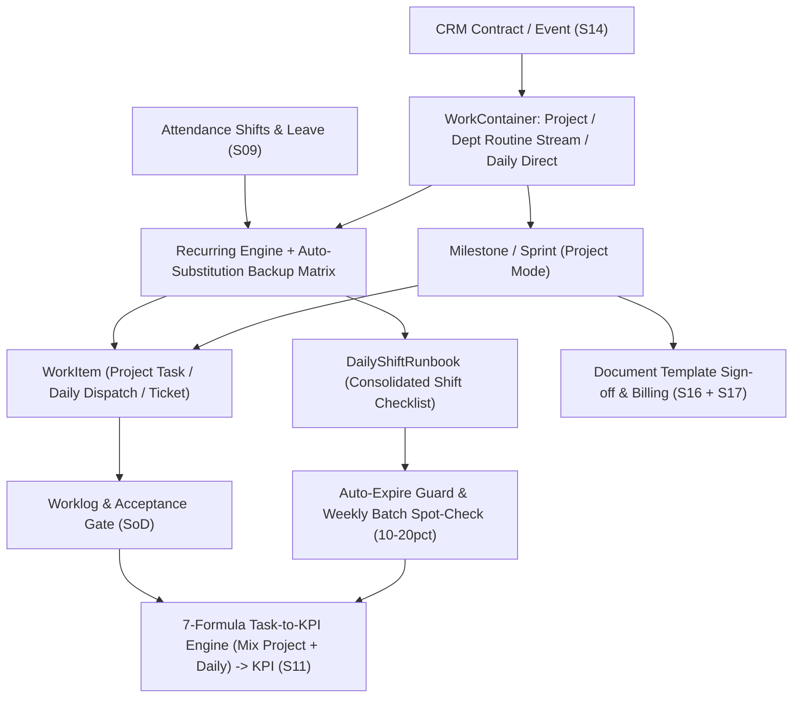
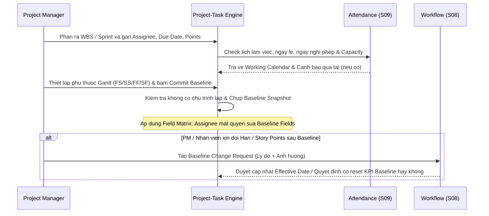
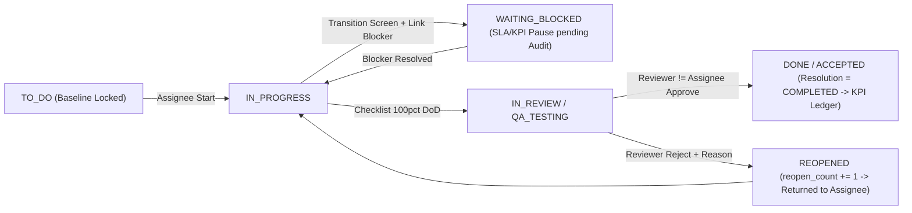
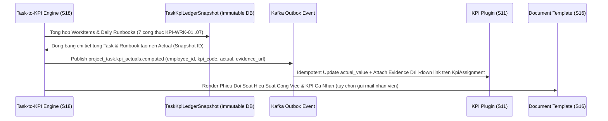
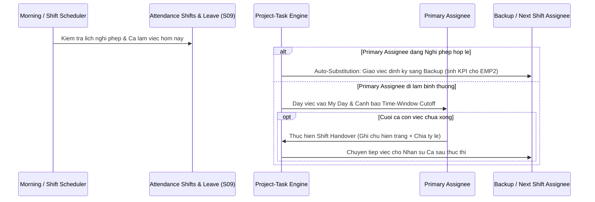

# Tài Liệu Phân Tích Nghiệp Vụ & Liên Thông KPI — Sprint 18 (`plugins/project-task`)

| Thuộc tính | Giá trị |
| :--- | :--- |
| ID | ANL-S18-001 |
| Sprint | Sprint 18 (`sprint_18_plugin_project_task`) |
| Tác giả | AI Business Analyst (BA) |
| Trạng thái | DRAFT — Chờ xác nhận qua Gate `CONF-S18-001` |
| Phiên bản | 0.2 |
| Tài liệu đầu vào | [00_READING_GUIDE.md](../00_READING_GUIDE.md) · [RAW-S18-001](../01_raw_notes/01_RAW-S18-001_project_task_management_requirements.md) · [BENCH-S18-001](../03_benchmarks/01_BENCH-S18-001_project_task_jira_redmine_benchmarks.md) |

---

## 1. Kiến Trúc Nghiệp Vụ Lõi (`3 Work Containers + Jira-Redmine Hybrid + Recurring Runbook + Task-to-KPI`)

### 1.1. Kiến Trúc 3 Không Gian Công Việc & Cây Phân Cấp Thực Thể
`plugins/project-task` không ép buộc mọi công việc phải gắn vào "Dự án" hay "Hợp đồng", mà tổ chức dữ liệu trên **3 Không gian Công việc Độc lập (`Work Containers`)** dùng chung 1 lõi thực thể `WorkItem` & `DailyRunbook`:
- **`PROJECT_WORKSPACE`**: Cho Dự án / Hợp đồng / Chiến dịch có ngày bắt đầu-kết thúc, Ngân sách, Sprint hoặc Gantt WBS (`AGILE_SCRUM`, `KANBAN`, `WATERFALL_GANTT`, `HYBRID`).
- **`DEPARTMENT_ROUTINE_STREAM`**: Không gian vận hành liên tục gắn với từng `department_id` / `branch_id` / `warehouse_id` / `store_id` (Kế toán, HCNS, Hành chính, Kho, Cửa hàng, Kỹ thuật ca) để chứa các đầu việc lặp lại, SOP phòng ban và Runbook hàng ngày.
- **`DAILY_DIRECT_AND_MY_DAY`**: Không gian Giao việc nhanh hàng ngày (`Quick Dispatch`), Yêu cầu phối hợp liên phòng ban (`Inter-department Request`), và Bảng kế hoạch trong ngày của cá nhân (`My Day` & `End-of-Day Handover`).

Cây phân cấp thực thể thống nhất:
1. **`WorkContainer` (`Project / Sub-project` HOẶC `DepartmentRoutineStream`)**:
   - Chứa `container_type`, `execution_mode`, `working_calendar_id` & `shift_catalog` (từ `attendance` S09), `crm_contract_id` (`crm` S14), `cost_center_id` (`accounting` S17), danh sách thành viên (`ProjectRole` / `DepartmentRole`), `inherit_members` và `enabled_modules`.
2. **`Milestone / Target Version` & `Sprint / Iteration`** *(dành cho `PROJECT_WORKSPACE`)*:
   - `Milestone`: Cột mốc bàn giao (có cờ `is_billing_milestone`, `shared_scope` cho dự án con, `target_date`).
   - `Sprint`: Chu kỳ ngắn (`FUTURE -> ACTIVE -> CLOSED`), chụp `Sprint Commitment Baseline` ngay khi `Start Sprint` và theo dõi biến động `Scope Added / Scope Removed`.
3. **`RecurringTemplate` & `DailyShiftRunbook` (`Phiếu Kiểm Soát Ca/Ngày Gộp`)** *(trụ cột cho Việc Hàng ngày & Lặp lại)*:
   - `RecurringTemplate`: Định nghĩa mẫu công việc lặp theo 1 trong **4 mô hình** (`CALENDAR_SHIFT`, `ROLLING_AFTER_COMPLETE`, `EVENT_SOP_BUNDLE`, `DAILY_RUNBOOK_CONSOLIDATED`), quy tắc dịch chuyển ngày lễ (`Holiday Shift Policy`), cửa sổ quá hạn (`Time-Window Cutoff`), danh sách **`Backup Assignee Matrix`** (`Primary -> Backup 1 -> Backup 2`), và chế độ nghiệm thu (`Mode 1 / 2 / 3`).
   - `DailyShiftRunbook`: 1 thực thể đại diện cho trọn bộ 10–25 bước kiểm tra lặp lại trong 1 ca/ngày của 1 nhân sự hoặc ca trực (tránh tạo rác hàng trăm Issue rời rạc), mỗi dòng mang khung giờ cam kết, bắt buộc ảnh/số đo và tự tổng hợp `% Hoàn thành Ca`.
4. **`WorkItem` (Đầu việc Thống nhất theo `Tracker / Issue Type`)**:
   - Phân cấp: `Epic / Phase (Cấp 1)` -> `Story / Task / Bug / Ticket / Deliverable / Daily Dispatch (Cấp 0)` -> `Sub-task (Cấp -1)`.
   - Quan hệ ngang (`WorkItemRelation`): `BLOCKS / IS_BLOCKED_BY`, `PRECEDES / FOLLOWS (+ lag_days)`, `CAUSES / IS_CAUSED_BY` (Bug sinh từ Story/Task), `DUPLICATES / IS_DUPLICATED_BY`, `RELATES_TO`.
   - Bộ ngày & ước lượng tách 2 lớp bất biến:
     - **Lớp Baseline (`baseline_*`)**: `baseline_start_date`, `baseline_due_date`, `baseline_estimated_hours`, `baseline_story_points`, `baseline_version`.
     - **Lớp Hiện hành (`effective_*`)**: `start_date`, `due_date`, `estimated_hours`, `story_points`, `done_ratio (0..100%)`.
5. **`Checklist`, `TimeEntry (Worklog)` & `Acceptance / Spot-Check`**:
   - `ChecklistItem`: Danh sách kiểm tra nội bộ (`Definition of Done`), có cờ bắt buộc hoàn tất 100% trước khi chuyển sang trạng thái nghiệm thu.
   - `TimeEntry`: Nhật ký giờ làm (`spent_on`, `hours`, `activity_type`, `is_billable`, `attendance_validation_status`).
   - `WorkAcceptance` / `WeeklyRoutineSignOff`: Phiếu xác nhận chất lượng nghiệm thu từng việc (`Reviewer != Assignee`) HOẶC Phiếu nghiệm thu gộp tuần kèm kết quả **Hậu kiểm Ngẫu nhiên `10–20%` (`Random Spot-Check`)** cho công việc lặp lại.

---

### 1.2. Kết Hợp Quy Trình Jira & Ma Trận Phân Quyền Redmine
Mỗi cặp `(Project / Template, Tracker)` sử dụng một **Workflow Definition** thống nhất gồm 3 lớp bảo vệ:
1. **`StatusCategory` (Bất biến cho KPI & Báo cáo)**: `TO_DO`, `IN_PROGRESS`, `WAITING_BLOCKED`, `IN_REVIEW`, `DONE`, `CANCELLED`.
2. **`Resolution` (Bắt buộc khi vào `DONE` hoặc `CANCELLED`)**: `COMPLETED`, `FIXED`, `WONT_DO`, `DUPLICATE`, `CANNOT_REPRODUCE`, `CANCELLED_BY_CLIENT`. Chỉ các WorkItem có `StatusCategory = DONE` và `Resolution IN (COMPLETED, FIXED)` mới được tính vào sản lượng KPI đầu ra.
3. **Ma trận Phân quyền 3 Chiều `Role x Tracker x Status`**:
   - **Transition Rule**: Quy định Vai trò nào (kèm điều kiện `is_assignee` / `is_reporter` / `is_not_assignee` để thực thi `SoD`) được phép chuyển `Status A -> Status B`.
   - **Transition Guards & Post-Functions (kiểu Jira)**: Kiểm tra ràng buộc (không còn Blocker chưa đóng, Checklist đạt 100%, đã nhập `Worklog / Resolution Note`), mở Transition Screen bắt buộc nhập trường bổ sung, rồi thực thi hậu xử lý (`Auto-Snapshot Baseline`, `Update Rollup % Done`, `Pause/Resume SLA Clock`, `Trigger Next Dependent Task`, `Emit KPI Event`).
   - **Field Permission Matrix (`READ_ONLY` / `REQUIRED` / `EDITABLE` — kiểu Redmine)**: VD khi `StatusCategory IN (IN_PROGRESS, IN_REVIEW, DONE)`, các trường `due_date`, `estimated_hours`, `story_points`, `weight` tự động chuyển `READ_ONLY` đối với nhân viên thực hiện (`Assignee`). Mọi chỉnh sửa phải đi qua **`Baseline Change Request`**.

---

### 1.3. 5 Chỉ Số Điều Hành Dự Án & Nguồn Lực Thời Gian Thực (`PM & Executive Cockpit`)

| Mã | Chỉ số | Công thức / Định nghĩa | Ý nghĩa điều hành |
| :--- | :--- | :--- | :--- |
| `PM-01` | **Schedule Performance Index (`SPI`)** | `SPI = Earned Value (EV_progress) / Planned Value (PV_baseline)` | `SPI < 1.0` cảnh báo dự án chậm so với kế hoạch Baseline gốc |
| `PM-02` | **Milestone On-Time Rate** | `Số Milestone nghiệm thu đúng/trước baseline_target_date / Tổng số Milestone đến hạn * 100%` | Đo lường uy tín bàn giao với khách hàng & tiến độ thu tiền (`crm` S14) |
| `PM-03` | **Scope Creep / Sprint Churn %** | `(Points Added + Points Removed sau khi Start) / Committed Baseline Points * 100%` | Kiểm soát phình phạm vi giữa kỳ từ khách hàng hoặc lỗi lập kế hoạch |
| `PM-04` | **Resource Utilization & Overload %** | `Tổng (Project Hours + Routine/Daily Committed Hours) / (Available Attendance Hours - Leave Hours) * 100%` | Phát hiện ngay nhân sự quá tải `> 110%` (tính gộp cả việc dự án lẫn việc định kỳ hàng ngày) |
| `PM-05` | **Bottleneck & Routine Discipline Index** | `AVG(Aging Hours tại IN_REVIEW/BLOCKED)` và `Routine Missed Occurrence Rate %` | Phát hiện khâu nghẽn cổ chai hoặc phòng ban bỏ sót đầu việc định kỳ hàng ngày |

### 1.4. Kiến Trúc Nghiệp Vụ Việc Hàng Ngày (`My Day`), 4 Mô Hình Lặp Lại & Nghiệm Thu 3 Cấp
1. **4 Mô hình Lặp đi Lặp lại (`4 Recurrence Archetypes`)**:
   - `CALENDAR_SHIFT`: Lặp theo Ca làm việc (`Đầu ca / Giữa ca / Cuối ca` lấy từ `attendance` S09), Hàng ngày, Hàng tuần, Ngày làm việc thứ $N$ hoặc cuối cùng của tháng, Quý, Năm + **`Holiday Shift Policy`** (`SHIFT_TO_PREVIOUS_WORKDAY` / `SHIFT_TO_NEXT_WORKDAY` / `KEEP_EXACT_DATE`).
   - `ROLLING_AFTER_COMPLETE`: Sinh kỳ kế tiếp sau $\Delta t$ ngày/giờ tính từ `completed_at` của kỳ vừa xong (không đẻ chồng chéo khi kỳ trước trễ).
   - `EVENT_SOP_BUNDLE`: Tự sinh bộ đầu việc SOP liên phòng ban từ sự kiện Kafka (`employee.onboarded`, `employee.offboarded`, `inventory.stocktake_opened`, `accounting.period_closing`).
   - `DAILY_RUNBOOK_CONSOLIDATED`: Gom 10–25 mục kiểm tra lặp trong ca/ngày vào **1 Phiếu Runbook Ca/Ngày**, hỗ trợ khung giờ bắt buộc và chụp ảnh/số đo từng dòng.
2. **Điều phối Thực tế Khi Vắng Mặt & Giao Ca (`Auto-Substitution` & `Shift Handover`)**:
   - Mỗi sáng/đầu ca, Job đồng bộ danh sách nghỉ phép/công tác đã duyệt từ **`plugins/attendance` (S09)**: nếu `Primary Assignee` vắng mặt hợp lệ, hệ thống tự gán sang `Backup 1 -> Backup 2 -> Round-Robin` trong **`Backup Assignee Matrix`** (`Substitute Assignee` hưởng trọn điểm KPI của phiên làm thay, người nghỉ không bị phạt `OTD`).
   - Cuối ca/cuối ngày, việc dở dang bắt buộc chọn `Handover to Next Shift` (kèm ghi chú & chia `%` đóng góp) hoặc `Carry-over to Tomorrow` (giữ `baseline_due_at` gốc).
3. **Động cơ Nghiệm thu 3 Cấp độ chống Quá tải cho Quản lý (`3-Mode Verification Engine`)**:
   - **`Mode 1 — STRICT_SOD_PER_TASK`**: Duyệt từng đầu việc (`Reviewer != Assignee`) — dùng cho Task Dự án, Milestone, Việc đột xuất trọng số lớn.
   - **`Mode 2 — WEEKLY_BATCH_AND_SPOT_CHECK`** *(Chuyên cho Việc Hàng ngày & Lặp lại)*: Nhân viên nộp kèm minh chứng bắt buộc (ảnh/file/số liệu form `S08`) trước `cutoff`; cuối tuần hệ thống gom toàn bộ phiên đã làm thành **1 Phiếu Nghiệm thu Tuần (`Weekly Routine Sign-off Sheet`)**, tự động chọn ngẫu nhiên **`10–20%`** phiên có minh chứng để Trưởng phòng/QC bấm kiểm tra chéo (`Random Spot-Check`). Nếu phát hiện làm ẩu/tick khống khi hậu kiểm, áp dụng **Phạt Hậu kiểm (`Spot-Check Penalty Multiplier = 3x`)** và tự động tăng tỷ lệ hậu kiểm lên `50%` trong 4 tuần tiếp theo với nhân sự đó.
   - **`Mode 3 — INTERNAL_REQUESTER_CSAT`** *(Chuyên cho Phối hợp Liên phòng ban hàng ngày)*: Người đặt yêu cầu ở phòng ban nhận dịch vụ bấm xác nhận đạt và đánh giá `1–5 sao` làm hệ số chất lượng $Q_i$.

---

## 2. Động Cơ Định Lượng Task-to-KPI (`plugins/project-task` -> `plugins/kpi` Sprint 11)

Thực hiện tích hợp trực tiếp với kênh Event Subscription `AC-C04` / `Q5` tại `CONF-S11-001` của **`plugins/kpi` (Sprint 11)**. Toàn bộ công việc hợp lệ (cả **Dự án/Hợp đồng** lẫn **Công việc Hàng ngày / Lặp lại**) trong kỳ đánh giá KPI (`MONTHLY` hoặc `QUARTERLY`) được tổng hợp thành **7 Nhóm Chỉ số Định lượng Chuẩn hóa** kèm **Tỷ trọng Hỗn hợp theo Vị trí (`KPI Source Mix`)**:

### 2.1. Bộ 7 Công Thức Chuẩn Hóa (`KPI-WRK-01` .. `KPI-WRK-07`) & Cấu Hình Tỷ Trọng Hỗn Hợp

> [!TIP]
> **Cấu hình Tỷ trọng Hỗn hợp (`Configurable KPI Source Mix`)**: Tùy vai trò công việc tại `plugins/employee` (S07) & `plugins/kpi` (S11), doanh nghiệp cấu hình tỷ trọng đóng góp giữa luồng Dự án và luồng Hàng ngày/Lặp lại:
> - *Đội Dự án / R&D / Triển khai*: `80% Project Tasks (`KPI-WRK-01..04, 06`) + 20% Daily/Routine (`KPI-WRK-07`)`
> - *Phòng Ban Chức Năng (Kế toán, HCNS, Hành chính, Mua hàng)*: `70% Daily & Recurring Routine (`KPI-WRK-07`) + 30% Ad-hoc / Project (`KPI-WRK-01, 02, 04`)`
> - *Cửa hàng / Kho / Trực Ca*: `90% Daily Shift Runbook (`KPI-WRK-07`) + 10% Ad-hoc Dispatch`

#### 1. `KPI-WRK-01`: Tỷ lệ Hoàn thành Công việc Đúng hạn Có Trọng số (`Weighted OTD %` — Chỉ số Thuận)
- Thay vì đếm thô (1 task 5 phút ngang bằng 1 task 5 ngày), mỗi công việc $i$ thuộc tập công việc đến hạn hoặc hoàn thành trong kỳ có trọng số độ lớn $W_i$ (`Story Points` hoặc `Normalized Hours / Priority Weight`) và hệ số đúng hạn $F_{\text{time}, i}$:
  - Hoàn thành đúng hoặc trước `effective_due_date` (nếu có thay đổi Baseline được duyệt) / `baseline_due_date`: $F_{\text{time}, i} = 1.0$. *(Tùy chọn Tenant: hoàn thành sớm $\ge 20\%$ thời lượng đạt chuẩn vẫn giữ $1.0$ hoặc thưởng tối đa $1.05$ nhưng tổng chỉ số vẫn áp trần `Cap = 120%` theo `CONF-S11-001 Q9`)*.
  - Trễ nhẹ bậc 1 ($\le 1$ ngày làm việc hoặc $\le 15\%$ thời lượng cam kết): $F_{\text{time}, i} = 0.7$.
  - Trễ bậc 2 ($> 1$ đến $\le 3$ ngày làm việc): $F_{\text{time}, i} = 0.4$.
  - Trễ nặng ($> 3$ ngày làm việc) hoặc vẫn đang quá hạn chưa nghiệm thu khi chốt kỳ KPI: $F_{\text{time}, i} = 0.0$.
- Công thức:
  $$\text{OTD}_{\text{weighted}} (\%) = \frac{\sum_{i=1}^{N} \left( W_i \times F_{\text{time}, i} \right)}{\sum_{i=1}^{N} W_i} \times 100\%$$
  *(Lưu ý: Thời gian hợp lệ bị tạm dừng do `BLOCKED_EXTERNAL` có xác nhận của Quản lý hoặc ngày nghỉ phép hợp lệ phát sinh đột xuất trên `attendance` được trừ ra khi tính độ trễ).*

#### 2. `KPI-WRK-02`: Năng suất Đầu ra Đã Nghiệm thu (`Accepted Weighted Throughput / Points` — Chỉ số Thuận)
- Đo lường tổng giá trị công việc thực chất đã qua cổng nghiệm thu (`StatusCategory = DONE`, `Resolution IN (COMPLETED, FIXED)`, đã có xác nhận `Reviewer != Assignee` nếu yêu cầu SoD):
  $$\text{Output}_{\text{emp}} = \sum_{i \in \text{Accepted}} \left( W_i \times R_{\text{contrib}, i} \times Q_i \right)$$
  trong đó:
  - $W_i$: Trọng số công việc gốc (`baseline_story_points` hoặc `standard_catalog_points`).
  - $R_{\text{contrib}, i} \in (0, 1]$: Tỷ lệ đóng góp (`1.0` nếu làm độc lập; chia tổng `= 100%` giữa `Primary Assignee` và `Collaborators`).
  - $Q_i \in [0.5, 1.2]$: Hệ số chất lượng do `Reviewer / Manager` chấm khi nghiệm thu (mặc định `1.0` đạt chuẩn; `0.7` đạt nhưng phải nhắc sửa nhiều lần; `1.1–1.2` xuất sắc vượt kỳ vọng có ghi chú minh chứng).

#### 3. `KPI-WRK-03`: Hiệu suất Thời gian Thực thi (`Effort Efficiency %` — Chỉ số Thuận có Trần `Cap`)
- So sánh tổng giờ định mức ước lượng đã duyệt ($H_{\text{est}, i}$) trên các công việc đã nghiệm thu với tổng giờ công thực tế đã ghi nhận ($H_{\text{actual}, i}$):
  $$\text{Efficiency} (\%) = \min\left(\text{Cap}, \frac{\sum_{i \in \text{Accepted}} H_{\text{est}, i}}{\sum_{i \in \text{Accepted}} H_{\text{actual}, i}} \times 100\%\right)$$
  *(Mặc định `Cap = 120%` đồng bộ `CONF-S11-001 Q9`. Đối với tác vụ không log worklog theo giờ — VD khối Back-office chỉ giao deadline — chỉ số này là tùy chọn không kích hoạt).*

#### 4. `KPI-WRK-04`: Chất lượng Ngay Lần Đầu (`First-Time-Right %`) & Tỷ lệ Lỗi/Làm lại (`Weighted Defect & Reopen Rate` — Chỉ số Ngược `LOWER_IS_BETTER`)
- **First-Time-Right (`FTR %` — Càng cao càng tốt)**:
  $$\text{FTR} (\%) = \frac{\text{Số WorkItem nghiệm thu đạt ngay ở lần Review/QA đầu tiên (`reopen_count = 0`)}}{\text{Tổng số WorkItem đã trình nghiệm thu trong kỳ}} \times 100\%$$
- **Tỷ lệ Lỗi/Trả lại có Trọng số (`Weighted Rework Ratio` — Càng thấp càng tốt)**:
  $$\text{ReworkRatio} = \frac{\sum_{r} \text{ReopenPenalty}_r + \sum_{b \in \text{CausedBugs}} S_b}{\max(1, \sum_{i \in \text{Accepted}} W_i)}$$
  *(với trọng số mức độ Bug liên kết `CAUSED_BY`: `Critical = 5`, `High = 3`, `Medium = 1`, `Low = 0.25`; đẩy sang `plugins/kpi` theo loại chỉ số `LOWER_IS_BETTER` đã hỗ trợ sẵn ở Sprint 11).*

#### 5. `KPI-WRK-05`: Tỷ lệ Tuân thủ Cam kết Dịch vụ (`SLA Compliance Rate %` — Chỉ số Thuận)
- Áp dụng cho Ticket/Yêu cầu hỗ trợ nội bộ & CSKH:
  $$\text{SLA Compliance} (\%) = \frac{\text{Số Ticket đạt cả `First Response SLA` và `Resolution SLA`}}{\text{Tổng số Ticket đóng hợp lệ trong kỳ}} \times 100\%$$
  *(Loại trừ Ticket có `Resolution = DUPLICATE / CANCELLED_BY_REQUESTER`; áp dụng `SLA Clock Pause` chuẩn Jira Service Management).*

#### 6. `KPI-WRK-06`: Chỉ số Điều hành Dự án & Cột mốc Dành cho Quản lý (`PM Project Delivery & EVM Score`)
- Áp dụng cho cấp `Project Manager / Team Lead`: Tổng hợp từ danh sách dự án phụ trách:
  - `% Milestone hoàn thành đúng hạn`;
  - `SPI` bình quân có trọng số giá trị hợp đồng/ngân sách;
  - `CPI` (nếu nối `accounting` S17) & `Tỷ lệ Bug nghiêm trọng sau phát hành`.

#### 7. `KPI-WRK-07`: Tỷ lệ Tuân thủ & Đúng hạn Công việc Định kỳ / Hàng ngày (`Daily & Routine Discipline Rate %` — Chỉ số Thuận)
- Đo lường kỷ luật vận hành đối với các công việc hàng ngày, lặp đi lặp lại (`Recurring`) và Phiếu kiểm tra Ca (`Daily Shift Runbook`):
  $$\text{Routine Discipline} (\%) = \frac{\sum_{j=1}^{M} \left( W_j \times C_{\text{window}, j} \times C_{\text{verify}, j} \right)}{\sum_{j=1}^{M} W_j} \times 100\%$$
  trong đó:
  - $M$: Tổng số phiên việc lặp lại/Runbook ca đến hạn của nhân sự trong kỳ (**đã tự động loại trừ các phiên nghỉ phép được giao sang `Backup Assignee` qua `Auto-Substitution`**).
  - $C_{\text{window}, j}$: Hệ số hoàn thành trong cửa sổ thời gian cam kết (`1.0` nếu nộp đủ minh chứng trong khung giờ chuẩn; `0.5` nếu hoàn tất muộn trước giờ tự động khóa; **`0.0` nếu quá `expiration_cutoff` bị đóng thành `MISSED_OCCURRENCE`**).
  - $C_{\text{verify}, j}$: Hệ số kiểm chứng (`1.0` mặc định hoặc đạt `Weekly Batch & Spot-Check`; **`-3.0` (`Spot-Check Penalty`) hoặc `0.0` tùy mức cấu hình Tenant nếu bị phát hiện tick khống khi Trưởng phòng hậu kiểm ngẫu nhiên `10–20%`**).

### 2.2. Cơ Chế Chống Gian Lận KPI 7 Tầng (`7-Layer Anti-Gaming Governance`)

| Tầng | Nguy cơ gian lận thực tế | Cơ chế kiểm soát cứng trong `plugins/project-task` |
| :--- | :--- | :--- |
| **1. Baseline Lock (`Redmine Matrix`)** | Nhân viên tự lùi `due_date` hoặc nâng `story_points`/`estimated_hours` khi việc đã chạy | Khóa `READ_ONLY` các trường Baseline ngay khi `StatusCategory != TO_DO`; muốn đổi phải nộp **`Baseline Change Request`** được Quản lý phê duyệt phân loại nguyên nhân |
| **2. Segregation of Duties (`SoD` + CSAT)** | Nhân viên tự tạo việc, tự làm và tự bấm `Done` để lấy 100% KPI | Mọi `Tracker` có cờ `requires_kpi_acceptance = true` bắt buộc `Assignee != Reviewer`; việc phối hợp liên phòng ban dùng `Internal Requester CSAT` xác nhận |
| **3. Blocker & Pause Audit** | Nhân viên cố tình đẩy task sang `Blocked` để "đứng hình" đồng hồ SLA/OTD | Chuyển sang `WAITING_BLOCKED` bắt buộc qua Transition Screen nhập `Blocker Reason` + link `Blocking WorkItem / Vendor` và Quản lý xác nhận mới được miễn trừ độ trễ KPI |
| **4. Attendance Cross-Check (`S09`)** | Log khống `Worklog` vào ngày nghỉ phép hoặc 14h/ngày để làm đẹp chi phí | Kiểm tra chéo Realtime sang `plugins/attendance`: chặn/cảnh báo vượt trần `(Giờ chấm công thực tế + OT duyệt)`, gắn cờ đỏ Worklog vào ngày `APPROVED_LEAVE` |
| **5. Task Splitting Guard** | Xé nhỏ 1 việc bình thường thành 30 task con để tăng số lượng `Tasks Done` | Công thức KPI không chấm theo số lượng task thô mà theo **Tổng trọng số chuẩn (`Weighted Output`)**, có **Danh mục Định mức Chuẩn (`Standard Task Weight Catalog`)** và yêu cầu Manager duyệt trọng số nếu vượt khung |
| **6. Auto-Expire Anti-Backdating & Weekly Spot-Check (`3x` Penalty)** | Nhân viên bỏ quên việc hàng ngày rồi cuối tuần/cuối tháng bấm `Done` bù loạt việc định kỳ, hoặc tick khống Runbook không làm thật | Hết khung giờ hiệu lực hệ thống **tự đóng khóa phiên thành `MISSED_OCCURRENCE`** cấm bấm bù; Trưởng phòng duyệt gộp cuối tuần kết hợp **lấy mẫu hậu kiểm `10–20%`** ảnh/số liệu (sai phạm bị phạt gấp `3x` và nâng tỷ lệ hậu kiểm lên `50%`) |
| **7. Evidence Drill-down Snapshot** | Số KPI tổng hợp không kiểm chứng được đến từ đâu hoặc bị sửa task sau khi chốt lương KPI | Khi chốt kỳ KPI, tạo bản ghi bất biến **`TaskKpiLedgerSnapshot`** đóng băng danh sách từng `WorkItem ID / DailyRunbook ID`, `Baseline Due Date`, `Completed At`, `Penalty`, `Reviewer / Spot-Check`, rồi gửi kèm URL `?drawer=kpi-evidence&snapshotId=...` sang `plugins/kpi` |

---

## 3. 12 Luồng Nghiệp Vụ End-to-End (`End-to-End Workflows`)

### 3.1. Luồng 1: Khởi Tạo Dự Án Đa Mô Hình & Đồng Bộ Hợp Đồng Từ `CRM` (`S14`) + Ngân Sách (`S17`)
1. **Khởi tạo Thủ công hoặc Tự động từ `CRM (S14)`**: Khi Hợp đồng bán hàng được ký (`crm.contract.won`), `plugins/project-task` tự tạo Dự án triển khai (hoặc Dự án nội bộ chọn `Project Template`: `Agile Scrum`, `Waterfall EPC`, `Operations`, `Service Desk`), ánh xạ `Cost Center` sang `plugins/accounting` (S17) và tự sinh các `Billing Milestones` theo lịch thanh toán hợp đồng.
2. **Thiết lập Cây Dự án & `Project Charter` (`plugins/form` S08)**: Nhập thông tin chuẩn + trường tùy biến theo Tenant/Chi nhánh, chỉ định `Project Manager`, `Team Lead`, `Project Members` và vai trò (`PM`, `Lead`, `Dev/Executor`, `QA/Reviewer`, `Client Observer`).
3. **Phê duyệt & Kết xuất `Project Charter` (`plugins/workflow` S08 + `plugins/document-template` S16)**: Nếu dự án vượt ngưỡng ngân sách hoặc phạm vi quản trị `DOA`, gửi luồng duyệt; khi duyệt, kết xuất PDF `Project Charter` qua Sprint 16.

### 3.2. Luồng 2: Phân Rã WBS / Backlog, Gắn Phụ Thuộc Gantt & Chốt Kế Hoạch Gốc (`Baseline Lock`)
1. **Phân rã Cấu trúc Công việc**: PM/Team Lead tạo `Epics / Phases` -> `Stories / Tasks / Work Packages` -> `Sub-tasks`, nhập `Tracker`, `Assignee`, `Reviewer`, `Estimated Hours`, `Story Points / Weight`, `Start Date`, `Due Date`.
2. **Kiểm tra Năng lực & Nghỉ phép (`plugins/attendance` S09)**: Hệ thống hiển thị ngay cảnh báo quá tải (`Workload > 100%`) hoặc trùng ngày nghỉ phép đã duyệt của nhân sự.
3. **Thiết lập Phụ thuộc Gantt (`FS/SS/FF/SF + Lag`)**: Kiểm tra phát hiện chu trình vòng lặp (`Circular Dependency Guard`); tính Đường găng (`Critical Path`).
4. **Chốt Baseline (`Commit / Start Sprint / Lock Baseline`)**: Hệ thống chụp toàn bộ `baseline_start_date`, `baseline_due_date`, `baseline_estimated_hours`, `baseline_story_points` làm chuẩn đánh giá KPI và khóa quyền tự sửa của nhân viên qua Ma trận `Role x Tracker x Status`.

### 3.3. Luồng 3: Thực Thi Agile Sprint (`Scrum Planning -> Active Sprint -> Scope Change -> Retro`)
1. Sắp xếp `Product Backlog`, ước lượng `Story Points` & kiểm tra sẵn sàng (`Definition of Ready`).
2. Kéo hạng mục vào Sprint nháp (`FUTURE`), đối chiếu `Sprint Capacity` (giờ khả dụng của cả nhóm sau khi trừ ngày nghỉ phép từ `attendance` S09).
3. Bấm `Start Sprint` -> Chốt `Sprint Commitment Baseline` (`Active`). Mọi task thêm/bớt sau thời điểm này được gắn cờ `scope_change_type (ADDED_MID_SPRINT / REMOVED_MID_SPRINT)` để báo cáo trung thực `Burndown` và `Velocity`.
4. Kết thúc Sprint (`Complete Sprint`): Task đã `ACCEPTED` đóng gói vào Velocity & KPI kỳ; Task chưa xong được chọn chuyển sang Sprint kế tiếp hoặc trả về Backlog (ghi nhận `carryover_count` để phân tích nguyên nhân trễ).

### 3.4. Luồng 4: Thực Thi Vòng Đời Công Việc Theo Ma Trận Trạng Thái (`Jira State Machine + Redmine Field Matrix`)
1. `Assignee` kéo thẻ trên Kanban hoặc bấm nút `Start Progress` (`TO_DO -> IN_PROGRESS`): `Validator` kiểm tra điều kiện tiên quyết (VD: không bị chặn bởi task `IS_BLOCKED_BY` chưa xong); `Post-function` ghi nhận `actual_started_at`.
2. Nếu gặp trở ngại khách quan: Chuyển `IN_PROGRESS -> WAITING_BLOCKED` qua `Transition Screen` (chọn lý do `CLIENT_DELAY / PROCUREMENT_DELAY / DEPENDENCY_BLOCKED`, gắn link minh chứng). Quản lý nhận thông báo xác nhận lý do hợp lệ để tạm dừng tính trễ KPI/SLA.
3. Khi làm xong: `Assignee` hoàn thành Checklist `DoD` 100%, chuyển `IN_PROGRESS -> IN_REVIEW / READY_FOR_QA`. Lúc này `Field Matrix` khóa quyền sửa kết quả với `Assignee`.
4. `Reviewer / QA` (bắt buộc `!= Assignee` theo `SoD`) kiểm tra:
   - Nếu **Đạt**: Chuyển `DONE / ACCEPTED` với `Resolution = COMPLETED`, chấm hệ số chất lượng `Q_i`, ghi nhận `completed_at`.
   - Nếu **Không đạt**: Chuyển `REOPENED` qua `Transition Screen` nhập lý do lỗi/sửa, tự động tăng `reopen_count += 1` (ảnh hưởng trực tiếp `KPI-WRK-04`) và gửi lại `Assignee`.

### 3.5. Luồng 5: Dời Lịch Dây Chuyền Gantt & Đề Xuất Điều Chỉnh Baseline (`Baseline Change Request`)
1. Khi một công việc tiền nhiệm `Task A` bị thay đổi `due_date` (hoặc trên màn hình Gantt kéo thanh lịch), hệ thống chạy thuật toán duyệt đồ thị phụ thuộc (`FS/SS/FF/SF + Lag`) theo Lịch làm việc chuẩn (`attendance` S09) để **xem trước danh sách `N` công việc hậu nhiệm bị ảnh hưởng dây chuyền (`Impact Preview`)**.
2. Nếu dự án đang chạy (`Baseline Locked`), việc dời hạn phải tạo **`Baseline Change Request`** gửi qua `plugins/workflow` (S08), ghi rõ 1 trong 5 mã nguyên nhân (`CLIENT_SCOPE_CHANGE`, `CLIENT_DELAY`, `INTERNAL_DEPENDENCY`, `TECHNICAL_RISK`, `EXECUTION_DELAY`) và lựa chọn chính sách KPI:
   - *Chính sách 1 (`Baseline Reset`)*: Do lỗi/đổi yêu cầu từ khách hàng hoặc ban giám đốc điều phối -> Cập nhật `kpi_target_due_date` mới (không phạt KPI nhân viên).
   - *Chính sách 2 (`Keep Original KPI Baseline`)*: Cho phép dời lịch vận hành để điều phối thực tế (`effective_due_date`), nhưng vẫn giữ nguyên `baseline_due_date` gốc để đánh giá đúng hạn KPI (`KPI-WRK-01`).

### 3.6. Luồng 6: Ghi Nhận Thời Gian (`TimeEntry Worklog`), Đối Soát Chấm Công (`S09`) & Đẩy Lương (`S10`)
1. Nhân viên bấm đồng hồ `Live Timer` trên thanh việc hoặc log nhanh `Worklog` cuối ngày (chọn `spent_on`, `hours`, `TimeEntryActivity`, cờ `Billable/Non-billable`, mô tả).
2. **Kiểm tra chéo tức thời sang `plugins/attendance` (S09)**:
   - Nếu `spent_on` là ngày nhân viên có đơn `APPROVED_FULL_DAY_LEAVE` -> Chặn hoặc đánh dấu vi phạm ngoại lệ.
   - Cộng tổng `Worklog` của nhân viên trong ngày `spent_on` trên toàn bộ các dự án; nếu vượt quá `Actual Attendance Hours + Approved OT Hours` (cộng dung sai cấu hình, VD 0h hoặc 15 phút) -> Chặn cứng hoặc chuyển trạng thái `PENDING_MANAGER_AUDIT` tùy chính sách Tenant.
3. Cuối kỳ chốt công, `plugins/project-task` khóa sổ Worklog kỳ và phát sự kiện `project_task.timesheets.period_closed` sang `plugins/payroll` (S10) & `plugins/accounting` (S17) để hạch toán chi phí nhân công theo dự án.

### 3.7. Luồng 7: Điều Hành 4 Mô Hình Lặp Đi Lặp Lại (`Recurring Engine`) & Service Desk SLA
1. **Recurring Engine (4 Mô hình)**: Cho phép cấu hình `RecurringTemplate` trong `DEPARTMENT_ROUTINE_STREAM` hoặc `PROJECT_WORKSPACE` theo 4 chế độ:
   - `CALENDAR_SHIFT`: Theo Ca làm việc (`attendance` S09), Hàng ngày, Hàng tuần, Ngày làm việc thứ $N$/cuối cùng của tháng, Quý, Năm kèm **`Holiday Shift Policy`** (`SHIFT_TO_PREVIOUS_WORKDAY` / `SHIFT_TO_NEXT_WORKDAY` / `KEEP_EXACT_DATE`);
   - `ROLLING_AFTER_COMPLETE`: Chỉ sinh kỳ tiếp theo sau $N$ ngày/giờ tính từ lúc `completed_at` của kỳ vừa xong;
   - `EVENT_SOP_BUNDLE`: Tự sinh chuỗi SOP khi nhận event từ `employee` S07, `inventory` S13, `crm` S14, `accounting` S17;
   - `DAILY_RUNBOOK_CONSOLIDATED`: Gom 10–25 bước lặp lại trong ngày/ca vào **1 Phiếu Runbook Ca**.
2. **Service Desk SLA**: Ticket gửi từ Portal (`plugins/form` S08) hoặc nội bộ được tự động gán `SLA Policy` theo `(Tracker, Priority)`. Đồng hồ `First Response` & `Resolution` đếm thuần giờ làm việc, tự động dừng khi `WAITING_FOR_REQUESTER` và gửi cảnh báo leo thang qua `in-app-notification` tại các mốc `75%`, `90%`, `100%`.

### 3.8. Luồng 8: Liên Kết Mua Sắm (`purchasing` S15), Nghiệm Thu Cột Mốc & Xuất Hóa Đơn (`crm` S14, `accounting` S17, `doc-template` S16)
1. **Mua sắm theo Dự án**: Trên màn hình Dự án/WBS, người dùng tạo nhanh Đề nghị mua vật tư/thuê ngoài gắn `project_id` + `wbs_task_id` sang `plugins/purchasing` (S15); khi hàng về kho/nghiệm thu PO, trạng thái task chờ vật tư tự động cập nhật sẵn sàng.
2. **Nghiệm thu & Thanh toán Cột mốc (`Milestone Sign-off`)**: Khi tất cả công việc trong `Billing Milestone` đạt `DONE`, PM trình nghiệm thu nội bộ và gửi khách hàng xác nhận; dùng **`plugins/document-template` (S16)** kết xuất `Biên bản Nghiệm thu Giai đoạn` (PDF có QR Verify) & gửi email tự động cho khách hàng.
3. Khi Milestone chuyển `ACCEPTED`, phát sự kiện sang `crm` (S14) & `accounting` (S17) để kích hoạt đề nghị xuất hóa đơn & ghi nhận doanh thu đợt.

### 3.9. Luồng 9: Tổng Hợp, Đóng Băng Minh Chứng & Đẩy Số Liệu Tự Động Sang `plugins/kpi` (`S11`)
1. Khi có WorkItem / Weekly Routine Sign-off đạt `ACCEPTED` (chế độ Real-time Incremental) và khi chạy chốt kỳ đánh giá (chế độ Batch End-of-Period), `Task-to-KPI Engine` tổng hợp số liệu cho từng `employee_id` theo **7 công thức (`KPI-WRK-01`..`KPI-WRK-07`)** và áp dụng **Cấu hình Tỷ trọng Hỗn hợp** (Dự án vs. Hàng ngày/Lặp lại).
2. Tạo bản ghi **`TaskKpiLedgerSnapshot`** bất biến lưu chi tiết từng `WorkItem ID` & `DailyShiftRunbook ID` đóng góp vào tử số và mẫu số của từng chỉ số (`baseline_due_date`, `completed_at`, `weight`, `delay_days`, `penalty_factor`, `spot_check_result`, `reopen_count`, `reviewer_id`).
3. Phát sự kiện Kafka Outbox `project_task.kpi_actuals.computed` tới `plugins/kpi` (Sprint 11) khớp với kênh Event Subscription (`CONF-S11-001 Q5 / AC-C04`), điền tự động `actual_value` vào từng `KpiAssignment` tương ứng kèm `evidence_url` dẫn thẳng về Drawer `?drawer=kpi-evidence&snapshotId=...`.
4. Kết xuất **`Phiếu Đối soát Hiệu suất Công việc & KPI Cá nhân`** bằng `plugins/document-template` (S16) để nhân viên đối soát minh bạch nếu có khiếu nại trước khi chốt KPI/Lương (`S10`).

### 3.10. Luồng 10: Lưu Vết 4 Tầng & No-Code Automation Rules
1. **4-Layer Audit Trail**: (1) `Approval & Workflow Transition History` (ai chuyển bước/duyệt lúc nào); (2) `Field Diff History` (giá trị cũ vs mới cho mọi trường, đặc biệt `due_date`, `story_points`, `assignee`); (3) `Lineage Graph` (`CRM Contract / Dept Routine Template -> Project / Stream -> Milestone/Sprint -> WorkItem / DailyRunbook -> Worklog / Spot-Check -> KPI Snapshot -> Accounting Billing`); (4) `Append-Only Worklog & KPI Ledger`.
2. **Automation Rules (`Trigger -> Condition -> Action`)**: Người quản trị dự án cấu hình quy tắc không cần viết code (có chặn vòng lặp vô hạn max depth), VD: *Khi tất cả Sub-task chuyển `DONE` -> Tự chuyển Task cha sang `IN_REVIEW`*; *Khi WorkItem bị `Reopened >= 2 lần` -> Tự gắn thẻ `HIGH_RISK` và báo `Project Manager`*.

### 3.11. Luồng 11: Điều Hành Việc Hàng Ngày (`My Day`), Tự Động Thế Chỗ Khi Nghỉ Phép (`Auto-Substitution`) & Bàn Giao Ca (`Shift Handover`)
1. **Đầu ngày / Đầu ca — Auto-Substitution**: Hệ thống đọc trạng thái nghỉ phép/công tác từ **`plugins/attendance` (S09)**. Nếu `Primary Assignee` của `RecurringTemplate` vắng mặt hợp lệ, hệ thống tự động gán phiên việc ngày hôm đó sang `Backup 1 -> Backup 2 -> Round-Robin` trong `Backup Matrix`, gửi thông báo nhận việc và tính điểm KPI thực thi phiên đó cho người làm thay.
2. **Thực thi `My Day` & Giao việc Liên phòng ban (`Quick Dispatch / Inter-Dept Request`)**: Nhân viên mở màn hình `My Day` tập trung toàn bộ việc lặp trong ngày, việc dự án sắp đến hạn và việc phối hợp liên phòng ban vừa nhận; ghim ưu tiên đầu ngày (`Focus List`). Với yêu cầu liên phòng ban hoàn tất, người đặt yêu cầu xác nhận & chấm `Internal CSAT (1–5 sao)` (`Mode 3`).
3. **Cuối ca / Cuối ngày — `Shift Handover`**: Đối với việc còn dở khi kết thúc ca, nhân sự chọn `Handover to Next Shift` (kèm ghi chú hiện trạng & chia tỷ lệ đóng góp) để nhân sự ca tiếp theo kế thừa ngay không đứt quãng, hoặc kết xuất **`Sổ Giao Ca PDF`** qua `plugins/document-template` (S16).

### 3.12. Luồng 12: Phiếu Kiểm Tra Ca Gộp (`Daily Shift Runbook`), Tự Đóng Quá Hạn (`Auto-Expire`) & Nghiệm Thu Gộp Tuần + Hậu Kiểm (`Spot-Check 10–20%`)
1. **Sinh & Thực thi `Daily Shift Runbook`**: Đầu ca/đầu ngày, thay vì sinh 20 Issue nhỏ lẻ, hệ thống tạo **1 Phiếu Runbook Ca** chứa 20 dòng kiểm tra theo khung giờ (`08:00`, `11:30`, `17:30`), hỗ trợ nhập chỉ số/ảnh chụp trên Mobile (`390x844px`) trong đúng cửa sổ thời gian.
2. **`Auto-Expire Guard` (Chống đánh dấu bù)**: Qua mốc `expiration_cutoff` quy định (VD `23:59` cuối ngày hoặc kết thúc ca + dung sai 30 phút), các phiên/dòng Runbook chưa nộp tự động khóa chuyển sang **`MISSED_OCCURRENCE` (`F_time = 0.0`)** trước khi sinh phiên mới ngày hôm sau.
3. **Nghiệm thu Gộp Tuần & Hậu kiểm Ngẫu nhiên (`Weekly Batch Sign-off + 10–20% Spot-Check`)**: Cuối tuần, Trưởng phòng mở **1 Bảng Nghiệm thu Công việc Thường xuyên Tuần** gom toàn bộ phiên đã hoàn thành của đội; hệ thống tự động đánh dấu ngẫu nhiên **`10–20%`** phiên có minh chứng để Trưởng phòng mở kiểm tra thực tế ảnh/số liệu (`Spot-Check`). Nếu đạt, duyệt toàn lô trong 1 lần bấm (`1-Click Batch Approve -> KPI-WRK-07`). Nếu phát hiện tick khống/làm giả, gắn cờ **`SPOT_CHECK_FAILED`**, trừ điểm kỷ luật `3x` và tự nâng tỷ lệ hậu kiểm cá nhân lên `50%` trong 4 tuần kế tiếp.

---

## 4. Ma Trận Quy Tắc Nghiệp Vụ (`BR-W01`–`BR-W28`)

| Mã | Nhóm | Nội dung Quy tắc Nghiệp vụ | Tham chiếu |
| :--- | :--- | :--- | :--- |
| `BR-W01` | Tenant & Scope | Mọi `WorkContainer`, `Sprint`, `Milestone`, `WorkItem`, `DailyShiftRunbook`, `Worklog`, `KpiSnapshot` đều phải gắn `tenant_id` từ JWT và phân quyền theo `Project / Department Role` / `Issue Security Level`. | `AGENTS.md` |
| `BR-W02` | Hybrid Mode | Một Dự án hỗ trợ cấu hình module bật/tắt (`Backlog/Sprint`, `Kanban`, `Gantt`, `Timesheet`, `SLA Desk`, `Billing/Cost`) trên cùng lõi `WorkItem`. | `BENCH-S18 L01` |
| `BR-W03` | Status vs Resolution | Chuyển WorkItem sang `StatusCategory = DONE / CANCELLED` bắt buộc chọn `Resolution`; chỉ `COMPLETED / FIXED` được tính vào sản lượng KPI đầu ra. | `BENCH-S18 L03` |
| `BR-W04` | Field Matrix | Áp dụng ma trận `Role x Tracker x Status` (`READ_ONLY / REQUIRED / EDITABLE`); khóa cứng `due_date`, `estimated_hours`, `story_points`, `weight` với `Assignee` khi đã thoát `TO_DO`. | `BENCH-S18 L04` |
| `BR-W05` | Baseline Lock | Ngay khi `Commit Plan / Start Sprint / Start Work`, hệ thống sao lưu bộ trường `baseline_*`. Thay đổi Baseline sau khi chốt bắt buộc qua `Baseline Change Request` (`plugins/workflow` S08). | `BENCH-S18 L05` |
| `BR-W06` | Change Reason KPI | Khi duyệt `Baseline Change Request`, người duyệt phải chọn `kpi_baseline_policy` (`RESET_KPI_BASELINE` cho đổi yêu cầu từ khách hàng/sếp vs `KEEP_ORIGINAL_BASELINE` cho trễ do thực thi). | Luồng 5 |
| `BR-W07` | Segregation of Duties | Cấm `Assignee` tự bấm chuyển trạng thái hoàn tất tính KPI cuối cùng (`ACCEPTED / VERIFIED_DONE`) trên các `Tracker` bật `requires_kpi_acceptance = true`; bắt buộc `Reviewer != Assignee`. | `BENCH-S18 L09` |
| `BR-W08` | Gantt Cycle Guard | Khi tạo quan hệ phụ thuộc (`PRECEDES/BLOCKS` với `FS/SS/FF/SF + Lag`), hệ thống chạy thuật toán DFS/Topological check; từ chối ngay nếu phát hiện chu trình lặp (`A -> B -> A`). | `BENCH-S18 L06` |
| `BR-W09` | Weighted Rollup | Nếu bật `auto_rollup` trên Task cha/Milestone, `start_date = MIN(children)`, `due_date = MAX(children)`, `estimated_hours = SUM(children)`, và `done_ratio` tính theo trọng số `estimated_hours` (hoặc trung bình đều). | `BENCH-S18 L06` |
| `BR-W10` | Working Calendar | Mọi phép tính `Duration`, `Gantt Auto-Reschedule`, `SLA Clock`, `Recurring Task Due Date` đều dựa trên lịch làm việc & ngày lễ chi nhánh từ `plugins/attendance` (S09). | `attendance` S09 |
| `BR-W11` | Attendance Cross-Check | Tổng giờ `TimeEntry (Worklog)` trong 1 ngày `spent_on` của nhân viên trên toàn bộ các dự án không được vượt quá `Actual Attendance Hours + Approved OT Hours` từ `plugins/attendance` (theo chế độ Hard-Block hoặc Audit-Flag của Tenant). | `BENCH-S18 L08` |
| `BR-W12` | Leave Conflict | Khi giao việc có `Due Date` rơi vào ngày nhân viên có đơn nghỉ phép đã duyệt (`S09`), hệ thống cảnh báo đỏ và gợi ý người nhận thay thế (`Delegation`). | `attendance` S09 |
| `BR-W13` | Weighted OTD | Công thức `KPI-WRK-01` bắt buộc tính theo trọng số `Weight / Story Points` và bậc trễ `F_time`, loại trừ task hủy (`WONT_DO/DUPLICATE`) và thời gian `BLOCKED_EXTERNAL` đã được duyệt. | Mục 2.1 |
| `BR-W14` | Effort Efficiency Cap | Công thức `KPI-WRK-03` áp trần tối đa `Cap = 120%` (khớp `CONF-S11-001 Q9`) để không khuyến khích kê khai thiếu giờ làm thực tế hoặc ước lượng vống giờ ban đầu. | `kpi` S11 |
| `BR-W15` | Quality & Rework Penalty | Mỗi lần QA/Reviewer trả lại (`IN_REVIEW -> REOPENED`) làm tăng `reopen_count` và giảm `FTR %`; các `Bug` liên kết quan hệ `CAUSED_BY` được cộng trọng số phạt sang `KPI-WRK-04` (`LOWER_IS_BETTER`). | Mục 2.1 |
| `BR-W16` | Multi-Assignee Split | Một WorkItem tối đa có 1 `Primary Assignee` và N `Collaborators`; tổng `contribution_ratio` của toàn nhóm bắt buộc bằng đúng `100%` trước khi nghiệm thu chia điểm KPI. | `BENCH-S18 L11` |
| `BR-W17` | Task Splitting Guard | Chặn "cày" số lượng task ảo: điểm sản lượng KPI (`KPI-WRK-02`) dựa trên `Standard Task Weight / Approved Story Points`, và Sub-task con không được cộng trùng `Points` với Story cha (`Double-Count Guard`). | Mục 2.2 |
| `BR-W18` | SLA Clock Pause | Đồng hồ `SLA` tự động dừng khi Ticket chuyển vào trạng thái thuộc danh sách `sla_pause_statuses` (`WAITING_FOR_REQUESTER`, `WAITING_VENDOR`) và ghi log từng phiên chạy/dừng để kiểm toán. | `BENCH-S18 L07` |
| `BR-W19` | KPI Period Lock & Snapshot | Khi chốt kỳ KPI (`Monthly/Quarterly Close`), tạo `TaskKpiLedgerSnapshot` bất biến. Nếu có task được mở lại (`Reopen`) sau khi đã chốt kỳ trước, phần điều chỉnh trừ/cộng được ghi nhận vào **kỳ KPI hiện tại** (Adjustment Entry) chứ không sửa đè lịch sử đã trả lương. | `CONF-S11-001` |
| `BR-W20` | Cross-Plugin Bridge | Giao tiếp với `employee`, `attendance`, `payroll`, `kpi`, `crm`, `purchasing`, `document-template`, `accounting` bắt buộc qua `PluginDataServiceGrpc` & `Kafka Outbox (Idempotent Key)`. | `AGENTS.md` #24 |
| `BR-W21` | Custom Form Protection | Biểu mẫu qua `plugins/form` (S08) bắt buộc giữ `System Locked Core Fields` cho các trường điều phối & tính KPI (`tracker`, `status`, `due_date`, `estimated_hours`, `story_points`, `weight`), tránh tenant vô tình xóa mất trường khiến hỏng công thức KPI. | `form` S08 |
| `BR-W22` | Append-Only Ledger | Nhật ký `Worklog`, `WorkflowTransitionLog`, `FieldDiffHistory`, `SpotCheckAudit` và `TaskKpiLedgerSnapshot` chỉ được thêm mới/bù trừ đảo chiều; cấm `DELETE` vật lý sau khi đã duyệt hoặc chốt kỳ. | `AGENTS.md` |
| `BR-W23` | 3 Work Containers | Cho phép tạo `WorkItem` & `RecurringTemplate` trực tiếp trong `DEPARTMENT_ROUTINE_STREAM` và `DAILY_DIRECT_AND_MY_DAY` mà không bắt buộc phải gắn vào Dự án/Hợp đồng. | Mục 1.1 |
| `BR-W24` | Holiday Shift Policy | Mọi `RecurringTemplate` theo lịch cố định phải cấu hình rõ chính sách khi rơi vào ngày lễ/cuối tuần từ `attendance` (S09): `SHIFT_TO_PREVIOUS_WORKDAY`, `SHIFT_TO_NEXT_WORKDAY`, hoặc `KEEP_EXACT_DATE`. | Luồng 7 |
| `BR-W25` | Auto-Substitution | Phiên việc định kỳ của nhân sự đang nghỉ phép/công tác đã duyệt trên `attendance` (S09) tự động chuyển cho `Backup Assignee` theo thứ tự ưu tiên; người nghỉ không bị phạt OTD, người làm thay hưởng trọn điểm KPI phiên đó. | Luồng 11 |
| `BR-W26` | Auto-Expire Guard | Phiên việc hàng ngày/Runbook ca quá cửa sổ hiệu lực (`expiration_cutoff`) tự động chuyển `MISSED_OCCURRENCE` (`F_time = 0.0`), khóa quyền bấm `Done` bù về sau (`Anti-Backdating`). | Luồng 12 |
| `BR-W27` | Weekly Spot-Check | Chế độ nghiệm thu gộp tuần (`Weekly Batch`) bắt buộc chọn ngẫu nhiên tối thiểu `10–20%` phiên có minh chứng để Trưởng phòng hậu kiểm; phát hiện gian lận phạt `3x` trọng số và nâng tỷ lệ hậu kiểm lên `50%` trong 4 tuần kế tiếp. | Mục 1.4 |
| `BR-W28` | Mix & Shift Handover | Hỗ trợ cấu hình Tỷ trọng Hỗn hợp (`Project % vs. Daily/Routine %`) theo vị trí việc làm khi đẩy KPI sang `plugins/kpi` (S11); việc bàn giao ca cuối ngày (`Shift Handover`) ghi rõ người nhận ca và tỷ lệ đóng góp. | Mục 2.1 |

---

## 5. 15 Trường Hợp Biên Quan Trọng (`Edge Cases EC-01`–`EC-15`)

1. **`EC-01` — Task Kéo Dài Vắt Qua Ranh Giới 2 Kỳ KPI (`Cross-Period Task`)**:
   - *Xử lý*: Trong kỳ 1 khi chưa tới hạn và đang `IN_PROGRESS`, task không tính vào OTD kỳ 1. Nếu `baseline_due_date` nằm trong kỳ 1 nhưng hết kỳ 1 vẫn chưa xong (`Overdue Open`), tại thời điểm chốt kỳ 1 hệ thống tính task đó vào mẫu số `OTD kỳ 1` với `F_time = 0.0` (ghi dấu `OVERDUE_AT_PERIOD_CLOSE`) để nhân viên không giữ mãi task trễ không bấm đóng nhằm né phạt KPI. Khi hoàn thành ở kỳ 2, chỉ số `Accepted Output` mới ghi nhận (hoặc ghi nhận theo quy tắc cấu hình).
2. **`EC-02` — Double Counting Trọng Số Giữa Story Cha và Sub-task Con**:
   - *Xử lý*: Theo `BR-W17`, nếu `Story` cha mang `8 Story Points` và chia thành `4 Sub-task`, sản lượng KPI chỉ tính ở cấp `Story` khi nghiệm thu Story cha (`8 điểm`), hoặc chỉ tính ở các Sub-task nếu Story cha đánh dấu `points_mode = SUM_FROM_CHILDREN` (khi đó Story cha không tự mang điểm riêng). Tuyệt đối cấm cộng 2 lần (`8 + 8 = 16`).
3. **`EC-03` — Nhân Viên Chuyển Phòng Ban Hoặc Đổi `Assignee` Giữa Chừng (`Mid-Task Handover`)**:
   - *Xử lý*: Khi đổi `Assignee` từ nhân sự `A` sang `B`, hệ thống ghi nhận mốc bàn giao (`Handover Log`) và gợi ý chia `contribution_ratio` (VD: `A 40% - B 60%`) hoặc tách Sub-task phần việc đã xong cho `A`; nếu giao quá sát hạn do người trước làm trễ, PM điều chỉnh `handover_adjusted_due_date` cho `B` để `B` không gánh oan độ trễ của `A`.
4. **`EC-04` — Nhân Viên Xin Nghỉ Ốm / Nghỉ Phép Đột Xuất Khi Đang Cầm Task Sắp Đến Hạn**:
   - *Xử lý*: Khi đơn nghỉ phép được duyệt trên `plugins/attendance` (S09) trùng vào khoảng thời gian thực hiện task, hệ thống tự động gia hạn ngày công tương ứng hoặc cảnh báo Quản lý để điều chuyển (`Reassign/Delegate`) trước hạn; ngày nghỉ phép hợp lệ được trừ khỏi phép tính phạt `OTD` nếu Quản lý xác nhận.
5. **`EC-05` — WorkItem Bị Mở Lại (`Reopened`) Sau Khi Đã Đóng Kỳ KPI & Đã Chi Lương Thưởng**:
   - *Xử lý*: Snapshot kỳ cũ (`TaskKpiLedgerSnapshot`) bất biến; tạo một **`KPI Adjustment Entry` (`-Reopen Penalty`)** hạch toán vào kỳ KPI hiện tại đang mở (`BR-W19`) để cấn trừ minh bạch.
6. **`EC-06` — Log Worklog Vào Nửa Đêm Ca Đêm Hoặc Ngày Lễ Có OT Duyệt (`S09`)**:
   - *Xử lý*: Phép kiểm tra `Worklog` so với `Attendance` lấy theo **Work Shift Date + Approved OT Requests** của `plugins/attendance` S09 thay vì cắt cứng theo đồng hồ `00:00` UTC.
7. **`EC-07` — Task Thuộc Dạng Khẩn Cấp Không Thể Đợi Duyệt Trước Khi Làm (`Unplanned Urgent P0 Task`)**:
   - *Xử lý*: Cho phép role có quyền (`Lead / Ops / Helpdesk`) tạo Ticket `P0` và bấm làm ngay; `Baseline Snapshot` lấy theo thời điểm xác nhận tiếp nhận (`Accepted into Triage / In Progress`), miễn không sửa lùi hạn quá khứ.
8. **`EC-08` — Xóa Hoặc Hủy Dự Án / Hợp Đồng Giữa Chừng (`Contract Cancelled from CRM`)**:
   - *Xử lý*: Các task đang dở chuyển sang `StatusCategory = CANCELLED`, `Resolution = CANCELLED_BY_CLIENT`; toàn bộ task hủy bị loại khỏi mẫu số `OTD` và `Rework`, riêng phần giai đoạn/task đã nghiệm thu trước thời điểm hủy vẫn được bảo lưu đầy đủ điểm sản lượng và giờ công `Worklog` đã làm.
9. **`EC-09` — Thay Đổi Dependency Gantt Gây Lỗi Vòng Lặp Hoặc Đẩy Ngày Qua Quá Khứ**:
   - *Xử lý*: Backend từ chối tức thì giao dịch tạo link nếu phát hiện chu trình (`HTTP 422` `CIRCULAR_DEPENDENCY_DETECTED`); khi dời lịch dây chuyền, giữ cố định các task đã `DONE` hoặc có cờ `pin_manual_schedule = true` (cảnh báo xung đột màu đỏ trên Gantt thay vì ghi đè mù quáng).
10. **`EC-10` — Không Có Dữ Liệu Worklog Ở Các Phòng Ban Hành Chính/Kinh Doanh**:
    - *Xử lý*: Bộ 7 công thức KPI kích hoạt linh hoạt theo từng `KPI Profile` / `Job Position`; phòng ban không bật Timesheet sẽ bỏ qua `KPI-WRK-03 (Effort Efficiency)` và chỉ tính `OTD %`, `Weighted Output`, `FTR %` và **`KPI-WRK-07 (Routine Discipline %)`** theo **Tỷ trọng Hỗn hợp** đã cấu hình.
11. **`EC-11` — Cột Mốc Dùng Chung Của Redmine (`Shared Milestone Across Sub-projects`)**:
    - *Xử lý*: Khi Milestone dự án mẹ chia sẻ cho 3 dự án con, chỉ cho phép gắn WorkItem cùng `tenant_id` và nằm đúng phạm vi cây phân cấp `sharing` (`DESCENDANTS` / `HIERARCHY`); chỉ `Parent PM` được bấm chốt nghiệm thu cuối cùng Milestone chung.
12. **`EC-12` — Gửi Sự Kiện Trùng Lặp Hoặc Rớt Mạng Giữa `project-task` (S18) Và `kpi` (S11)**:
    - *Xử lý*: Sử dụng **Transactional Outbox Pattern** tại PostgreSQL + `idempotency_key = sha256(tenant_id + period_id + employee_id + kpi_code + snapshot_version)`; `plugins/kpi` xử lý Idempotent tuyệt đối không cộng dồn 2 lần.
13. **`EC-13` — Cả `Primary Assignee` Lẫn `Backup Assignee` Cùng Nghỉ Phép Đột Xuất (`Double Leave on Recurring Work`)**:
    - *Xử lý*: Khi Job đầu ngày kiểm tra `attendance` (S09) phát hiện cả người chính lẫn `Backup 1` đều nghỉ phép, hệ thống tự động xoay vòng sang `Backup 2` (hoặc gửi cảnh báo khẩn cho `Department Head` điều phối tức thì qua `My Day Dispatch`) thay vì bỏ trống phiên việc định kỳ.
14. **`EC-14` — Ngày Thực Hiện Việc Lặp Lại Rơi Vào Kỳ Nghỉ Tết Dài Ngày (`Extended Multi-Day Holiday Shift`)**:
    - *Xử lý*: Áp dụng `Holiday Shift Policy` kết hợp **`Working Calendar` (`attendance` S09)**: `SHIFT_TO_PREVIOUS_WORKDAY` tự động tìm ngày làm việc hợp lệ gần nhất trước Tết (VD việc chốt lương/thuế), `SHIFT_TO_NEXT_WORKDAY` tìm ngày làm việc đầu tiên sau Tết, và cho phép gộp/bỏ qua phiên đối với ngày nghỉ chính thức.
15. **`EC-15` — Phát Hiện Gian Lận Khi Hậu Kiểm Ngẫu Nhiên (`Spot-Check Failure` Trên Weekly Batch)**:
    - *Xử lý*: Nếu Trưởng phòng/QC phát hiện 1 phiên trên Phiếu Tuần bị tick khống/ảnh giả trong lúc hậu kiểm `10–20%`, hệ thống lập tức hủy trạng thái đạt của phiên đó, áp dụng phạt **`-3x` trọng số** vào `KPI-WRK-07`, ghi nhật ký bất biến `SpotCheckAudit`, và tự động nâng tỷ lệ lấy mẫu hậu kiểm cá nhân lên **`50%`** cho 4 tuần tiếp theo.

---

## 6. Danh Sách User Stories (`US-WRK-01`–`US-WRK-36`)

| Mã | Vai trò | Nhu cầu (`User Story`) | Phân nhóm |
| :--- | :--- | :--- | :--- |
| `US-WRK-01` | PMO / Admin | Cấu hình `Project Templates` (`Agile Scrum`, `Waterfall Gantt`, `Ops`, `Service Desk`), danh mục `Tracker`, và bật/tắt module theo dự án | Cấu hình |
| `US-WRK-02` | Admin / BA | Thiết lập **Ma trận Phân quyền 3 Chiều `Role x Tracker x Status`** (`Transition Allowed` + `Read-only / Required / Editable` cho từng trường) kiểu Redmine | Workflow |
| `US-WRK-03` | Admin | Cấu hình Workflow **`Conditions / Validators / Transition Screen / Post-Functions`** và bộ đôi `StatusCategory + Resolution` kiểu Jira | Workflow |
| `US-WRK-04` | Admin | Tùy biến biểu mẫu `Project Charter` và từng loại `Tracker` qua **`plugins/form` (S08)** đồng thời khóa `System Core KPI Fields` | Form S08 |
| `US-WRK-05` | Sales / PM | Tự động sinh Dự án triển khai & `Billing Milestones` khi Hợp đồng bán hàng thắng trên **`plugins/crm` (S14)** | Tích hợp |
| `US-WRK-06` | PM | Tạo cây Dự án mẹ - Dự án con (`Nested Sub-projects`), kế thừa thành viên và chia sẻ `Target Milestone` xuống dự án con | Cấu trúc |
| `US-WRK-07` | PM / Lead | Phân rã WBS đa cấp (`Phase -> Milestone -> Task -> Sub-task`) và bật tự động cuộn `Start/Due Date`, `Estimated Hours` và `% Done` có trọng số | WBS |
| `US-WRK-08` | PM | Vẽ phụ thuộc Gantt (`FS/SS/FF/SF + Lag`), phát hiện `Critical Path`, chạy xem trước `Auto-Reschedule` và lưu **Nhiều phiên bản `Baseline`** | Gantt |
| `US-WRK-09` | Scrum Master / Lead | Quản lý `Product Backlog`, lập kế hoạch `Sprint`, đối chiếu `Team Capacity` từ `attendance` (S09) và chốt `Sprint Commitment Baseline` | Agile |
| `US-WRK-10` | Scrum Master / Dev | Theo dõi `Sprint Scope Change` (thêm/rút giữa kỳ), `Velocity Chart`, `Burndown / Burnup` và giới hạn **WIP Limit** trên Kanban Board | Agile |
| `US-WRK-11` | Lead / Manager | Xem **Biểu đồ Cân bằng Tải (`Workload Heatmap`)** theo ngày/tuần tích hợp ngày nghỉ phép từ `attendance` (S09) và kéo thả điều phối việc | Nguồn lực |
| `US-WRK-12` | Nhân viên | Xem toàn bộ việc được giao qua các chế độ `Sticky Table List / My Kanban / Calendar`, đồng bộ bộ lọc, tab, sắp xếp và cột lên URL | Thực thi |
| `US-WRK-13` | Nhân viên | Bấm chuột phải lên dòng công việc mở **Context Menu** (`Bắt đầu làm`, `Log Worklog`, `Gửi Review`, `Báo Blocked`, `Xem KPI Impact`, `Nhân bản`) | UI/UX |
| `US-WRK-14` | Nhân viên | Hoàn thành Checklist `Definition of Done`, chuyển trạng thái sang `IN_REVIEW` kèm ghi chú bàn giao & tài liệu (`office-webapp` S12) | Thực thi |
| `US-WRK-15` | Reviewer / QA | Nghiệm thu độc lập (`SoD: Assignee != Reviewer`), chấm hệ số chất lượng `Q_i`, hoặc bấm `Reopen` bắt buộc nhập nguyên nhân & mức độ lỗi | Chất lượng |
| `US-WRK-16` | Nhân viên / PM | Nộp **`Baseline Change Request`** xin điều chỉnh hạn/ước lượng sau khi đã chốt Baseline, trình duyệt qua `plugins/workflow` (S08) | Anti-Gaming |
| `US-WRK-17` | Nhân viên | Báo cáo trở ngại `WAITING_BLOCKED` kèm `Blocking Issue` để tạm dừng tính trễ hạn KPI/SLA sau khi Quản lý duyệt xác nhận | Anti-Gaming |
| `US-WRK-18` | Nhân viên | Bấm `Live Timer` hoặc nhập nhanh `TimeEntry Worklog` phân loại theo `Activity`, tự động đối soát chéo giờ công & nghỉ phép từ `attendance` (S09) | Timesheet |
| `US-WRK-19` | Kế toán / PM | Khóa kỳ Timesheet chuyển giờ `Billable / Non-billable` sang **`payroll` (S10)** và tổng hợp chi phí/lãi lỗ dự án sang **`accounting` (S17)** | Tài chính |
| `US-WRK-20` | PM / Thu mua | Tạo Yêu cầu mua hàng (`PR`) vật tư/thầu phụ gắn `project_id` sang **`purchasing` (S15)** và tự mở khóa việc khi hàng về | Mua sắm |
| `US-WRK-21` | PM / Kế toán | Thực hiện Nghiệm thu `Billing Milestone`, xuất `Biên bản Nghiệm thu` qua **`doc-template` (S16)** và kích hoạt xuất hóa đơn trên `accounting` (S17) | Tài chính |
| `US-WRK-22` | Trưởng phòng | Thiết lập **4 Mô hình Lặp lại (`Calendar/Shift`, `Rolling After Complete`, `Event SOP Bundle`, `Daily Shift Runbook`)**, quy tắc dời ngày lễ và **Backup Assignee Matrix** | Vận hành & Lặp |
| `US-WRK-23` | Service Desk / IT | Cấu hình chính sách **`Dual SLA` (`First Response` & `Resolution`)**, tự động tạm dừng giờ SLA khi chờ khách hàng và leo thang cảnh báo | SLA Desk |
| `US-WRK-24` | HR / Trưởng nhóm | Cấu hình ánh xạ `7 Công thức Task-to-KPI` (`KPI-WRK-01..07`) + **Tỷ trọng Hỗn hợp (`Project % vs. Daily/Routine %`)** vào danh mục `plugins/kpi` (S11) | Task-to-KPI |
| `US-WRK-25` | Hệ thống / HR | Tự động tính, đóng băng **`TaskKpiLedgerSnapshot`** (gồm cả `WorkItem` & `DailyShiftRunbook`) và đẩy `Actual` kèm link minh chứng sang **`plugins/kpi` (S11)** cuối kỳ / theo sự kiện | Task-to-KPI |
| `US-WRK-26` | Nhân viên | Mở Drawer `?drawer=kpi-evidence` (hoặc xuất `Phiếu Đối soát KPI` qua S16) để xem danh sách chính xác từng task, runbook, điểm trễ, điểm spot-check cấu thành nên số KPI của mình | Minh bạch KPI |
| `US-WRK-27` | PM / Admin | Thiết lập **`No-Code Automation Rules`** (`Trigger -> Condition -> Action`, VD tự tạo task kế tiếp, tự cảnh báo task quá hạn/reopen nhiều) | Tự động hóa |
| `US-WRK-28` | PM | Quản lý **`RAID Log`** (Risks, Assumptions, Issues, Dependencies) và kết xuất `Project Charter` / `Báo cáo Tiến độ` / `Sổ Giao Ca` qua **`doc-template` (S16)** | Báo cáo |
| `US-WRK-29` | Kiểm toán / PM | Kiểm tra **Lưu vết 4 tầng** (Workflow History, Field Diff trên Baseline/Points, Lineage Graph, KPI & Spot-Check Ledger) tại Drawer `?drawer=audit` | Audit |
| `US-WRK-30` | Nhân viên di động | Thao tác xem `My Day`, chuyển trạng thái nhanh, tick `Daily Shift Runbook`, chụp ảnh minh chứng hiện trường, bấm Timer và xử lý Context Action `>= 40px` trên Mobile Ionic (`390x844px`) | Mobile |
| `US-WRK-31` | Nhân viên | Vận hành màn hình **`My Day`**: gom toàn bộ việc hôm nay (Dự án + Định kỳ + Giao nhanh), ghim `Morning Focus` và tổng kết cuối ngày không cần qua màn hình Dự án | Daily Work |
| `US-WRK-32` | Trưởng phòng / Nhân viên | Tạo **Giao việc Nhanh 1 chạm (`Quick Dispatch`)** và **Phiếu Phối hợp Liên phòng ban (`Inter-Dept Request`)** có đánh giá `Internal CSAT (1–5 sao)` làm hệ số chất lượng | Daily Work |
| `US-WRK-33` | Hệ thống / Trưởng ca | Tự động kiểm tra lịch nghỉ phép từ `attendance` (S09) để kích hoạt **`Auto-Substitution` sang người làm thay**, và thực hiện **Bàn giao Ca (`Shift Handover`)** cuối ca | Daily & Shift |
| `US-WRK-34` | Thủ kho / Cửa hàng / Trực ca | Thực hiện **1 Phiếu `Daily Shift Runbook` gộp ca/ngày** thay vì 20 Issue lẻ, chụp ảnh/nhập số đo từng khung giờ trước mốc tự khóa **`Auto-Expire`** | Runbook & Anti-Backdate |
| `US-WRK-35` | Trưởng phòng / QC | Mở **Bảng Nghiệm Thu Gộp Tuần (`Weekly Routine Sign-off`)** để hậu kiểm ngẫu nhiên `10–20%` minh chứng ảnh/số liệu (`Spot-Check`) và duyệt cả lô hoặc phạt `3x` nếu tick khống | Spot-Check |
| `US-WRK-36` | Giám đốc Chi nhánh / HR | Quản lý **`Department Routine Streams`** theo từng phòng ban/chi nhánh/cửa hàng để theo dõi tỷ lệ tuân thủ SOP hàng ngày (`KPI-WRK-07`) của toàn đơn vị | Quản trị Vận hành |

---

## 7. Đặc Tả Kiến Trúc UI/UX Tuân Thủ `AGENTS.md` & `ui_ux_standards.md`

1. **Tái sử dụng 100% `@shared/*` (`src/frontend/shared/`)**:
   - Toàn bộ Data Table (Danh sách Dự án, Danh sách Luồng Phòng ban, Danh sách Công việc, `Daily Shift Runbook`, Bảng Nghiệm thu Tuần, Bảng Worklog, Bảng Ledger Minh chứng KPI) dùng chung Shared Sticky Scroll Table: **Cố định `Header` & `Footer`, chỉ cuộn vùng dữ liệu bên trong**, hỗ trợ lọc nâng cao (JQL-style Query Builder + Quick Filters), sắp xếp đa cột, **tùy chỉnh ẩn/hiện cột, kéo đổi thứ tự cột, chọn số hàng/trang**, đồng bộ 2 chiều lên URL Query Params.
   - Không cài đặt thư viện UI hay biểu đồ Gantt/Kanban ngoài danh mục được phê duyệt; xây dựng lớp View Adapter nhẹ trên hạ tầng `@shared/*` (Kanban Drag-Drop, Gantt SVG/Canvas Timeline, Workload Heatmap).
2. **Context Menu Chuột Phải + Fallback Mobile (`>= 40px`)**:
   - Chuột phải trên từng dòng/thẻ công việc & Runbook mở Context Menu đầy đủ nghiệp vụ (`Start / Complete / Send Review`, `Pin to My Day`, `Handover Shift`, `Log Work`, `Change Assignee`, `Request Baseline Change`, `Create Sub-task`, `Inspect KPI Impact`, `Export PDF S16`).
   - Trên Mobile (`390x844px`), mỗi thẻ hiển thị nút Action Menu kích thước tối thiểu `40x40 px`, chạm `0` tràn ngang (`overflow = 0`).
3. **Anti-Modal & Route-Driven Split-Screen / Stacked Drawers**:
   - Màn hình `My Day`, Chi tiết Công việc, Runbook Ca & Backlog sử dụng **Split-View** (Danh sách bên trái + Chi tiết Issue/Runbook bên phải) hoặc Nested Route `/projects/:id/issues/:key` & `/routines/:streamId`.
   - Mọi thao tác phụ mở qua URL Drawers chồng tầng: `?drawer=quick-dispatch`, `?drawer=create-issue`, `?drawer=runbook-verify`, `?drawer=log-work`, `?drawer=baseline-cr`, `?drawer=kpi-evidence`, `?drawer=audit`, `?drawer=doc-output` (`plugins/document-template` S16).
4. **High Density, Sharp & 100% i18n + Zero-Emoji**:
   - Font `text-xs`/`text-sm`, bo góc `rounded-none`/`rounded-sm`, không nhét banner mô tả dài dòng (dùng icon `help-circle`/`info` + Tooltip); mọi nhãn, trạng thái `Status/Resolution/Missed`, `KPI code`, tooltip đều đi qua `TranslatePipe` (`vi.json` / `en.json`) và tuyệt đối dùng SVG Icons (`Zero-Emoji`).
5. **Ma Trận Desktop (`>= 1280px`) vs Mobile (`390x844px`)**:
   - **Desktop**: Đầy đủ WBS Gantt Editor, Kanban đa cột kèm WIP Limit, `Department Routine Streams`, Bảng Nghiệm thu Gộp Tuần + Highlight `10–20% Spot-Check`, Workload Heatmap, JQL Filter Bar, Ma trận `Role x Tracker x Status`, Split-View Issue & KPI Evidence.
   - **Mobile Ionic (`390x844px`)**: Tối giản tập trung cho thực thi hàng ngày & hiện trường: **`My Day`**, **`Daily Shift Runbook`** (tick khung giờ & chụp ảnh minh chứng trực tiếp), **`Quick Dispatch`**, `One-Tap Worklog Timer`, `Shift Handover`, `Approve Baseline / Weekly Batch Sign-off`, `View My Task-to-KPI Progress`; Gantt & Ma trận Admin chỉ hiển thị dạng Danh sách Tiến độ tóm tắt hoặc khóa chế độ chỉnh sửa phức tạp sang Desktop.
