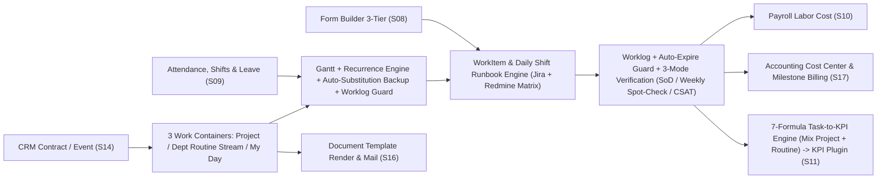

# Đối Sánh Nền Tảng & Phân Tích Reverse-Engineering (`REA`) Jira & Redmine — Sprint 18 (`plugins/project-task`)

| Thuộc tính | Giá trị |
| :--- | :--- |
| ID | BENCH-S18-001 |
| Sprint | Sprint 18 (`sprint_18_plugin_project_task`) |
| Tác giả | AI Business Analyst (BA) & System Analyst |
| Trạng thái | DRAFT — Phục vụ thiết kế kiến trúc & Gate `CONF-S18-001` |
| Phiên bản | 0.2 |
| Tài liệu liên quan | [00_READING_GUIDE.md](../00_READING_GUIDE.md) · [RAW-S18-001](../01_raw_notes/01_RAW-S18-001_project_task_management_requirements.md) · [ANL-S18-001](../02_analysis/01_ANL-S18-001_project_task_kpi_workflows.md) |

---

## 1. Phân Tích Reverse-Engineering (`REA Methodology`) Chuyên Sâu: Atlassian Jira & Redmine

> [!NOTE]
> **Ghi chú Phương pháp luận `reverse-engineer-anything (REA)` & Phạm vi Bằng chứng (`Evidence Boundary`)**:
> Theo nguyên tắc phân định bằng chứng của `REA`: Tại thời điểm lập tài liệu trong kho mã nguồn `open-erp`, không có gói nhị phân cài đặt nội bộ (`binary`) hay phiên trình duyệt (`browser CDP target`) của Jira/Redmine được gắn trực tiếp. Do đó, toàn bộ phần phân tích dưới đây áp dụng **Khung Mô hình Hóa Hành vi & Lược đồ Thực thể của `REA`** *(Data Model Decomposition, State Machine Reconstruction, Permission & Field Guard Matrix Extraction, Rollup & Rescheduling Algorithm Analysis, Behavioral Obligation Ledger)* dựa trên **kiến trúc chuẩn đã công bố của hệ sinh thái Redmine (Rails Schema & Workflow Engine) và Atlassian Jira (Scheme Architecture, Workflow Engine, Agile/SLA Engine)** nhằm trích xuất các cơ chế lõi tinh túy nhất cho `plugins/project-task`.

### 1.1. Giải Phẫu Kiến Trúc & Cơ Chế Hành Vi Của Atlassian Jira

Jira (`Jira Software`, `Jira Work Management`, `Jira Service Management`) thống trị thị trường quản lý dự án phần mềm và vận hành doanh nghiệp nhờ 4 cơ chế kiến trúc cốt lõi sau:

#### A. Kiến Trúc Tầng Ánh Xạ Gián Tiếp (`Project -> Scheme -> Definition Indirection`)
- **Cơ chế phân tích**: Trong Jira, một `Project` **không sở hữu trực tiếp** các trạng thái hay trường dữ liệu, mà trỏ qua các **`Scheme`** dùng chung:
  1. `Issue Type Scheme`: Quyết định dự án được tạo những loại việc nào (`Epic`, `Story`, `Task`, `Bug`, `Sub-task`).
  2. `Workflow Scheme`: Ánh xạ `(Issue Type) -> Workflow Definition` (ví dụ cùng 1 dự án, `Bug` đi quy trình 5 bước, `Task` đi quy trình 3 bước, `Epic` đi quy trình duyệt ngân sách).
  3. `Field Configuration Scheme` & `Screen Scheme`: Kiểm soát trường nào hiển thị/bắt buộc trên từng màn hình `Create`, `Edit`, `View` và `Transition Screen` (màn hình bật ra khi chuyển trạng thái).
  4. `Permission Scheme` & `Issue Security Scheme`: Phân quyền cấp Dự án (`Browse`, `Create`, `Assign`, `Transition`, `Schedule`, `Log Work`) và cấp từng Đầu việc cụ thể (`Security Level`: chỉ Ban giám đốc hoặc Khách hàng thấy issue nội bộ).
- **Nhược điểm khi đưa vào ERP thực tế (Config Hell)**: Jira Server/Data Center nổi tiếng phức tạp vì quản trị viên phải qua 4–5 lớp scheme để thêm 1 trường dữ liệu.
- **Cách Open-ERP Kế thừa & Tinh gọn (`L01`)**: Áp dụng trực tiếp **`plugins/form` (Sprint 08)** với **Kế thừa 3 tầng (`System -> Tenant -> Project Template`)** kết hợp ánh xạ trực tiếp `(Project Template / Project, Tracker)` thay cho rừng Scheme rườm rà của Jira.

#### B. Đồ Thị Phân Cấp & Liên Kết Có Hướng (`Hierarchy + Typed Directed Issue Links`)
- **Cơ chế phân tích**:
  - **Cấu trúc Cây Cứng (`Parent-Child Hierarchy`)**: `Initiative (Level 2+) -> Epic (Level 1) -> Standard Issue (Story/Task/Bug — Level 0) -> Sub-task (Level -1)`. Một `Sub-task` bắt buộc gắn vào đúng 1 Issue cha và nằm trong cùng Project/Sprint với Issue cha đó.
  - **Đồ thị Liên kết Ngang Có Hướng (`IssueLink` với `Inward Description` & `Outward Description`)**: Mọi Issue ở các Project khác nhau đều có thể nối với nhau bằng cặp quan hệ đối ngẫu:
    - `BLOCKS` <-> `IS_BLOCKED_BY` (ràng buộc tiến độ — điều kiện chặn chuyển trạng thái).
    - `CAUSES` <-> `IS_CAUSED_BY` (truy vết `Bug` sinh ra từ `Story/Task` nào để tính **Chỉ số Chất lượng/Rework KPI**).
    - `DUPLICATES` <-> `IS_DUPLICATED_BY` (đóng trùng ticket mà không tính trùng sản lượng KPI).
    - `RELATES_TO` (tham khảo chéo).
    - `CLONES` <-> `IS_CLONED_BY`.

#### C. Động Cơ Máy Trạng Thái Đa Tầng (`Workflow State Machine` + `Status vs. Resolution`)
Đây là thành phần mang tính "xương sống" của Jira mà ít công cụ thông thường (như Trello/Asana) sao chép đúng bản chất:

1. **Tách Bạch 3 Khái Niệm Trạng Thái**:
   - **`StatusCategory` (3 nhóm bất biến để tính báo cáo & KPI)**: `TO_DO`, `IN_PROGRESS`, `DONE`. Dù mỗi dự án có thể đặt tên 10 `Status` khác nhau (*"Chờ Dev"*, *"Đang Code"*, *"UAT Khách hàng"*), động cơ báo cáo & KPI luôn biết chính xác đầu việc đã thực sự hoàn tất hay chưa dựa vào `StatusCategory = DONE`.
   - **`Status` (Trạng thái nghiệp vụ chi tiết)**: Cấu hình tự do theo loại dự án.
   - **`Resolution` (Kết cục Hoàn thành — Cực kỳ quan trọng cho KPI!)**: Trong Jira, một Issue ở trạng thái `Closed/Done` **vẫn phải phân biệt lý do đóng**:
     - `FIXED / COMPLETED`: Hoàn thành thực chất (tạo ra giá trị -> **TÍNH KPI SẢN LƯỢNG & ĐÚNG HẠN**).
     - `WONT_DO / CANCELLED`: Hủy bỏ do đổi yêu cầu (loại khỏi mẫu số tính KPI trễ hạn của nhân viên).
     - `DUPLICATE`: Trùng lặp (không tính sản lượng đầu ra để tránh gian lận KPI).
     - `CANNOT_REPRODUCE`: Không tái hiện được (đối với Bug).

2. **Bộ Tứ Bảo Vệ Khi Chuyển Trạng Thái (`Transition Lifecycle Hooks`)**:
   Mỗi mũi tên chuyển từ `Status A -> Status B` trong Jira gồm 4 thành phần chuẩn:
   - **`Conditions` (Điều kiện hiển thị)**: Ai được quyền thực hiện chuyển bước? VD: Chỉ `Assignee` mới bấm `Start Progress`; Chỉ `Reviewer / QA` (và `current_user != assignee` — **SoD**) mới thấy nút `Approve & Done`.
   - **`Validators` (Kiểm tra hợp lệ trước khi chuyển)**: Chặn chuyển sang `Done` nếu còn Sub-task chưa xong, Checklist chưa đạt 100%, hoặc thiếu trường `Root Cause` / `Worklog`.
   - **`Transition Screen` (Biểu mẫu trung gian)**: Bắt buộc người dùng nhập thêm thông tin ngay tại khoảnh khắc chuyển bước (VD: chuyển sang `Blocked` phải chọn `Blocker Reason` & `Blocking Issue`; chuyển sang `Reopened` phải nhập `Defect Severity`).
   - **`Post-Functions` (Hành động tự động sau khi chuyển)**: Tự gán `resolved_at = NOW()` và `resolution = COMPLETED` khi vào `DONE`; tự xóa `resolution = NULL` nếu bị `Reopen`; tự động gửi thông báo hoặc bắn sự kiện tính KPI.

#### D. Cơ Chế Agile Sprint, Scope Change, Estimation & SLA
- **Sprint Scope & Commitment Snapshot**: Khi bấm `Start Sprint`, hệ thống chụp ảnh (`Snapshot`) toàn bộ danh sách Issue trong Sprint và tổng `Story Points`. Nếu sau khi Sprint bắt đầu có ai đó nhét thêm task (`Scope Added`) hoặc rút task ra (`Scope Removed`), biểu đồ `Burndown` ghi nhận rõ đường biến động phạm vi để không làm sai lệch đánh giá năng lực nhóm.
- **Tách Biệt Estimation vs. Time Tracking**: `Story Points` dùng cho Backlog/Velocity/KPI Khối lượng; `Original Estimate -> Time Spent -> Remaining Estimate` dùng cho Lập lịch giờ công và Kiểm soát tiến độ chi tiết. Khi log Worklog, nhân viên có thể giảm `Remaining Estimate` thủ công hoặc tự động.
- **Dual SLA Clocks (`Jira Service Management`)**: Mỗi Ticket chạy đồng thời các bộ đếm SLA (`Time to First Response`, `Time to Resolution`) với cấu hình `Start Condition`, `Pause Condition` (khi ở `Waiting for Customer` hoặc `Blocked by External`), và `Stop Condition`, tính thuần trên giờ làm việc theo `Working Calendar`.

---

### 1.2. Giải Phẫu Kiến Trúc & Cơ Chế Hành Vi Của Redmine

Nếu Jira mạnh về **Agile Board & Transition Hooks**, thì Redmine (mã nguồn mở kinh điển được viết trên Ruby on Rails) lại sở hữu những cơ chế **kiểm soát cây dự án, phân quyền ma trận theo vai trò và lập lịch Gantt/Rollup** cực kỳ chặt chẽ cho các doanh nghiệp triển khai dự án & kỹ thuật:

#### A. Cây Dự Án Đa Cấp (`Nested Set Hierarchy` & `Shared Target Versions`)
- **Cơ chế phân tích**:
  - Bảng `projects` dùng chỉ mục `lft / rgt` (Nested Set) cho phép tổ chức `Portfolio -> Parent Project -> Sub-project` nhiều tầng, truy vấn toàn cây con trong `O(1)` đọc mà không cần đệ quy chậm.
  - Cơ chế **`inherit_members`**: Dự án con tự động thừa hưởng thành viên và vai trò từ dự án cha, đồng thời cho phép bổ sung thêm thành viên đặc thù chỉ ở dự án con.
  - **`Target Versions / Milestones` với phạm vi chia sẻ (`sharing`)**: Một Cột mốc phát hành (`Version/Milestone`) ở dự án cha có thể chia sẻ xuống `descendants` (các dự án con), giúp Ban giám đốc theo dõi tiến độ gộp của 5 đội khác nhau vào cùng 1 mốc bàn giao khách hàng.
  - **`Enabled Modules`**: Từng dự án tự bật/tắt module cần dùng (`Issue Tracking`, `Time Tracking`, `Gantt`, `Calendar`, `Roadmap/Versions`, `Wiki/Documents`).

#### B. Tinh Hoa Lớn Nhất Của Redmine: Ma Trận Phân Quyền Quy Trình 3 Chiều (`workflows`: `Role x Tracker x Status`)
Trong lược đồ cơ sở dữ liệu chuẩn của Redmine, bảng `workflows` dùng mô hình **Single Table Inheritance (STI)** với 2 loại quy tắc mang tính chuẩn mực rất cao cho ERP:

1. **`WorkflowTransition` (`(role_id, tracker_id, old_status_id) -> new_status_id` + cờ `author`, `assignee`)**:
   - Không cần vẽ sơ đồ phức tạp cho mọi tình huống: Quản trị viên chọn một **Vai trò (`Role`)** và **Loại công việc (`Tracker`)** để tick vào ma trận `Trạng thái cũ -> Trạng thái mới` được phép chuyển.
   - Hỗ trợ quy tắc tinh vi bằng 2 cờ bổ sung:
     - `assignee = true`: Cho phép chuyển bước này **chỉ khi user đang là Assignee** (ví dụ Developer chỉ được chuyển `New -> In Progress -> Ready for QA`, **không có dấu tick** ở ô `Ready for QA -> Accepted/Closed`).
     - `author = true`: Chỉ người giao việc / tác giả (`Reporter / Author`) mới được xác nhận đóng (`Ready for QA -> Closed`) hoặc mở lại (`Closed -> Reopened`).

2. **`WorkflowPermission` (`(role_id, tracker_id, old_status_id, field_name) -> rule ['readonly' | 'required']`)**:
   - Đây là cơ chế **Chống Gian Lận (`Anti-Gaming`) tự nhiên và mạnh mẽ nhất** được phát hiện khi giải phẫu Redmine:
   - Với **cùng một trường dữ liệu** (ví dụ `due_date`, `estimated_hours`, `story_points`, `priority`), quyền thao tác thay đổi động theo trạng thái và vai trò:
     - Ở trạng thái `NEW` (`TO_DO`): `Manager` có quyền `Editable/Required`; `Developer` chỉ `Read-only`.
     - Khi Task đã sang `IN_PROGRESS`: Trường `due_date` và `estimated_hours` chuyển thành **`Read-only`** đối với `Developer/Assignee` -> **Triệt tiêu hoàn toàn hành vi nhân viên tự lùi deadline hay tự tăng định mức giờ công khi sắp trễ hạn!**
     - Khi chuyển sang `RESOLVED / READY_FOR_QA`: Trường `done_ratio` hoặc `resolution_note` tự động chuyển thành **`Required`**.

#### C. Cơ Chế Tính Toán Cuộn Cây Công Việc (`Parent Issue Attribute Rollup`) & Tự Động Dời Lịch Gantt (`Cascade Reschedule`)
- **Công thức Cuộn `% Hoàn thành` (`done_ratio`) của Redmine**:
  - Khi một Issue là cha có `N` Issue con trực tiếp (`children`), `parent.done_ratio` được tự động tính toán (nếu cấu hình chế độ `Calculated from subtasks`) theo **trọng số thời gian ước lượng (`estimated_hours`)**:
    $$\text{done\_ratio}_{\text{parent}} = \frac{\sum_{k=1}^{N} \left( \max(H_{\text{est}, k}, H_{\text{default}}) \times \text{done\_ratio}_k \right)}{\sum_{k=1}^{N} \max(H_{\text{est}, k}, H_{\text{default}})}$$
    *(Trong trường hợp Task con chưa nhập `estimated_hours`, Redmine lấy giá trị trung bình của các task có giờ ước lượng hoặc trọng số bằng nhau $1.0$, còn Task con đã đóng luôn coi tiến độ đạt $100\%$ hoặc theo quy tắc `issue_status.default_done_ratio`)*.
  - Tương tự, `parent.start_date = MIN(children.start_date)`, `parent.due_date = MAX(children.due_date)`, và `parent.estimated_hours = SUM(children.estimated_hours)` -> Đảm bảo kế hoạch cấp tổng luôn khớp toán học với kế hoạch chi tiết bên dưới.

- **Quan Hệ Gantt `precedes / follows` Kèm Độ Trễ (`delay`) & Dời Lịch Dây Chuyền**:
  - Trong Redmine, bảng `issue_relations` lưu `relation_type = 'precedes'` với thuộc tính `delay` (số ngày làm việc dương hoặc âm — `Lag / Lead Time`).
  - **Thuật toán Tự động Điều phối (`Auto-Schedule Cascade`)**:
    - Nếu Task `A` `precedes` Task `B` với `delay = d` ngày làm việc:
    - $\text{soonest\_start}(B) = \text{add\_working\_days}(A.\text{due\_date}, d + 1)$ *(nếu $A$ kết thúc thứ Sáu và $d=0$, $B$ bắt đầu sớm nhất vào thứ Hai tuần kế tiếp)*.
    - Khi người dùng kéo thanh Gantt hoặc cập nhật `A.due_date` trễ hơn kế hoạch, hệ thống duyệt đồ thị phụ thuộc (`Topological Traversal`, có phát hiện vòng lặp `Cycle Detection`) để đẩy `B.start_date` và `B.due_date` tịnh tiến theo lịch làm việc (`non_working_week_days` + ngày lễ quốc gia).

#### D. Time Tracking Phân Tách Hoạt Động (`TimeEntry` x `TimeEntryActivity`)
- Redmine tách bảng `time_entries` độc lập với Issue, gắn với danh mục **`TimeEntryActivity`** (`Design`, `Development`, `Testing`, `Documentation`, `Deployment`, `Project Management`) cho phép:
  - Báo cáo `Spent Time Report` xoay chiều theo `Project x Member x Activity x Week/Month`.
  - Hỗ trợ `spent_on` (ngày thực hiện thực tế khác với ngày bấm log), `hours`, `comments` (bắt buộc nếu cấu hình).

---

### 1.3. Tổng Hợp Điểm Mù Của Jira & Redmine Thuần Túy Khi Áp Dụng Vào Doanh Nghiệp Việt Nam (Và Cách Open-ERP Giải Quyết)

| Khía cạnh | Thực tế trên Jira & Redmine thuần túy | Điểm mù / Lỗ hổng khi vận hành ERP doanh nghiệp | Giải pháp nâng cấp trong `plugins/project-task` (Sprint 18) |
| :--- | :--- | :--- | :--- |
| **Liên thông KPI Nhân sự** | Không có sẵn mô hình chấm điểm KPI nhân viên (`% Đúng hạn có trọng số`, `Efficiency`, `Reopen Penalty`); muốn có phải mua plugin đắt tiền (`Tempo`, `eazyBI`) hoặc xuất Excel chấm tay | Cuối tháng HR & Quản lý vẫn phải tải CSV về Excel lọc tay; không chống được việc tự sửa `Due Date` hay tự đánh dấu `Done` | Tích hợp **Động cơ Task-to-KPI 6 công thức chuẩn** phát thẳng `Actual` + link minh chứng sang **`plugins/kpi` (Sprint 11)** |
| **Chốt Kế hoạch Gốc (`Baseline Lock`)** | Jira cơ bản không lưu Baseline Gantt; Redmine chỉ giữ 1 cặp `start_date / due_date` hiện hành (khi dời lịch mất luôn ngày gốc ban đầu!) | Không phân biệt được *Trễ hạn do lỗi nhân viên* vs. *Đổi hạn do khách hàng đổi yêu cầu*; mất cơ sở tính đúng hạn cho KPI | Lưu trường **`baseline_start_date` / `baseline_due_date` / `baseline_points`** tách biệt với `effective_*`; sửa Baseline sau khi chạy phải duyệt `Baseline Change Request` qua `plugins/workflow` |
| **Kiểm soát Chéo Chấm công** | Cho phép nhân viên log 24 giờ/ngày hoặc log vào ngày nghỉ phép/ngày lễ mà không biết | Khai khống Worklog để tăng chi phí dự án tính cho khách hàng hoặc làm đẹp biểu đồ năng suất | Đối chiếu chéo theo ngày với **`plugins/attendance` (S09)**: tổng Worklog `<= Giờ công thực tế + OT hợp lệ` |
| **Tài chính & Nghiệm thu Hợp đồng** | Không nối với Hợp đồng bán, Đơn mua hàng vật tư hay Sổ cái kế toán | Không biết dự án lãi hay lỗ thực tế theo thời gian thực (`Real-time Project P&L`); quên xuất hóa đơn khi xong Milestone | Nối 2 chiều với **`crm` (S14)**, **`purchasing` (S15)**, **`document-template` (S16)** và **`accounting` (S17)** (`Project Cost Center` & `Milestone Billing`) |
| **Biểu mẫu Theo Từng Công ty/Chi nhánh** | Cấu hình Custom Field toàn cục dễ xung đột giữa các phòng ban | Khó áp đặt trường bắt buộc khác nhau cho dự án Xây lắp vs Phần mềm vs Hành chính | Dùng trực tiếp **`plugins/form` (S08)** kế thừa 3 tầng + **Field Permission Matrix** theo vai trò & trạng thái |
| **Công việc Hàng ngày & Lặp đi Lặp lại / Bảng kiểm Ca** | Cả Jira & Redmine gốc đều **không có động cơ Recurring Tasks** (phải dùng Automation Rule phức tạp hoặc Plugin `Recurring Tasks`); không hỗ trợ **Bảng kiểm Ca gộp (`Daily Shift Runbook`)**, **Tự động thế chỗ khi nghỉ phép**, hay **Đóng quá hạn chống bấm bù** | Nếu áp dụng cho phòng Kế toán, Kho, Cửa hàng, Trực ca sẽ tạo hàng nghìn Issue rác, quên giao khi người chính nghỉ ốm, và nhân viên có thể cuối tháng mới bấm `Done` hàng loạt | Xây **3 Không gian Công việc (`Project`, `Department Routine`, `My Day`)**, **4 Mô hình Lặp lại**, **`Daily Shift Runbook`**, **`Auto-Substitution` từ `S09`**, **`Auto-Expire`**, và **Nghiệm thu gộp Tuần + Hậu kiểm `10–20%`** |

---

## 2. Bảng Đối Sánh 12 Nền Tảng Quản Lý Dự Án, Công Việc Hàng Ngày & Tác Vụ Lặp Lại Hàng Đầu

| Nền tảng | Mô hình chính | Quản lý Cấu trúc & Phụ thuộc | Workflow & Phân quyền Trường | Công việc Hàng ngày, Lặp lại & Bảng kiểm Ca | Thời gian & Cân bằng tải | Liên kết KPI Nhân sự & Tài chính ERP | Điểm yếu chính |
| :--- | :--- | :--- | :--- | :--- | :--- | :--- | :--- |
| **1. Atlassian Jira** | Agile / Scrum / Kanban / Service Desk | `Initiative -> Epic -> Story -> Sub-task` + `Issue Links` | Cực mạnh: `Conditions / Validators / Post-Functions` + `Status vs Resolution` | Rất yếu: phải chế bằng Scheduled Automation hoặc mua plugin; không có Runbook ca & Backup Assignee | Phải mua plugin ngoài (`Tempo`, `BigPicture`) | Không có sẵn | Rất nặng Scheme; không hợp cho việc hàng ngày phòng ban/cửa hàng |
| **2. Redmine** | Waterfall / Issue Tracking / Hybrid | Cây Dự án vô hạn cấp + WBS Rollup + Gantt `precedes/follows` | **Rất mạnh**: Ma trận `Role x Tracker x Status` (`Transition` + `Read-only/Required`) | Không có sẵn gốc (phải cài plugin `Redmine Recurring Tasks`) | Có `TimeEntry` theo `Activity`, thiếu Workload Heatmap chuẩn | Chỉ có giờ công thô, thiếu KPI & Chấm công | UI cũ; thiếu Recurring Runbook & Baseline versioning |
| **3. Linear** | Product Engineering tốc độ cao | `Cycle (Sprint)` + `Project` + `Milestone` + `Sub-issue` | Đơn giản, tốc độ cao, `Triage` queue | Có Recurring Issues đơn giản (theo lịch), thiếu Runbook/Backup nghỉ phép | Kém (chú trọng tốc độ issue) | Không có | Quá chuyên biệt cho đội code |
| **4. Asana** | Work Management & Cross-team | `Portfolio -> Project -> Section -> Task`, `Multi-homing` | `Rules` tự động mượt; phân quyền trường trung bình | Khá tốt: có `My Tasks`, Recurring Tasks theo lịch & Rolling sau khi xong; thiếu Runbook gộp & Auto-Expire KPI | Có `Workload` theo giờ/điểm | Chỉ có `Goals` mức cao, thiếu tính điểm KPI định lượng | Dễ tự đổi Due Date; thiếu chặt chẽ tài chính & SoD |
| **5. ClickUp** | All-in-One Workspace | Hierarchy rất sâu + Checklist | Nhiều View, `Custom Fields` | Tốt cho Recurring (`Daily/Weekly/When Complete`) & Remap Due Date; thiếu Auto-Substitution nghỉ phép | Có `Time Tracking`, `Workload` | Có `Goals` cơ bản | Quá rối thao tác hàng ngày; thiếu Field Matrix & Tài chính |
| **6. Microsoft Project / Planner** | Enterprise Waterfall / Gantt | WBS chuẩn PMI, Gantt `FS/SS/FF/SF`, `Critical Path`, `Baselines`, `EVM` | Kém về Issue Workflow chi tiết | Rất kém về Recurring Runbook hàng ngày/ca | Resource Leveling mạnh | Có `EVM` tài chính dự án, không chấm KPI việc vận hành | Cứng nhắc cho công việc hàng ngày & Agile |
| **7. Odoo Project** | ERP Services & Timesheet | `Project -> Stage -> Task`, gắn `Sales Order Line` | Quyền theo Stage khá đơn giản | Hỗ trợ Recurring Tasks định kỳ cơ bản trong ERP; thiếu Spot-check hậu kiểm | `Timesheet` gắn trực tiếp `HR Attendance` & Hóa đơn | Liên thông Kế toán & Hóa đơn rất tốt | Thiếu ma trận phân quyền trường & Scrum/Runbook sâu |
| **8. ERPNext Projects** | ERP Manufacturing & Services | `Project -> Task Tree` + `Project Template` + Gantt | State machine qua DocType | Có Auto-Repeat DocType định kỳ | `Timesheet` gắn Lương & Thanh toán | Nối tốt Accounting/HR; thiếu Scrum & Runbook ca | UI hạn chế cho thao tác hàng ngày |
| **9. Bitrix24 Tasks** | CRM + Operational Work & Efficiency | `Project / Group -> Task -> Checklist` | Phân quyền cơ bản + `Auditor/Observer` | Tốt cho việc lặp lại định kỳ & đếm chỉ số `Task Efficiency %` cá nhân; thiếu Runbook gộp & SoD chặt | Có Track time đơn giản | Có chỉ số hiệu suất việc nhưng chưa có Anti-Backdating/Spot-check | Khá nặng UI; thiếu Gantt & Field Matrix chuyên sâu |
| **10. SafetyCulture / Process Street** | Daily SOP & Shift Checklist Runbook | `Schedule -> Inspection / Runbook Run` | Bắt buộc ảnh minh chứng/GPS/đo lường từng dòng | **Xuất sắc nhất** về Bảng kiểm Ca hàng ngày (`Shift Runbook`), Hậu kiểm, Rolling & SOP lặp lại | Không quản lý Gantt/Timesheet | Không có | Chỉ làm checklist, không quản lý được Dự án/Agile/Tài chính |
| **11. Base Wework** *(VN)* | Điều hành công việc doanh nghiệp VN | `Department / Project -> Task List -> Task` | Tập trung giao việc nhanh, review đơn giản | Có lặp lại theo lịch cơ bản & việc phòng ban | Không chú trọng Worklog theo giờ chuẩn | Có thống kê % hoàn thành | Thiếu Agile Sprint, Gantt Baseline, Runbook & đối chiếu Chấm công |
| **12. 1Office Work** *(VN)* | Công việc + HRM nội địa | Gắn phòng ban, dự án cơ bản | Tùy biến trạng thái đơn giản | Có việc lặp lại cơ bản & gắn chấm công HRM | Gắn được với Đơn từ/Chấm công nội bộ | Có đẩy % hoàn thành việc sang KPI | Thiếu Validator, Ma trận trường Redmine, `Auto-Substitution` & Spot-Check |

---

## 3. Sơ Đồ Kiến Trúc Tổng Hợp Tinh Hoa Cho Open-ERP (`Jira + Redmine + Daily Runbook + Enterprise ERP`)

---

## 4. 16 Bài Học Kiến Trúc Cốt Lõi Rút Ra (`L01`–`L16`)

1. **`L01` — Hợp nhất `Agile` + `Waterfall` + `Operations` bằng Template thay vì ép 1 khuôn (Jira + MS Project + Asana)**: Một `Project` có thể bật chế độ `AGILE_SCRUM`, `KANBAN`, `WATERFALL_GANTT`, `HYBRID` hoặc `OPERATIONS_DESK` qua cờ cấu hình module, chia sẻ chung một thực thể lõi `WorkItem`.
2. **`L02` — Tránh "Địa ngục Scheme" của Jira bằng Kế thừa 3 Tầng của `plugins/form` (`S08`)**: Ánh xạ trực tiếp `(Tenant, Project Template / Project, Tracker)` tới Form Definition và Workflow Definition thay vì tạo 6 lớp Scheme trung gian.
3. **`L03` — Tách rạch ròi `StatusCategory` vs `Status` vs `Resolution` (từ Jira)**: Nhờ có `StatusCategory (TO_DO/IN_PROGRESS/DONE)` và `Resolution (COMPLETED/WONT_DO/DUPLICATE/CANCELLED)`, động cơ KPI luôn phân biệt được task "đã xong mang lại giá trị" với task "đóng do hủy/trùng".
4. **`L04` — Áp dụng `Role x Tracker x Status Field Permission Matrix` (từ Redmine) để chống gian lận từ gốc**: Khóa cứng `Read-only` đối với `due_date`, `estimated_hours`, `story_points` cho vai trò nhân viên ngay khi Task bước vào `IN_PROGRESS`.
5. **`L05` — Chốt `Baseline Snapshot` độc lập với Lịch trình Hiện hành (`effective_dates`) (khắc phục điểm mù Redmine)**: Bắt buộc lưu song song bộ ngày gốc (`baseline_*`) và bộ ngày điều chỉnh (`effective_*`), mọi thay đổi ảnh hưởng KPI phải qua `Baseline Change Request`.
6. **`L06` — Cuộn Tiến độ Có Trọng số (`Weighted Rollup`) & Dời lịch Dây chuyền Gantt (`Auto-Reschedule`) (từ Redmine + MS Project)**: Hỗ trợ đủ 4 quan hệ `FS/SS/FF/SF + Lag` (mặc định `FS`), kiểm tra chu trình lặp (`Cycle Detection`), tự động cuộn `% Done`, `Start/Due Date`, `Estimated/Spent Hours` lên Task cha & Milestone.
7. **`L07` — Bộ Đếm SLA 2 Chặng có Tự Động Tạm Dừng (`SLA Clock Pause`) (từ Jira Service Management)**: Tính đúng giờ làm việc của chi nhánh từ `plugins/attendance`, tạm dừng đồng hồ khi chờ khách hàng/bên thứ 3 và tự động leo thang khi đạt ngưỡng `75%/90%/100%`.
8. **`L08` — Đối Chiếu Chéo Worklog Với Chấm Công (`S09`) (từ Odoo/ERP thực chiến)**: Ngăn triệt để tình trạng log khống giờ công vào ngày nghỉ phép hoặc vượt quá giờ công thực tế + OT hợp lệ.
9. **`L09` — Cổng Nghiệm Thu Bất Kiêm Nhiệm (`SoD: Assignee != Reviewer`) trước khi tính điểm KPI**: Nhân viên tự bấm `Done` chỉ đưa task vào hàng đợi `IN_REVIEW / READY_FOR_ACCEPTANCE`; chỉ khi `Reviewer / QA / Manager` nghiệm thu đạt thì sự kiện tính KPI mới được ghi nhận.
10. **`L10` — Định lượng KPI Đa Chiều Có Chống Gian Lận Chia Nhỏ Task (`Weighted Output + Quality Penalty`)**: Chấm KPI trên tổng hợp `OTD có trọng số`, `Sản lượng Story Points/Weight`, `Hiệu suất giờ làm (Cap 120%)`, `First-Time-Right %` và `Tỷ lệ Bug/Reopen`, đi kèm bảng truy vết đóng băng (`Evidence Snapshot`).
11. **`L11` — Quản trị "Multi-homing" & Người Phối hợp Chia Tỷ lệ (`Collaborator Contribution Split`)**: Một công việc liên phòng ban có 1 `Primary Assignee` (chịu trách nhiệm chính) và nhiều `Collaborators` có tỷ lệ đóng góp `%` minh bạch để phân bổ điểm KPI công bằng.
12. **`L12` — Dự án là Cầu nối Sống với Thương mại & Tài chính (`CRM S14 -> Purchasing S15 -> Accounting S17`)**: Từ Hợp đồng bán ra Dự án; từ Dự án ra PR/PO vật tư; từ Nghiệm thu Milestone ra Đề nghị xuất hóa đơn và tập hợp Project P&L.
13. **`L13` — Động cơ Việc Hàng ngày, 4 Mô hình Lặp lại & Bảng Kiểm Ca Gộp (`Daily Shift Runbook` — từ SafetyCulture/Asana/Bitrix24)**: Hỗ trợ đồng thời Lặp theo Lịch/Ca (`Holiday Shift Policy`), Lặp Cuốn chiếu (`Rolling`), Bộ SOP Sự kiện và **Phiếu Runbook Ca/Ngày gộp** để tránh đẻ hàng nghìn Issue rác đồng thời giữ giao diện `My Day` tối giản 1 chạm.
14. **`L14` — Tự Động Thế Chỗ Khi Nghỉ Phép (`Auto-Substitution` từ `attendance` S09) & Chuyển Ca (`Shift Handover`)**: Việc lặp lại hàng ngày tự động chuyển sang `Backup Assignee` khi người chính nghỉ phép/vắng mặt, tính điểm KPI cho người trực tiếp làm thay và hỗ trợ bàn giao cuối ca.
15. **`L15` — Chống Đánh Dấu Bù (`Auto-Expire`) & Nghiệm Thu Gộp Tuần Hậu Kiểm Ngẫu Nhiên (`Weekly Spot-Check`)**: Khóa phiên hàng ngày quá hạn thành `MISSED_OCCURRENCE` tránh cuối tháng tick bù; giúp Trưởng phòng duyệt 1 lần cả tuần kèm lấy mẫu hậu kiểm `10–20%` minh chứng ảnh/số liệu (phạt nặng nếu tick khống).
16. **`L16` — Kết xuất Hồ sơ Chính quy qua `plugins/document-template` (S16) & Đa Góc nhìn `@shared/*`**: Mọi `Project Charter`, `Biên bản Nghiệm thu Milestone`, `Sổ Giao Ca / Runbook`, `Báo cáo Tuần/Tháng` dùng 100% engine Sprint 16; giao diện hỗ trợ chuyển mượt `My Day <-> List Table (Sticky Header/Footer + Right-Click Context Menu) <-> Kanban <-> Gantt <-> Workload <-> Calendar` với URL đồng bộ 2 chiều.
